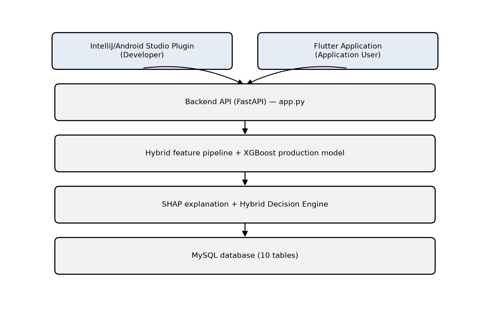
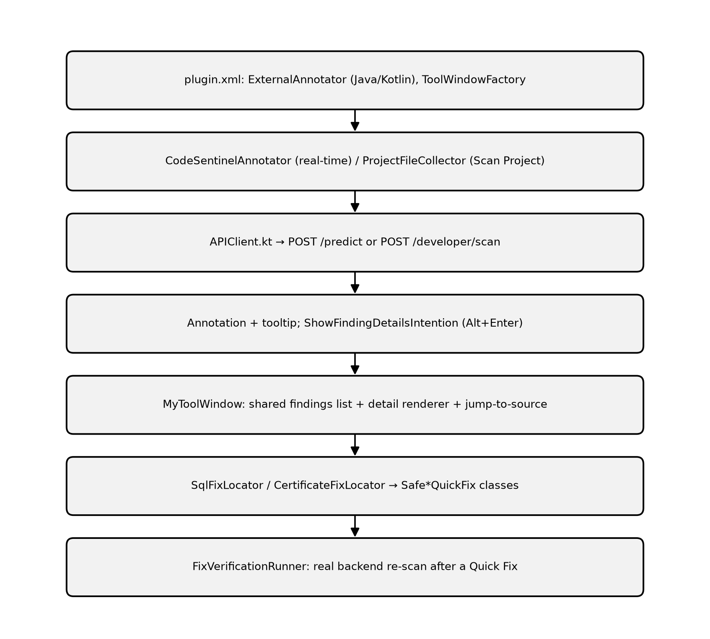
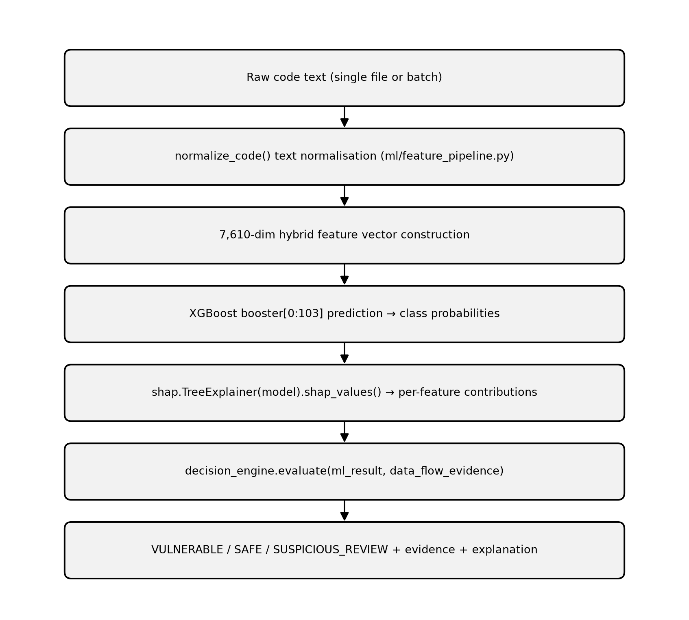
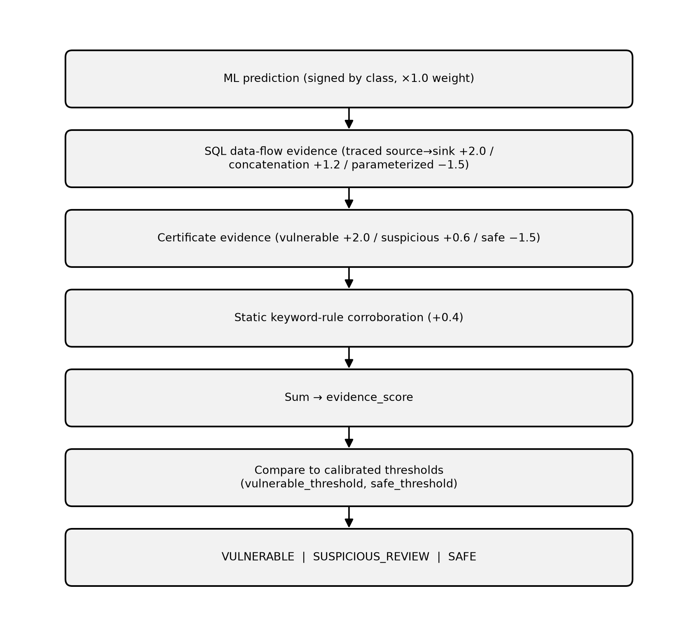
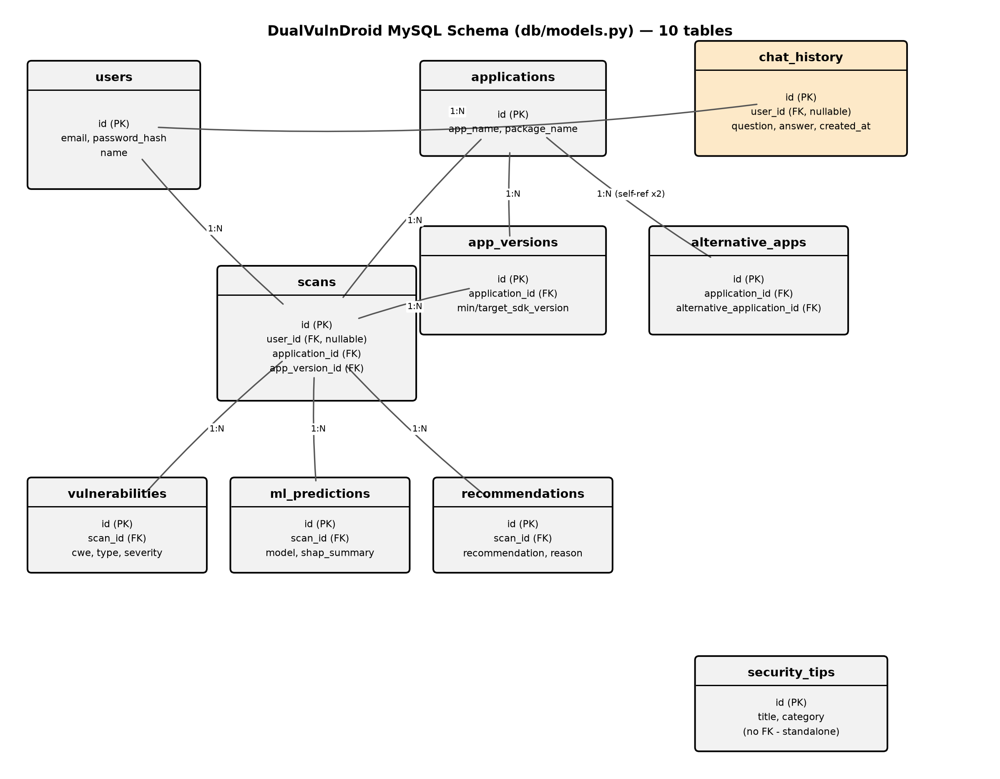
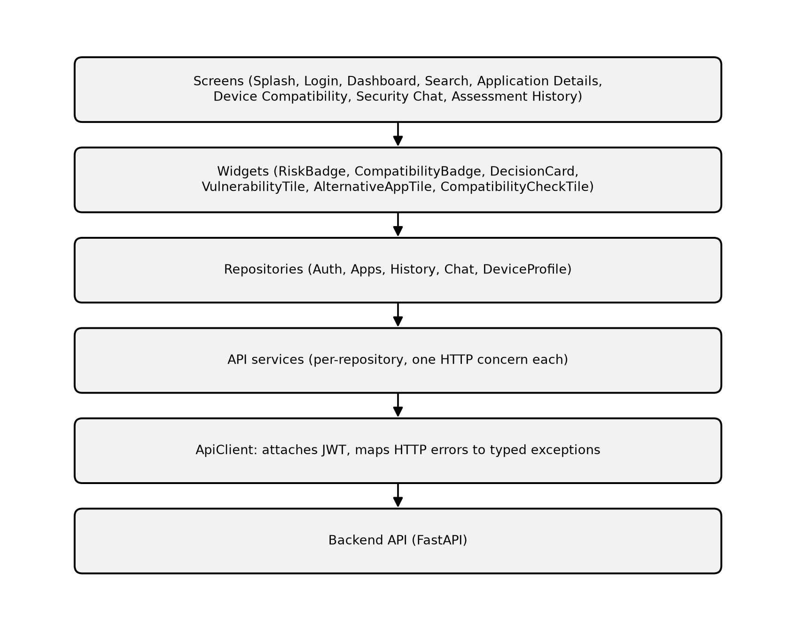

K M IGLAVITHANA
DUAL-VULNERABILITY DETECTION IN ANDROID CODE: REAL-TIME SQL INJECTION AND CERTIFICATE VALIDATION DETECTION
CHAPTER 04 – REQUIREMENTS, ANALYSIS AND SYSTEM/MODEL DESIGN

## 4.1 Chapter Overview

Chapters 1–3 established the research problem, the gap-derived research question, and the methodology used to investigate it. This chapter translates that problem into a systems-engineering statement: who the system serves, what it is required to do, and how its components are conceptually designed to satisfy those requirements. It covers the system's stakeholders and context; how requirements were elicited and analysed; the resulting functional and non-functional requirements; the use cases these requirements support; the overall architecture connecting the developer-facing and end-user-facing paths through one shared backend; the conceptual design of the plugin, backend, ML pipeline, Hybrid Decision Engine, database, Flutter application, and Security Chat; the system's security and privacy design; and a traceability matrix connecting every requirement back to a Chapter 1 research objective. This chapter describes design and rationale, not implementation code — the concrete implementation is presented in Chapter 5, and its experimental and validation results in Chapters 6–8.

## 4.2 System Context and Stakeholders

DualVulnDroid serves two structurally distinct interfaces sharing one backend detection pipeline, and the system's design deliberately keeps these two paths conceptually separate even though they draw on the same underlying evidence. The **developer-facing path** — a Kotlin IntelliJ/Android Studio plugin — performs real-time, in-editor source-code analysis; its actor is a **developer** writing Java/Kotlin Android code, and a secondary actor, a **security analyst or researcher**, who uses the same plugin interface analytically (project-wide scanning and evidence inspection) rather than for remediation. The **end-user-facing path** — a Flutter mobile application — is an **application user**'s window onto security assessments the backend has already computed for a given, previously-analysed application; it is a presentation and decision-support surface, not a second, independent detector. No stakeholder role beyond these three (developer, security analyst/researcher, application user) is implemented in the current system — for example, no administrative or backend-operator role with elevated privileges exists in the verified source code, and none is claimed here.

This distinction matters because it is easy, and inaccurate, to describe DualVulnDroid as "detecting vulnerabilities on the phone." It does not: source-code CWE-89/CWE-295 detection happens once, in the shared backend, driven by code the plugin submits from the developer's editor or project. The Flutter application never submits source code for analysis; it only requests and displays the security assessment, evidence, and recommendation the backend already holds for an application it has previously scanned.

## 4.3 Requirements Elicitation and Analysis

Requirements for this research were derived from three evidence sources, not from interviews, surveys, or stakeholder workshops — no such activity was conducted, and none is claimed here. First, from the **research objectives and literature gap** established in Chapters 1–2: the requirement for joint CWE-89/CWE-295 coverage, hybrid ML/static-evidence fusion, separated explanation, and real-time IDE integration follows directly from the five gaps identified in Chapter 2, Section 2.14. Second, from **authoritative security standards** (MITRE's CWE-89/CWE-295 definitions, OWASP's MASVS/MASTG, and Android's own documented security defaults), which informed specific requirements such as never fabricating a compatibility verdict and never reporting a finding with more certainty than its evidence supports. Third, and most concretely, from **iterative development and validation evidence** gathered across this project's own development and live-validation phases: several requirements were elicited directly from a defect or gap discovered during this process rather than specified in advance. The clearest example is the chat-history retrieval requirement (FR-16, Section 4.4): a code-level inspection during an early validation phase found that chat messages were being written to storage but never read back, so the requirement to expose `GET /user/chat-history` was added directly in response to that finding, then implemented and verified. Requirements were prioritised by their direct traceability to a Chapter 1 objective; a candidate feature not traceable to an objective (for example, a fully general-purpose chatbot capable of unconstrained natural-language security consultation) was deliberately excluded from scope, consistent with Chapter 1, Section 1.10.

## 4.4 Functional Requirements

Table 4.1 lists DualVulnDroid's functional requirements, each traced to the component that implements it and the verification evidence currently available. Verification status uses three specific phrasings: **Validated**, where the behaviour was genuinely observed (automated test, headless IntelliJ Platform integration test, or a live Android session, as stated); **Validated by automated testing only**, where the underlying code and its automated tests pass but no human-observed, on-screen GUI/device confirmation exists for that specific item; and **Not applicable**, where no such functionality exists in the current system.

**Table 4.1. Functional requirements.**

| ID | Requirement | Component | Verification/Evidence |
|---|---|---|---|
| FR-01 | Analyse Android Java/Kotlin source code for CWE-89/CWE-295, as a single file (real time) and as a project-wide batch. | `predictor.py`, `security_features.py`, `dataflow.py`; `CodeSentinelAnnotator.kt`, `ProjectFileCollector.kt` | Validated by automated testing only — 46 Kotlin unit tests + 9 headless IntelliJ Platform integration tests; no human-observed, on-screen IDE window validation has been performed (an explicit, stated scope boundary) |
| FR-02 | Classify a finding into one of four labels (s0/v0/s1/v1) with a confidence value and severity. | `predictor.py` | Validated — Chapter 6 test-set evaluation; backend `pytest` suite |
| FR-03 | Combine the ML prediction with static/data-flow evidence via a Hybrid Decision Engine, producing VULNERABLE, SAFE, or SUSPICIOUS_REVIEW. | `decision_engine.py` | Validated — Chapter 7 coverage/reliability analysis |
| FR-04 | Provide a developer-oriented explanation per finding: SHAP feature contributions, kept separately labelled from static/data-flow evidence. | `predictor.py`, `decision_engine.py`, `CodeSentinelAnnotator.kt` | Validated by automated testing only (headless IDE integration test confirms real tooltip content) |
| FR-05 | Annotate a VULNERABLE finding inline (severity, type, confidence) with a full detail view via an Alt+Enter intention. | `CodeSentinelAnnotator.kt`, `ShowFindingDetailsIntention.kt`, `MyToolWindow.kt` | Validated by automated testing only |
| FR-06 | Offer an automatic Quick Fix only for a verified, narrow pattern (SQL parameterisation of a supported concatenation; `HostnameVerifier` unconditional `return true`); otherwise show a manual-remediation message. | `SqlFixLocator.kt`, `CertificateFixLocator.kt`, `SafeSqlQuickFix*.kt`, `SafeHostnameVerifierQuickFix*.kt` | Validated by automated testing only |
| FR-07 | After a Quick Fix, re-scan the modified code against the real backend and report whether the finding was actually resolved. | `FixVerificationRunner.kt` | Validated by automated testing only |
| FR-08 | Support a project-wide "Scan Project" action: batch source files, submit to the backend, render an aggregated findings list with jump-to-source. | `MyToolWindow.kt`, `ProjectFileCollector.kt`, `POST /developer/scan` | Validated by automated testing only |
| FR-09 | Allow registration/login with an authenticated session persisted across app restarts until logout. | `POST /register`, `POST /login`, `flutter_secure_storage` | Validated — live Android device session |
| FR-10 | Allow searching for an application and viewing its real, stored security assessment (risk, recommendation, evidence). | `GET /apps/search`, `GET /apps/{id}/security` | Validated (known-app; unknown-app now live-confirmed); Search network-error remains **NOT VALIDATED** — not attempted live to date |
| FR-11 | Check and report Android-version, required-feature, and ABI compatibility from real manifest and device data, reporting NOT_AVAILABLE rather than guessing when data is missing. | `POST /apps/{id}/compatibility`, `compatibility.py` | Validated — COMPATIBLE, INCOMPATIBLE, and NOT_AVAILABLE cases all live-confirmed |
| FR-12 | Suggest safer alternative applications, excluding the target and any HIGH/CRITICAL-risk candidate, each with an evidence-based reason. | `GET /apps/{id}/alternatives` | Validated — live Android device session |
| FR-13 | Extract real APK manifest metadata on upload and persist it as one all-or-nothing transaction. | `POST /upload-apk`, `apk_scanner.py` | Validated by automated testing only at the backend level; **not applicable** at the mobile-UI level — no upload entry point is reachable in the Flutter app |
| FR-14 | Answer general CWE-89/CWE-295 questions with fixed reference text, and application-specific questions using the real, stored assessment for a client-supplied `app_id`. | `chatbot_logic.py`, `POST /ai-chat` | Validated — all required question categories confirmed live against the real backend |
| FR-15 | Render the backend's chat reply verbatim, with no client-side rewriting. | `chat_repository.dart`, `security_chat_screen.dart` | Validated — live Android device session |
| FR-16 | Record and expose a user's own chat history, retrievable only by that authenticated user. | `GET /user/chat-history`, `security_chat_screen.dart` | Validated — live Android device session (history reloaded correctly after navigating away and back) |
| FR-17 | Record a user's own APK-upload/scan history, correctly isolated per user. | `GET /user/history` | Validated — live Android device session |
| FR-18 | Research-only models (SVM, Random Forest, LSTM, CodeBERT) shall not be reachable through any production endpoint. | `predictor.py` | Validated — code review of the import/load path and every endpoint in `app.py` |

## 4.5 Non-Functional Requirements

Table 4.2 lists the system's non-functional requirements. Only requirements actually assessed are listed; no numeric performance target is stated as "met" without the corresponding evidence.

**Table 4.2. Non-functional requirements.**

| ID | Requirement | Rationale | Design Response | Verification Method |
|---|---|---|---|---|
| NFR-01 | Single-file real-time analysis should complete quickly enough for practical editor use. | Real-time feedback is only useful if latency does not disrupt the developer's workflow. | Asynchronous `ExternalAnnotator` execution off the UI thread | Measured, not a guaranteed SLA: sub-100ms `predict_code()` latency observed in development-machine measurements (Chapter 5) |
| NFR-02 | The backend shall not crash on malformed/oversized input; the plugin shall never fail silently. | Reliability under real, imperfect developer input. | Backend size-limit guards; `APIClient.lastError`/`lastBatchError` fields | Validated — backend `pytest` suite; plugin unit tests |
| NFR-03 | Passwords never stored in plaintext; sessions use signed, expiring JWTs; error responses never leak a secret or path. | Baseline authentication security. | Argon2 password hashing; PyJWT-based sessions | Validated — code review of every error-response path; live logout/re-login test |
| NFR-04 | Every Flutter screen presents an honest empty/loading/error state, never a fabricated result. | Enforces the "no fabricated findings" principle throughout this research. | Dedicated empty/error state widgets per screen | Validated for the states reached in live testing to date; Search's network-error state remains untested live |
| NFR-05 | Every VULNERABLE/SUSPICIOUS_REVIEW finding carries both a SHAP explanation and separately-labelled static/data-flow evidence. | Explainability requirement (Chapter 2, Section 2.9–2.10). | Distinct `shapTopFeatures` and `decisionEvidence` response fields | Validated by automated testing (headless IDE integration test) |
| NFR-06 | Model comparisons use a fixed random seed and a frozen, leakage-checked split; production artefacts are versioned. | Reproducibility (Chapter 3). | Seed 42; content-hashed model artefact at load time | Validated — stored split/leakage-check artefacts; content-hash confirmed at backend startup |
| NFR-07 | Feature construction is implemented in exactly one shared module for both training and inference. | Prevents training/inference drift. | Single `ml/feature_pipeline.py` module | Validated — import-graph review |
| NFR-08 | The backend accepts a bounded batch of files per project-scan request. | Resource-exhaustion protection. | 200-file batch cap, enforced server-side | Validated — enforced and exercised by an automated batch-parsing test |
| NFR-09 | Compatibility checking never fabricates a RAM/CPU-model requirement without a verified data source. | Enforces "no fabricated results" for a previously-identified risk area. | Explicit NOT_AVAILABLE placeholder | Validated — live device session confirms the UI displays "NOT AVAILABLE" verbatim, never a guessed value |

## 4.6 System Use Cases and User Interactions

Eleven use cases were identified from the system's actual, reachable entry points (Table 4.3); no use case describing a feature the implementation does not expose — such as a Flutter-reachable APK upload — is included as if it were reachable.

**Table 4.3. Use case summary.**

| ID | Name | Actor |
|---|---|---|
| UC-01 | Real-time code inspection | Developer |
| UC-02 | View finding detail (Alt+Enter) | Developer |
| UC-03 | Scan Project | Developer, Security Analyst/Researcher |
| UC-04 | Apply Quick Fix | Developer |
| UC-05 | Register and log in | Application user |
| UC-06 | Search and review application security | Application user |
| UC-07 | Check device compatibility | Application user |
| UC-08 | View safer alternatives | Application user |
| UC-09 | Ask the Security Chat | Application user |
| UC-10 | Retrieve own chat history | Application user |
| UC-11 | Upload and assess an APK | Backend/API client only (no Flutter UI reaches this) |

Two representative use cases are described in full to illustrate the level of detail applied consistently across all eleven; the remainder follow the same structure and are summarised briefly.

**UC-01 — Real-time code inspection.** *Actor:* Developer. *Precondition:* Plugin installed; backend reachable. *Main flow:* the developer edits a Java/Kotlin file; `CodeSentinelAnnotator` submits the current file text to the backend `/predict` endpoint on a background thread; if the Decision Engine returns VULNERABLE, the annotator attaches a severity-prefixed annotation with a rich tooltip and, where applicable, a Quick Fix. *Alternative flow:* a SUSPICIOUS_REVIEW or SAFE result produces no annotation at all — a deliberate consequence of the engine's conservative calibration, not a defect; an unreachable backend sets a specific error state without crashing the editor. *Postcondition/system response:* the developer sees a real, evidence-backed annotation for every VULNERABLE finding and no annotation otherwise.

**UC-09 — Ask the Security Chat.** *Actor:* Application user. *Precondition:* User authenticated. *Main flow:* the user asks a question, optionally with a selected application's `app_id`; the backend classifies the question's intent, resolves any application-specific data from real storage, and returns a reply the client renders verbatim. *Alternative flow:* an unrecognised question with no application context produces an honest, generic fallback reply, never a fabricated answer. *Postcondition/system response:* a real, grounded reply is displayed, or an honest fallback.

**UC-07 — Check device compatibility.** *Actor:* Application user. *Precondition:* The target application has extracted manifest metadata (minimum SDK version, declared `<uses-feature>` entries). *Main flow:* the user enters or has auto-detected their device's Android API level, supported ABIs, and hardware features; the backend independently checks each of the three dimensions — Android version, required features, and ABI — against the application's real manifest data, returning COMPATIBLE, INCOMPATIBLE, or NOT_AVAILABLE per dimension plus one combined recommendation. *Alternative flow:* where a required piece of data (on either side) is genuinely missing — for example, no Android version supplied — the affected dimension is reported NOT_AVAILABLE rather than guessed, and a favourable compatibility result never overrides an independently-computed HIGH-risk security verdict in the combined recommendation. *Postcondition/system response:* the user sees an honest, per-dimension compatibility result that cannot be used to mask a genuine security risk.

The remaining use cases (UC-02 through UC-08, UC-10, UC-11) follow the same structural pattern — a defined actor and precondition, a main flow through a specific, named implementation component, an alternative flow that fails honestly rather than silently, and a postcondition tied to observable system behaviour — and are traced to their implementing requirement in Table 4.1 and Table 4.6 rather than repeated here in full.

## 4.7 Overall System Architecture

Figure 4.1 shows DualVulnDroid's overall architecture: both client surfaces — the IntelliJ/Android Studio plugin (developer) and the Flutter application (application user) — call one shared FastAPI backend, which runs the hybrid feature pipeline and production XGBoost model, attaches a SHAP explanation, resolves a decision through the Hybrid Decision Engine, and persists state in a ten-table MySQL database. This single-backend design is a direct response to the integration gap identified in Chapter 2: rather than two independently-maintained detection implementations, one for the IDE and one for the mobile application, both surfaces draw on the identical detection and evidence pipeline, so a security decision is computed once and presented twice, in a form appropriate to each audience.

**Figure 4.1. Overall system architecture.**

The critical architectural distinction, restated here because it governs the rest of this chapter, is that only the left-hand (developer/plugin) path submits source code for analysis. The right-hand (application-user/Flutter) path never does; it requests and displays an assessment the backend has already computed and stored for a previously-analysed application. Sections 4.8 and 4.13 detail each path in turn.

## 4.8 Developer-Facing Security Analysis Architecture

The plugin's `plugin.xml` was inspected directly to establish exactly which components are active. Three extension points are registered: a tool window (`MyToolWindowFactory`) providing project-wide scanning; an `ExternalAnnotator` for Kotlin/Java source (`CodeSentinelAnnotator`), providing real-time in-editor annotation; and a separate `ExternalAnnotator` for XML (`NetworkSecurityAnnotator`), covering the Android manifest and network-security-configuration files. These three are the only **registered and reachable** components. Several further inspection-style classes exist in the plugin's source tree (for example, standalone `LocalInspectionTool` subclasses) but are not registered in `plugin.xml` and are not reachable through any active extension point; they are **legacy, unregistered artefacts** of earlier development increments and are not described anywhere in this thesis as active functionality.

Figure 4.2 shows the reachable flow: `plugin.xml`'s registered extension points route to `CodeSentinelAnnotator` (real-time) or `ProjectFileCollector` (Scan Project); both call `APIClient`, which submits to the backend and receives a Decision Engine result; the result is rendered as an annotation with a tooltip and, via `ShowFindingDetailsIntention`, a full detail view in the shared tool window; where a finding matches a verified, narrow pattern, `SqlFixLocator`/`CertificateFixLocator` route to a Quick Fix class, and `FixVerificationRunner` re-scans the result against the real backend afterward.

**Figure 4.2. Developer-facing security analysis flow.**

The rationale for this design follows directly from the real-time-developer-workflow gap identified in Chapter 2 (Section 2.11): detection is asynchronous and non-blocking so it does not interrupt editing, evidence and explanation are attached to the same annotation rather than requiring a separate lookup, and remediation is offered only where a fix can be applied with high confidence and independently re-verified, rather than assumed correct.

## 4.9 Backend and API Architecture

The backend is a single FastAPI service (`app.py`) exposing 20 verified HTTP endpoints, grouped by concern: authentication (`POST /register`, `POST /login`); developer-facing code analysis (`POST /predict`, `POST /developer/predict`, `POST /developer/scan`, `POST /developer/explain`, `POST /developer/rescan`, `POST /decision`); application search and assessment (`GET /apps/search`, `GET /apps/{id}`, `GET /apps/{id}/security`, `POST /apps/{id}/compatibility`, `GET /apps/{id}/alternatives`); APK ingestion (`POST /upload-apk`); user-scoped history (`GET /user/history`, `GET /history/{user_id}` — a documented, unauthenticated legacy path retained for backward compatibility, not the secure route); chat (`POST /chat`, `POST /ai-chat`, `GET /user/chat-history`); and a root health check (`GET /`). Internally, the backend separates concerns into distinct modules rather than one undifferentiated script: `predictor.py` (feature construction, model inference, SHAP), `decision_engine.py` (evidence fusion), `dataflow.py` (static/data-flow analysis), `chatbot_logic.py` (intent classification and response generation), `apk_scanner.py` (manifest metadata extraction), and a `db/` package (SQLAlchemy models, session management, and per-entity CRUD operations) — a design chosen so that a change to, for example, the Decision Engine's thresholds does not require touching the chatbot or the APK-ingestion code.

Every request to a code-analysis or application-assessment endpoint follows the same logical path: the request is parsed and validated by FastAPI's typed request models; the relevant service module (`predictor.py`, `compatibility.py`, or `chatbot_logic.py`) is invoked; where persistence is required, a single, transactional write occurs through the `db/` layer; and a typed JSON response is returned. Authentication is enforced only where user-scoped data is returned (`/user/history`, `/user/chat-history`), via a single `get_current_user` dependency that derives the requesting user's identity exclusively from a verified JWT — most developer- and application-facing endpoints (`/developer/*`, `/apps/*`) are not authenticated, a deliberate scope decision for this research stage rather than an oversight, and is stated here rather than left implicit.

## 4.10 Machine Learning Pipeline Design

Figure 4.3 shows the ML pipeline's conceptual design — the flow from raw code text to a decision — as designed, not as a report of the experimental results presented in Chapter 6. Raw code text is normalised (`normalize_code()`) and transformed into a 7,610-dimensional hybrid feature vector — 7,587 text-derived dimensions from three separately fitted vectorizers (word TF-IDF, character TF-IDF, count vectorizer) plus 23 deterministic security/data-flow features — the same representation and normalisation logic described in Chapter 3, Section 3.7. This vector is passed to the production XGBoost booster for a class-probability prediction, and, in the same request, to a live `shap.TreeExplainer` for a per-feature contribution breakdown. Both outputs then feed the Hybrid Decision Engine (Section 4.11) together with the independently-computed static/data-flow evidence.

**Figure 4.3. Machine learning pipeline design.**

This design's dataset foundation (Chapter 3, Section 3.6) is 1,687 raw labelled rows, cleaned to 1,128 rows after excluding 559 conflicting-label rows, split 791/169/168 under a fixed seed of 42. The design decision to fit every vectorizer on the training split only, and never re-fit on validation, test, or live inference input, is what keeps the production feature representation identical to the one every reported evaluation metric in Chapter 6 was computed against — a design requirement, not a result, and is stated here only for that reason.

## 4.11 Hybrid Decision Engine Design

Figure 4.4 shows the Decision Engine's conceptual design: it does not treat the ML prediction as a sufficient basis for a security decision on its own, but accumulates a signed evidence score from several independently-weighted sources — the ML prediction itself, a traced SQL source-to-sink finding, an unparameterised-concatenation finding, confirmation that SQL sinks are parameterised, a certificate-validation finding, and a static keyword-based corroboration — and compares the resulting score against two calibrated thresholds to produce one of three states: **VULNERABLE**, **SAFE**, or **SUSPICIOUS_REVIEW** (a case the engine explicitly declines to decide automatically, deferring it to manual review rather than forcing a verdict).

**Figure 4.4. Hybrid Decision Engine design.**

The design rationale, established in Chapter 2 (Section 2.10) and Chapter 3 (Section 3.10), is that a genuinely traced, structural data-flow finding should carry more influence over the final decision than an average-confidence ML prediction alone, and that a security decision process should measure and report the proportion of cases it is willing to resolve automatically, rather than assume completeness. This chapter deliberately does not restate the Decision Engine's numeric coverage, false-negative rate, or false-positive rate: those are experimental evaluation results and belong to, and are reported in full in, Chapter 7. It is stated plainly here only that the Decision Engine is not designed, and is not claimed anywhere in this thesis, to eliminate false negatives, false positives, or the need for manual review in every case.

## 4.12 Database and Data Model Design

The database schema, verified directly in `db/models.py`, defines exactly ten tables (Figure 4.5): `users`, `applications`, `app_versions`, `scans`, `vulnerabilities`, `ml_predictions`, `recommendations`, `alternative_apps`, `chat_history`, and `security_tips`. The design separates an application's identity (`applications`, `app_versions`) from a specific analysis event (`scans`), which in turn owns its own findings (`vulnerabilities`), model output (`ml_predictions`), and recommendation (`recommendations`) as one-to-many child records — a normalised design chosen so that a single application can accumulate multiple scans over time (for example, across app versions) without duplicating its identity data, and so that a scan's ML output, static findings, and final recommendation remain independently queryable rather than flattened into one row. `alternative_apps` is a self-referencing table linking one application to another as a suggested alternative; `chat_history` links a nullable `user_id` (supporting an unauthenticated or context-free exchange) to a question/answer pair; and `security_tips` is intentionally standalone, carrying no foreign key, since it holds fixed reference content rather than per-user or per-scan data.

**Figure 4.5. Database entity-relationship design.**

No table beyond these ten exists in the verified schema, and no table described in this chapter holds real user credentials in a directly readable form: `users.password_hash` stores an Argon2 hash, never a plaintext password, consistent with the security design described in Section 4.15.

## 4.13 End-User Flutter Application Design

Figure 4.6 shows the Flutter application's layered design: ten screens (Splash, Login, Registration, Dashboard, Search, Application Details, Vulnerability Details, Device Compatibility, Security Chat, Assessment History, and Settings, plus a generic Not-Available placeholder screen) are composed from a shared set of reusable widgets (`RiskBadge`, `CompatibilityBadge`, `DecisionCard`, `VulnerabilityTile`, `AlternativeAppTile`) so that the same backend fields are always presented consistently rather than reformatted ad hoc per screen. Screens call per-concern repositories (Auth, Apps, History, Chat, DeviceProfile), which in turn call typed API services, which route every request through one centralised `ApiClient` that attaches the stored JWT and translates every HTTP failure into one of a small set of typed exceptions.

**Figure 4.6. Flutter application architecture.**

This design enforces a specific, verified constraint stated plainly here because it is easily misdescribed: **no layer of this application performs source-code analysis**. Every risk level, recommendation, finding, and piece of evidence a screen displays originates from a backend JSON response; the application's own code contains no CWE-89/CWE-295 detection logic of any kind. The Dashboard's "Upload APK" and "Installed Apps" actions route to a generic `NotAvailableScreen` with an honest "not available in this version" message — verified directly in the application's routing code — rather than to a functioning upload or device-scanning flow, even though the backend itself exposes an APK metadata-ingestion endpoint (`POST /upload-apk`, Section 4.9) used to build the application catalogue that Search and Application Details draw on. The Device Compatibility screen compares a device profile against Android-manifest-derived metadata (declared permissions, minimum/target SDK version, declared hardware features); this is a manifest/metadata-level comparison performed by the backend, not source-code CWE-89/CWE-295 detection, and is never described in this thesis as equivalent to it.

## 4.14 Security Chat and Decision-Support Design

Security Chat is designed as a constrained, intent-classification-driven decision-support feature, not a general-purpose conversational security expert — a distinction stated explicitly because the feature's name could otherwise imply more than it delivers. A user's message is classified server-side into one of a fixed set of intents (CWE-89 explanation, CWE-295 explanation, why-risky, what-to-do, explain-recommendation, compatibility, or a backward-compatible application-name lookup) using deterministic keyword matching, not a general large-language-model-style free-form understanding. Where a question concerns a specific application, the backend resolves a real, client-supplied `app_id` to that application's actual stored assessment rather than attempting to parse an application name out of free text — a design decision introduced specifically to fix a previously-identified defect in which a free-text context prefix could not be reliably matched. An unrecognised question with no resolvable application context produces a fixed, honest fallback reply, never a fabricated answer. The four suggestion chips shown in the Flutter UI map directly to four of these fixed intents, giving the user a low-friction way to ask a well-formed question without needing to guess acceptable phrasing. Chat history is persisted per user and exposed only to that authenticated user, closing a defect (Section 4.3) in which history was previously written but never read back.

## 4.15 Security and Privacy Design Considerations

The system's security design was verified directly against `ApiConfig` (Flutter) and `APIClient` (Kotlin plugin) rather than assumed. Both clients communicate with the backend over **plain HTTP**, not HTTPS: the plugin's default backend URL is `http://127.0.0.1:8000/predict`, and the Flutter application's `baseUrl` always resolves to an `http://` address (`10.0.2.2` for the Android emulator, `127.0.0.1` for desktop/web, or a manually configured physical-device host) — no TLS/SSL configuration exists in the verified backend deployment. This is stated plainly, not minimised, because a thesis whose research subject is transport-layer certificate validation (CWE-295) would be materially inconsistent with itself if it silently claimed HTTPS where none exists; the HTTP configuration is treated as a scope/deployment-configuration limitation of the evaluated system (Chapter 1, Section 1.10), not as a property to be hidden.

Within that constraint, other security design measures are genuinely implemented and verified: user passwords are hashed with Argon2 before persistence and are never logged or returned in a response; authenticated sessions use signed, expiring JSON Web Tokens, verified server-side on every request to a user-scoped endpoint via one shared dependency, so that a user's identity is derived from a cryptographically verified token rather than a client-supplied field; the Flutter client persists its token via `flutter_secure_storage` rather than plain shared preferences; error responses are generic and do not leak an internal file path, stack trace, or secret value; and the backend's `.env` configuration file, holding the database connection string and JWT signing secret, is excluded from version control. Input validation occurs at the FastAPI request-model layer for structural correctness and, for code-analysis endpoints, at a bounded input-size guard (Section 4.5, NFR-02/NFR-08) to prevent resource exhaustion from an oversized submission. No encryption-at-rest mechanism beyond the database's own storage is claimed for stored scan or chat data, since none was verified in the implementation, and this chapter does not describe one.

The HTTP-only transport is treated here as an evaluation-stage scope limitation rather than a claim of production readiness: OWASP's MASVS treats network-communication security (in-transit encryption, certificate validation) as its own distinct verification requirement (Chapter 2, Section 2.2), separate from the authentication, storage, and input-validation requirements this system does implement, and this thesis does not claim the network-communication requirement is satisfied. This is stated here for the same reason the Decision Engine's SUSPICIOUS_REVIEW state and the compatibility module's NOT_AVAILABLE state exist throughout this design: a requirement that is not genuinely met is reported as such, not silently assumed or omitted.

## 4.16 Requirements-to-Design Traceability

Table 4.6 traces each of Chapter 1's five research objectives through the requirements and design components described in this chapter to its implementation location and verification method, closing the loop from research problem to concrete design.

**Table 4.6. Requirements-to-design traceability matrix.**

| Research Objective (Ch. 1) | Requirement(s) | Design Component | Implementation Location | Verification Method |
|---|---|---|---|---|
| 1. Investigate and compare existing approaches | FR-01, FR-02 | Shared detection pipeline design | `security_features.py`, `dataflow.py` | Chapter 2 comparative synthesis; Chapter 6 model evaluation |
| 2. Compare SVM/Random Forest/XGBoost against LSTM/CodeBERT under one protocol | FR-02, NFR-06, NFR-07 | ML pipeline (Section 4.10) | `ml/feature_pipeline.py`, `predictor.py` | Chapter 6 test-set metrics |
| 3. Design a Hybrid Decision Engine with SHAP explanation | FR-03, FR-04, NFR-05 | Decision Engine (Section 4.11) | `decision_engine.py`, `predictor.py` (SHAP) | Chapter 7 coverage/reliability analysis |
| 4. Build the IDE plugin and Flutter application | FR-05–FR-17, NFR-01–NFR-04, NFR-08, NFR-09 | Plugin architecture (4.8), Flutter architecture (4.13) | `CodeSentinelAnnotator.kt`, `MyToolWindow.kt`, `dualvulndroid_flutter/lib/*` | Automated test suites (Table 4.7); live device sessions |
| 5. Evaluate via automated testing and live validation, honestly | All FR/NFR | Full system | Backend `pytest`, Kotlin Gradle suite, `flutter test` | Chapter 7/8; live validation record (Chapter 3, Section 3.13) |

**Table 4.7. Automated test suite totals referenced above.**

| Suite | Result |
|---|---|
| Backend (pytest) | 323 passed, 2 skipped |
| IntelliJ plugin (Kotlin) | 55 total (46 unit + 9 platform-integration) |
| Flutter (`flutter test`) | 59 passed, 0 failed |

## 4.17 Chapter Summary

This chapter analysed DualVulnDroid's stakeholders and system context, distinguishing the developer-facing source-code analysis path from the end-user-facing, backend-mediated assessment path; described how requirements were derived from research objectives, literature-grounded standards, and iterative development evidence rather than stakeholder interviews; and specified eighteen functional and nine non-functional requirements, each traced to a verified implementation component. Eleven use cases were identified from the system's actual, reachable entry points. The overall architecture, and the conceptual design of the developer-facing plugin, the backend/API, the ML pipeline, the Hybrid Decision Engine, the ten-table database, the Flutter application, and Security Chat were each presented with an accompanying verified diagram and an explicit statement of what each component does and does not do — including that the Flutter application performs no source-code analysis, that its APK-upload and Installed-Apps entries are honest "not available" placeholders, and that the verified deployment communicates over HTTP rather than HTTPS. The requirements-to-design traceability matrix connects each of Chapter 1's five research objectives to a concrete design decision and its verification evidence. Chapter 5 now presents how this design was actually implemented.

## References (APA 7)

MITRE. (n.d.-a). *CWE-89: Improper neutralization of special elements used in an SQL command ('SQL Injection')*. Common Weakness Enumeration. Retrieved 2026, from https://cwe.mitre.org/data/definitions/89.html

MITRE. (n.d.-b). *CWE-295: Improper certificate validation*. Common Weakness Enumeration. Retrieved 2026, from https://cwe.mitre.org/data/definitions/295.html

OWASP Foundation. (n.d.-a). *OWASP Mobile Application Security Verification Standard (MASVS)*. Retrieved 2026, from https://mas.owasp.org/MASVS/

OWASP Foundation. (n.d.-b). *OWASP Mobile Application Security Testing Guide (MASTG)*. Retrieved 2026, from https://mas.owasp.org/MASTG/

Android Developers. (n.d.). *Security checklist*. Android Open Source Project. Retrieved 2026, from https://developer.android.com/topic/security/best-practices
