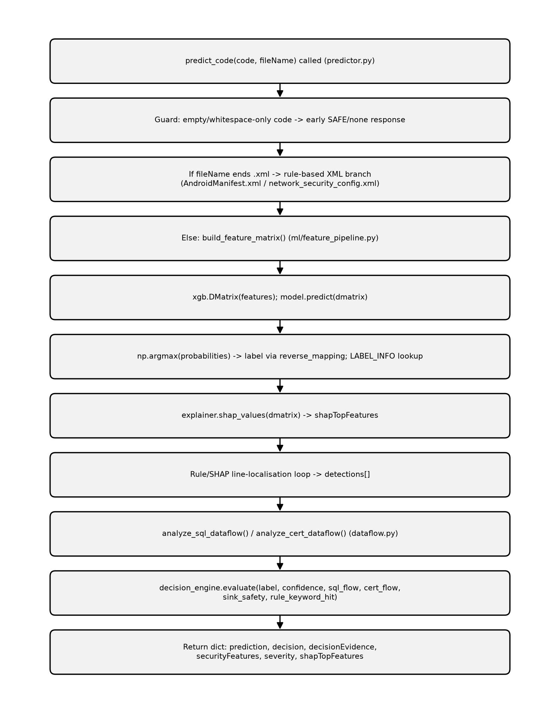
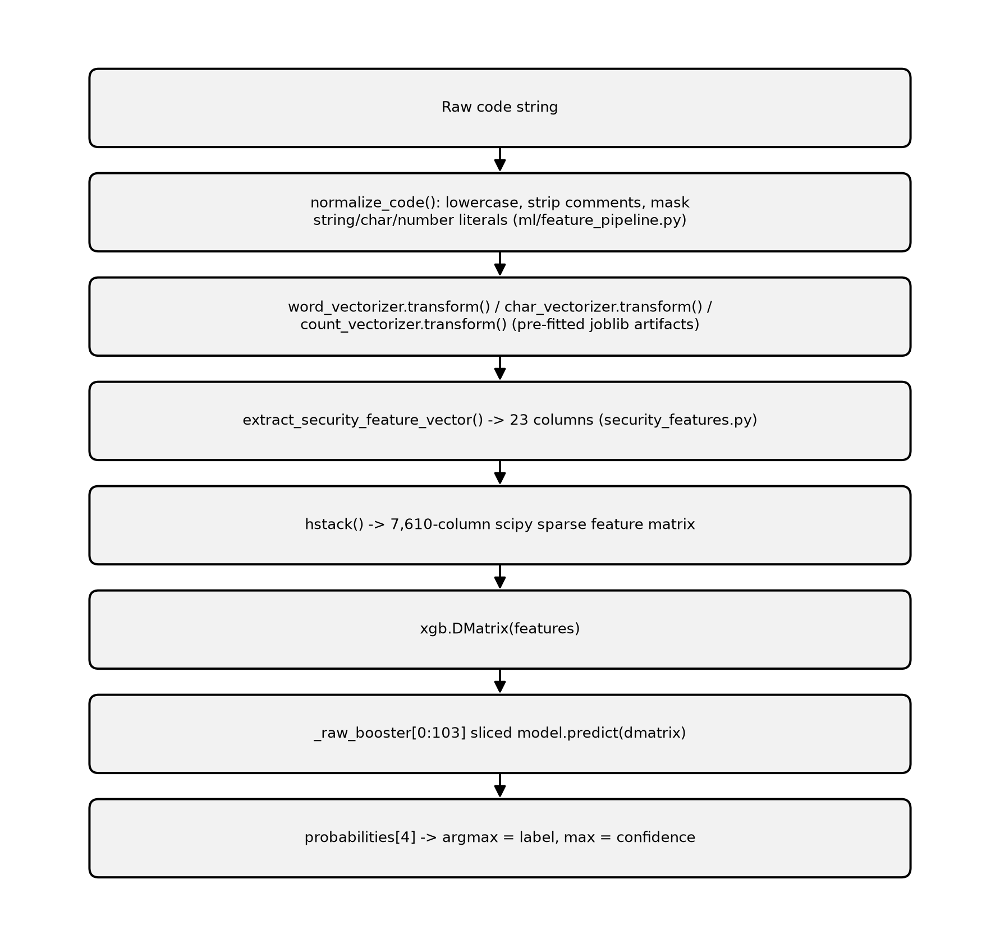
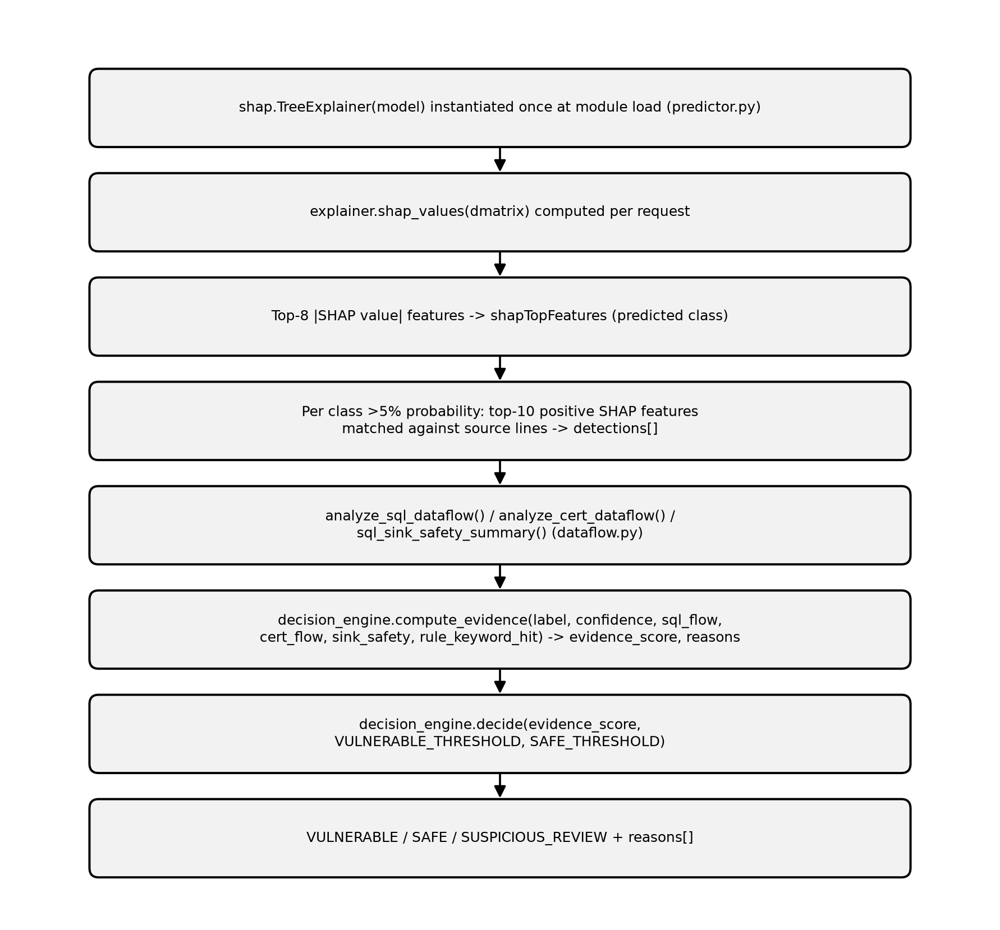
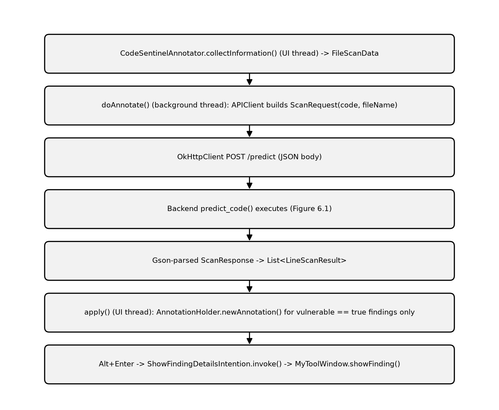
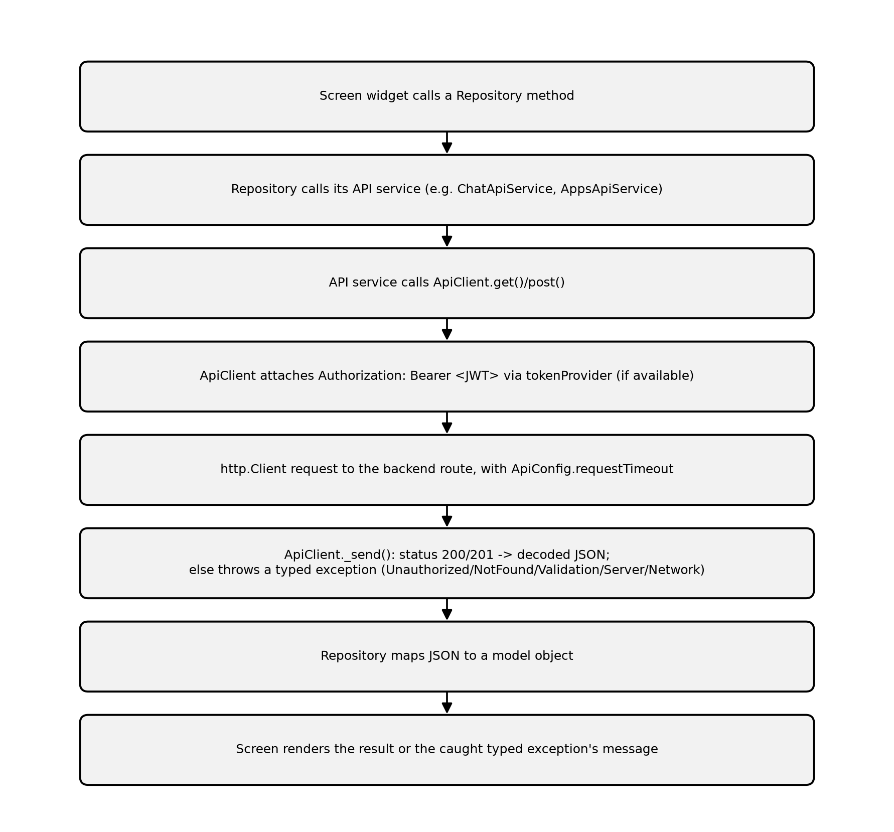
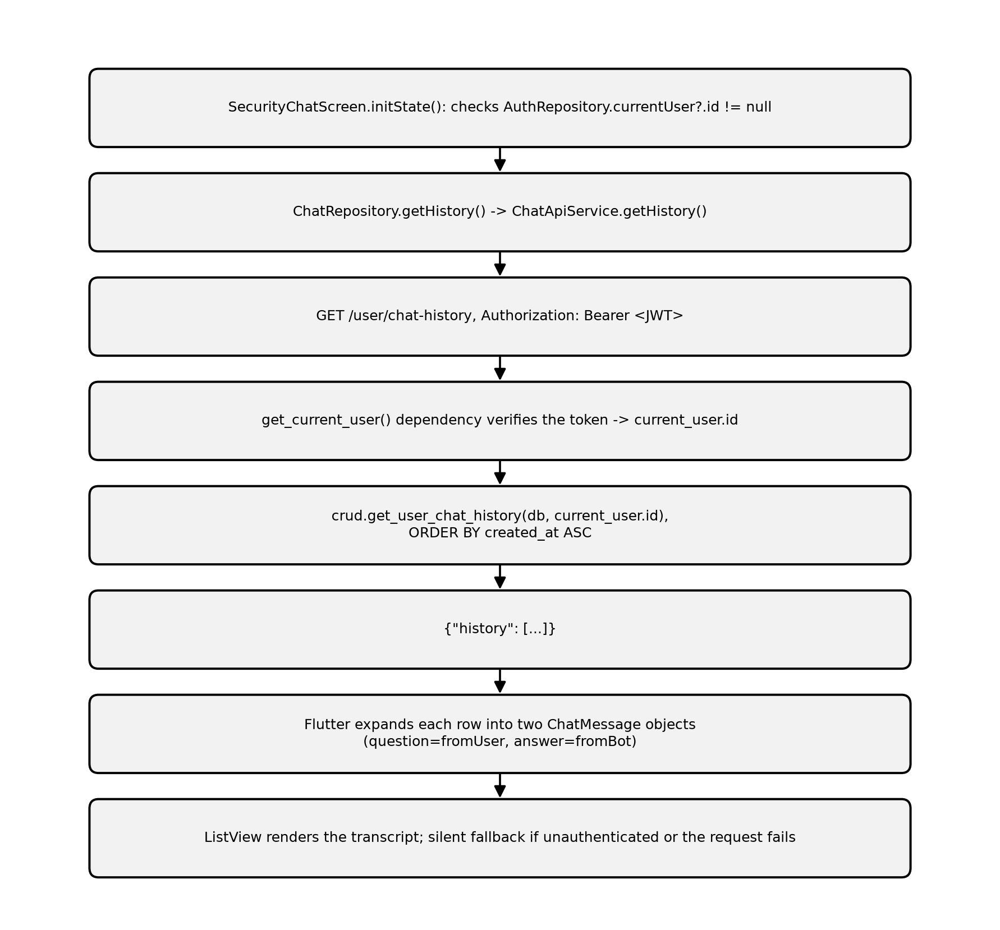

K M IGLAVITHANA
DUAL-VULNERABILITY DETECTION IN ANDROID CODE: REAL-TIME SQL INJECTION AND CERTIFICATE VALIDATION DETECTION
CHAPTER 05 – ARTEFACT DESIGN REALISATION AND IMPLEMENTATION

## 5.1 Chapter Overview

Chapter 4 established DualVulnDroid's requirements and the conceptual design of its components. This chapter answers a narrower question: how was that design actually realised in working code? It traces specific functions, classes, and modules in the current codebase, showing how each design decision became an implementation, and states plainly where implementation deviates from, or narrows, what an idealised design might suggest. It does not repeat Chapter 4's requirements tables or architecture diagrams; it instead follows the shared detection pipeline from raw input to a returned decision, then the plugin, the Flutter application, and the cross-cutting concerns (authentication, error handling, integration) that bind them together. Every implementation detail below — function names, class names, file paths, constants, and control flow — was verified directly against the current source while writing this chapter; Chapter 6 evaluates the resulting system's performance, and this chapter does not anticipate those results.

## 5.2 Implementation Environment and Technology Stack

The implementation environment was verified against the project's own dependency and configuration files rather than assumed (Table 5.1). The backend is a Python/FastAPI service run via Uvicorn, with SQLAlchemy 2.x and Alembic managing the MySQL schema. The production classifier is XGBoost, with SHAP providing explainability and scikit-learn supplying the TF-IDF/count vectorisers used in feature construction; the supplementary research models add TensorFlow/Keras (LSTM) and PyTorch with Hugging Face `transformers` (CodeBERT), used only in the research-comparison pipeline (Section 5.6). Authentication uses PyJWT and `argon2-cffi`. The IDE plugin is Kotlin, targeting the IntelliJ Platform SDK (the same platform Android Studio itself is built on), built with Gradle. The mobile application is Dart/Flutter, using the `http` package for networking and `flutter_secure_storage` for token persistence. Live device validation used an Android Virtual Device via the Android Emulator, referenced throughout this chapter and reported in full in Chapter 7.

**Table 5.1. Technology stack by layer.**

| Layer | Technology | Verified Source |
|---|---|---|
| IDE/plugin | Kotlin, IntelliJ Platform SDK, Gradle | `DualVulnDroid/build.gradle.kts`, `plugin.xml` |
| Mobile | Dart, Flutter, `http`, `flutter_secure_storage` | `dualvulndroid_flutter/pubspec.yaml` |
| Backend | Python, FastAPI, Uvicorn, Pydantic | `backend/app.py` |
| ML (production) | XGBoost, scikit-learn (TF-IDF/CountVectorizer) | `backend/predictor.py`, `backend/ml/feature_pipeline.py` |
| ML (research-only) | TensorFlow/Keras (LSTM), PyTorch + `transformers` (CodeBERT) | `research_eval/` training scripts |
| Explainability | SHAP (`TreeExplainer`) | `backend/predictor.py` |
| Decision fusion | Custom Python module | `backend/decision_engine.py` |
| Database | MySQL, SQLAlchemy, Alembic | `backend/db/models.py` |
| Communication | REST over HTTP, JSON, JWT (PyJWT) | `backend/app.py`, `APIClient.kt`, `api_config.dart` |

Where an exact version could not be independently confirmed from an inspected project file, this chapter states the technology without inventing a version number.

## 5.3 Backend Implementation

`app.py` is a single FastAPI application in which every request body is validated against a Pydantic model (`CodeRequest`, `BatchScanRequest`, `ChatMessage`, `DeviceProfile`, and others) before a route handler runs. Route handlers are implemented thinly: they perform request-shape checks — for example, `_guarded_predict()`'s 200KB single-file size guard — and delegate to the shared analysis core or the data-access layer rather than embedding analysis logic inline. Application startup performs a best-effort database connectivity check that logs a warning rather than blocking startup, since routes such as `/predict` have no database dependency; three exception handlers (generic `Exception`, `HTTPException`, and a dedicated `DatabaseNotConfiguredError`) are registered once at the application level so every route inherits the same error-response shape.

Figure 5.1 shows the implemented request flow for a vulnerability-analysis request. `predict_code(code, file_name)` in `predictor.py` is the single function implementing this entire sequence, called by every analysis route (`/predict`, `/developer/predict`, `/developer/scan`, `/developer/explain`, `/developer/rescan`, `/decision`). An early guard returns a `SAFE`/none response for empty input; files ending `.xml` are diverted to a small, separate rule-based check of `AndroidManifest.xml`/`network_security_config.xml` (cleartext-traffic and permissive-trust-anchor patterns) that does not use the ML pipeline at all, since these are structural configuration facts rather than code patterns; all other Java/Kotlin input proceeds through feature construction, XGBoost prediction, SHAP explanation, static/data-flow evidence extraction, and Decision Engine evaluation.

**Figure 5.1. Backend prediction implementation flow.**



## 5.4 Database Implementation

`db/models.py` was inspected directly and defines exactly ten SQLAlchemy models — `User`, `Application`, `AppVersion`, `Scan`, `Vulnerability`, `MLPrediction`, `RecommendationRecord`, `AlternativeApp`, `ChatHistory`, and a standalone `SecurityTip` — matching the design established in Chapter 4. `db/crud.py` implements every read and write against these models; no route in `app.py` issues SQL or touches a model class directly, keeping the database a genuinely encapsulated layer. Two implementation patterns recur across `db/crud.py` and materially affect correctness: functions participating in a larger transaction (`get_or_create_application()`, `create_scan()`, `add_vulnerability()`) call `db.flush()` rather than `db.commit()`, leaving the final commit to the top-level caller (`persist_apk_scan()`) so a failure partway through leaves nothing partially committed; and several "get or create" functions apply a "never overwrite a real value with a blank one" rule when merging new data into an existing row.

`User.password_hash` never leaves `db/crud.py`/`db/security.py` as a plaintext or reversible value (Section 5.14). Application and finding data are written by `persist_apk_scan()` as one transaction — creating/updating `Application` and `AppVersion` rows, a `Scan` row, and zero or more `Vulnerability` rows strictly from `apk_scanner.py`'s real detections, never a fabricated finding, plus one `RecommendationRecord` derived from the scan's actual risk level. `ChatHistory` supports a nullable `user_id`, so an unauthenticated or context-free exchange can still be recorded, while `GET /user/chat-history` (Section 5.13) only ever reads rows matching a verified, authenticated identity.

## 5.5 Data Processing and Feature Extraction Implementation

The production feature pipeline (`ml/feature_pipeline.py`) implements the single, shared feature-construction path used by both training and live inference, so that training and inference cannot drift apart — the module's own docstring states this as its explicit purpose. `normalize_code()` lower-cases the text, strips comments, masks string/character/numeric literals to fixed placeholder tokens, and collapses whitespace, before the normalised text is passed to three separately-fitted vectorisers: a word-level TF-IDF vectoriser (5,000 features, n-grams 1–3), a character-level TF-IDF vectoriser (2,000 features, n-grams 2–5), and a count vectoriser (1,000 features, n-grams 1–2). `build_feature_matrix()` concatenates these with the 23-element security-feature vector to produce the 7,610-dimensional matrix consumed by XGBoost — the same figures (1,687 raw rows, 559 excluded, 1,128 clean rows, split 791/169/168 under seed 42) established in Chapter 3 as the dataset this pipeline was fitted against. All three vectorisers were fit exclusively on the training split and are loaded at backend startup from pre-fitted artefacts, never re-fit at inference time.

`security_features.py` implements `extract_security_features(code)`, converting `dataflow.py`'s analysis output plus a handful of direct structural checks into the fixed-order, 23-element feature vector. The function is a pure function of the code text — no randomness, no external state — a deliberate implementation property guaranteeing the same snippet always produces the same feature vector. `dataflow.py` itself implements a deliberately scoped static analyzer: single-file, statement-per-line intraprocedural taint tracking through variable assignment and string concatenation, plus exactly one bounded interprocedural hop; certificate-validation checks are structural, inspecting the actual body of `HostnameVerifier`/`X509TrustManager`/`onReceivedSslError` implementations rather than a blanket keyword search, so a genuinely correct custom implementation is not flagged merely for existing.

## 5.6 Machine Learning Implementation

The **production model is XGBoost, exclusively**. `predictor.py` loads it from `research_eval_artifacts/xgboost/` (`model.json`, `metadata.json`); the older `ml/artifacts/` directory is kept on disk for historical reference only and is not loaded. The loader reads the selected boosting-round count from `metadata.json`, loads the full booster, then slices it to only the validated range before it is ever used for prediction — a decision that exists because the saved booster contains additional trees trained past the point early stopping selected, so predicting with the raw, unsliced booster would silently use non-selected trees:

```python
# predictor.py
_NUM_BOOST_ROUND_SELECTED = _model_metadata["final_hyperparameters"]["num_boost_round_selected"]
_raw_booster = xgb.Booster()
_raw_booster.load_model(MODEL_PATH)
model = _raw_booster[0:_NUM_BOOST_ROUND_SELECTED]
```
**Code Snippet 5.1.** Production booster load-time slicing to its validated round count (`predictor.py`).

This slice is applied once at load time, so every later call to `model.predict()` and the `shap.TreeExplainer` built against `model` automatically sees only the validated, evaluated rounds — no call site elsewhere needs to remember an iteration range. The model is versioned by content hash (`PRODUCTION_MODEL_INFO` records a SHA-256 prefix of the loaded model and vectoriser artefacts), so a caller can determine at runtime exactly which trained artefact is being served. The fixed class order — `s0` (CWE-89 vulnerable), `v0` (CWE-295 vulnerable), `s1` (CWE-89 safe), `v1` (CWE-295 safe) — is defined once and reused by every downstream consumer: the Decision Engine's vulnerable-label set, the plugin's response parsing, and the Flutter client.

Figure 5.2 shows the resulting prediction path. `build_feature_matrix()`'s output is passed to XGBoost as an `xgb.DMatrix`; `model.predict(dmatrix)` returns a four-element probability array, and `np.argmax()`/`np.max()` yield the predicted label and its confidence, before proceeding to SHAP and the Decision Engine.

**Figure 5.2. Machine learning feature-to-prediction implementation flow.**



**Research-comparison models — Linear SVM, Random Forest, and, alongside XGBoost itself under identical conditions, LSTM and CodeBERT — were trained and evaluated during the research phase reported in Chapter 6, but none of the four non-production models is loaded or reachable from any route in `app.py`.** This chapter does not describe LSTM or CodeBERT as production components, and no code path in `predictor.py` imports either.

## 5.7 Hybrid Decision Engine Implementation

`decision_engine.py` implements the engine as three functions: `compute_evidence()`, `decide()`, and `evaluate()` (which composes the first two). `compute_evidence()` accepts the predicted label, its confidence, the SQL and certificate data-flow findings, the parameterised-sink safety summary, and a static-rule match flag, returning a signed evidence score and a list of labelled reasons. The ML prediction contributes `±confidence × 1.0`, signed by predicted class; the remaining fixed weights — traced source-to-sink (`+2.0`), unparameterised concatenation (`+1.2`), confirmed parameterisation (`−1.5`), certificate vulnerable (`+2.0`)/suspicious (`+0.6`)/safe (`−1.5`), and static-rule corroboration (`+0.4`) — are the module's own documented constants, not re-derived per request.

```python
# decision_engine.py
def decide(evidence_score, vulnerable_threshold=VULNERABLE_THRESHOLD,
           safe_threshold=SAFE_THRESHOLD):
    if evidence_score >= vulnerable_threshold:
        return "VULNERABLE"
    elif evidence_score <= safe_threshold:
        return "SAFE"
    return "SUSPICIOUS_REVIEW"
```
**Code Snippet 5.2.** The Decision Engine's three-way threshold comparison (`decision_engine.py`).

The thresholds actually applied at runtime are not the module's hand-picked reference defaults (`VULNERABLE_THRESHOLD = 1.5`, `SAFE_THRESHOLD = -0.9`) unless no calibration artefact exists: on import, the module checks for a calibrated-threshold JSON artefact (produced from the validation split only, never the test split) and, when present, overwrites both constants before any request is served. `SUSPICIOUS_REVIEW` is a deliberate third state, not an implementation gap: the module's own documentation records that collapsing it into a binary `vulnerable` flag was considered and rejected, since neither client surface has a dedicated "needs review" UI, and doing so at this decision boundary would place a warning on a large share of scanned files. This chapter does not restate the engine's numeric coverage or false-negative/false-positive rate — those are Chapter 6 evaluation results — and does not claim the engine resolves every case automatically or is free of error.

## 5.8 Explainability and Evidence Implementation

Figure 5.3 (right-hand portion) shows the explainability path. `shap.TreeExplainer(model)` is instantiated once, at module import time, against the identical sliced production booster used for prediction — a deliberate implementation property, since it guarantees every SHAP value corresponds to the actual serving model rather than a separately-configured explainer. If instantiation fails, the explainer is set to `None` and SHAP-dependent response fields are simply omitted rather than the request failing. For each prediction, `explainer.shap_values()` is called to build `shapTopFeatures` (the top 8 features by absolute SHAP value for the predicted class) and, separately, to extract top positive-contribution features for any class with predicted probability above 5%, used for line-level localisation against the source text.

**Figure 5.3. SHAP and Decision Engine implementation flow.**



SHAP output is used strictly as feature attribution — a measure of how much each feature pushed the model's output toward or away from a given class for this specific input — and is never presented as proof that the underlying code is genuinely vulnerable. This is why it is returned as a field distinct from `decisionEvidence` (the independently-computed static/data-flow findings, Section 5.5): a developer sees which features the model weighted (`shapTopFeatures`) and, separately, what deterministic evidence was actually traced in the code, rather than one undifferentiated "explanation."

## 5.9 Developer IDE Plugin Implementation

`plugin.xml` was inspected directly to establish exactly which plugin components are active. It registers three extension points: a tool window (`MyToolWindowFactory`, providing project-wide scanning); an `ExternalAnnotator` for Kotlin/Java (`CodeSentinelAnnotator`, providing real-time in-editor annotation); and a separate `ExternalAnnotator` for XML (`NetworkSecurityAnnotator`, covering the Android manifest and network-security-configuration files). These three are the plugin's **registered and reachable** components.

Several further classes exist in the plugin's source tree but are **not registered in `plugin.xml` and are not reachable through any active extension point or other call site** — standalone `LocalInspectionTool` subclasses and detector classes left over from earlier development increments. These are legacy, unused artefacts, not active functionality, and this chapter does not describe them as part of the working system. The plugin communicates with the backend exclusively through `APIClient.kt`, whose Kotlin data classes mirror the backend's real JSON response shapes field-for-field, checked directly against `app.py`'s response construction rather than inferred; every field added after the plugin's initial version is declared nullable, so a response from an older backend or from a guard-clause early return still parses successfully.

## 5.10 Vulnerability Detection and Finding Workflow

Figure 5.4 shows the realised end-to-end developer workflow. `CodeSentinelAnnotator` implements the IntelliJ Platform's three-method `ExternalAnnotator` contract: `collectInformation()` runs on the UI thread, restricts scanning to `java`/`kotlin`/(for two specific manifest-related filenames) `xml`, and builds the per-line data the annotation needs; `doAnnotate()` runs on a background thread — the only point at which this class performs network I/O — calling `APIClient` to `POST /predict` and mapping the response into per-line results carrying vulnerability type, confidence, character offsets, severity, decision, decision evidence, and SHAP features, so the tooltip renders this richness from one request; `apply()` runs back on the UI thread and creates an annotation only for results the backend actually reported vulnerable — a `SUSPICIOUS_REVIEW` decision produces no annotation at all, a direct consequence of the Decision Engine's conservative calibration rather than a plugin defect.

**Figure 5.4. Developer-to-backend communication and finding workflow.**



CWE-89 and CWE-295 detection are each the composition of the pieces already described: for CWE-89, `dataflow.py`'s traced-source-to-sink and unparameterised-concatenation findings, nine of the 23 security features, the `s0`/`s1` probability pair, and the Decision Engine's SQL-specific weights; for CWE-295, `dataflow.py`'s structural analysis of `HostnameVerifier`/`TrustManager`/WebView SSL-handler bodies, a further nine security features, the `v0`/`v1` probability pair, and the Decision Engine's certificate-specific weights. Developer-facing explanation sentences (`generate_explanation_sentences()`) are built purely from already-computed real values — for example, a source-to-sink sentence is only generated when that feature was actually set for this request — rather than templated text unconditionally attached to every finding of a given type. Neither detection path claims complete coverage: `dataflow.py`'s own documentation states it is a deliberately scoped, single-file analyzer, not a full whole-program static analyzer.

## 5.11 Remediation and Quick-Fix Implementation

Quick Fix follows a locator/action split. `SqlFixLocator.kt` and `CertificateFixLocator.kt` implement the "is this safe to rewrite" decision by inspecting the actual PSI structure of the flagged expression — for example, `SqlFixLocator` determines whether a flagged SQL string has a sufficiently simple, single-level concatenation shape before considering a fix. Only where a locator returns a positive result do `SafeSqlQuickFixJava/Kotlin.kt` or `SafeHostnameVerifierQuickFixJava/Kotlin.kt` perform the actual PSI expression rewrite, inside a write action, re-validating that the target pattern still matches immediately before writing. This is a **narrow, pattern-scoped remediation, not a general or fully automated repair capability**: any finding that does not match one of these specific, verified shapes receives a manual-remediation message in its tooltip instead of a fix action, and this chapter does not claim otherwise.

After a fix is applied, `FixVerificationRunner.kt` triggers a genuine, asynchronous re-scan of the modified file through the same backend path used for real-time annotation — whether the fix worked is a freshly-computed backend decision on the post-fix code, not an assumption. Batch/project-wide scanning is implemented separately: `ProjectFileCollector.kt` gathers eligible files and drives a single `POST /developer/scan` request rather than one request per file, with results populating the same shared, in-memory findings list `MyToolWindow.kt` also uses for real-time findings, so jump-to-source navigation works identically regardless of which path produced a given finding.

## 5.12 Flutter End-User Application Implementation

`ApiClient` (`lib/core/api_client.dart`) implements all network communication behind `get()`/`post()`, both routing through a shared `_send()` implementation that catches `TimeoutException`, `SocketException`, and `http.ClientException`, re-throwing all three as one `NetworkException`, and maps HTTP status codes to a small set of typed exceptions (`UnauthorizedException`, `NotFoundException`, `ValidationException`, `ServerException`). Both the underlying `http.Client` and the token-provider callback are constructor-injected, which is what allows the project's own tests to substitute a mock client without touching real network or storage.

**Figure 5.5. Flutter-to-backend communication implementation.**



Authentication/session state is implemented in `AuthRepository`, the only class permitted to read or write the persisted token, delegated to a thin `flutter_secure_storage` wrapper; `restoreSession()` runs once at startup so a user is not required to log in on every launch, and `handleUnauthorized()` — invoked whenever any API call surfaces an `UnauthorizedException` — clears the token and routes the UI back to login rather than silently retrying with a dead session. Security-relevant screens (Search, Application Details, Device Compatibility) depend on a repository rather than an API service directly, and render every typed exception through shared state-view widgets rather than each screen implementing its own error UI.

Stated plainly, because it is the property most easily misdescribed: **no layer of this Flutter implementation performs source-code CWE-89/CWE-295 analysis.** Every risk level, finding, and piece of evidence a screen displays originates from a backend JSON response. The Dashboard's "Upload APK" and "Installed Apps" actions route to a generic not-available screen with an honest "not available in this version" message, verified directly in the application's own routing code — this chapter does not claim an upload flow is implemented or reachable from the mobile UI, notwithstanding the backend's separate `POST /upload-apk` capability (Section 5.3).

## 5.13 Security Chat and Decision-Support Implementation

Figure 5.6 shows the chat-history retrieval path as a concrete, representative example of the wider Security Chat implementation. `SecurityChatScreen` sends each message through `ChatRepository`/`ChatApiService`, issuing `POST /ai-chat` with the message text and, where opened from a specific application's context, that application's real `app_id`. `chatbot_logic.py`'s `generate_chat_response()` is the single backend entry point: it classifies the message deterministically against fixed phrase lists, in order — CWE-89 explanation, CWE-295 explanation, compatibility, recommendation explanation, why-risky, what-to-do, falling back to an application-name lookup. **This is deterministic keyword-based intent classification, not a general-purpose large-language-model chatbot**, and this chapter does not describe it as one.

**Figure 5.6. Chat history retrieval implementation flow.**



CWE-89/CWE-295 questions return fixed, hand-written reference text, since these are stable definitions that do not vary per application. The `why_risky`, `what_to_do`, `explain_recommendation`, and `compatibility` intents require a real, resolved assessment: when `app_id` is supplied, the corresponding answer function builds its response strictly from that assessment's real stored fields, returning an explicit "no verified assessment" message rather than fabricating one when none exists. An unrecognised question with no resolvable context returns a fixed, honest fallback. Chat history is implemented as a write on every exchange (`save_chat_message()`, whenever a `user_id` is present) and a read exposed only to the authenticated owner: `GET /user/chat-history` derives the requesting identity exclusively from the verified JWT payload, never a client-supplied identifier, so the endpoint structurally cannot return another user's transcript — a property enforced by how the underlying query is constructed, not merely a convention.

## 5.14 Authentication, API Communication and Security Controls

Backend authentication is implemented in `db/security.py`. Passwords are hashed with Argon2 for all new and updated credentials; `verify_password()` additionally recognises a legacy SHA-256 hex-digest scheme, transparently re-hashing with Argon2 on a successful legacy match at login — a standard rolling migration, since a one-way hash cannot be batch-converted without the plaintext. JWTs are signed with `PyJWT` (HS256) using a server-side secret read from the environment; `get_current_user()` in `app.py` is the single dependency every protected route uses, distinguishing an expired token, a structurally invalid token, and a token for a user that no longer exists, rather than one undifferentiated 401.

**Network transport was verified directly against `ApiConfig` (Flutter) and `APIClient` (Kotlin) rather than assumed, and both communicate with the backend over plain HTTP, not HTTPS.**

```dart
// api_config.dart
static String get baseUrl {
  if (physicalDeviceHost != null && physicalDeviceHost!.isNotEmpty) {
    return 'http://$physicalDeviceHost:$_port';
  }
  if (kIsWeb) { return 'http://127.0.0.1:$_port'; }
  if (Platform.isAndroid) { return 'http://10.0.2.2:$_port'; }
  return 'http://127.0.0.1:$_port';
}
```
**Code Snippet 5.3.** The Flutter client's backend base URL, confirming HTTP-only transport (`api_config.dart`).

No TLS/SSL configuration exists anywhere in the verified backend deployment, and the plugin's default backend URL (`http://127.0.0.1:8000/predict`) confirms the same for the developer-side client. This is stated plainly, not minimised, because a thesis whose research subject includes transport-layer certificate validation (CWE-295) would be materially inconsistent with itself if it silently implied HTTPS where none exists; it is recorded as a deployment-configuration limitation of the evaluated system, addressed further in Chapter 8's limitations discussion.

Within that constraint, other implemented security measures are genuine: JWT authentication is scoped to exactly the routes exposing a specific user's own private data; the Flutter client persists its token via `flutter_secure_storage` rather than plain shared preferences; error responses are generic and never leak an internal path, stack trace, or secret; the backend's `.env` file (database connection string, JWT signing secret) is excluded from version control; and Pydantic request-model validation applies at the API boundary for every route accepting a body. No at-rest database encryption or end-to-end message encryption was located in the inspected source, and none is claimed here.

## 5.15 Error Handling and Availability States

Error handling operates at three levels. At the framework level, Pydantic request models reject a structurally invalid body (missing fields, wrong types, an out-of-bounds batch size) with a `422` before any route handler runs. At the application level, the three registered exception handlers (Section 5.3) normalise every failure mode into a consistent response shape: unhandled exceptions become a generic `500` with the real exception logged server-side only; deliberate `HTTPException`s (a `404` for an unknown application, a `400` for an empty search query, a `413` for an oversized upload) are returned in the same `{"error": ..., "detail": ...}` shape; a missing database surfaces as an explicit `503`, not a generic failure. At the authentication level, `get_current_user()` implements three distinct `401` cases rather than one undifferentiated response.

Availability is handled close to where a value would otherwise have to be guessed: the compatibility module reports `NOT_AVAILABLE` for a dimension whenever either the application-side manifest fact or the device-side data is genuinely missing, rather than inferring one; the chatbot's fallback (`GREETING` text) is returned when no intent or application name can be resolved, rather than raising an error or returning an empty response; and every error the Flutter client's `ApiClient` surfaces is one of five typed exceptions, rendered through shared state-view widgets so no screen improvises its own error text. **Implemented error handling and live-validated behaviour are reported separately in this chapter**: an implemented and automated-test-covered path (for example, Search's network-error handling) is not described as live-validated unless it was actually exercised on a real device — Search's network-error state remains **not validated live** as of the most recent validation phase (Chapter 3, Section 3.13), and this chapter does not claim otherwise.

## 5.16 Integration of System Components

The developer path integrates as: IDE Plugin → Backend/API → ML feature extraction and static/data-flow analysis → Decision Engine → Finding/Evidence → (where applicable) Quick Fix. The end-user path integrates as: Flutter Application → Backend/API → stored application assessment/security data → risk and evidence presentation → Compatibility → Security Chat. Both paths converge on exactly one backend and one detection pipeline (Sections 5.3–5.8); no functionality is duplicated between the plugin and the Flutter client. The integration boundary that matters most for this thesis's accuracy is stated once more here because it governs both paths: the Flutter client never submits source code and never independently computes a CWE-89/CWE-295 verdict; it is a consumer of decisions the shared pipeline has already produced and stored. Cross-component contracts are kept explicit and versioned where practical — the plugin's response data classes are checked field-for-field against the backend's actual response construction, and the production model is content-hash versioned — so that a change on one side of an integration boundary is detectable rather than silently assumed compatible.

## 5.17 Implementation Verification and Traceability

Table 5.2 traces representative Chapter 4 requirements to their realised implementation and current verification status, using four distinct labels rather than a single "done": **Implemented** (the code exists and was read directly); **Automated Tested** (covered by a passing automated test); **Live Validated** (directly observed on a real device/emulator against the real backend); and **Not Validated** (not yet observed live, for a stated reason).

**Table 5.2. Implementation verification and traceability.**

| Requirement (Ch. 4) | Component | Source Module | Verification Status |
|---|---|---|---|
| FR-01 Real-time + batch source-code analysis | `CodeSentinelAnnotator`, `ProjectFileCollector` | `CodeSentinelAnnotator.kt`, `predictor.py` | Implemented; Automated Tested (46 unit + 9 headless-IDE integration tests); **Not** human-observed on-screen IDE GUI-validated |
| FR-03 Hybrid Decision Engine (3-state) | `decision_engine.py` | `decision_engine.py` | Implemented; Automated Tested; evaluated quantitatively in Chapter 7 |
| FR-04 SHAP + separated evidence | `predictor.py` | `predictor.py` | Implemented; Automated Tested |
| FR-06/07 Quick Fix + re-verification | Locator/Fix/`FixVerificationRunner` classes | `SqlFixLocator.kt` et al. | Implemented; Automated Tested |
| FR-10 Search + security assessment | `AppsRepository`, `apps_api_service.dart` | `dualvulndroid_flutter/lib/*` | Implemented; Live Validated (known and unknown-app cases); Search network-error remains **Not Validated** |
| FR-11 Compatibility (3 dimensions) | `compatibility.py` | `compatibility.py` | Implemented; Live Validated (COMPATIBLE, INCOMPATIBLE, NOT_AVAILABLE all confirmed) |
| FR-14/15 Security Chat + verbatim rendering | `chatbot_logic.py`, `security_chat_screen.dart` | `chatbot_logic.py` | Implemented; Live Validated (all required question categories) |
| FR-16 Own chat history | `GET /user/chat-history` | `app.py`, `db/crud.py` | Implemented; Automated Tested (7 backend + 2 Flutter tests); Live Validated |
| FR-18 Research-only models excluded from production | `predictor.py` import path | `predictor.py` | Implemented; verified by direct code/import review |

Table 5.3 connects each Chapter 1 research objective to its principal implemented artefact and the evidence this chapter and Chapter 7 provide for it.

**Table 5.3. Research objective to implemented artefact.**

| Research Objective (Ch. 1) | Implemented Artefact | Evidence |
|---|---|---|
| 2. Compare five models under one protocol | Shared feature pipeline + five trained models | Chapter 6 evaluation; only XGBoost reachable in production (Section 5.6) |
| 3. Hybrid Decision Engine with SHAP | `decision_engine.py` + `predictor.py` SHAP integration | This chapter (Sections 5.7–5.8); Chapter 7 quantitative results |
| 4. IDE plugin and Flutter application | `CodeSentinelAnnotator`/Quick Fix classes; `dualvulndroid_flutter/lib/*` | This chapter (Sections 5.9–5.13); Kotlin/Flutter automated suites |
| 5. Evaluate via testing and honest live validation | Backend/Kotlin/Flutter test suites; Phase-based live validation record | 323 backend passed/2 skipped, 55 Kotlin, 59 Flutter passed/0 failed; Chapter 3 §3.13 live record |

## 5.18 Chapter Summary

This chapter has traced Chapter 4's design down to the functions, classes, and modules that implement it: `predict_code()`'s guarded, branching prediction sequence; the 23-feature extraction over `dataflow.py`'s deliberately scoped static analysis; the production XGBoost booster's load-time slicing to its validated round count and fixed class order, with SVM/Random Forest/LSTM/CodeBERT confirmed absent from every production route; the Hybrid Decision Engine's three-function implementation and its calibrated, JSON-loaded thresholds; the SHAP explainer built once against the exact serving model; the plugin's three registered extension points, with legacy, unregistered classes explicitly excluded from this description of active functionality; the narrow, re-verified Quick Fix implementation; the Flutter client's `ApiClient`/`AuthRepository` implementation, confirmed to perform no source-code analysis of its own; the deterministic, intent-classified Security Chat and its now-implemented chat-history read path; and the system's authentication, error-handling, and integration implementation — including the direct, source-verified confirmation that the deployed system communicates over HTTP, not HTTPS. Table 5.2 and Table 5.3 trace this implementation back to Chapter 4's requirements and Chapter 1's research objectives using verification labels that distinguish implemented, automated-tested, live-validated, and not-yet-validated behaviour, rather than a single undifferentiated claim of completeness. Chapter 6 now presents the experimental evaluation results this implementation was built to produce.

## References (APA 7)

MITRE. (n.d.-a). *CWE-89: Improper neutralization of special elements used in an SQL command ('SQL Injection')*. Common Weakness Enumeration. Retrieved 2026, from https://cwe.mitre.org/data/definitions/89.html

MITRE. (n.d.-b). *CWE-295: Improper certificate validation*. Common Weakness Enumeration. Retrieved 2026, from https://cwe.mitre.org/data/definitions/295.html

Lundberg, S. M., & Lee, S.-I. (2017). A unified approach to interpreting model predictions. In *Advances in Neural Information Processing Systems 30* (pp. 4765–4774). Curran Associates.

Chen, T., & Guestrin, C. (2016). XGBoost: A scalable tree boosting system. In *Proceedings of the 22nd ACM SIGKDD International Conference on Knowledge Discovery and Data Mining* (pp. 785–794). ACM. https://doi.org/10.1145/2939672.2939785
