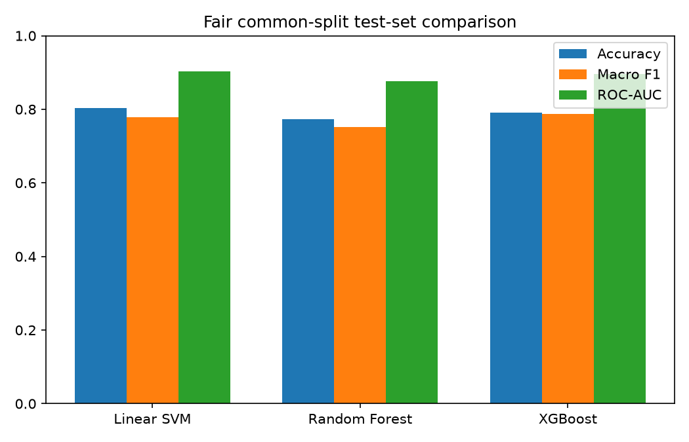
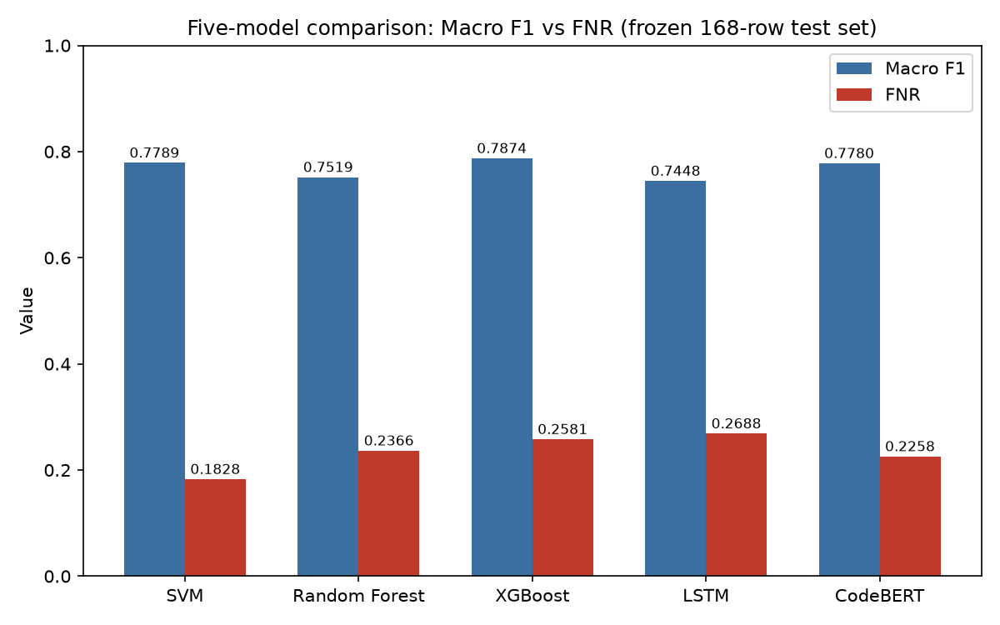
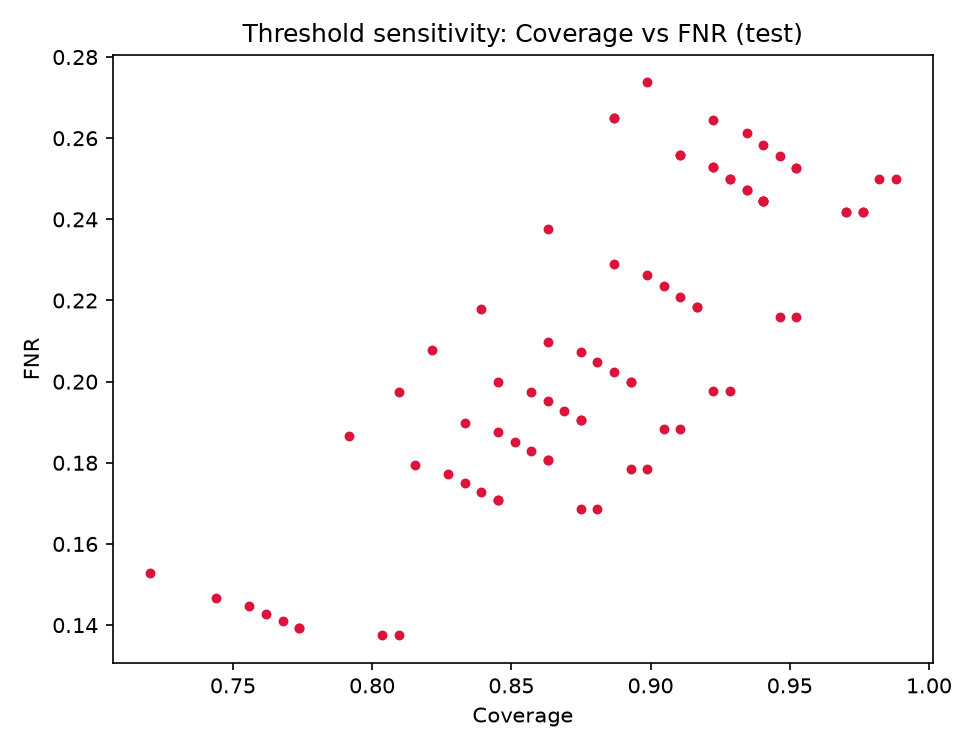

K M IGLAVITHANA
DUAL-VULNERABILITY DETECTION IN ANDROID CODE: REAL-TIME SQL INJECTION AND CERTIFICATE VALIDATION DETECTION
CHAPTER 06 – EXPERIMENTAL RESULTS AND MODEL EVALUATION

## 6.1 Chapter Overview

Chapters 1–5 stated the research question, the literature-derived gap, the methodology, the requirements/design, and the implementation. This chapter reports what the resulting experiments actually showed. It evaluates the dataset and split actually used, the hybrid feature representation, the three classical models (Linear SVM, Random Forest, XGBoost), the supplementary LSTM and CodeBERT models, a full five-model comparison, an evidence-based error analysis, the Hybrid Decision Engine's measured coverage/reliability trade-off, the explainability evidence actually generated, measured inference performance, and each of Chapter 1's five research objectives against the evidence gathered for it. Every numeric result in this chapter was read directly from a stored evaluation artefact under `backend/research_eval_artifacts/` or `backend/ml/`, re-verified during the writing of this chapter rather than copied from an earlier chapter draft; where two artefacts disagreed, both are reported and the disagreement is not silently resolved (Section 6.7). This chapter does not restate the methodology (Chapter 3) or implementation (Chapter 5) except where a specific detail is required to interpret a result correctly.

## 6.2 Experimental Evaluation Setup

Every model in this chapter was evaluated under one identical protocol: the same frozen dataset split, the same feature representation (for the classical models), the same evaluation metrics, and a test split consulted exactly once, after all hyperparameter/checkpoint selection was complete. The dataset split (Section 6.3) was constructed to be group-aware — rows sharing a normalised-code template are confined to one subset — with the resulting split independently confirmed to have zero group-key overlap and zero exact-text overlap across the training, validation, and test subsets (`dataset_report.json`: `"leakage_check": "PASSED - no normalize_code() group_key shared across splits"`). This is **not a true application-level split**: the source dataset carries no reliable application or project identifier, so the split cannot guarantee that no two rows in different subsets originate from the same real-world application, only that no two rows share an (near-)identical code template. This limitation is carried forward, unweakened, from Chapter 3 and is revisited in Section 6.14. All results reported below for the three classical models and CodeBERT's `codebert/` artefact were computed against the identical 168-row frozen test set; this is confirmed directly in the stored artefact metadata (`comparison_summary.json`: `"fairness_check": "PASSED - all 3 models evaluated on the identical 168-row frozen test set"`) and independently corroborated for all five models by the shared `test_size: 168` recorded in each model's own reproducibility metadata.

## 6.3 Dataset and Experimental Split

Table 6.1 reports the dataset composition verified directly from `backend/ml/data/dataset_report.json`. The raw dataset contained 1,687 labelled rows; 559 rows (270 conflicting-label template groups) were excluded because their normalised code template mapped to more than one distinct label, leaving 1,128 clean rows. This was split, under a fixed random seed of 42, into 791 training, 169 validation, and 168 test rows.

**Table 6.1. Dataset composition (verified against `dataset_report.json`).**

| Stage | s0 (CWE-89 vuln.) | s1 (CWE-89 safe) | v0 (CWE-295 vuln.) | v1 (CWE-295 safe) | Total |
|---|---|---|---|---|---|
| Clean dataset | 196 (17.4%) | 176 (15.6%) | 426 (37.8%) | 330 (29.3%) | 1,128 |
| Training split | 138 | 125 | 297 | 231 | 791 |
| Validation split | 29 | 26 | 65 | 49 | 169 |
| Test split | 29 | 25 | 64 | 50 | 168 |

Percentages are calculated directly from the clean-dataset counts (e.g., 196/1,128 = 17.4%). Two composition facts materially affect how later results should be read. First, the dataset is imbalanced by CWE category, not only by class: CWE-295 rows (v0+v1 = 756, 67.0%) outnumber CWE-89 rows (s0+s1 = 372, 33.0%) by roughly two to one, which is a plausible contributing factor, though not independently proven here, to the recurring pattern in Sections 6.5–6.8 that every evaluated model's CWE-295 F1 exceeds its CWE-89 F1. Second, the split fractions realised (70.1% / 15.0% / 14.9%, per `robustness/all_seeds_summary.json`) closely match the nominal 70/15/15 target, confirming the grouped-split procedure did not distort the intended proportions in pursuit of leakage avoidance.

## 6.4 Feature Representation Results

The production feature pipeline was verified to produce a 7,610-dimensional vector for every input, confirmed identically in `research_eval_artifacts/xgboost/metadata.json` (`"feature_dims": 7610`) and `ml/artifacts/training_config.json`. This comprises 7,587 realised text-derived dimensions (word TF-IDF, character TF-IDF, and count-vectorizer features, each capped at 5,000/2,000/1,000 respectively but not all reaching their cap given the clean dataset's 1,128-row vocabulary) plus the fixed 23-element deterministic security/data-flow feature vector (Table 6.2).

**Table 6.2. Feature representation summary.**

| Component | Dimensions | Fitted On |
|---|---|---|
| Word-level TF-IDF (n-grams 1–3) | ≤5,000 | Training split only |
| Character-level TF-IDF (n-grams 2–5) | ≤2,000 | Training split only |
| Count vectorizer (n-grams 1–2) | ≤1,000 | Training split only |
| **Realised text-derived total** | **7,587** | — |
| Deterministic security/data-flow features | 23 | Computed directly per sample (no fitting) |
| **Total production dimensionality** | **7,610** | — |

This hybrid representation's relevance to CWE-89/CWE-295 specifically is that the 23 security features encode exactly the source-to-sink and structural indicators (traced SQL source-to-sink, parameterisation status, `HostnameVerifier`/`TrustManager` structural verdicts) that a purely lexical TF-IDF representation cannot express without an engineered feature. The feature count alone is not evidence of effectiveness — dimensionality is a design parameter, not a result — and Section 6.11's SHAP evidence is the more direct test of whether the security features are actually influential to the trained model's predictions.

## 6.5 Classical Machine Learning Results

Table 6.3 reports the three classical models' results, verified directly from `research_eval_artifacts/comparison/model_comparison.csv` and `comparison/vulnerability_comparison.csv`.

**Table 6.3. Classical model results (frozen 168-row test set).**

| Model | Accuracy | Macro F1 | ROC-AUC | CWE-89 F1 | CWE-89 FNR | CWE-295 F1 | CWE-295 FNR | Overall FPR | Overall FNR |
|---|---|---|---|---|---|---|---|---|---|
| Linear SVM | 0.8036 | 0.7789 | 0.9025 | 0.7742 | 0.1724 | 0.8525 | 0.1875 | 0.2000 | 0.1828 |
| Random Forest | 0.7738 | 0.7519 | 0.8758 | 0.7541 | 0.2069 | 0.8205 | 0.2500 | 0.2133 | 0.2366 |
| XGBoost | 0.7917 | 0.7874 | 0.8957 | 0.7931 | 0.2069 | 0.8000 | 0.2812 | 0.1467 | 0.2581 |

**Figure 6.1. Classical model comparison (verified project artefact).**

**Result.** No single classical model dominates every metric. **XGBoost** achieves the best CWE-89 F1 (0.7931) and the lowest overall FPR (0.1467); **Linear SVM** achieves the best CWE-295 F1 (0.8525), the best overall FNR (0.1828), and the best ROC-AUC (0.9025); **Random Forest** is not best on any metric in this table. **Interpretation.** Using CWE-89 F1 and overall FPR as the criteria, XGBoost is the strongest classical candidate for CWE-89 specifically and for minimising false alarms; using CWE-295 F1 and overall FNR as the criteria, SVM is the strongest candidate for CWE-295 specifically and for minimising missed vulnerabilities overall. Neither statement generalises to "best overall" without specifying which metric is being optimised, consistent with Chapter 2's caution against assuming one classical algorithm dominates. **Comparison.** Random Forest trails both other classical models on every reported metric here, plausibly reflecting its comparatively coarser decision boundaries on the same sparse, mixed lexical/security feature representation. **Limitation.** These are single-run results on one frozen test split (168 rows); no confidence interval or statistical significance test was computed for the differences between models, so a claim that XGBoost's CWE-89 F1 advantage over SVM (0.7931 vs 0.7742) is statistically significant would not be supported by the available evidence.

## 6.6 Deep Learning Results

Table 6.4 reports the LSTM's results, verified from `research_eval_artifacts/lstm/test_metrics.json` and `lstm/cwe_metrics.csv`.

**Table 6.4. LSTM results (frozen 168-row test set).**

| Metric | Value |
|---|---|
| Accuracy | 0.7798 |
| Macro F1 | 0.7448 |
| CWE-89 F1 | 0.6415 |
| CWE-89 FNR | 0.4138 |
| CWE-295 F1 | 0.8500 |
| CWE-295 FNR | 0.2031 |
| Overall FNR (binary view) | 0.2688 |

**Result.** The LSTM's macro F1 (0.7448) is the lowest of all five models evaluated in this research (Table 6.6), and its CWE-89 FNR (41.4%) is markedly worse than every classical model's CWE-89 FNR (17.2–20.7%). Its CWE-295 F1 (0.8500) is competitive with, and marginally exceeds, XGBoost's (0.8000) and Random Forest's (0.8205). **No claim of LSTM superiority is made anywhere in this chapter**, consistent with Chapter 2's literature-grounded caution (Chakraborty et al., 2022) that deep-learning benchmark performance does not reliably transfer, and consistent with this thesis's own prior chapters. **Interpretation.** The LSTM's markedly weaker CWE-89 performance, relative to its comparatively strong CWE-295 performance, is consistent with CWE-89's smaller training-data share (372 of 1,128 rows, Section 6.3) combined with the LSTM's from-scratch, no-pretraining training regime (Chapter 5, Section 5.6/Chapter 3, Section 3.8): a model trained without any external pretraining is, in principle, more dependent on in-dataset example volume for a given class than a model that begins from a pretrained representation. This is offered as a plausible, not proven, explanation, since no dedicated ablation isolating this specific cause was run. **Comparison.** The LSTM's training methodology differs materially from the classical models': it uses a custom, case-sensitive, code-aware tokenizer with a training-split-only vocabulary rather than TF-IDF, and was trained on CPU with validation-based early stopping rather than train-only cross-validation — a difference already stated in Chapter 3 and repeated here because it means the LSTM's weaker result cannot be attributed to identical preprocessing producing a worse outcome; the input representations are genuinely different. **Limitation.** As with the classical models, this is a single-run result with no statistical test of significance.

## 6.7 Transformer Model Results

CodeBERT's evaluation record required a specific provenance investigation, because three separate artefact directories under `research_eval_artifacts/` contain CodeBERT results with materially different reported metrics. All three were inspected directly for this chapter (Table 6.5).

**Table 6.5. CodeBERT artefact provenance table.**

| Artefact Directory | Device | Strategy Label | Validation Macro F1 (selected checkpoint) | Test Accuracy | Test Macro F1 | CWE-89 F1 | CWE-295 F1 | File Timestamp |
|---|---|---|---|---|---|---|---|---|
| `codebert/` | CPU | C_full_finetune | 0.8432 | 0.7976 | 0.7780 | 0.7813 | 0.8246 | 2026-08-19 01:34:00 (latest) |
| `codebert final result/` | CUDA (GPU) | C_full_finetune | 0.8677 | 0.8333 | 0.7871 | 0.6047 | 0.9120 | 2026-08-19 01:20:20 |
| `codebert_final_artifacts/` | Not recorded | C_full_finetune | 0.8677 | 0.8333 | 0.7871 | 0.6047 | 0.9120 | 2026-08-19 01:14:41 (earliest) |

`codebert final result/` and `codebert_final_artifacts/` report numerically identical metrics to each other and share the same `train_size`/`validation_size`/`test_size` (791/169/168) and label mapping as `codebert/`, but were produced roughly 14–20 minutes earlier and record a CUDA (GPU) device where `codebert/`'s own `training_config.json` and `reproducibility.json` explicitly record `"device": "cpu"`. All three share the identical strategy label (`C_full_finetune`) and an identical target configuration (learning rate, batch size, epochs, seed 42), but the two artefact groups achieved different selected-checkpoint validation macro F1 (0.8432 vs 0.8677) and different final test-set metrics. **This pattern — identical configuration and seed, different device, different result — is consistent with, though not conclusively proven to be caused by, the well-documented non-determinism of GPU-accelerated Transformer fine-tuning relative to CPU execution, rather than a labelling or data error**; this chapter does not claim certainty about the cause.

This project's own evaluation documentation (`final_documentation/final_project_report.md`, Section 6) records that the `codebert/` artefact's figures were cross-checked against an independently-supplied verification value set for that phase of the research and matched exactly, and states that the other two directories were consequently treated as earlier, superseded runs and excluded from the project's consolidated comparison tables (`model_comparison_table.csv`, `cwe89_table.csv`, `cwe295_table.csv`), while explicitly not being deleted. **This chapter reports the `codebert/` figures (CWE-89 F1 = 0.7813, CWE-295 F1 = 0.8246, macro F1 = 0.7780) as the primary CodeBERT result used in Section 6.8's comparison, on the basis of this documented, dated provenance trail — not because it is the more favourable-looking number for either metric individually (it is, in fact, lower on CWE-295 F1 and higher on CWE-89 F1 than the excluded pair, so neither directional selection bias applies).** The independent verification process referenced in that provenance note was not itself re-derivable from the artefacts inspected for this chapter, so this resolution is reported with that caveat rather than as an independently re-proven fact, and the excluded pair's figures (CWE-89 F1 = 0.6047, CWE-295 F1 = 0.9120) are retained here, not discarded, precisely so a reader can evaluate the same evidence. **This chapter does not claim the CodeBERT provenance conflict is fully and independently resolved; it reports the project's own documented resolution and its basis, and treats CodeBERT's absolute figures with corresponding caution throughout Section 6.8.**

## 6.8 Comparative Model Evaluation

Table 6.6 consolidates all five evaluated models under the identical protocol, verified from `final_documentation/model_comparison_table.csv`, `cwe89_table.csv`, and `cwe295_table.csv` (CodeBERT's row uses the `codebert/` artefact per Section 6.7).

**Table 6.6. Five-model comparative evaluation (frozen 168-row test set).**

| Model | Type | Accuracy | Macro F1 | ROC-AUC | CWE-89 F1 | CWE-89 FNR | CWE-295 F1 | CWE-295 FNR | Overall FPR | Overall FNR |
|---|---|---|---|---|---|---|---|---|---|---|
| Linear SVM | Classical ML | 0.8036 | 0.7789 | 0.9025 | 0.7742 | 0.1724 | 0.8525 | 0.1875 | 0.2000 | 0.1828 |
| Random Forest | Classical ML | 0.7738 | 0.7519 | 0.8758 | 0.7541 | 0.2069 | 0.8205 | 0.2500 | 0.2133 | 0.2366 |
| XGBoost (production) | Classical ML | 0.7917 | 0.7874 | 0.8957 | 0.7931 | 0.2069 | 0.8000 | 0.2812 | 0.1467 | 0.2581 |
| LSTM | Deep learning | 0.7798 | 0.7448 | 0.8845 | 0.6415 | 0.4138 | 0.8500 | 0.2031 | 0.1600 | 0.2688 |
| CodeBERT | Transformer | 0.7976 | 0.7780 | 0.8764 | 0.7813 | 0.1379 | 0.8246 | 0.2656 | 0.1733 | 0.2258 |

**Figure 6.2. Five-model Macro F1 and FNR comparison (generated for this chapter from the verified table above).**

**Result — no universal winner.** XGBoost achieves the best macro F1 (0.7874) and the lowest overall FPR (0.1467). Linear SVM achieves the best overall FNR (0.1828, among the four full-coverage-style models excluding CodeBERT's narrower CWE-89 FNR) and the best ROC-AUC (0.9025). CodeBERT achieves the best CWE-89 recall/lowest CWE-89 FNR (0.1379) among all five models, using the `codebert/` artefact reported in Section 6.7. LSTM is not best on any metric in this table and has the lowest macro F1 overall. **Interpretation.** Consistent with Chapter 2's literature-derived expectation (no model family consistently dominates), this project's own controlled, five-model comparison under one protocol reproduces that pattern empirically rather than merely restating it: each of three different model families (classical, deep-learning, Transformer) is strongest on at least one distinct, security-relevant axis, and none is strongest on all axes. **Comparison — classical vs. deep learning vs. Transformer.** Deep learning (LSTM) does not outperform the classical models on this dataset by any metric in this table; the Transformer model (CodeBERT) is competitive with, and on CWE-89 recall specifically exceeds, the classical models, offering partial but not unqualified support for the theoretical pretraining advantage discussed in Chapter 2, Section 2.8. **Implication for production selection.** XGBoost's combination of the best macro F1 and lowest FPR, together with its existing SHAP/Decision Engine/plugin integration (Chapter 5), is the evidentiary basis for its selection as the production classifier — this is a combined-evidence justification, not a claim that XGBoost wins on every axis, and SVM's better FNR/ROC-AUC and CodeBERT's better CWE-89 recall are recorded here, not minimised.

## 6.9 Error Analysis

Error analysis in this chapter is bounded by what the stored evaluation artefacts make available. The three classical models' raw four-class confusion matrices (`svm/test_metrics.json`, `random_forest/test_metrics.json`, `xgboost/test_metrics.json`) and the LSTM's and CodeBERT's per-CWE confusion counts (`lstm/cwe_metrics.csv`, `codebert/cwe_metrics.csv`) were both inspected directly; no individual misclassified source-code sample (with its original text) was located in any stored, inspectable artefact, so this section does not present representative misclassified-code snippets — presenting a fabricated example would violate this chapter's evidence-first requirement, and this specific limitation is stated here rather than worked around.

Table 6.10 decomposes each model's CWE-89 test-set outcome (of 29 genuinely vulnerable s0 samples and 25 genuinely safe s1 samples) directly from its stored confusion matrix, so the FNR figures already reported in Table 6.6 can be read as concrete counts rather than only a ratio.

**Table 6.10. CWE-89 confusion breakdown (test set: 29 vulnerable, 25 safe).**

| Model | CWE-89 TP (of 29) | CWE-89 FN (of 29) | CWE-89 FP (of 25 safe, misclassified vulnerable) | CWE-89 TN (of 25) |
|---|---|---|---|---|
| Linear SVM | 24 | 5 | 9 | 15 |
| Random Forest | 23 | 6 | 9 | 15 |
| XGBoost | 23 | 6 | 6 | 19 |
| LSTM | 17 | 12 | 7 | 18 |
| CodeBERT | 25 | 4 | 10 | 15 |

**Result.** XGBoost is the only classical model whose CWE-89 false positives (6) are lower than its false negatives would suggest a naive trade-off requires — it achieves the lowest CWE-89 false-positive count of the three classical models (6, vs. 9 for both SVM and Random Forest) while keeping false negatives at the same level as Random Forest (6). SVM and Random Forest, despite differing false-negative counts by only one sample (5 vs. 6), both misclassify the same number of genuinely safe samples as vulnerable (9), a pattern their aggregate FPR figures alone do not make visible. CodeBERT's CWE-89 result is the most false-negative-averse of all five models (4 missed vulnerabilities) but also has the highest CWE-89 false-positive count (10 of 25 safe samples flagged) — a markedly different error profile from XGBoost's, trading a higher false-alarm rate for a lower missed-vulnerability rate on this specific category. **CWE-89 is the harder category for every evaluated model**: every model in Table 6.6 has a higher CWE-89 FNR than CWE-295 FNR except XGBoost, whose CWE-89 FNR (0.2069) is in fact lower than its own CWE-295 FNR (0.2812) — the one reversal of this pattern in the entire table, worth noting as a genuine model-specific exception rather than smoothing it into the general trend. A plausible, evidence-consistent explanation for CWE-89's general difficulty across most models is the class-imbalance finding already established in Section 6.3 (CWE-89 rows are roughly half as numerous as CWE-295 rows in training), though this chapter does not claim to have isolated imbalance as the sole cause, since no controlled re-balancing experiment was run as part of this research. Certificate-validation-specific and SQL-injection-specific qualitative edge cases (for example, a `TrustManager` with a non-trivial but still-unsafe validation body) are discussed architecturally in Chapter 5, Section 5.10, but no quantitative, per-case breakdown of such edge cases beyond the confusion counts above exists in the inspected artefacts.

## 6.10 Hybrid Decision Engine Evaluation

Table 6.7 reports the Decision Engine's evaluated configurations, verified from `final_documentation/decision_engine_summary.csv` and `ml/artifacts/decision_engine_thresholds.json`.

**Table 6.7. Hybrid Decision Engine evaluation (168-row frozen test set).**

| Configuration | Status | Coverage | Auto-Decided FNR | Auto-Decided FPR | Auto-Decided Precision | Review Workload | Robustness Classification |
|---|---|---|---|---|---|---|---|
| Current production (vulnerable≥1.379, safe≤−0.926) | Deployed | 32.74% (55/168) | 3.03% | 9.09% | 94.12% | 67.26% | N/A — current production |
| Balanced research candidate (vulnerable≥0.753, safe≤−0.376) | Not deployed | 88.69% (149/168) | 20.24% | 13.85% | 88.16% | 11.31% | INCONCLUSIVE (5-seed robustness check) |

**Result.** The deployed configuration auto-decides only 32.74% of test cases, but among exactly those cases its false-negative rate is 3.03% and its precision is 94.12% — the engine achieves high reliability on the subset it is willing to decide by deferring the large majority of cases (67.26%) to manual review rather than forcing a verdict. The Balanced candidate raises coverage to 88.69% but its auto-decided FNR rises nearly seven-fold to 20.24%. **This is a coverage/reliability trade-off, not an improvement on every metric**: the Balanced candidate resolves far more cases automatically but is markedly less reliable on the cases it resolves, and its cross-split robustness (tested across five random seeds — 42, 7, 21, 84, 123 — per `robustness/all_seeds_summary.json`) was classified INCONCLUSIVE, which is the documented, evidence-based reason it was not deployed to production (`decision_engine_summary.csv`: `"B. PROMISING BUT MORE DATA REQUIRED"`).

**Figure 6.3. Decision Engine threshold sensitivity: coverage vs. FNR across the evaluated threshold grid (verified project artefact).**

Figure 6.3 shows this trade-off is not specific to the two named configurations above but holds across the broader threshold grid evaluated during robustness analysis: coverage and FNR rise together across nearly every tested threshold pair, with no point in the sampled grid combining both high coverage and low FNR simultaneously.

Table 6.7's INCONCLUSIVE robustness classification for the Balanced candidate is itself an evidence-based finding, not an assumption, verified directly from `robustness/all_seeds_summary.json`, which re-runs the identical Balanced-style threshold-selection procedure against five independently reconstructed data splits (seeds 42, 7, 21, 84, 123). Table 6.11 reports the resulting operating point selected on each split's own validation data and its outcome on that split's own test data.

**Table 6.11. Balanced-candidate threshold selection and outcome across five independent seeds.**

| Seed | Selected Vulnerable Threshold | Selected Safe Threshold | Test Coverage | Test FNR | Test FPR |
|---|---|---|---|---|---|
| 42 | 0.753 | −0.376 | 88.69% | 20.24% | 13.85% |
| 7 | 0.626 | +0.538 | 99.42% | 14.89% | 24.36% |
| 21 | 0.721 | −0.182 | 90.53% | 16.47% | 22.06% |
| 84 | 0.679 | −0.451 | 92.94% | 5.68% | 32.86% |
| 123 | 0.798 | +0.677 | 93.06% | 21.84% | 20.27% |

**Result.** Both the selected thresholds and the resulting test-set outcome vary substantially across seeds: coverage ranges from 88.69% to 99.42%, FNR ranges more than three-fold (5.68% to 21.84%), and the selected safe threshold changes sign entirely between seeds (negative for seeds 42, 21, and 84; positive for seeds 7 and 123) — a qualitative, not merely numeric, instability in what the validation-based selection procedure converges to. **This is the direct, concrete evidence behind the INCONCLUSIVE robustness classification**: a threshold-selection procedure whose selected operating point and resulting reliability both vary this substantially across otherwise-identical re-splits of the same source data does not provide the stable, generalisable operating point that "PROMISING BUT MORE DATA REQUIRED" (the project's own documented candidate decision) requires before production deployment could be justified. **This chapter does not claim the Balanced candidate is unusable or wrong**; it reports, with concrete cross-seed evidence, why deploying it now would not be supported by the available robustness evidence.

## 6.11 Explainability Evaluation

SHAP explainability is implemented as a live `TreeExplainer` computed against the exact serving XGBoost booster at prediction time (Chapter 5, Section 5.8), producing a per-prediction, per-feature signed contribution value. A separate, offline global-importance report (`ml/reports/shap_summary.json`) was also located and inspected for this chapter; it reports the mean absolute SHAP value per feature, aggregated across the evaluation set, for each of the four target classes. In this report, **`sql_sink_detected` — one of the 23 deterministic security features — is the single highest-mean-absolute-SHAP-value feature for all four classes (s0, v0, s1, v1)**, ahead of every individual lexical TF-IDF token feature. This is offered as supporting, not conclusive, evidence that the hybrid feature design (Section 6.4) is being genuinely used by the trained model rather than dominated entirely by lexical noise; it is a global-importance measure over an evaluation set, not a guarantee about any single prediction. One provenance caveat is stated here for accuracy, consistent with this chapter's evidence-first requirement: the script generating this specific global-importance report (`ml/shap_summary.py`) is configured to load its model from the `ml/artifacts/` directory, which Chapter 5 (Section 5.6) establishes is the older artefact location no longer loaded by the live production backend (`predictor.py` loads from `research_eval_artifacts/xgboost/`); this chapter therefore treats this global-importance report as indicative of the general feature-importance pattern learned by the same modelling approach, not as a report computed against the exact currently-served production booster. This distinction does not affect the live, per-prediction SHAP values a developer actually sees in the plugin, which Chapter 5 separately confirms are computed against the exact serving model.

**SHAP values are not evidence, on their own, that a piece of code is genuinely vulnerable**: they report which features the model weighted, for this specific input, not an independently verified security fact. This is why SHAP output (`shapTopFeatures`) and the deterministic static/data-flow evidence (`decisionEvidence`) are returned as two separate, distinctly labelled fields (Chapter 5, Section 5.8) rather than merged. No quantitative human-comprehension study of these explanations (for example, a developer study measuring whether SHAP output improved remediation decisions) was conducted as part of this research, and this chapter states that limitation plainly rather than implying such a study occurred.

## 6.12 Inference and Performance Analysis

Table 6.8 reports the development-machine latency measurements located in `final_documentation/final_project_report.md`, taken across two separate measurement sessions under different process-warmth conditions and reported here exactly as recorded, not as a formal, controlled benchmark.

**Table 6.8. Measured inference/response latency (development-machine measurements; not a production SLA).**

| Path | Session A ("cold"/first-run) | Session B (warm process) |
|---|---|---|
| `predict_code()` full pipeline | ≈70.03 ms | ≈39.82 ms |
| — Feature construction | ≈9.30 ms | Not separately measured in Session B |
| — XGBoost inference | ≈0.40 ms | Not separately measured in Session B |
| — SHAP | ≈28.93 ms | Not separately measured in Session B |
| Chatbot, application-context path | Not measured in Session A | ≈5.76 ms |
| Chatbot, static CWE explanation | Not measured in Session A | <0.01 ms |

**Result.** The full `predict_code()` pipeline completed in under 100ms in both measurement sessions, with SHAP computation (≈28.93ms in Session A) the largest single contributor after the full-pipeline total itself, and XGBoost inference on the sliced, 103-round production booster (≈0.40ms) a small fraction of the total. **These two sessions are not directly comparable as a before/after benchmark**: Session A measured the pipeline's sub-components individually under first-run/cold conditions, while Session B measured only the full pipeline (and the chatbot separately) under warm-process conditions; the ≈30ms difference between the two full-pipeline figures is consistent with, but not proof of, warm-process effects such as Python import caching or OS-level file-cache warming, since no controlled variable-isolation test was run to confirm the cause. **This chapter ties its use of the term "real time" specifically to this measured evidence and this system context**: sub-100ms latency, on the development machine measured, is consistent with the plugin's asynchronous, non-blocking annotation design (Chapter 5, Section 5.10) not perceptibly disrupting editing, but this chapter does not claim this latency was measured on the range of hardware a real deployment might use, nor does it claim a guaranteed production service-level agreement.

## 6.13 Research Objective Evaluation

Table 6.9 evaluates each of Chapter 1's five research objectives directly against the evidence reported in this chapter and, for objectives outside this chapter's ML/experimental scope, the evidence reported in the chapters that address them.

**Table 6.9. Research objective evaluation.**

| Objective (Chapter 1) | Evidence | Result | Status | Interpretation |
|---|---|---|---|---|
| 1. Investigate and compare existing approaches | Chapter 2's five-gap comparative synthesis | Five specific, literature-derived gaps identified and each traced to a design response | **Achieved** | The literature review directly produced the specific gaps this research's objectives 2–4 respond to |
| 2. Compare SVM/Random Forest/XGBoost against LSTM/CodeBERT under one shared protocol | Sections 6.5–6.8; Table 6.6 | Five models evaluated under one identical protocol on a frozen, leakage-checked test split; no model dominates every metric; CodeBERT's provenance conflict documented, not silently resolved | **Achieved, with an explicitly documented evidence limitation** (CodeBERT provenance) | The comparison itself was successfully executed and is evidence-based; its CodeBERT component carries a stated, unresolved-by-independent-reproduction caveat |
| 3. Design a Hybrid Decision Engine with SHAP explanation, measuring its own coverage/reliability | Section 6.10; Table 6.7 | Coverage/reliability trade-off explicitly measured (32.74% coverage at 3.03% auto-decided FNR); Balanced alternative measured and correctly not deployed on documented INCONCLUSIVE robustness evidence | **Achieved** | The objective explicitly required measuring, not assuming, this trade-off, and Table 6.7/Figure 6.3 are that measurement |
| 4. Build a real-time IDE plugin and a backend-mediated Flutter application | Chapter 5 implementation evidence; Section 6.12 latency evidence | Both components implemented and verified in source; sub-100ms measured latency for the plugin's core prediction path | **Supported by evidence**; live, human-observed on-screen IDE GUI validation was not performed (Chapter 3, Section 3.13) | The artefact exists and its core latency claim is measured; one specific validation dimension (visible plugin GUI) remains outstanding, stated honestly rather than assumed complete |
| 5. Evaluate the system through automated testing and live validation, reporting all results honestly | Backend/Kotlin/Flutter automated suites (last recorded: 323 backend passed/2 skipped, 55 Kotlin, 59 Flutter passed/0 failed); Phase 33 live-validation record | Automated suites pass at the counts stated; live validation reached its most comprehensive state in Phase 33, with one item (Search network-error) explicitly preserved as NOT VALIDATED | **Achieved** | The objective required honest reporting, including of what remains unvalidated, which this chapter and Chapter 3 both do explicitly, rather than claiming completeness |

No objective in Table 6.9 is marked "fully achieved" on the strength of the software's mere existence; each status is tied to the specific evidence cited in its row, and Objective 4's status is qualified precisely because one validation dimension is genuinely outstanding.

## 6.14 Threats to Validity and Evidence Conflicts

**Internal validity.** The controlled, single-protocol comparison (Section 6.2) and the confirmed absence of test-split leakage (Section 6.3) support the internal validity of the reported model comparisons for the specific frozen split used: every model's hyperparameters or checkpoint were selected using only the training and validation splits, and the test split was consulted exactly once per model, so a reported test-set metric was not itself used to tune the model that produced it. The one unresolved-by-independent-reproduction evidence conflict in this chapter — CodeBERT's provenance (Section 6.7) — is a genuine internal-validity limitation specific to that model's absolute figures, and this chapter's Section 6.8 comparison should be read with that qualification for CodeBERT's row specifically. A further internal-validity consideration is that the LSTM and CodeBERT do not share the classical models' exact preprocessing pipeline (Section 6.6), so a performance difference between, say, XGBoost and the LSTM cannot be attributed to the model architecture alone without also considering the differing input representation.

**External validity.** The dataset's grouped, near-duplicate-template split is explicitly **not a true application-level split** (Section 6.2); no evidence in this chapter establishes how these models would perform on code from applications entirely absent from the source dataset, and this chapter does not claim generalisation to unseen applications or to Android codebases beyond the two targeted CWE categories. Relatedly, the dataset's class composition (Section 6.3) is itself a property of whatever source produced the original 1,687 raw rows; this chapter does not claim that CWE-89 and CWE-295 occur in this same roughly one-to-two ratio across real-world Android codebases generally, only that this is the ratio present in the dataset actually used for training and evaluation.

**Construct validity.** F1, macro F1, FNR, and FPR were selected specifically because a missed vulnerability (false negative) is judged, throughout this research, a materially more serious practical failure than a false alarm (Chapter 3, Section 3.14); this chapter's repeated reporting of FNR alongside F1, rather than F1 alone, is a direct reflection of that construct choice, not an incidental inclusion. A related construct-validity consideration applies to the Decision Engine specifically: "coverage" and "auto-decided reliability" (Section 6.10) are two distinct constructs that could each individually be maximised at the other's expense, and this chapter's decision to report both together, rather than either alone, is itself a construct-validity choice aimed at preventing a single, misleadingly favourable number from standing in for the engine's actual behaviour.

**Reproducibility.** A fixed random seed (42) was used for dataset splitting and model training throughout; artefact provenance was checked, not assumed, for every result in this chapter, and the one case where an artefact's provenance could not be fully re-derived (CodeBERT, Section 6.7) is reported as such rather than silently trusted. The five-seed robustness re-runs (Section 6.10, Table 6.11) are themselves a reproducibility check in the stricter sense: they test whether the Decision Engine's threshold-selection *procedure* — not just one trained model — produces a stable outcome when the entire pipeline (split, training, calibration) is re-executed from a different starting seed, and Table 6.11's variation is evidence that, for the Balanced configuration specifically, it does not yet do so reliably.

**Further threats, stated without elaboration since each is already substantiated in the section indicated:** dataset size (1,128 clean rows is small for deep-learning/Transformer fine-tuning specifically, Section 6.6–6.7); model-comparison methodological differences (the LSTM's distinct tokenizer and training regime, Section 6.6); hardware/environment effects on the CodeBERT conflict (CPU vs. CUDA, Section 6.7); and live-validation/emulator environment limitations, which are a distinct evaluation dimension from the ML results in this chapter and are not merged with them (Chapter 3, Section 3.13; Phase 33 remains the most comprehensive live-validation session, with Search's network-error state the sole remaining NOT VALIDATED item, and this chapter does not claim 100% live validation).

## 6.15 Chapter Summary

This chapter reported the experimental evidence this research actually produced. The dataset (1,687 raw → 559 excluded → 1,128 clean, split 791/169/168 under seed 42, leakage-checked and confirmed group-aware but not application-level) and the 7,610-dimensional hybrid feature representation were verified against their stored artefacts. Three classical models, one deep-learning model, and one Transformer model were compared under an identical protocol: no model dominates every metric, XGBoost leads macro F1 and FPR, SVM leads FNR and ROC-AUC, CodeBERT leads CWE-89 recall (on its documented-as-authoritative artefact), and LSTM trails on every reported metric — a result consistent with, not merely asserted from, Chapter 2's literature-derived caution against assuming any one model family's superiority. CodeBERT's three conflicting artefact directories were investigated directly, reported in full with their provenance, and treated according to this project's own documented (though not independently re-proven) resolution rather than a silent or favourable-number-driven choice. The Hybrid Decision Engine's deployed configuration was shown to trade coverage for reliability (32.74% coverage at 3.03% auto-decided FNR), with its higher-coverage alternative correctly left undeployed on documented, inconclusive robustness grounds. SHAP explainability evidence, measured inference latency, and each of Chapter 1's five research objectives were each evaluated directly against the evidence gathered for them, with no objective marked complete beyond what its specific evidence supports. Chapter 7 now builds on this evaluation to address DualVulnDroid's testing coverage and live-validation record in full.

## References (APA 7)

Chakraborty, S., Krishna, R., Ding, Y., & Ray, B. (2022). Deep learning based vulnerability detection: Are we there yet? *IEEE Transactions on Software Engineering*, 48(9), 3280–3296. https://doi.org/10.1109/TSE.2021.3087402

Chen, T., & Guestrin, C. (2016). XGBoost: A scalable tree boosting system. In *Proceedings of the 22nd ACM SIGKDD International Conference on Knowledge Discovery and Data Mining* (pp. 785–794). ACM. https://doi.org/10.1145/2939672.2939785

Lundberg, S. M., & Lee, S.-I. (2017). A unified approach to interpreting model predictions. In *Advances in Neural Information Processing Systems 30* (pp. 4765–4774). Curran Associates.

Pedregosa, F., Varoquaux, G., Gramfort, A., Michel, V., Thirion, B., Grisel, O., Blondel, M., Prettenhofer, P., Weiss, R., Dubourg, V., Vanderplas, J., Passos, A., Cournapeau, D., Brucher, M., Perrot, M., & Duchesnay, É. (2011). Scikit-learn: Machine learning in Python. *Journal of Machine Learning Research*, 12, 2825–2830.
