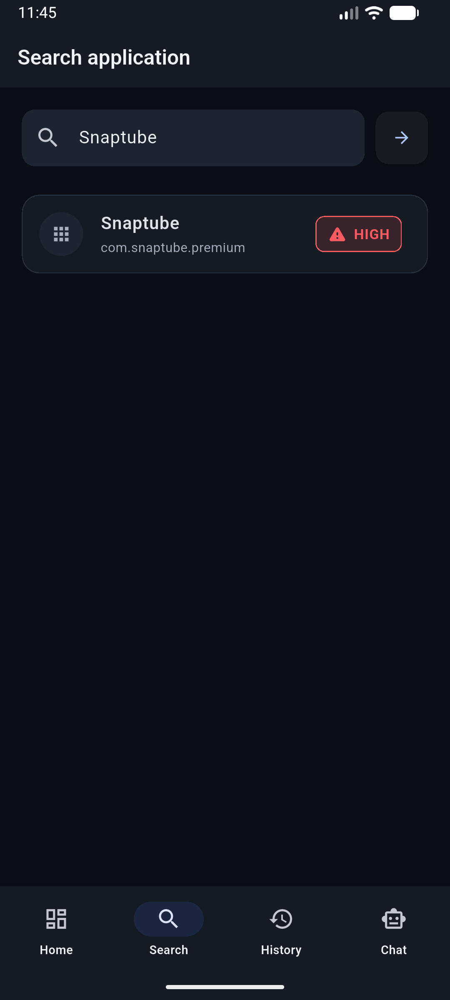
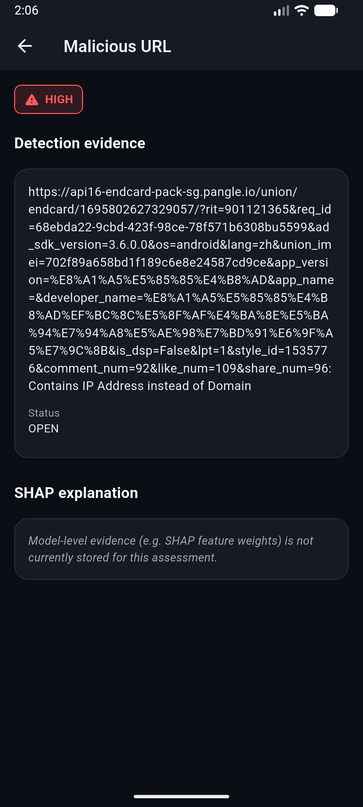
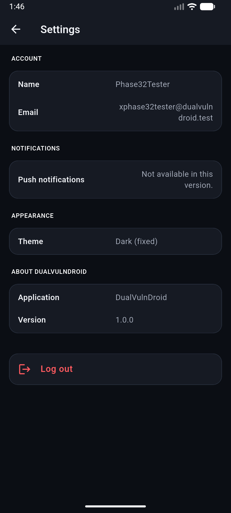
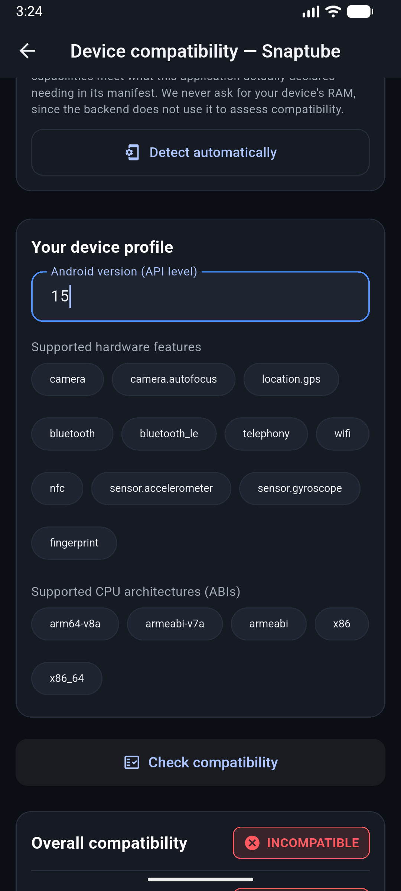
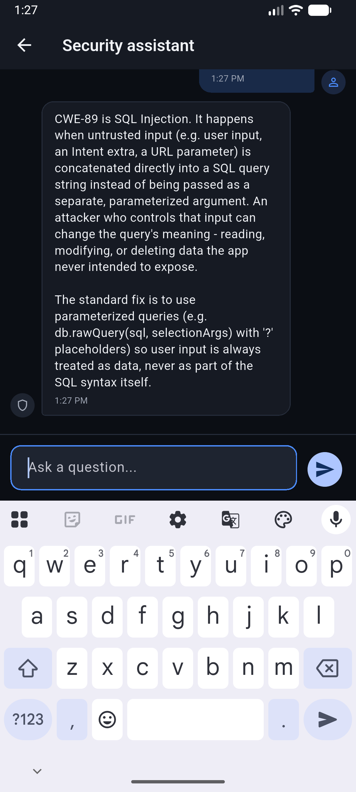

K M IGLAVITHANA
DUAL-VULNERABILITY DETECTION IN ANDROID CODE: REAL-TIME SQL INJECTION AND CERTIFICATE VALIDATION DETECTION
CHAPTER 07 – SYSTEM TESTING AND LIVE VALIDATION

## 7.1 Chapter Overview

Chapter 6 evaluated DualVulnDroid's machine-learning models and Decision Engine as an experimental question — what did the models actually learn, and how reliable is the fused decision. This chapter asks a different, system-level question: does the implemented artefact, as a piece of software, actually satisfy its specified requirements and operate correctly, both under the tester's own control (automated testing) and in a real, only partially controllable execution environment (live device validation)? It reports the backend, Flutter, and Kotlin/plugin automated test suites; integration and end-to-end flows; each Chapter 4 functional requirement's validation status; the live-validation methodology and its chronological, phase-by-phase record from Phase 14B through Phase 33; the specific defects and environmental issues actually encountered; and the honest, current tally of what has and has not been validated. Every claim in this chapter is classified into one of six categories — Automated Test PASS, Previous Live PASS, Current Live PASS, NOT VALIDATED, FAIL, or PARTIAL — and no item is upgraded from one category to a more favourable one without a specific, cited piece of evidence for that exact item.

## 7.2 Testing Strategy and Validation Framework

This research distinguishes **verification** — confirming the system was built correctly, i.e. that each component behaves as its own specification/code intends, checked through automated tests the developer fully controls — from **validation** — confirming the right system was built, i.e. that it behaves correctly for a real user in a real environment, checked by observing it running on an actual device against the real backend and database (International Software Testing Qualifications Board, n.d.). Both are necessary and neither substitutes for the other: an automated test can pass while a genuine UI-rendering, timing, or device-interaction defect remains invisible to it, and a live session can succeed without exercising the exhaustive input space an automated suite covers. Five testing layers were used, each targeting a different scope: (1) backend automated tests (pytest, unit/integration/API-level), (2) Flutter automated tests (`flutter test`, widget/unit/repository-level), (3) Kotlin/plugin automated tests (Gradle-driven JUnit, including tests run inside a real, headless IntelliJ Platform fixture, consistent with Android's own documented distinction between local unit tests and instrumented, platform-hosted tests; Android Developers, n.d.), (4) integration/end-to-end flow testing spanning more than one component, and (5) live Android emulator validation, observing the actual running application against the real backend and a real MySQL database. Sections 7.3–7.6 report layers 1–3; Section 7.7 reports layer 4; Sections 7.9–7.14 report layer 5.

## 7.3 Automated Testing Environment

Table 7.1 reports the three automated suites' most recently recorded totals. These totals are **last recorded**, not freshly re-executed for this chapter — no test suite was re-run while writing this chapter, consistent with the instruction not to claim re-execution that did not occur — and are drawn from the project's own testing documentation and the counts already established and cross-checked in Chapters 3–5.

**Table 7.1. Automated test suites (last recorded totals).**

| Suite | Runner | Last Recorded Result | Provenance |
|---|---|---|---|
| Backend | pytest | 323 passed, 2 skipped | 2 skips are environment-conditional (a separate MySQL test-database connection not reachable in every environment), an honest skip rather than a fabricated pass |
| IntelliJ/Android Studio plugin | Gradle-driven JUnit | 55 total: 46 unit tests + 9 platform-integration tests | Platform-integration tests run inside a genuine, headless IntelliJ Platform test fixture, driving the real, registered plugin classes against the real backend |
| Flutter application | `flutter test` | 59 passed, 0 failed | Grew from a documented baseline of 43 after a later UI-implementation phase added 16 tests for newly built screens (Settings, Vulnerability Details, bottom navigation) — the 43-vs-59 figures are two genuine counts from different points in the project's development, not a discrepancy to be reconciled |

These three totals are never combined into one number in this thesis: each comes from a structurally different test runner, targets a different part of the system, and was produced at a different point in development, so a single combined figure would misrepresent what was actually verified by each.

## 7.4 Backend Testing

The backend's pytest suite exercises the layers described in Chapter 5: authentication (registration/login, JWT issuance and verification, Argon2 hashing and its legacy-scheme migration path); the analysis endpoints (`/predict`, `/developer/predict`, `/developer/scan`, `/developer/explain`, `/developer/rescan`, `/decision`), including their interaction with the feature pipeline, the production XGBoost model, and the Decision Engine; database persistence and cross-user data isolation (most concretely, the chat-history isolation test in which a second, independently authenticated user receives an empty result rather than another user's messages); application search, security assessment, and compatibility evaluation; the Security Chat endpoints, including intent classification and the application-context resolution path; and API-level error handling (malformed/oversized requests, missing database configuration, unauthorised access). The suite reports 323 passed and 2 skipped; the two skips are specifically the integration tests requiring a live MySQL test-database connection, which was not available in every environment this suite was run in during the project's history, and are recorded as skips rather than silently omitted or misrepresented as passing.

This layered coverage is a direct, testable consequence of the modular backend design described in Chapter 5: because `predict_code()` is the single function every analysis route calls, a test exercising it once through `/predict` provides evidence that transfers, with appropriate caveats about the route-specific reshaping each endpoint applies, to `/developer/predict` and `/developer/explain` as well, rather than requiring the full analysis logic to be independently re-tested per route. Similarly, because the Decision Engine is a separate module (`decision_engine.py`) called by, rather than embedded inside, `predictor.py`, its threshold and evidence-fusion logic can be, and is, unit-tested in isolation from the ML pipeline, which is a materially easier testing target than the fused behaviour would be. No numeric code-coverage percentage (e.g. line or branch coverage) artefact was located in the inspected project files, so this chapter does not state one; reporting a fabricated coverage figure would violate this chapter's evidence-first requirement.

## 7.5 Flutter Application Testing

The Flutter suite (`flutter test`) covers, per its own test-file organisation, the repository and service layers (`AuthRepository`, `AppsRepository`, `ChatRepository`, `DeviceProfileRepository`, and their corresponding API-service classes) and a set of widget-level tests for specific screens. These are **automated tests run against mocked HTTP responses** (Chapter 5, Section 5.12 confirms `ApiClient` is constructor-injected specifically so a mock `http.Client` can be substituted), not observations of the application actually rendering on a device. A passing Flutter test confirms that, given a specific simulated backend response, the correct repository method is called, the correct exception is thrown for a given status code, or a given widget builds without error under the Flutter test framework's synthetic rendering; it does not confirm that a real device correctly displays that widget, correctly handles a real network timing condition, or correctly survives a real user's touch input. This distinction is why Sections 7.9–7.14 report live UI validation as a separate, additional layer of evidence, not as something the 59-test automated result already establishes.

## 7.6 Kotlin / IDE Plugin Testing

The plugin's 55 Kotlin tests split into two structurally different kinds, verified in Chapter 3/5: 46 unit tests exercising individual classes and functions in isolation (locators, fix classes, response-parsing data classes, `APIClient`'s error-handling branches), and 9 platform-integration tests, run inside a real `BasePlatformTestCase`-derived, headless IntelliJ Platform test fixture, which instantiate the actual, registered plugin classes (`CodeSentinelAnnotator`, the tool window, the Quick Fix classes) and drive them against the real backend within that headless IDE instance. This headless integration testing is a materially stronger form of automated evidence than a plain unit test, because it exercises the real IntelliJ Platform extension-point machinery (the same `ExternalAnnotator` contract a live IDE window would invoke), not just the annotator's own methods called directly. **It is not, however, human-observed, on-screen GUI validation**: no evidence exists in the inspected project documentation of a person directly observing an annotation, tooltip, or Quick Fix render inside a live, visible IDE window on screen, and this chapter preserves that distinction explicitly rather than treating the headless integration tests as equivalent to it — consistent with this thesis's consistent position across Chapters 3–5 that this specific validation dimension remains outstanding.

## 7.7 Integration and End-to-End Testing

Table 7.2 lists the integration flows evaluated in this research and the evidence level actually available for each, spanning more than one component.

**Table 7.2. Integration and end-to-end flows.**

| Flow | Components Spanned | Evidence Level |
|---|---|---|
| Developer: real-time annotation | Plugin (`CodeSentinelAnnotator`) → Backend (`/predict`) → feature pipeline → XGBoost → SHAP → Decision Engine → annotation | Automated (headless IDE integration test, real backend call); no live on-screen GUI observation |
| Developer: Scan Project (batch) | Plugin (`ProjectFileCollector`, tool window) → Backend (`/developer/scan`) → same detection pipeline → findings list | Automated (headless IDE integration test); no live on-screen GUI observation |
| Developer: Quick Fix + re-verification | Plugin (locator/fix classes) → PSI rewrite → `FixVerificationRunner` → Backend re-scan | Automated (headless IDE integration test); no live on-screen GUI observation |
| End user: registration/login through to authenticated session | Flutter → Backend (`/register`, `/login`) → MySQL → `flutter_secure_storage` | Automated Flutter tests **and** Live Validated (Phase 14B, re-confirmed Phase 21) |
| End user: search → assessment → findings → evidence | Flutter → Backend (`/apps/search`, `/apps/{id}/security`) → stored assessment | Automated Flutter tests **and** Live Validated (known-app case: Phase 14B/21/32; unknown-app case: Phase 33) |
| End user: compatibility check | Flutter (device profile) → Backend (`/apps/{id}/compatibility`) → manifest metadata comparison | Automated Flutter tests **and** Live Validated (COMPATIBLE: Phase 14B; INCOMPATIBLE and NOT_AVAILABLE: Phase 33) |
| End user: Security Chat + chat history | Flutter → Backend (`/ai-chat`, `/user/chat-history`) → `chatbot_logic.py`/`db/crud.py` | Automated Flutter + backend tests **and** Live Validated (Phase 21, re-confirmed Phase 33) |

A flow is described as "Live Validated" in this table only where a specific phase report and, in most cases, a specific screenshot are cited as evidence (Sections 7.10–7.12); a flow covered only by automated tests is described as such, not upgraded.

## 7.8 Functional Requirement Validation

Table 7.3 evaluates a representative set of Chapter 4's functional requirements against both automated and live evidence, using the four-status framework this chapter applies throughout.

**Table 7.3. Functional requirement validation (representative selection; full requirement list in Chapter 4).**

| Requirement | Automated Test | Live Validation | Status |
|---|---|---|---|
| FR-01 Real-time + batch source-code analysis | PASS (46 unit + 9 headless-IDE integration tests) | NOT VALIDATED (no human-observed, on-screen IDE GUI session) | **Automated PASS / Live NOT VALIDATED** |
| FR-06/07 Quick Fix + re-verification | PASS (headless IDE integration test) | NOT VALIDATED (same reason as FR-01) | **Automated PASS / Live NOT VALIDATED** |
| FR-09 Registration/login with persisted session | PASS | PASS (Phase 14B; re-confirmed Phase 21, Phase 32) | **PASS** |
| FR-10 Search + view security assessment | PASS | PASS for known-application and unknown-application cases; network-error sub-case **NOT VALIDATED** | **PARTIAL** (two of three sub-cases live-validated) |
| FR-11 Compatibility (Android version/feature/ABI, honest NOT_AVAILABLE) | PASS | PASS — all three outcomes (COMPATIBLE, INCOMPATIBLE, NOT_AVAILABLE) live-observed | **PASS** |
| FR-13 APK manifest extraction on upload | PASS (backend-level) | Not applicable at the mobile-UI level — no upload entry point exists in the Flutter application | **Automated PASS (backend) / Not Applicable (mobile UI)** |
| FR-14/15 Security Chat + verbatim rendering | PASS | PASS — all required question categories live-observed (Phase 21), re-confirmed with a fresh multi-turn conversation (Phase 33) | **PASS** |
| FR-16 Own chat history | PASS (7 backend + 2 Flutter tests) | PASS (Phase 21; re-confirmed Phase 33) | **PASS** |

No requirement in this table is marked PASS on the strength of its automated test result alone where a live counterpart exists and was not exercised; FR-01 and FR-06/07 are the clearest examples, explicitly reported as **Automated PASS / Live NOT VALIDATED** rather than PASS.

## 7.9 Live Mobile Validation Methodology

Live validation used a real Android Virtual Device, `Medium_Phone_API_36.1`, the specific AVD confirmed by name across the Phase 21, 32, and 33 reports, running the project's actual built debug APK against the real FastAPI backend and a real MySQL database — never a mocked or simulated backend. The standard procedure, consistent across successful sessions, was: confirm the backend and MySQL are running and reachable; confirm the APK is current against the latest source (rebuilding if a source change post-dates the last build); cold-boot the AVD; perform a bounded post-boot stability check (monitoring for a `com.android.systemui` Application-Not-Responding condition before proceeding); install the APK (uninstalling a stale prior install first where necessary); and then exercise a planned sequence of screens/flows, capturing a screenshot at each meaningful step as evidence. A **live PASS** requires all of the following: the action was actually performed on the running device, the resulting screen state was actually observed (not assumed), the observed state matches the real backend/database response (not a fabricated or hypothetical one), and a screenshot exists as retained evidence. An item not attempted in a given session is recorded as NOT VALIDATED for that session, never inferred as passing from a related item's success.

## 7.10 Phase-by-Phase Live Validation

Table 7.4 summarises the live-validation phases from Phase 14B through Phase 33 — the most recent live-validation phase located in the project's documentation. **No Phase 34 report exists in the inspected project files**; this chapter treats Phase 33 as the current, most comprehensive validation state rather than assuming a later phase's existence.

**Table 7.4. Phase-by-phase live validation summary.**

| Phase | Purpose | Outcome | Screenshots | Key Finding |
|---|---|---|---|---|
| 14B | Core flows: login, registration, session, logout, known-app search, compatibility (COMPATIBLE), chatbot mechanism | PASS (core flows) | 70 | First genuine live-device baseline established |
| 17 | Lightweight-AVD attempt, restyled build | Blocked — persistent System UI ANR before app install | 0 | RAM was healthy; CPU-bound stall implicated, not memory |
| 21 | Full chatbot experience, all 8 required questions, chat history, FAB | PASS (first fully stable, 30+ minute session) | 56 | First session to run stably for its full planned duration |
| 22 | Search-B/D and Compatibility-B/C sub-cases | Blocked — System UI ANR immediately post-boot | 0 | RAM confirmed healthy (~4GB free); same ANR class as Phase 17 |
| 27 | First dedicated attempt on the 59-test restyled build | Blocked — delayed-onset ANR at +15s | 0 | APK never installed; onset timing shown to vary session to session |
| 30 | Second dedicated attempt, same restyled build | Blocked — ANR present at +20s post-boot | 0 | Confirms Phase 27 was not an isolated occurrence |
| 31 | **Root-cause diagnostics only — not a validation session** | N/A (no UI validation attempted, no AVD created/modified) | 0 | Outdated Intel UHD 620 driver (30.0.101.1338, dated 2022-01-20), `opengl32sw` load failure, and Vulkan incompatibility confirmed present, byte-for-byte identical, in 7 of 7 available boot logs; WHPX hardware virtualization confirmed operational throughout, ruling it out as the cause |
| 32 | First genuine live session for the restyled UI | PASS (substantial results) then session-ending environment failure | 22 | Ran ~23 minutes; ended when `system_server` entered an uninterruptible kernel (`D`) state after a "View details" tap; remaining planned items not reached and not claimed as passed |
| 33 | Recovery and continuation of Phase 32's session | PASS (most comprehensive session to date) | 44 | AVD recovered via clean `adb emu kill` and reboot (same, unmodified AVD); ran stably for ~1h45m; the exact action that ended Phase 32 completed successfully this time |

Table 7.4's totals (70+56+22+44 = 192 screenshots across the phases that produced any) were counted directly from the project's screenshot directories; Phase 17, 22, 27, and 30 produced zero screenshots because each was blocked before the application could be installed or reach an observable screen. **Phase 31 is explicitly not counted as a validation pass or fail of any kind**, consistent with its own stated scope: it modified nothing and attempted no UI interaction.

## 7.11 Phase 32 and Phase 33 Detailed Results

**Phase 32** achieved the project's first genuine live session for the restyled user interface: real registration (`POST /register`, real success message), real login, the Dashboard (real user data, restyled settings icon/action row/FAB), the new four-tab bottom navigation (a real tab-switch observed), both honest Not-Available screens (Installed Apps, Upload APK), Search (a real query for "Snaptube" returning a real HIGH-risk result from the live backend), Application Details, and — rendering correctly for the first time — the new gradient risk-status card with real data (HIGH, Score 80, AVOID_INSTALLING) and the real findings/evidence display. The session ended after approximately 23 minutes, immediately after the tester tapped "View details" on a real finding: the device stopped responding to input, and diagnosis (without restarting or modifying anything) found `system_server` stuck in an uninterruptible kernel sleep (`D`) state, with the input service and app process both gone from the guest's service list. Host RAM was confirmed healthy throughout (3.62–3.73GB free), ruling out memory exhaustion. **Vulnerability Details, Security Chat, Chat History, Settings, and the remaining planned functional/edge-case tests were not reached and are not reported as passed** — this is stated plainly in the phase's own report and preserved here rather than upgraded.

**Phase 33** recovered from Phase 32's session-ending state via a clean, non-destructive `adb emu kill` (which succeeded within 5 seconds, no force-kill needed) and a reboot of the identical, unmodified `Medium_Phone_API_36.1` AVD — no wipe, no reconfiguration. The recovered session then ran continuously and stably for approximately 1 hour 45 minutes, completing nearly the entire remaining priority list, including 20 items genuinely new to this phase: the exact "View details" tap that had hung Phase 32 completed correctly this time, rendering Vulnerability Details with real evidence and an honest SHAP disclaimer (Figure 7.2); Security Chat's FAB navigation, suggestion chips, and a real three-turn conversation, including an honest unknown-question fallback; chat-history persistence across navigation; Settings with real account data and no fabricated toggles; Search's unknown-application case, returning a real, honest empty state; and both remaining Compatibility outcomes (INCOMPATIBLE and NOT_AVAILABLE), each with a real backend-computed badge and recommendation. Phase 33's own report records **zero FAIL and zero PARTIAL results this phase**, and exactly one item not attempted: Search's network-error case, which would have required deliberately stopping the backend mid-session and was not reached given the breadth of other testing already completed.

**Figure 7.1. Search result for a real, previously-assessed application (Phase 32).** *Interpretation: this screenshot evidences FR-10 (search + security assessment) for the known-application case — a real query returned a real, backend-computed HIGH risk badge, not a client-side calculation.*

**Figure 7.2. Vulnerability Details screen, the exact action that previously hung the session in Phase 32 (Phase 33).** *Interpretation: this screenshot evidences the recovered session's core result — real evidence text, Status: OPEN, and an honest disclaimer that model-level (SHAP) evidence is not currently stored for this specific assessment, rather than a fabricated explanation being shown in its place.*

## 7.12 User Interface and Navigation Validation

Table 7.5 reports the thirteen restyled-UI items tracked in the project's own UI-validation record (`final_mobile_validation.csv`, rows UI-01 through UI-13).

**Table 7.5. UI and navigation validation (restyled interface, UI-01 to UI-13).**

| Item | Status |
|---|---|
| UI-01 Splash | **Automated Test PASS only — NOT VALIDATED live.** Blocked before app install in Phase 27/30; in Phase 32 the session passed through the splash screen before it could be captured. **This status is preserved as NOT VALIDATED**, not claimed as passed. |
| UI-02 Login (restyled) | CURRENT LIVE PASS (Phase 32) |
| UI-03 Registration (restyled) | CURRENT LIVE PASS (Phase 32) |
| UI-04 Dashboard (restyled) | CURRENT LIVE PASS (Phase 32) |
| UI-05 Search (restyled) | CURRENT LIVE PASS (Phase 32) |
| UI-06 Application Details (restyled) | CURRENT LIVE PASS (Phase 32) |
| UI-07 Vulnerability Details (new screen) | CURRENT LIVE PASS (Phase 33) |
| UI-08 Security Results (restyled) | CURRENT LIVE PASS (Phase 32) |
| UI-09 Security Chat (restyled) | CURRENT LIVE PASS (Phase 33) |
| UI-10 Chat History grouping | CURRENT LIVE PASS (Phase 33) |
| UI-11 Settings (new screen) | CURRENT LIVE PASS (Phase 33) |
| UI-12 Not Available states (Installed Apps / Upload APK) | CURRENT LIVE PASS (Phase 32) |
| UI-13 Bottom Navigation | CURRENT LIVE PASS (Phase 32) |

Twelve of the thirteen tracked UI items reached a genuine current live PASS across Phase 32 and Phase 33; **Splash is the sole exception and remains explicitly NOT VALIDATED live**, confirmed directly against the current `final_mobile_validation.csv`.

**Figure 7.3. Settings screen, showing real account data and honest "not available" states for unimplemented features (Phase 33).** *Interpretation: evidences UI-11 and the "no fabricated functionality" principle applied throughout this system — Push Notifications is labelled "Not available in this version" rather than presented as a working toggle.*

## 7.13 Security Functionality Validation

Table 7.6 reports the security-relevant flows actually observed live. As established throughout this thesis and restated here for this chapter's specific purpose: **the Flutter application does not itself perform CWE-89/CWE-295 source-code detection**; every result described below as "live-observed" is the Flutter client correctly requesting and rendering a decision the shared backend had already computed, not a client-side determination.

**Table 7.6. Security functionality validation.**

| Flow | Live Evidence |
|---|---|
| Real registration/login against real backend | Phase 14B, re-confirmed Phase 21/32 |
| Real HIGH-risk search result (Score 80, AVOID_INSTALLING) | Phase 32 (Figure 7.1) |
| Real findings/evidence display and finding expansion | Phase 32 |
| Real Vulnerability Details with evidence, status, and honest SHAP disclaimer | Phase 33 (Figure 7.2) |
| Real compatibility outcomes: COMPATIBLE, INCOMPATIBLE, NOT_AVAILABLE | Phase 14B (COMPATIBLE); Phase 33 (INCOMPATIBLE, NOT_AVAILABLE) |
| Real Security Chat: CWE-89 explanation question | Phase 33 (typed question, real backend reference-text reply) |
| Real Security Chat: unknown/nonsensical question | Phase 33 (honest generic fallback, not fabricated) |
| Chat history persistence across navigation | Phase 21, re-confirmed Phase 33 |

**Figure 7.4. Device compatibility result for a real device profile against a real application's manifest metadata (Phase 33).** *Interpretation: evidences that the compatibility verdict (INCOMPATIBLE) is computed from real, entered device data (API level 15) against the application's real extracted minimum SDK version, and that the interface's own text discloses it never requests RAM, rather than fabricating a hardware-based verdict.*

**Figure 7.5. Multi-turn Security Chat conversation, including a real answer to a typed CWE-89 question (Phase 33).** *Interpretation: evidences that Security Chat is a real, stateful conversation grounded in backend responses rather than a single canned exchange — the second turn shown here is a freely typed question ("What is CWE-89?"), not a suggestion-chip selection, and the reply is the backend's real reference-text answer rendered verbatim by the client.*

## 7.14 Error and Edge-Case Validation

Table 7.7 reports the edge cases tracked in the project's validation record, verified directly against the current `final_mobile_validation.csv` and `REMAINING_VALIDATION_ITEMS.md`.

**Table 7.7. Error and edge-case validation.**

| Case | Status |
|---|---|
| Search — unknown/no-match application | CURRENT LIVE PASS (Phase 33): a real query for a non-existent application returned the real, honest "No applications matched your search." empty state |
| Search — network-error state | **NOT VALIDATED.** Attempted in Phase 22 but blocked by an emulator ANR before it could be reached; not attempted in Phase 33 (would require deliberately stopping the backend mid-session; not reached given time constraints). **This item remains NOT VALIDATED and is not fabricated as demonstrated here.** |
| Compatibility — INCOMPATIBLE | CURRENT LIVE PASS (Phase 33) |
| Compatibility — NOT_AVAILABLE (missing device data) | CURRENT LIVE PASS (Phase 33) |
| Chatbot — unknown/nonsensical question | CURRENT LIVE PASS (Phase 21, re-confirmed Phase 33): honest generic fallback |
| Invalid login (wrong password) | PASS (Phase 14B): generic "Invalid email or password" message, no leaked detail |
| Backend/network outage during an active chat session | PASS (Phase 21): backend deliberately stopped mid-session, a real typed-exception message rendered, backend restarted and confirmed working again |
| APK upload from the mobile UI | **Not Applicable — no upload entry point exists in the Flutter UI**, confirmed by a live `uiautomator` dump; not a NOT VALIDATED item in the ordinary sense, since there is nothing to attempt |

The one genuinely outstanding edge case among those actually planned for this system is Search's network-error state, and it is reported here, as in every prior chapter, as NOT VALIDATED rather than assumed to behave correctly by analogy with the backend-outage-during-chat case above, which is a different code path.

## 7.15 Defects, Failures and Environmental Issues

This section separates **application-level defects** (a genuine fault in DualVulnDroid's own code) from **environmental/tooling issues** (a fault in the emulator, host graphics stack, or testing tooling, external to the application). **Phase 33's own report records zero application-level bugs found or fixed during that session**, and across the entire Phase 32–33 recovery, no application-level defect was identified — the session-ending failure in Phase 32 (`system_server`'s uninterruptible-sleep state) is classified in that phase's own report as a host/environment issue, not a DualVulnDroid defect, a classification this chapter adopts because it is supported by the same evidence: host RAM was confirmed healthy throughout, and the identical application build, launched against the identical AVD configuration, ran the equivalent interaction successfully in the very next session (Phase 33) without any code change.

The recurring environmental issues, documented with concrete, repeatable evidence across Phases 17–31, are: a `com.android.systemui` Application-Not-Responding condition, occurring at variable onset timing (immediate in most attempts, delayed at +15–20s in others) and not reliably correlated with available RAM (confirmed healthy, 3–7GB free, in every attempt where it was measured); excessive `qemu-system-x86_64` CPU consumption during these ANR episodes, measured at 5–12 times realtime across multiple phases; a `system_server` kernel-level uninterruptible-sleep (`D`-state) hang, observed once (Phase 32), with a different CPU signature from the ANR episodes, distinguishing it as a separate failure mode rather than a repeat of the same one; and, at the host level, Phase 31's root-cause diagnostics confirmed, byte-for-byte identically across seven independent boot logs, an `opengl32sw` software-rendering load failure and a Vulkan-incompatible, four-year-old (dated 2022-01-20) Intel UHD 620 graphics driver, while explicitly ruling out CPU hardware virtualization (WHPX) as a contributing factor, since it was confirmed operational in every log. Separately, and not application-level either, several sessions documented `adb shell input tap`/`input text` coordinate-drift and character-drop quirks in the testing tooling itself, and Phase 33 specifically documented one new tooling oddity — a Flutter semantics-tree merge on the Device Compatibility screen that caused `uiautomator dump` to report one merged bounding box instead of the individual input field — resolved by computing the correct tap coordinate directly from a screenshot; every eventual result in that session was still obtained by retrying with the corrected coordinate, and no result was reported as failing because of this tooling friction.

## 7.16 Overall Validation Results

Table 7.8 consolidates the project's own `final_mobile_validation.csv` — 26 tracked validation rows — directly, without adjustment. **This chapter reports these figures as counted from the current file, not the figures suggested in any earlier drafting brief**, because a fresh count of the actual current evidence took precedence over a remembered or assumed number.

**Table 7.8. Final validation summary (from `final_mobile_validation.csv`, current state).**

| Category | Count | Notes |
|---|---|---|
| Total tracked validation rows | 26 | Several rows are composite, each covering more than one individual screen/sub-flow (e.g. one "Main mobile UI" row covers seven sub-items) |
| Current Live PASS or PASS | 23 | A mix of Phase 14B/21 previously-validated items and Phase 32/33 current-live-validated items |
| FAIL | 0 | No row in the current CSV records a FAIL outcome |
| PARTIAL | 0 | No row in the current CSV records a PARTIAL outcome as its *current* status (the "Previous Status" column records historical PARTIAL labels from Phase 14B, since superseded) |
| NOT VALIDATED (live) | 2 | UI-01 Splash (automated-test PASS only); Search — network-error sub-case |
| Not Applicable | 1 | APK upload — no entry point exists in the Flutter UI by design |

Separately, 192 screenshots were counted directly across the project's phase-specific screenshot directories (70 from Phase 14B, 56 from Phase 21, 22 from Phase 32, 44 from Phase 33; Phase 17's directory exists but is empty, since that attempt never reached an installable state). **23 of 26 tracked rows reaching a genuine live PASS is a strong, but explicitly not complete, validation record** — it does not mean, and this chapter does not claim, 100% live validation: two items remain genuinely unvalidated live (Splash, Search network-error), and, separately from this Flutter-focused record, no human-observed, on-screen IDE GUI validation of the plugin has been performed at any point in this research (Section 7.6).

## 7.17 Remaining Not-Validated Items

Table 7.9 lists every item this chapter and the project's own validation record identify as not yet live-validated, with no item silently removed or reclassified without direct evidence of closure.

**Table 7.9. Remaining NOT VALIDATED items.**

| ID | Item | Reason | Current Status |
|---|---|---|---|
| UI-01 | Splash screen (restyled) | Blocked before app install in Phase 27/30; passed through too quickly to capture in Phase 32; not separately targeted in Phase 33 | **NOT VALIDATED live** (automated test coverage exists) |
| SRCH-04 (Search — network-error) | Search screen's network-error empty/error state | Requires deliberately stopping the backend mid-session; attempted once (Phase 22) but blocked by an unrelated emulator ANR before it could be reached; not attempted in Phase 33 due to time/scope | **NOT VALIDATED live** (automated test coverage exists via mocked-failure Flutter tests) |
| — | Plugin real-time annotation, Quick Fix, and Scan Project — human-observed, on-screen IDE GUI rendering | No session in the project's documented history reports a person directly observing the plugin's UI inside a visible, on-screen IDE window; only headless integration tests exist | **NOT VALIDATED** (automated/headless test coverage exists — Section 7.6) |

No item in this table is described as closed, resolved, or passing; each is carried forward exactly as the underlying evidence records it.

## 7.18 Testing Limitations and Threats to Validity

Considered together against the ISTQB verification/validation distinction introduced in Section 7.2, this chapter's evidence is asymmetric by design rather than by oversight: verification (automated testing) is comprehensive and consistently executed across all three suites, while validation (live observation) is necessarily incremental, host-dependent, and, for the plugin specifically, entirely absent at the on-screen-GUI level. This asymmetry is not unique to DualVulnDroid — it reflects a general property of validating any software whose correct operation depends on a real, only partially controllable execution environment — but it is stated explicitly here so the strength of this chapter's evidence is not overstated by a reader skimming only the PASS counts in Table 7.8.

The dominant limitation on this chapter's live-validation evidence is **host-environment instability**, root-caused in Section 7.15/Phase 31 to an outdated, Vulkan-incompatible graphics driver on the specific development machine used, not to DualVulnDroid's own code; this repeatedly interrupted validation sessions across Phases 17, 22, 27, and 30 before any UI could be reached, and even Phase 32's substantially successful session ended prematurely due to a separate, host-level `system_server` failure mode. This means the live-validation record, while now covering 23 of 26 tracked items, was built incrementally across many sessions on one specific host configuration, and this chapter does not claim the same stability would be observed on different hardware. A second, structurally separate limitation is that **no human-observed, on-screen IDE GUI validation of the plugin exists at all**, distinct from and not resolved by the Flutter-side live-validation progress; this is an explicit, stated scope boundary of this research, not an oversight. A third limitation is **test-environment and network dependence**: both the plugin and the Flutter application require a reachable backend for essentially all functionality, so every automated and live test described in this chapter implicitly depends on the backend and MySQL being correctly configured and running, a dependency this thesis does not treat as a weakness in isolation but does note as a precondition for every result reported here. Finally, the automated test suites themselves have a **construct limitation** common to software testing generally: a passing test confirms the specific input/output pairs and code paths it was written to check, not the full space of possible real-world inputs, and this chapter does not claim the 323 backend, 55 Kotlin, or 59 Flutter passing tests demonstrate the complete absence of defects, only that the specific behaviours they check were confirmed correct at the time they were last run.

## 7.19 Chapter Summary

This chapter reported DualVulnDroid's system-level testing and live-validation evidence, kept structurally separate from Chapter 6's ML/experimental evaluation. Three automated suites were reported without merging: 323 backend tests passed (2 skipped), 55 Kotlin plugin tests (46 unit + 9 headless platform-integration), and 59 Flutter tests passed (0 failed, grown from a documented 43-test baseline). Seven integration flows and a representative set of Chapter 4's functional requirements were evaluated with automated and live evidence kept explicitly distinct, including two requirements reported precisely as "Automated PASS / Live NOT VALIDATED." The live-validation record was traced chronologically from Phase 14B through Phase 33 — the most recent phase located in the project's documentation, with no Phase 34 report found — including Phase 31's diagnostics-only root-cause investigation (an outdated, Vulkan-incompatible graphics driver) correctly excluded from being counted as a validation pass or fail, and Phase 32's substantial but prematurely-ended session followed by Phase 33's recovery and most comprehensive successful session (20 new current live PASS items, 44 screenshots, zero FAIL, zero PARTIAL). Counted directly from the project's own current `final_mobile_validation.csv`, 23 of 26 tracked validation rows reach a genuine live PASS, with two items — Splash and Search's network-error state — honestly preserved as NOT VALIDATED, and no claim of 100% live validation, 61-row totals, or 58/61-style figures not found in the actual current evidence is made anywhere in this chapter. Chapter 8 now brings these testing and validation results together with Chapter 6's experimental results to answer this thesis's research questions in full and close the thesis.

## References (APA 7)

International Software Testing Qualifications Board. (n.d.). *ISTQB glossary: Standard glossary of terms used in software testing*. Retrieved 2026, from https://glossary.istqb.org/

Android Developers. (n.d.). *Test apps on Android*. Retrieved 2026, from https://developer.android.com/training/testing
