%%TITLEPAGEBLOCK%%
DUAL-VULNERABILITY DETECTION IN ANDROID CODE: REAL-TIME SQL INJECTION AND CERTIFICATE VALIDATION DETECTION

Design and Evaluation of a Hybrid Vulnerability Detection Approach for CWE-89 and CWE-295 in Android Code

DualVulnDroid

K M Iglavithana

A thesis submitted in partial fulfilment of the requirements for the degree of BSc (Hons) in Software Engineering

2026
%%ENDTITLEPAGEBLOCK%%


# ABSTRACT

Android applications continue to ship with recurring, well-documented source-code weaknesses, of which SQL Injection (CWE-89) and Improper Certificate Validation (CWE-295) recur with particular frequency. Existing detection approaches tend to address these two categories separately, rarely fuse machine-learning prediction with deterministic static/data-flow evidence into one measured decision, integrate explainability inconsistently, and, with limited exception, do not extend a comparable, comprehension-appropriate assessment from the developer to the end user of an already-published application. This research asks to what extent a hybrid approach combining machine-learning classification with static and data-flow evidence can detect CWE-89 and CWE-295 in Android source code, and be delivered as explainable, decision-supported feedback through both a real-time IDE plugin and a backend-mediated end-user assessment interface.

Following a Design Science Research approach for artefact development, combined with a controlled experimental methodology for the machine-learning component, DualVulnDroid was designed, implemented, and evaluated. A 7,610-dimensional hybrid feature representation (TF-IDF text features plus 23 deterministic security/data-flow features) was constructed from a leakage-checked, 1,128-row cleaned dataset (split 791/169/168 under a fixed seed), and used to train and compare five models under one identical protocol: Linear SVM, Random Forest, and XGBoost as classical baselines, and LSTM and CodeBERT as supplementary deep-learning/Transformer comparisons. No model dominated every metric: XGBoost, selected as the production classifier, achieved the best macro F1 (0.7874) and lowest false-positive rate; Linear SVM achieved the best false-negative rate and ROC-AUC; CodeBERT achieved the lowest CWE-89 false-negative rate on the project's documented-authoritative evaluation artefact, a result reported alongside an unresolved provenance conflict between competing project artefacts rather than silently settled. A Hybrid Decision Engine fusing the production model's prediction with static/data-flow evidence and SHAP-based explanation was evaluated as a measured coverage/reliability trade-off: its deployed configuration auto-decides 32.74% of cases at a 3.03% false-negative rate, while a higher-coverage alternative (88.69%) was correctly not deployed on evidence of cross-split instability.

The resulting system comprises a real-time IntelliJ/Android Studio plugin, providing in-editor annotation and narrowly-scoped, re-verified remediation, and a backend-mediated Flutter application providing application search, security assessment, device-compatibility checking, and a grounded Security Chat — the Flutter client performs no source-code analysis of its own. System testing separated automated verification (323 backend, 55 Kotlin, and 59 Flutter tests) from live-device validation: 23 of 26 tracked validation items reached a genuine live PASS across a phased validation record culminating in a comprehensive session, with two items — a splash screen and a search network-error state — honestly preserved as not yet validated, alongside a plugin GUI-validation gap that likewise remains open. The evidence gathered demonstrates that a hybrid ML-and-evidence approach can be built, measured, and honestly evaluated as an integrated developer- and end-user-facing system; it does not demonstrate complete, error-free detection, and this thesis does not claim otherwise. Limitations — dataset size and composition, the absence of a true application-level split, an HTTP-only evaluated transport configuration, and the specific unresolved and not-yet-validated items above — are reported explicitly, together with concrete recommendations and a future-work roadmap.


# KEYWORDS

Android application security; SQL Injection; CWE-89; Improper Certificate Validation; CWE-295; static and data-flow analysis; machine learning; XGBoost; explainable AI; SHAP; Hybrid Decision Engine; IntelliJ plugin; Flutter; software testing; live validation.


# TABLE OF CONTENTS

%%TOCFIELD%%


# LIST OF FIGURES

Figure 4.1 — Overall system architecture
Figure 4.2 — Developer-facing security analysis flow
Figure 4.3 — Machine learning pipeline design
Figure 4.4 — Hybrid Decision Engine design
Figure 4.5 — Database entity-relationship design
Figure 4.6 — Flutter application architecture
Figure 5.1 — Backend prediction implementation flow
Figure 5.2 — Machine learning feature-to-prediction implementation flow
Figure 5.3 — SHAP and Decision Engine implementation flow
Figure 5.4 — Developer-to-backend communication and finding workflow
Figure 5.5 — Flutter-to-backend communication implementation
Figure 5.6 — Chat history retrieval implementation flow
Figure 6.1 — Classical model comparison (verified project artefact)
Figure 6.2 — Five-model Macro F1 and FNR comparison (generated for this chapter from the verified table above)
Figure 6.3 — Decision Engine threshold sensitivity: coverage vs. FNR across the evaluated threshold grid (verified project artefact)


# LIST OF TABLES

Table 2.1 — Comparative analysis of reviewed vulnerability-detection approaches
Table 2.2 — Research objectives and their literature justification
Table 3.1 — Research design stages and their objective mapping
Table 3.2 — Dataset preparation summary
Table 3.3 — Feature dimensionality
Table 3.4 — Classical model configurations
Table 3.5 — Automated test suite totals (most recently verified)
Table 3.6 — Live validation phase history
Table 3.7 — Evaluation metrics used in this research
Table 3.8 — Research objectives, methods, and evaluation traceability
Table 4.1 — Functional requirements
Table 4.2 — Non-functional requirements
Table 4.3 — Use case summary
Table 4.6 — Requirements-to-design traceability matrix
Table 4.7 — Automated test suite totals referenced above
Table 5.1 — Technology stack by layer
Table 5.2 — Implementation verification and traceability
Table 5.3 — Research objective to implemented artefact
Table 6.1 — Dataset composition (verified against `dataset_report.json`)
Table 6.2 — Feature representation summary
Table 6.3 — Classical model results (frozen 168-row test set)
Table 6.4 — LSTM results (frozen 168-row test set)
Table 6.5 — CodeBERT artefact provenance table
Table 6.6 — Five-model comparative evaluation (frozen 168-row test set)
Table 6.10 — CWE-89 confusion breakdown (test set: 29 vulnerable, 25 safe)
Table 6.7 — Hybrid Decision Engine evaluation (168-row frozen test set)
Table 6.11 — Balanced-candidate threshold selection and outcome across five independent seeds
Table 6.8 — Measured inference/response latency (development-machine measurements; not a production SLA)
Table 6.9 — Research objective evaluation
Table 7.1 — Automated test suites (last recorded totals)
Table 7.2 — Integration and end-to-end flows
Table 7.3 — Functional requirement validation (representative selection; full requirement list in Chapter 4)
Table 7.4 — Phase-by-phase live validation summary
Table 7.5 — UI and navigation validation (restyled interface, UI-01 to UI-13)
Table 7.6 — Security functionality validation
Table 7.7 — Error and edge-case validation
Table 7.8 — Final validation summary (from `final_mobile_validation.csv`, current state)
Table 7.9 — Remaining NOT VALIDATED items
Table 8.1 — Research objective evaluation summary


# LIST OF ABBREVIATIONS

ABI — Application Binary Interface
ACVED — AI-powered Android Code Vulnerabilities Early Detection (plugin)
ANR — Application Not Responding
API — Application Programming Interface
APK — Android Package (Kit)
AVD — Android Virtual Device
CI/CD — Continuous Integration / Continuous Deployment
CRUD — Create, Read, Update, Delete
CWE — Common Weakness Enumeration
DL — Deep Learning
DSR — Design Science Research
F1 — F1-score (harmonic mean of precision and recall)
FNR — False Negative Rate
FPR — False Positive Rate
GNN — Graph Neural Network
GPU — Graphics Processing Unit
HTTP / HTTPS — HyperText Transfer Protocol (Secure)
IDE — Integrated Development Environment
JSON — JavaScript Object Notation
JWT — JSON Web Token
LSTM — Long Short-Term Memory (neural network)
MASTG — OWASP Mobile Application Security Testing Guide
MASVS — OWASP Mobile Application Security Verification Standard
ML — Machine Learning
MITRE — MITRE Corporation (maintainer of the CWE catalogue)
NFR — Non-Functional Requirement
NIST — National Institute of Standards and Technology
NLU — Natural Language Understanding
ORM — Object-Relational Mapping
OWASP — Open Worldwide Application Security Project
PSI — Program Structure Interface (IntelliJ Platform)
REST — Representational State Transfer
ROC-AUC — Receiver Operating Characteristic – Area Under the Curve
SDK — Software Development Kit
SHAP — SHapley Additive exPlanations
SLA — Service-Level Agreement
SQL — Structured Query Language
SSL/TLS — Secure Sockets Layer / Transport Layer Security
UI/UX — User Interface / User Experience
XGBoost — Extreme Gradient Boosting


# CHAPTER 01 – INTRODUCTION AND RESEARCH PROBLEM

## 1.1 Chapter Overview

This chapter establishes the research problem addressed by DualVulnDroid, an Android security analysis system targeting two recurring weakness classes: SQL Injection (CWE-89) and Improper Certificate Validation (CWE-295). It situates the problem within Android and mobile application security, argues that existing detection approaches leave a specific, evidence-supported gap around the joint, explainable, decision-supported treatment of both classes across a developer workflow and an end-user assessment surface, and derives a research question, aim, and measurable objectives from that gap. It also states the study's significance, scope, and constraints, and outlines how later chapters build toward an evaluated answer. Implementation detail is kept to a minimum here and covered fully in Chapters 4–5.

## 1.2 Problem Context and Background

Android is the dominant mobile operating system, and its applications routinely handle authentication, payments, and personal data, making source-code-level security weaknesses a continuing concern (Android Developers, n.d.-a). SQL Injection (CWE-89) occurs when externally influenced input reaches a SQL statement without neutralisation, letting an attacker alter the query's logic and read, modify, or delete data it was never meant to expose (MITRE, n.d.-a). Improper Certificate Validation (CWE-295) occurs when TLS/SSL certificate or hostname verification is bypassed or weakened — for example, a `HostnameVerifier` that unconditionally returns true — letting a network-positioned attacker intercept or tamper with traffic the app believes is secure (MITRE, n.d.-b). OWASP's mobile security standard treats network-communication and cryptographic weaknesses as recurring verification domains (OWASP Foundation, n.d.-a), and Android's network-security-configuration mechanism exists precisely because default certificate handling needs a developer to opt into stricter validation (Android Developers, n.d.-a).

Both weaknesses follow recognisable but not always obvious coding patterns, and manual review scales poorly across large codebases. Static/data-flow analysis can trace a value from an untrusted source to a sensitive sink at the Android level (Arzt et al., 2014), but such tools address a narrow question and are not, alone, packaged for continuous in-editor use — motivating pairing this evidence with machine-learning classification, since a model can learn patterns difficult to express as fixed rules while data-flow evidence supplies justification a probability score cannot. Classical algorithms (SVM, Random Forest, XGBoost) and deep-learning/Transformer models (LSTM, CodeBERT) have each been applied to vulnerability classification, but no family consistently dominates, and deep-learning gains do not reliably transfer from benchmark to real-world conditions (Chakraborty et al., 2022). A bare label gives a developer little basis to trust a finding, motivating explanation such as SHAP (Lundberg & Lee, 2017) alongside the evidence. An equivalent need exists once an application is published: a prospective user has little accessible way to judge its risk, device compatibility, or alternatives without technical expertise. This combination — dual-CWE coverage, hybrid ML/static evidence, explainability, real-time developer support, and accessible end-user assessment — motivates the research problem below.

## 1.3 Research Problem Statement

**General problem.** Automated Android source-code security analysis remains fragmented: a given tool typically targets one vulnerability class, one form of evidence (a learned model or a static rule), and one audience (usually the developer), rather than treating detection, evidence, explanation, and audience-appropriate presentation as one evaluated system.

**Specific problem.** For CWE-89 and CWE-295, ML classification is rarely benchmarked against classical and deep-learning baselines under one protocol covering both categories, leaving unclear which modelling approach is justified. Static/data-flow evidence, where produced, is not consistently fused with a prediction into one transparent decision that reports its own coverage and reliability rather than forcing a verdict every time. Explanation, where offered, is inconsistently separated from deterministic evidence and rarely reaches the developer inside the editor rather than as a later, separate scan. Once an application exists only as a compiled artefact, consumer-facing tools rarely give a non-technical user an equivalent assessment, device-compatibility check, or safer alternative. This motivates the deficiency addressed here: limited evidence on how a hybrid ML and static/data-flow decision process for CWE-89 and CWE-295 can be integrated, and honestly evaluated, across a real-time developer workflow and a backend-mediated end-user interface within one architecture.

## 1.4 Research Gap

Chapter 2 reviews this in full; the summary argument follows. Static/taint tools such as FlowDroid and TaintDroid provide checkable source-to-sink evidence but address a narrow question and are not packaged for continuous developer use (Arzt et al., 2014). CWE-89 and CWE-295 detection are, with limited exception, evaluated by separate tools and studies — SQL-Injection-focused work is not evaluated against certificate-validation cases and vice versa — so evidence of one pipeline evaluated across both together remains limited. No model family is shown to dominate consistently across datasets and representations, and deep-learning benchmark gains do not reliably transfer to real-world data (Chakraborty et al., 2022), arguing for empirical, multi-model comparison rather than assuming a technique in advance. Explainability methods such as SHAP exist but are applied inconsistently and are not typically kept explicitly separate from independently-verifiable static evidence. Real-time, IDE-integrated, ML-based Android detection has been demonstrated as achievable (Senanayake et al., 2023a), but the closest identified prior system is not documented as also combining static/data-flow evidence, separated explanation, and joint CWE-89/CWE-295 coverage, and none of the reviewed literature extends an equivalent assessment to a companion end-user interface. Support for a dual-CWE, hybrid-evidence, explainable, real-time-and-end-user-facing architecture therefore remains fragmented across separate tools rather than demonstrated as an integrated, evaluated whole — the gap DualVulnDroid addresses.

## 1.5 Research Question(s)

**Main research question.** To what extent can a hybrid approach combining machine-learning classification with static and data-flow evidence detect CWE-89 and CWE-295 in Android source code, and be delivered as explainable, decision-supported feedback through both a real-time IDE plugin and a backend-mediated end-user assessment interface?

**Sub-questions.**
RQ1 — How do classical models (Linear SVM, Random Forest, XGBoost) and supplementary deep-learning/Transformer models (LSTM, CodeBERT) compare when trained and evaluated on the same CWE-89/CWE-295 dataset under an identical protocol?
RQ2 — How can static/data-flow evidence be fused with a model's prediction into a decision process that reports its own automatic-decision coverage and reliability rather than assuming complete, error-free classification?
RQ3 — How effectively can this pipeline be surfaced as real-time, explainable feedback to a developer and as an accessible, evidence-grounded assessment to an end user, and what do automated testing and real-device validation establish about it?

## 1.6 Research Aim

The aim is to design, develop, and evaluate DualVulnDroid: an Android security analysis system that classifies CWE-89 and CWE-295 using a machine-learning pipeline compared against classical and deep-learning baselines, reinforces that classification with independent static/data-flow evidence through a Hybrid Decision Engine, and delivers the resulting explainable findings through a real-time IntelliJ/Android Studio plugin for developers and a backend-mediated Flutter application for end users.

## 1.7 Research Objectives

1. To investigate and critically compare existing static-analysis, machine-learning, and IDE-integrated approaches to CWE-89/CWE-295 detection, establishing the specific gap this research addresses (Chapter 2).
2. To prepare a leakage-checked, labelled dataset and a feature-engineered pipeline, then train and compare Linear SVM, Random Forest, and XGBoost against the supplementary deep-learning models LSTM and CodeBERT under one shared protocol (Chapters 3, 6).
3. To design and integrate a Hybrid Decision Engine fusing the production model's prediction with deterministic static/data-flow evidence and SHAP-based explanation into a single decision, measuring its automatic-decision coverage and reliability rather than assuming it (Chapters 3, 5, 6).
4. To develop a real-time IntelliJ/Android Studio plugin (in-editor annotation, project-wide scanning, narrowly-scoped, re-verified remediation) and a backend-mediated Flutter application (application search, security assessment, compatibility checking, a data-grounded security chatbot) (Chapters 5, 7).
5. To evaluate the system through the automated backend, Kotlin, and Flutter test suites and live validation on a real Android device/emulator, reporting all results — including any item that could not be validated — honestly (Chapters 7, 8).

## 1.8 Research Motivation and Significance

**1.8.1 Academic/research significance.** This research contributes an empirical, shared-protocol comparison of classical, deep-learning, and Transformer-based classifiers on CWE-89 and CWE-295 jointly, rather than assuming which family suits the task in advance, plus a documented Hybrid Decision Engine fusing an ML prediction with independent static/data-flow evidence and a measured coverage/reliability trade-off, while keeping SHAP explanation explicitly distinct from that evidence. This is a contribution in evaluation design and system integration, not in the routine features (authentication, persistence, navigation) that support them.

**1.8.2 Practical/technical significance.** For developers, real-time, explained, in-editor findings with narrowly-scoped, re-verified remediation reduce the effort and risk of manual correction. For application users and owners, a plain-language, backend-mediated assessment, honest compatibility reporting, and a grounded chatbot provide security information not otherwise accessible without specialist tooling. For software teams and researchers, the architecture — a shared detection/evidence pipeline feeding a separate decision layer and separate interfaces — is offered as a documented, evaluated pattern, not a claim that Android security is generally solved.

## 1.9 Proposed Solution / Research Artefact Overview

DualVulnDroid is one backend-centred architecture serving two interfaces. On the developer side, a Kotlin IntelliJ/Android Studio plugin annotates open Java/Kotlin files in real time and offers project-wide scanning; both call a FastAPI backend that runs a 7,610-dimensional hybrid feature pipeline (lexical TF-IDF/count features plus 23 deterministic security/data-flow features) through the production XGBoost classifier, fuses its prediction with independent static/data-flow evidence in a Hybrid Decision Engine, and attaches a live SHAP explanation before returning a finding; a matched, narrow remediation pattern is offered as a Quick Fix that rewrites only the matched expression and re-verifies it with a fresh scan. On the end-user side, a Flutter application calls the same backend to search previously-assessed applications, display their security status, evidence, and explanation, check device compatibility against manifest-derived metadata (reporting "not available" honestly rather than guessing when data is absent), suggest lower-risk alternatives, and provide a security chatbot grounded in the same stored data and rendered verbatim by the client. The Flutter application does not itself analyse source code or an uploaded APK; it is a display client over the shared backend. Its "Upload APK" and "Installed Apps" entries currently show an honest "not available" state, even though the backend separately exposes an APK metadata-ingestion capability used to build the catalogue Search draws on.

## 1.10 Project Scope, Delimitations and Boundaries

| In Scope | Out of Scope |
|---|---|
| Java/Kotlin static/data-flow analysis for CWE-89/CWE-295 via the plugin | Malware detection generally; CWEs beyond CWE-89/CWE-295 |
| SVM/Random Forest/XGBoost/LSTM/CodeBERT comparison under one protocol | LSTM/CodeBERT in production (research comparison only) |
| Production XGBoost classifier with live, per-prediction SHAP | Functioning end-user APK upload or "Installed Apps" (honest placeholders) |
| Hybrid Decision Engine with measured, reported coverage/reliability | A zero-false-negative guarantee; uncertain cases are deferred |
| Real-time annotation, project scan, narrow re-verified Quick Fix | Binary reverse engineering beyond manifest/metadata extraction |
| FastAPI/MySQL backend serving both interfaces | HTTPS/TLS transport (evaluated configuration is HTTP only) |
| Flutter app: search, assessment display, compatibility, alternatives, chatbot | Fabricated device metadata (e.g., RAM/CPU) when unavailable |
| Automated testing and live device/emulator validation | Search "network-error" branch (test-covered, not live-validated) |

As a research delimitation, the study is bounded to two CWE categories, one fixed dataset snapshot, and five compared model families, to keep evaluation feasible within an individual undergraduate project.

## 1.11 Assumptions, Constraints and Resource Requirements

Both interfaces assume network access to a reachable backend; no offline mode is evaluated. The labelled dataset (1,128 cleaned rows after excluding 559 conflicting-label rows from 1,687 raw rows; split 791/169/168) has no application-level identifier, so its split, though leakage-checked for near-duplicates, is not a true cross-application split, constraining generalisation claims. CodeBERT fine-tuning required materially more compute than the classical models, limiting experimentation depth; the project's own artefacts also contain an unreconciled discrepancy between two recorded CodeBERT evaluation runs, so its figures are treated cautiously later. The evaluated backend communicates over HTTP without TLS — a deployment-configuration constraint of the evaluated environment, not evidence about the application logic. Live validation was repeatedly interrupted by host-side Android-emulator instability, traced to a graphics-driver/virtualisation limitation of the evaluation machine rather than the application; validation was completed incrementally, and one interaction (a deliberately induced Search network failure) remains without live-device confirmation, though it is exercised by the automated test suite.

## 1.12 Thesis Organization

The remainder of this thesis comprises seven further chapters. Chapter 2 (Critical Literature Review and Research Gap) reviews Android security, static/data-flow analysis, ML/DL vulnerability detection, and explainability literature to substantiate the gap above. Chapter 3 (Research and Development Methodology) describes the end-to-end method, from dataset preparation through feature engineering, model comparison, and Decision Engine design, to production integration. Chapter 4 (Requirements, Analysis and System/Model Design) derives requirements and a conceptual design for each component from the stated problem. Chapter 5 (Artefact Design Realisation and Implementation) traces this design into the actual, verified implementation. Chapter 6 (Experimental Results and Model Evaluation) reports the ML model comparison, Decision Engine evaluation, explainability evidence, and measured performance. Chapter 7 (System Testing and Live Validation) reports the automated test suites and the phase-by-phase live-device validation record. Chapter 8 (Discussion, Conclusions and Future Work) synthesises these results, answers the research question, evaluates the five objectives, and closes the thesis.

## 1.13 Chapter Summary

This chapter has situated DualVulnDroid within the recurring problem of fragmented, single-audience, single-evidence-source approaches to Android CWE-89 and CWE-295 detection, and derived a research gap concerning the joint, explainable, decision-supported treatment of both classes across a developer workflow and an end-user interface. It has stated one main research question with three sub-questions, an overarching aim, and five measurable objectives moving from investigation through comparison and integration to honest evaluation. It has outlined DualVulnDroid's conceptual architecture, the study's scope and explicit boundaries — including capabilities not implemented or not live-validated — and the constraints under which the research was conducted. Chapter 2 now examines the underlying literature in full to substantiate the research gap stated here through a critical, comparative review.


# CHAPTER 02 – CRITICAL LITERATURE REVIEW AND RESEARCH GAP

## 2.1 Chapter Overview

Chapter 1 argued that automated Android source-code security analysis remains fragmented across vulnerability class, evidence type, and audience, and stated a research question asking to what extent a hybrid machine-learning and static/data-flow approach, delivered through a real-time IDE plugin and a backend-mediated end-user interface, can detect CWE-89 and CWE-295. This chapter tests that argument against the published literature rather than restating it. It examines, in turn, the Android/mobile security context; the CWE-89 and CWE-295 literatures specifically; static/data-flow, classical machine-learning, deep-learning, and Transformer-based detection techniques; explainability; remediation and decision support; developer-facing IDE tooling; and end-user mobile security assessment. Each theme is treated critically — what a body of work establishes, what it does not, and what that implies for this research — rather than summarised paper by paper, and Section 2.13 consolidates the comparison into a single table. Section 2.14 then derives the research gap directly from that comparison and reconnects it, explicitly, to the research question, aim, and five objectives stated in Chapter 1.

## 2.2 Android and Mobile Application Security

Android's security model is built around per-application sandboxing, a permission system mediating access to sensitive resources, and a set of platform mechanisms — the manifest, inter-component messaging via Intents, and, since API level 24, an explicit Network Security Configuration — through which a developer can either rely on secure defaults or weaken them (Android Developers, n.d.). The platform's own security guidance is explicit that many of the most damaging Android vulnerabilities are not flaws in this underlying model but the result of individual applications misusing it: constructing a query unsafely, storing data insecurely, or overriding TLS/certificate validation logic that the platform would otherwise enforce correctly (Android Developers, n.d.). This is corroborated by two complementary standards bodies. OWASP's Mobile Application Security Verification Standard defines network-communication security, cryptographic practice, and platform-interaction correctness as distinct, independently verifiable requirement categories rather than a single generic "security" checkbox (OWASP Foundation, n.d.-a), and its companion Mobile Application Security Testing Guide operationalises those requirements into concrete, technique-level test procedures for both static and dynamic assessment (OWASP Foundation, n.d.-b). NIST's guidance on vetting mobile applications takes an organisational rather than a code-level view, but reaches a consistent conclusion: that mobile app vetting requires combining several distinct evaluation sources — static analysis, dynamic analysis, and requirement-based checklists — because no single technique reliably covers the space of app-introduced vulnerabilities (Ogata et al., 2019).

Read together, these sources establish the specific claim this research relies on: Android application security is not principally a platform-level problem but a per-application, source-code-level one, in which SQL Injection and TLS/certificate-validation misuse are singled out by the platform's own documentation and by both standards bodies as recurring, developer-introduced weaknesses. Their limitation, for this research, is that none of the three sources is a detection technique; MASVS/MASTG and NIST SP 800-163 define what should be checked and, at a high level, how, but neither prescribes how CWE-89 or CWE-295 should be automatically detected in source code, nor whether machine learning, static analysis, or a combination is preferable. This motivates turning to the CWE-specific and technique-specific literature in the sections that follow.

## 2.3 SQL Injection and CWE-89

**Claim.** SQL Injection (CWE-89) is a well-understood, well-characterised vulnerability class, and the literature on detecting it spans classification/taxonomy work, static and data-flow analysis, and, more recently, machine learning.

**Evidence.** MITRE's formal definition frames CWE-89 as a failure to neutralise special elements before they reach a SQL command, distinguishing it from the broader class of injection vulnerabilities by its specific sink (MITRE, n.d.-a). Halfond, Viegas and Orso's early classification of SQL Injection attack types and countermeasures established that no single technique — input validation, parameterisation enforcement, or detection — covers the full attack surface, a conclusion that still shapes how the more recent literature is organised (Halfond et al., 2006). On the static-analysis side, Livshits and Lam demonstrated that points-to analysis translating hand-authored vulnerability signatures into automated checkers can detect Java injection vulnerabilities with reasonable precision (Livshits & Lam, 2005), while more recent work has combined static reasoning with concolic execution specifically for Android: ConsiDroid uses static analysis to identify suspicious paths and concolic execution to confirm them, evaluated on a small sample of real F-Droid applications (Ermuth et al., 2018, arXiv preprint). On the machine-learning side, the Senanayake et al. programme of work built on the LVDAndro dataset includes SQL Injection among the CWE categories its ensemble classifier targets, reporting strong aggregate accuracy across CWE categories (Senanayake et al., 2022, 2023c).

**Comparison.** These three lines of work address the same vulnerability with structurally different guarantees. Livshits and Lam's and ConsiDroid's static/concolic approaches produce an explicit, checkable account of how a query is built, but at the cost of manually authored signatures or expensive per-path execution, and neither is Android-specific in the case of Livshits and Lam, nor evaluated beyond a small sample in the case of ConsiDroid. Senanayake et al.'s ML approach scales to a much larger corpus and requires no hand-authored signature, but its published descriptions report aggregate, cross-CWE performance rather than an isolated CWE-89 precision/recall/false-negative breakdown.

**Limitation and implication.** No study reviewed here reports both a source-to-sink evidentiary trace and an isolated, CWE-89-specific false-negative rate for Android code. This absence is one input into the integration gap developed in Section 2.14: it suggests that combining static/data-flow evidence with an ML prediction, and reporting CWE-89 performance in isolation rather than folded into an aggregate figure, is not yet standard practice in the reviewed literature — a specific requirement carried into DualVulnDroid's evaluation design (Chapter 3).

## 2.4 Improper Certificate Validation and CWE-295

**Claim.** CWE-295 is empirically established as a widespread, exploitable weakness in real Android software, and its detection literature is more consistently static-analysis-based than the CWE-89 literature, but it is treated as a self-contained problem rather than integrated with other vulnerability classes.

**Evidence.** MITRE defines CWE-295 as a failure to properly validate a certificate during authentication, enabling an attacker to spoof a trusted entity (MITRE, n.d.-b). Large-scale empirical studies independently establish that this is not a theoretical concern: Fahl et al.'s static analysis of 13,500 Android applications (MalloDroid) found a substantial proportion contained potentially vulnerable SSL/TLS code, with manual testing confirming exploitability in a meaningful subset (Fahl et al., 2012), and Georgiev et al. showed the same failure pattern recurring across non-browser software generally, attributing it largely to confusing SSL/TLS API design rather than isolated developer error (Georgiev et al., 2012). Detection-specific work is dominated by static, signature-based approaches: SSLINT performs scalable static analysis against a maintained model of correct SSL/TLS API usage (He et al., 2015), and DCDroid extends this to Android specifically, pairing static identification with dynamic, UI-driven confirmation on a sample of roughly 2,200 real applications (Wang et al., 2020). A related, broader empirical study of Android cryptographic API misuse (Egele et al., 2013) reinforces the same pattern using static analysis rather than machine learning.

**Comparison.** Relative to the CWE-89 literature in Section 2.3, CWE-295 detection is more uniformly static/signature-based; no reviewed study applies a dedicated machine-learning classifier to certificate-validation code in isolation, and DCDroid's own design choice — pairing static detection with dynamic confirmation — implies that a purely static signature match is not, on its own, considered sufficient evidence of real exploitability. This is a materially different picture from the CWE-89 literature, where ML classification (Senanayake et al.) exists but static/dynamic confirmation of a specific reported finding is comparatively rare.

**Limitation and implication.** Critically, none of the certificate-validation-specific studies reviewed here (Fahl et al., Georgiev et al., He et al., Wang et al.) also evaluates SQL Injection, and none of the SQL-Injection-specific studies in Section 2.3 evaluates certificate validation; even the broader, multi-CWE Senanayake et al. line of work does not report an isolated, per-category comparison distinguishing CWE-89 from CWE-295 performance. This absence of a joint, per-category treatment of both weakness classes — established here as a literature pattern, not assumed — is a direct input into the vulnerability-coverage gap in Section 2.14.

## 2.5 Static Analysis and Data-Flow Analysis for Vulnerability Detection

**Claim.** Static and data-flow analysis provide an explicit, independently checkable account of how a value moves from a source to a sink, which neither a bare pattern match nor a machine-learning score can offer on its own, but this precision is bought at the cost of adaptability and maintenance.

**Evidence.** FlowDroid demonstrates that a context-, flow-, field-, and object-sensitive taint analysis can be built specifically for Android's lifecycle and callback model, substantially improving on the false-positive/false-negative rates of earlier, coarser Android taint tools (Arzt et al., 2014). TaintDroid takes a complementary, dynamic approach, instrumenting the Android runtime itself to track sensitive data at the point it actually flows during execution (Enck et al., 2010). Both tools evaluate a narrow, technique-specific question — information-flow leakage — rather than classifying arbitrary code as vulnerable or safe across multiple CWE categories, and neither packages its findings for continuous, in-editor developer use.

**Comparison.** FlowDroid's static and TaintDroid's dynamic approaches trade the same two properties in opposite directions: FlowDroid can reason about paths that are never actually executed during testing but is more expensive to run and depends on a maintained platform/API model, while TaintDroid observes only code paths genuinely exercised at runtime but does so with comparatively low false-negative risk for the paths it does see. Against the AST-/pattern-based approaches used in SSLINT and DCDroid (Section 2.4), both FlowDroid and TaintDroid reason about actual value propagation rather than surface syntax, which is a stronger form of evidence but a narrower one — they answer "does a value reach this sink" rather than "is this code vulnerable," and do not, on their own, produce a security verdict across multiple CWE categories.

**Limitation and implication.** Across every static/data-flow study reviewed in this chapter, none is evaluated as, or integrated into, a real-time IDE workflow, and none combines its evidence with a learned model's prediction. This is not a claim that static analysis is inferior to machine learning — the reviewed literature does not support that claim either way — but rather that the two produce different, complementary evidence, which is the specific design rationale, developed further in Chapter 3, for DualVulnDroid's decision to fuse deterministic data-flow evidence with a machine-learning prediction rather than relying on either alone.

## 2.6 Machine Learning for Software Vulnerability Detection

**Claim.** Classical machine-learning classifiers can generalise beyond an explicitly authored rule by learning statistical regularities in vulnerable code, but their performance is strongly dependent on feature representation, training-data size, and class balance, and no single classical algorithm is shown to dominate consistently.

**Evidence.** The classical pipeline transforms code into a feature vector — typically lexical features such as TF-IDF-weighted token or character n-grams, sometimes supplemented with handcrafted, security-specific indicators — and trains a supervised classifier such as a Support Vector Machine (Cortes & Vapnik, 1995), a Random Forest (Breiman, 2001), or a gradient-boosted tree ensemble such as XGBoost (Chen & Guestrin, 2016). Applied to Android specifically, the Senanayake et al. ensemble classifier trained on the LVDAndro dataset reports strong aggregate accuracy for both binary vulnerability detection and multi-class CWE classification across more than 15,000 scanned applications (Senanayake et al., 2022, 2023c).

**Comparison.** Relative to the static/data-flow techniques in Section 2.5, classical ML trades explicit, checkable reasoning for the ability to learn a broader family of patterns from labelled examples without a maintained signature set — but this exchange is conditional, not unconditional: a purely lexical feature representation cannot itself encode a source-to-sink relationship unless a dedicated feature is engineered to capture one, and the reviewed classical-ML literature does not report a case where lexical features alone matched the precision of an explicit data-flow trace for the same finding. Between the three classical algorithms themselves (SVM, Random Forest, XGBoost), the reviewed literature — including the foundational papers introducing each algorithm and the applied Android-security studies citing them — does not establish a consistent ranking across datasets and feature representations; each has documented strengths (SVM's margin-based generalisation on high-dimensional sparse features, Random Forest's robustness to feature noise, XGBoost's typically strong performance on structured/tabular feature sets) without a general claim of superiority over the others for source-code vulnerability classification specifically.

**Limitation and implication.** A recurring, specific limitation in the Android-focused ML literature (Senanayake et al.) is that published results report aggregate, cross-CWE metrics rather than an isolated per-CWE precision/recall/false-negative breakdown, and rely on labels produced by an existing scanner rather than independently verified ground truth. Class imbalance and dataset-dependence are acknowledged constraints in the broader vulnerability-detection ML literature generally, though the reviewed Android-specific studies do not report a dedicated ablation isolating this effect. Because no classical algorithm is shown to dominate and per-CWE isolation is rarely reported, this literature justifies — rather than assumes — the decision to compare multiple classical algorithms under one identical, per-CWE-reporting protocol, which is Chapter 1's second research objective.

## 2.7 Deep Learning Approaches for Vulnerability Detection

**Claim.** Sequence- and graph-based deep-learning approaches can learn a representation of code directly rather than relying on hand-designed features, but the literature contains a specific, well-evidenced warning against assuming this architectural sophistication translates into superior real-world detection performance.

**Evidence.** Devign represents code as a composite graph combining abstract syntax, control-flow, and data-flow information, and reports improved detection accuracy over prior learning-based methods on its own evaluation set (Zhou et al., 2019). IVDetect extends the graph-based paradigm while explicitly targeting fine-grained, statement-level interpretability of its own predictions (Li et al., 2021). Sequence models such as LSTMs have also been applied to tokenised source code as a comparatively simpler deep-learning baseline. The single most consequential finding for this theme, however, is Chakraborty et al.'s critical empirical study, which found that several published deep-learning vulnerability detectors, when evaluated on more realistic, less-curated real-world data than their original benchmarks, suffered a performance drop exceeding 50% (Chakraborty et al., 2022).

**Comparison.** Devign and IVDetect both demonstrate a genuine representational advantage over the purely lexical features used in classical ML (Section 2.6) by encoding structural and, in IVDetect's case, interpretable information directly into the model. Chakraborty et al.'s study is not a competing detector but a direct challenge to how the field has evaluated all of the above: it establishes, empirically rather than theoretically, that strong benchmark performance for a deep-learning detector does not reliably indicate strong real-world performance, a finding that applies to the graph- and sequence-based literature reviewed here regardless of a given model's architectural sophistication.

**Limitation and implication.** This is a literature-level, general finding about deep-learning vulnerability detectors as a class; it is not a claim about any specific model evaluated on this project's own CWE-89/CWE-295 dataset, and this project's own LSTM results, reported in full in Chapter 6, are kept explicitly separate from this literature discussion. The implication for this research is methodological rather than predictive: because the literature itself cautions against assuming deep-learning superiority, an empirical, controlled comparison against classical baselines on the project's own data — rather than assuming a ranking in advance — is the appropriate research design, consistent with Chapter 1's second objective.

## 2.8 Transformer and Code Representation Approaches

**Claim.** Pretrained Transformer models for code offer a theoretically grounded advantage — reducing the task-specific labelled data required to reach strong performance by first learning general code structure from a very large corpus — but this advantage carries real computational cost and does not remove the model's dependence on a representative fine-tuning dataset.

**Evidence.** CodeBERT is a bimodal Transformer pretrained jointly on natural-language/programming-language pairs across six languages, intended to support downstream code-understanding tasks including, but not limited to, vulnerability-related classification (Feng et al., 2020). GraphCodeBERT extends this by pretraining on data-flow information rather than treating code purely as a token sequence, incorporating a semantic "where does this value come from" signal directly into pretraining (Guo et al., 2021). VulBERTa shows that a comparatively simple RoBERTa-style pretraining pipeline, applied specifically to open-source C/C++ code, can reach strong vulnerability-detection performance across several established benchmarks with more modest training-data and parameter requirements than larger contemporary models (Hanif & Maffeis, 2022).

**Comparison.** Relative to the graph-based deep-learning approaches in Section 2.7, GraphCodeBERT and CodeBERT both benefit from large-scale pretraining before any task-specific fine-tuning, which Devign and IVDetect do not — a genuine, literature-established difference in how much general code knowledge the model has before it ever sees a labelled vulnerability example. VulBERTa's finding that architectural simplicity, applied to the right pretraining data, can match more complex pipelines is a further caution against assuming that a larger or more structurally sophisticated Transformer automatically performs better, consistent with Chakraborty et al.'s broader caution in Section 2.7.

**Limitation and implication.** None of the three Transformer studies reviewed here evaluates Android-specific CWE-89/CWE-295 code specifically; CodeBERT and GraphCodeBERT are evaluated on general code-understanding benchmarks, and VulBERTa is evaluated on C/C++. Fine-tuning a Transformer of this kind also requires materially more computation than the classical models in Section 2.6, a genuine resource constraint independent of any performance question. This project's own CodeBERT evaluation, including a discrepancy between two internally recorded evaluation runs that is not resolved within this thesis, is reported and discussed as project evidence in Chapter 6 and is deliberately not used here to characterise the published CodeBERT literature, which concerns the pretrained architecture in general rather than this project's specific fine-tuning run.

## 2.9 Explainable AI for Cybersecurity and Vulnerability Detection

**Claim.** A security classifier that returns only a bare "vulnerable" or "safe" label gives a developer little basis to trust, verify, or act on that verdict, and the literature treats explanation as necessary supporting evidence rather than a replacement for detection performance — but is clear that an explanation describes the model's own reasoning, not an independently verified account of the code's real security properties.

**Evidence.** SHAP assigns each input feature a signed contribution to a specific prediction within a theoretically grounded, unified attribution framework and has been applied within security-specific debugging and explanation workflows (Lundberg & Lee, 2017). IVDetect, reviewed already in Section 2.7, builds fine-grained, statement-level interpretation directly into a graph-based detector rather than adding attribution as a separate, post-hoc step (Li et al., 2021).

**Comparison.** SHAP and IVDetect represent two different points on the same spectrum: SHAP is a general, model-agnostic, post-hoc method applicable to any classifier including the classical models in Section 2.6, while IVDetect's interpretability is architecturally built into one specific graph-based model and does not transfer to a different classifier family. Neither method independently verifies that a prediction is correct; both explain why the model produced the output it did, which is a materially different guarantee from confirming that the underlying code is genuinely vulnerable or safe.

**Limitation and implication.** Of the studies compared across this chapter, explicit explainability is reported for only these two; the closest real-time Android IDE tool reviewed in Section 2.11 does not report an explanation mechanism in its published description. This motivates a security workflow understood as prediction, plus independently-computed evidence, plus explanation, plus action, rather than prediction alone — and specifically motivates keeping a model-level explanation (SHAP, applied to the production classifier) explicitly distinct from deterministic static/data-flow evidence (Section 2.5), rather than merging the two into one undifferentiated "explanation," since the literature gives no basis for treating them as interchangeable.

## 2.10 Security Remediation and Decision Support

**Claim.** Detecting a vulnerability and providing a developer or user with something actionable to do about it are distinct research problems, and the literature on the latter is comparatively less mature and more cautious about full automation than the detection literature reviewed above.

**Evidence.** Shen and Chen's survey of automatic software vulnerability detection, program repair, and defect prediction techniques finds that automated repair approaches can reduce the manual effort of debugging and patching, but consistently require some form of validation — a test suite, a crash-constraint check, or human review — before a generated patch can be trusted, rather than being applied automatically at production scale (Shen & Chen, 2020). This is consistent with the narrower explainability literature in Section 2.9: SHAP and IVDetect both frame their contribution as informing a human's remediation or review decision, not as themselves deciding or repairing anything.

**Comparison.** Relative to the detection-focused literature in Sections 2.5–2.8, which is evaluated primarily on precision/recall/F1 against a held-out label, the remediation literature reviewed by Shen and Chen is evaluated on whether a proposed fix is actually correct and safe to apply — a stricter and, on the evidence surveyed, harder-to-achieve bar, which is why automated repair in that survey remains validation-gated rather than autonomous.

**Limitation and implication.** No study reviewed in this chapter reports a decision process that explicitly reports its own automatic-decision coverage — the proportion of cases it is willing to resolve without deferring to manual review — as a first-class, measured property, separate from raw detection accuracy. This is the specific gap that motivates DualVulnDroid's Hybrid Decision Engine, which fuses the ML prediction with static/data-flow evidence into a `VULNERABLE`/`SAFE`/`SUSPICIOUS_REVIEW` decision and, critically, treats the fraction of cases it resolves automatically, and the reliability of those automatic resolutions, as a measured, reported result (Chapter 7) rather than an assumption — narrowly-scoped, re-verified Quick Fixes are then offered only for the subset of confidently-matched patterns, consistent with the validation-gated caution the remediation literature recommends.

## 2.11 Developer-Facing Security Analysis and IDE Integration

**Claim.** Real-time, IDE-integrated, ML-based Android vulnerability detection is demonstrably achievable, but the literature documenting it is comparatively thin, and even the closest identified system is not documented as also combining static/data-flow evidence, separated explanation, and safety-scoped automated remediation within one workflow.

**Evidence.** The most directly comparable published work is ACVED, an open-source, AI-powered Android Studio plugin built on the LVDAndro dataset that reports providing developers with a real-time vulnerability status for the current source-code line and receiving ongoing dataset updates to cover additional CWE categories (Senanayake et al., 2023a). Commercial IDE security plugins demonstrate that real-time, in-editor feedback is achievable in a broader, non-Android-specific sense, but independently verifiable technical detail on their underlying detection technique or explainability mechanism is generally not available in the academic literature and is treated here as "not reported" rather than assumed absent.

**Comparison.** Evaluated against real-time operation, CWE-specificity, Android-specificity, ML-based detection, and multi-category coverage, ACVED's published description confirms all five directly, and is treated in this review as genuine, important prior art rather than overlooked. What its published description does not report is a separately surfaced static/data-flow evidence trace comparable to Section 2.5, a model-level explanation mechanism comparable to SHAP (Section 2.9), or a safety-scoped automated remediation feature — recorded here as "not reported" in the available material, not as a claim that ACVED categorically lacks these capabilities.

**Limitation and implication.** Of the twenty studies compared across this chapter, real-time IDE integration is confirmed for exactly one (ACVED), indicating that offline evaluation against a held-out dataset remains the dominant reporting practice in the reviewed literature even where a technique could plausibly be integrated into a live developer workflow. This directly supports Chapter 1's fourth objective — building a real-time IntelliJ/Android Studio plugin — as addressing a documented, not assumed, scarcity in the literature, while stopping short of the unsupported claim that no comparable real-time tool exists.

## 2.12 End-User Mobile Security Assessment

**Claim.** End users are not, on the evidence reviewed here, well served by existing mechanisms for understanding an application's security posture before installing or continuing to use it, which motivates presenting security information to a non-technical audience as its own, distinct problem from developer-facing detection.

**Evidence.** Felt et al.'s usability study of Android's install-time permission warnings, combining a 308-respondent survey and a 25-participant laboratory study, found that only 17% of participants paid attention to permissions during installation and that current permission warnings do not help most users make correct security decisions (Felt et al., 2012). Chin et al.'s companion study of user confidence in smartphone security and privacy examined how users decide whether to trust and install an application, finding that users' trust decisions are often based on limited, informal cues rather than a systematic risk assessment (Chin et al., 2012). NIST's mobile app vetting guidance, reviewed already in Section 2.2, is written for an organisational vetting process rather than an individual end user, and neither OWASP's MASVS nor MASTG (Section 2.2) specifies how a verified security finding should be communicated to a non-technical audience.

**Comparison.** These findings sit in direct tension with the detection-and-explanation literature reviewed in Sections 2.6–2.9: that literature is concerned with whether a prediction is accurate and whether it can be explained to someone with the technical background to interpret a feature-attribution chart or a data-flow trace, while Felt et al.'s and Chin et et al.'s findings establish that the intended beneficiary of an end-user-facing security assessment typically has neither the attention nor the background to consume that form of explanation directly.

**Limitation and implication.** No study reviewed in this chapter proposes or evaluates a system that takes a source-code-level, ML-and-evidence-based security finding of the kind produced by the techniques in Sections 2.5–2.9 and re-presents it, in a form consistent with the comprehension limitations Felt et al. and Chin et al. document, to an end user considering whether to install or keep an already-published application, alongside device-compatibility information and a means of asking follow-up questions. This is the specific, narrower claim this research relies on for its end-user-facing component: not that mobile security assessment is unstudied in general, but that the reviewed literature does not connect it to a shared, developer-facing detection pipeline of the kind described in Sections 2.5–2.11. DualVulnDroid's Flutter application is accordingly positioned, consistent with this evidence, as a backend-mediated presentation and decision-support interface over the same detection pipeline — not as an independent detection technique, and not as this research's primary novelty claim.

## 2.13 Comparative Critical Analysis of Existing Approaches

Table 2.1 consolidates the studies and systems reviewed above against the capabilities most relevant to DualVulnDroid's design. A cell is marked "Not reported" where the available published material does not describe the capability, rather than assuming its absence.

**Table 2.1. Comparative analysis of reviewed vulnerability-detection approaches.**

| Study/System | CWE-89 | CWE-295 | Static/Data-flow | ML/DL | Explainability | Remediation | IDE Integration | End-user Support | Key Limitation |
|---|---|---|---|---|---|---|---|---|---|
| FlowDroid (Arzt et al., 2014) | No | No | Yes | No | Not applicable | No | No | No | Narrow (information-flow only); not IDE-integrated |
| TaintDroid (Enck et al., 2010) | No | No | Yes (dynamic) | No | Not applicable | No | No | No | Only exercised runtime paths observed |
| ConsiDroid (Ermuth et al., 2018) | Yes | No | Yes | No | Not reported | No | No | No | Small (140-app) evaluation sample |
| SSLINT (He et al., 2015) | No | Yes | Yes (static) | No | Not reported | No | No | No | Requires maintained API signatures |
| DCDroid (Wang et al., 2020) | No | Yes | Yes (static+dynamic) | No | Not reported | No | No | No | Dynamic confirmation adds cost; no IDE integration |
| LVDAndro/ensemble ML (Senanayake et al., 2022, 2023c) | Yes (aggregate) | Yes (aggregate) | Not reported | Yes (classical) | Not reported | No | Not applicable | No | No isolated per-CWE-89/295 breakdown reported |
| ACVED plugin (Senanayake et al., 2023a) | Yes (aggregate) | Yes (aggregate) | Not reported | Yes (classical) | Not reported | Not reported | Yes | No | Evidence trace, explanation, remediation not reported |
| Devign (Zhou et al., 2019) | No | No | Yes (graph-based) | Yes (DL) | No | No | No | No | High data/compute cost; general C code, not Android |
| IVDetect (Li et al., 2021) | No | No | Yes (graph-based) | Yes (DL) | Yes | No | No | No | Not Android-specific |
| CodeBERT/GraphCodeBERT/VulBERTa (Feng et al., 2020; Guo et al., 2021; Hanif & Maffeis, 2022) | No | No | Partial (GraphCodeBERT pretraining only) | Yes (Transformer) | No | No | No | No | Not Android-specific; high fine-tuning cost |
| DualVulnDroid (this research) | Yes | Yes | Yes | Yes (classical + DL comparison) | Yes (SHAP, kept distinct from static evidence) | Yes (scoped, re-verified Quick Fix) | Yes | Yes (backend-mediated) | Coverage/reliability trade-off explicitly measured, not assumed complete |

Three observations follow directly from the table rather than from any single study. First, no row other than DualVulnDroid's own combines both CWE-89 and CWE-295 coverage with static/data-flow evidence and ML/DL classification in one system. Second, explainability and remediation are each reported in at most one or two rows, and never together with real-time IDE integration in the same row. Third, end-user support is not reported for any reviewed detection study, confirming the Section 2.12 finding that this remains an unconnected concern in the reviewed detection literature specifically, independent of the separate usable-security literature that studies end users directly.

## 2.14 Identified Research Gap

The comparison in Table 2.1, together with the section-by-section critical analysis above, supports five specific, evidence-based gaps rather than a claim that no comparable system exists anywhere. First, an **integration gap**: static/data-flow evidence (Section 2.5) and ML/DL classification (Sections 2.6–2.8) are, in the reviewed literature, evaluated and published largely independently of one another, and even ACVED, the closest identified real-time Android IDE tool, does not report combining an ML prediction with a separately surfaced static/data-flow trace. Second, a **vulnerability-coverage gap**: CWE-89 and CWE-295 are consistently studied by separate tools and separate empirical work (Sections 2.3–2.4), and even the broader, multi-CWE Senanayake et al. line of work does not report an isolated, per-category comparison between them. Third, an **explainability gap**: only a minority of the reviewed detection systems report an explicit explanation mechanism (Section 2.9), and the one directly comparable real-time Android tool does not report one. Fourth, a **remediation/decision-support gap**: the reviewed literature treats automated remediation as validation-gated and rarely reports a decision process's own automatic-decision coverage as a measured property (Section 2.10). Fifth, a **developer-to-end-user gap**: no reviewed study connects a source-code-level, ML-and-evidence-based detection pipeline to an end-user-facing, comprehension-appropriate security assessment interface (Section 2.12), even though the usable-security literature independently establishes that end users are poorly served by existing, mostly permission-based security signals.

Across these five gaps, the literature indicates limited integration rather than an absence of individual capability: static/data-flow analysis, classical and deep-learning classification, Transformer-based representation, explainability, IDE tooling, and mobile security assessment are each independently demonstrated in the reviewed studies. What existing approaches tend to address separately is their combination into one system that treats CWE-89 and CWE-295 jointly, fuses learned and deterministic evidence into one measured decision, keeps model-level and evidence-level explanation distinct, delivers this in real time inside the developer's editor, and extends an equivalent, comprehension-appropriate assessment to an end user. This combination remains comparatively underexplored in the literature reviewed here, and is the gap DualVulnDroid is positioned to address — directly supporting Chapter 1's research question, which asks to what extent a hybrid ML and static/data-flow approach, delivered through a real-time IDE plugin and a backend-mediated end-user interface, can detect CWE-89 and CWE-295 explainably and with decision support.

Table 2.2 makes explicit how each of Chapter 1's five research objectives is justified by a specific gap identified above, so that the objectives are traceable to evidence rather than asserted independently of it.

**Table 2.2. Research objectives and their literature justification.**

| Research Objective (Chapter 1) | Literature Justification |
|---|---|
| 1. Investigate and critically compare existing static-analysis, ML, and IDE-integrated approaches | Sections 2.3–2.5, 2.11 establish that these approaches exist but are evaluated separately (integration gap) |
| 2. Compare Linear SVM, Random Forest, XGBoost against LSTM/CodeBERT under one protocol | Section 2.6 shows no classical algorithm dominates consistently; Sections 2.7–2.8 show DL/Transformer gains do not reliably transfer, motivating controlled, multi-model comparison rather than assumed ranking |
| 3. Design a Hybrid Decision Engine fusing ML prediction, static/data-flow evidence, and SHAP explanation | Section 2.5 establishes static/data-flow evidence as complementary, not redundant, to ML; Section 2.9 establishes explainability as under-integrated; Section 2.10 establishes measured decision coverage as unreported elsewhere |
| 4. Build a real-time IDE plugin and a backend-mediated end-user application | Section 2.11 shows real-time IDE integration is rare (one confirmed case); Section 2.12 shows no reviewed detection study extends to end-user assessment |
| 5. Evaluate the system through automated testing and live validation, reporting all results honestly | Sections 2.6–2.8 show cross-study evaluation protocols differ, motivating this project's own controlled, transparently reported evaluation (Chapters 6–7) as a direct response to that inconsistency |

This project's own experimental evidence, reported in full in Chapter 6, is the direct output of pursuing Objective 2 above: under one shared protocol and frozen test split, Linear SVM, Random Forest, and XGBoost achieved CWE-89/CWE-295 F1-scores of 0.7742/0.8525, 0.7541/0.8205, and 0.7931/0.8000 respectively — evidence generated by this project, not drawn from the literature reviewed above, and reported here only to show that the shared-protocol comparison motivated in this chapter was actually carried out. LSTM and CodeBERT were evaluated under the same protocol; consistent with the caution established in Sections 2.7–2.8, no claim of LSTM superiority is made, and a discrepancy between two internally recorded CodeBERT evaluation runs is reported, not resolved, in Chapter 6.

## 2.15 Chapter Summary

This chapter has critically reviewed the literature underlying DualVulnDroid's research problem: Android and mobile application security standards; the CWE-89 and CWE-295 literatures individually; static/data-flow analysis; classical machine learning; deep learning; Transformer-based code representation; explainable AI; remediation and decision support; developer-facing IDE tooling; and end-user mobile security assessment. Table 2.1 consolidated these into a single comparison, from which five specific gaps were derived — integration, vulnerability coverage, explainability, remediation/decision support, and the developer-to-end-user connection — expressed in defensibly cautious terms rather than as a claim that no comparable system exists. Table 2.2 traced each of Chapter 1's five research objectives back to one or more of these gaps, and this project's own shared-protocol classical-ML results were reported, clearly separated from the literature evidence above, as the direct output of pursuing Objective 2. Chapter 3 now describes the methodology through which this research problem — and the gap established here — was actually investigated.


# CHAPTER 03 – RESEARCH AND DEVELOPMENT METHODOLOGY

## 3.1 Chapter Overview

Chapter 1 stated the research question, aim, and five objectives this research pursues; Chapter 2 derived, from a critical literature review, the five specific gaps — integration, vulnerability coverage, explainability, remediation/decision support, and the developer-to-end-user connection — that justify them. This chapter explains how those objectives were actually pursued: the overall research approach and why it was selected; the research design and software development approach followed; how the dataset was prepared and how features were engineered; how the five candidate models were trained and compared under one protocol; how the Hybrid Decision Engine was designed and evaluated; how the plugin, backend, and Flutter application were developed and integrated; how automated testing and live device validation were carried out and kept distinct; the metrics used and why; and the ethical, reproducibility, and methodological limitations of the work. This chapter reports method, not results: the performance figures and validation outcomes it refers to are presented and discussed in full in Chapters 6, 7, and 8. Where a specific number appears below — a dataset size, a split configuration, a hyperparameter — it is stated because it is itself a methodological parameter of the study design, not because it is a finding.

## 3.2 Research Approach and Methodological Rationale

This research does not fit a single, named methodology label without qualification, and forcing one would misrepresent what was actually done. Two methodological traditions apply to different parts of the work, and the evidence for each is drawn directly from the shape of the project itself.

The first is Design Science Research (DSR), which characterises research whose central activity is to design, build, and rigorously evaluate a novel artefact addressing an identified problem, extracting generalisable design knowledge from that process (Hevner et al., 2004). DualVulnDroid fits this directly: Chapter 1 identified a gap-motivated problem; this research responded by designing and constructing an artefact — the integrated plugin, backend, ML pipeline, Decision Engine, and Flutter application; and Chapters 6–8 evaluate that artefact against the objectives it was built to satisfy. DSR is the appropriate framing here because the research contribution is inseparable from the artefact's own construction, not merely from data collected about a phenomenon existing independently of the research.

The second is a controlled, quantitative, experimental software-engineering methodology, of the kind Wohlin et al. (2012) describe as a staged, evidence-driven investigation of a defined problem rather than an unstructured, exploratory process. This applies specifically to the machine-learning model-comparison thread of the work (Objective 2): five candidate models are trained and evaluated under one identical, frozen protocol, so that a difference in a reported metric can be attributed to the model itself rather than to an uncontrolled difference in data or procedure — the defining property of a controlled comparison in this tradition.

These two traditions are complementary rather than competing here: the DSR paradigm frames the research as a whole (why an artefact was built, and how its construction responds to the Chapter 2 gap), while the controlled-experiment tradition governs specifically how the ML component of that artefact was selected (Sections 3.8–3.9). Neither label is adopted because it sounds academic; both are supported directly by what Sections 3.3 onward describe as having actually been done.

## 3.3 Research Design

Table 3.1 lists the actual stages this research followed, each stage's output being a defined artefact consumed by the stage that follows it — a staged design chosen because several later stages, most importantly the frozen dataset split (Section 3.6), depend on an earlier stage's output being fixed before the next begins.

**Table 3.1. Research design stages and their objective mapping.**

| Stage | Output | Chapter 1 Objective Addressed |
|---|---|---|
| Literature review and gap identification | The five gaps in Chapter 2 | Objective 1 |
| Dataset collection, cleaning, and grouped split | A frozen, leakage-checked 791/169/168 split | Objective 2 |
| Feature engineering | A shared, 7,610-dimensional hybrid feature pipeline | Objective 2 |
| Model training and comparison | Five models evaluated under one protocol | Objective 2 |
| Production model selection | XGBoost selected on combined evidence | Objective 2, 3 |
| Hybrid Decision Engine design and calibration | A three-state, coverage-measured decision process | Objective 3 |
| Plugin and backend development | Real-time annotation, project scan, Quick Fix | Objective 4 |
| Flutter application development | Search, assessment, compatibility, chatbot | Objective 4 |
| Automated testing | Backend, Kotlin, and Flutter test suites | Objective 5 |
| Live device/emulator validation | Phase 14B–33 validation record | Objective 5 |

At no point in this sequence was the frozen test split consulted to select a hyperparameter, checkpoint, or decision threshold — a constraint enforced identically across every model and Decision Engine configuration described in this chapter, and a direct application of the leakage-prevention principle discussed further in Section 3.6 (Kaufman et al., 2012).

## 3.4 Software Development Methodology

DualVulnDroid was developed using an iterative and incremental approach: working, individually testable increments of functionality were implemented, integrated, and regression-tested in sequence, rather than through a single, monolithic build-then-test cycle. This description is deliberately specific rather than aspirational — no claim is made that a formally named process such as Scrum was followed, since no fixed-length sprint cadence, backlog-grooming ceremony, or defined role structure of that kind was actually used; the characterisation reflects only what the project's own commit and phase history actually shows.

Implementation proceeded through a sequence of coherent increments, each followed by testing before the next began: the FastAPI backend and MySQL persistence layer; the classical and deep-learning model research described in Sections 3.8–3.9; the Hybrid Decision Engine (Section 3.10); the IntelliJ/Android Studio plugin's real-time annotation and project-scan capability; the Flutter application's screens, beginning with authentication and search and extending to compatibility checking and the security chatbot; and a further sequence of live-validation phases (Phase 14B through Phase 33) used specifically to verify the system's behaviour in a real execution environment rather than only through automated tests. Whenever a later increment was added, the automated test suites covering earlier increments (Section 3.12) were re-run to confirm that new work had not silently altered previously verified behaviour — standard regression-testing practice within an iterative development approach.

## 3.5 Systematic Literature and Evidence Collection

The literature review presented in Chapter 2 was conducted as a structured, critical review rather than a formally registered systematic literature review: no pre-registered protocol such as PRISMA was followed, and this is stated explicitly rather than left ambiguous, since claiming a systematic review without following its formal procedure would misrepresent the method actually used. Relevant literature was identified through targeted searches of IEEE Xplore, the ACM Digital Library, Springer Link, ScienceDirect, and Google Scholar (used for discovery only), using search terms including "Android vulnerability detection," "CWE-89 Android," "CWE-295 certificate validation Android," "machine learning source code vulnerability detection," "CodeBERT vulnerability detection," "IDE-integrated security analysis," and "explainable vulnerability detection." Authoritative standards sources — MITRE's CWE-89 and CWE-295 definitions, OWASP's MASVS and MASTG, and NIST SP 800-163 — were consulted directly from their publishing organisations rather than through a secondary citation, and are treated in Chapter 2 as a distinct evidence category from peer-reviewed literature.

Studies were included where they addressed Android application security, CWE-89 or CWE-295 detection specifically, static/data-flow or ML/DL vulnerability-detection techniques, explainability in security contexts, or IDE-integrated or end-user-facing security tooling, and were excluded where a study's existence or reported detail could not be independently verified against a publisher, DBLP, or arXiv record — the same exclusion principle applied consistently while assembling this thesis's own reference list. This evidence base is what Chapter 2's comparative synthesis (Table 2.1) and the five identified gaps (Section 2.14) are built from, and is not repeated in full here; this section records only how that evidence was gathered.

## 3.6 Dataset Preparation and Data Processing

The raw labelled dataset used for model training and evaluation contains 1,687 rows of Android-relevant code samples, each carrying one of four labels combining vulnerability category and vulnerable/safe state: `s0` (CWE-89, vulnerable), `s1` (CWE-89, safe), `v0` (CWE-295, vulnerable), and `v1` (CWE-295, safe). Before this dataset could be split for training, label noise had to be identified and addressed: rows whose code text, once normalised (lower-cased, comments stripped, string/character/numeric literals replaced with placeholder tokens), is identical or near-identical to another row's normalised text but carries a different label. Since the same underlying code template cannot genuinely be both vulnerable and safe, such a conflict indicates an annotation inconsistency in the source data rather than a genuine distinction for a model to learn. Every row belonging to a group in which more than one distinct label appeared — 559 rows of the 1,687 — was excluded and preserved in a separate, inspectable file rather than deleted, leaving a clean dataset of 1,128 rows used for every subsequent step (Table 3.2).

**Table 3.2. Dataset preparation summary.**

| Stage | Row Count | Notes |
|---|---|---|
| Raw dataset | 1,687 | Original labelled dataset, before cleaning |
| Conflicting-label rows excluded | 559 | Normalised-template groups with more than one distinct label; preserved, not deleted |
| Clean dataset | 1,128 | Used for the grouped train/validation/test split |
| Training split | 791 | Fixed random seed 42; group-aware, leakage-checked |
| Validation split | 169 | Used for hyperparameter and threshold selection only |
| Test split | 168 | Consulted once per model/configuration, for final reported metrics only |

The clean dataset was then split into training, validation, and test subsets (791/169/168) using a fixed random seed of 42. This split was constructed to be group-aware rather than a naive row-level split, using the same normalised-code template as a grouping key so that every row from a given template is assigned to exactly one subset, never divided across more than one — a direct application of the leakage-avoidance principle that near-duplicate examples must not appear on both sides of a train/test boundary if a reported evaluation metric is to reflect genuine generalisation rather than memorisation (Kaufman et al., 2012). A group-key overlap check and an exact-text overlap check were then performed on the resulting split, both confirming zero overlap. A limitation stated plainly here, because it affects how the split should be interpreted, is that the dataset contains no reliable application- or project-level identifier, so template-based grouping is the closest leakage-preventing grouping the available data supports, not a guarantee that no two rows in different subsets originate from the same source application — a constraint returned to in Section 3.16.

## 3.7 Feature Engineering

The production feature pipeline combines two families of features into one 7,610-dimensional vector (Table 3.3): text-based features from three vectorizers fitted on the normalised code text — a word-level TF-IDF vectorizer (up to 5,000 features, word n-grams of length one to three), a character-level TF-IDF vectorizer (up to 2,000 features, character n-grams of length two to five), and a count vectorizer (up to 1,000 features, word n-grams of length one to two) — and a fixed set of 23 deterministic security- and data-flow-derived features computed directly from the code text. The security features cover, for CWE-89, indicators such as a detected untrusted source, a detected SQL sink, a traced source-to-sink relationship, string concatenation used to build a query, and use of a parameterised-query or raw-query API; for CWE-295, indicators such as a `HostnameVerifier` construct, an unconditional `return true` pattern, a `TrustManager` with an empty trust-check body, and WebView SSL-error-handling behaviour; and, separately, five indicators derived from the project's own data-flow analysis (Section 3.10) rather than raw keyword presence — overall flow depth, presence of an interprocedural flow, and counts of flows classified unsafe, safe, and suspicious.

**Table 3.3. Feature dimensionality.**

| Feature Family | Dimensions | Basis |
|---|---|---|
| Word-level TF-IDF | Up to 5,000 | Word n-grams (1–3) on normalised code |
| Character-level TF-IDF | Up to 2,000 | Character n-grams (2–5) on normalised code |
| Count vectorizer | Up to 1,000 | Word n-grams (1–2) on normalised code |
| Deterministic security/data-flow features | 23 | CWE-89 and CWE-295 keyword/API/data-flow indicators |
| **Total production dimensionality** | **7,610** | 7,587 text-derived + 23 security-derived |

The rationale for combining these two families, rather than relying on either alone, follows directly from Chapter 2's finding (Section 2.5) that lexical features cannot by themselves encode a source-to-sink relationship unless a dedicated feature is engineered to capture one, while a purely rule-based feature set cannot generalise beyond the specific patterns it was designed to recognise. Critically for leakage prevention, all three vectorizers are fitted on the training split only and reused, unmodified, to transform the validation split, the test split, and any later inference input; none is re-fitted on held-out data at any point.

## 3.8 Machine Learning Experimental Methodology

Five models were evaluated under the identical frozen split and feature representation described above, so that a difference in reported performance (Chapter 6) can be attributed to the model rather than to a difference in data or features. Three are classical models — Linear SVM, Random Forest, and XGBoost — and two are supplementary deep-learning models — an LSTM and CodeBERT — evaluated separately from, and methodologically distinct from, the classical group, consistent with Chapter 1's Objective 2 and the caution Chapter 2 establishes against assuming deep-learning superiority in advance.

The classical models share the identical feature representation and were each hyperparameter-tuned without ever consulting the frozen test split (Table 3.4). The Linear SVM was implemented as a `LinearSVC` with balanced class weights, wrapped in a `CalibratedClassifierCV` (three-fold, train-only) to obtain genuine class-probability estimates for ROC-AUC computation, with its regularisation parameter selected by five-fold stratified cross-validation on the training split, scored by macro-F1. The Random Forest was implemented as a `RandomForestClassifier` with balanced class weights, with its estimator count, maximum depth, and minimum leaf size selected under the identical train-only cross-validation protocol. XGBoost was trained as a multi-class softprob objective with validation-based early stopping (evaluated by multi-class log-loss on the validation split) rather than the train-only cross-validation used for the other two models — reflecting XGBoost's own established early-stopping mechanism for selecting boosting rounds, not an inconsistency in protocol. Class imbalance was addressed consistently across all three by weighting each class inversely to its training-split frequency.

**Table 3.4. Classical model configurations.**

| Model | Implementation | Hyperparameter Search | Selection Criterion |
|---|---|---|---|
| Linear SVM | `LinearSVC` + `CalibratedClassifierCV` (3-fold, train-only) | Grid search, C ∈ {0.01, 0.1, 1.0, 10.0} | 5-fold stratified CV macro-F1 (train split only) |
| Random Forest | `RandomForestClassifier`, balanced weights | Grid search over estimators, depth, leaf size | 5-fold stratified CV macro-F1 (train split only) |
| XGBoost | `multi:softprob`, native early stopping | max_depth ∈ {4, 6, 8}, eta ∈ {0.05, 0.1}; up to 300 rounds | Validation-set macro-F1, early stopping |

Both deep-learning models were trained and selected under materially different, but internally consistent, procedures because their input representations differ from the classical pipeline: this difference is stated explicitly rather than implied, because claiming an identical architecture or preprocessing across all five models would misrepresent what was actually done. The LSTM was trained entirely from scratch using a custom, case-sensitive, code-aware tokenizer (deliberately distinct from the TF-IDF normalisation, so that identifiers such as `HostnameVerifier` remain distinguishable), with a vocabulary built from the training split only and out-of-vocabulary tokens mapped to a dedicated token, trained on CPU with class weighting and validation-based early stopping. CodeBERT was fine-tuned from the pretrained `microsoft/codebert-base` checkpoint using its own shipped tokenizer, unmodified, with fine-tuning restricted strictly to the training split for weight updates and the validation split for checkpoint selection, and a fixed learning rate, batch size, and warm-up schedule. In both cases, the same train/validation/test protocol used for the classical models was applied once the model was frozen, and the test split was consulted only once, after training was complete, to produce the reported evaluation figures.

## 3.9 Model Training and Evaluation

Every model was evaluated once, after hyperparameter/checkpoint selection was complete, against the identical frozen test split (Section 3.6), using the metrics defined in Section 3.14. The classical models' comparative CWE-89/CWE-295 F1-scores obtained under this protocol were: Linear SVM 0.7742/0.8525, Random Forest 0.7541/0.8205, and XGBoost 0.7931/0.8000 — reported here as the methodological output of the comparison protocol just described, with full interpretation and the remaining metrics (accuracy, macro-F1, ROC-AUC, FPR, FNR) presented in Chapter 6. Consistent with Chapter 2's caution against assuming deep-learning superiority, no claim of LSTM superiority is made anywhere in this thesis; the LSTM's comparative standing is reported as an empirical finding in Chapter 6, not asserted here.

CodeBERT's evaluation record requires a specific methodological note. Multiple internally recorded CodeBERT evaluation runs exist across separate project artefact directories, and they report materially different CWE-89/CWE-295 metrics from one another. Rather than select whichever figure is most convenient, this discrepancy is treated here as an open provenance issue: it is documented as a methodological limitation (Section 3.16), and its detailed reconciliation — including which run, if any, should be treated as authoritative, and why — is deferred to Chapter 6, where the full evaluation record and artefact provenance can be examined directly. No CodeBERT figure is presented as settled fact in this chapter.

## 3.10 Hybrid Decision Engine Methodology

The Hybrid Decision Engine combines the production XGBoost model's prediction with the deterministic static/data-flow evidence described in Section 3.7 into a single, signed evidence score, rather than treating the ML prediction as the sole basis for a decision. The score accumulates weighted contributions from: the ML prediction, signed by predicted class and scaled by its own predicted probability; a traced SQL source-to-sink finding; an unparameterised-concatenation finding; confirmation that all SQL sinks are parameterised; a certificate-validation finding classified vulnerable, suspicious, or safe; and a static keyword-based corroboration. These weights were fixed by design, not learned, reflecting the deliberate choice that a genuinely traced, structural data-flow finding should carry more influence than an average-confidence ML prediction alone — directly operationalising the "evidence, not just prediction" argument developed in Chapter 2, Section 2.10.

The resulting score is compared against two thresholds to produce one of three states: VULNERABLE (score ≥ the upper threshold), SAFE (score ≤ the lower threshold), or SUSPICIOUS_REVIEW (any score between them, deferred rather than forced to a verdict). The thresholds actually governing the deployed engine were calibrated from the validation split only, never the test split, and are loaded from a versioned calibration artefact at runtime. A separate, higher-coverage "Balanced" threshold configuration was also evaluated as a research candidate but was not deployed, because its robustness across alternative data splits was assessed as inconclusive — this trade-off, and the full coverage/FNR/FPR figures for both configurations, are reported and discussed in Chapter 7, not asserted here. Methodologically, the engine's evaluation reports coverage (the proportion of test-set cases resolved automatically) alongside the reliability of exactly those automatically-resolved cases, rather than either figure in isolation, because a high-coverage configuration whose automatic decisions are not separately shown to be reliable would misrepresent what the engine actually achieves.

## 3.11 DualVulnDroid Artefact Development

The artefact comprises five methodologically distinct but integrated components, developed and verified as described in Sections 3.4 and 3.12. The **backend/API** (FastAPI, MySQL via SQLAlchemy) hosts the shared feature pipeline, the production XGBoost classifier, the static/data-flow analysis, and the Hybrid Decision Engine behind a common set of HTTP endpoints consumed by both client surfaces. The **ML pipeline and Decision Engine** are as described in Sections 3.7–3.10; XGBoost is the sole model loaded by the production backend, with the SVM, Random Forest, LSTM, and CodeBERT results kept explicitly as research-comparison evidence (Chapter 6), never as production behaviour. **Explainability** is provided by a live SHAP `TreeExplainer` computed against the production model at prediction time, kept methodologically and terminologically distinct from the deterministic static/data-flow evidence (Section 3.7), consistent with Chapter 2's argument (Section 2.9) that the two are different kinds of evidence and should not be merged. **Remediation** is offered as a narrowly-scoped Quick Fix, generated only when a finding matches a small set of verified, safe rewrite patterns, and re-verified with a fresh scan immediately after being applied, rather than assumed correct.

The **developer-facing IntelliJ/Android Studio plugin** was verified, by direct inspection of its `plugin.xml`, to register exactly three active extension points — a tool window for project-wide scanning, and two external annotators (Kotlin/Java source; Android manifest/network-security-configuration XML) providing real-time, in-editor annotation as the developer edits. Several additional inspection-style classes exist in the plugin's source tree but are not registered in `plugin.xml` and are not reachable through any active extension point; they are legacy artefacts of earlier increments and are not described anywhere in this thesis as active functionality. The **Flutter end-user application** was verified, by inspection of its service and repository layers, to perform no client-side source-code analysis: every finding and explanation displayed originates from a backend API response, positioning it as a backend-mediated presentation and decision-support client, not an independent detection engine — consistent with Chapter 2's (Section 2.12) positioning. Its **Security Chat** calls the backend's chat endpoint and renders the returned reply verbatim, grounded in the same stored assessment data. Its **compatibility assessment** compares a device profile against Android-manifest-derived metadata (permissions, SDK versions, hardware features) extracted by the backend; this is a manifest/metadata-level analysis, not equivalent to source-code CWE-89/CWE-295 detection. Two further claims are stated only because directly verified: the "Upload APK" and "Installed Apps" entry points present an honest "not available in this version" state, and the backend communicates with both client surfaces over plain HTTP, without TLS.

## 3.12 Testing and Validation Methodology

Automated testing and live device validation are methodologically distinct activities in this research and are reported separately throughout this thesis, because they answer different questions: automated testing verifies that individual components behave as coded, under the tester's control, while live validation verifies that the integrated system behaves correctly in a real execution environment neither fully scripted nor fully predictable. Automated testing was carried out at three structurally separate levels, each using a different test runner and covering a different part of the system (Table 3.5): backend unit, integration, and API-level tests (pytest, exercising the FastAPI endpoints, the Decision Engine, the data-flow analysis, and database persistence); IntelliJ plugin tests (Gradle-driven JUnit, including platform-integration tests that drive the plugin's real, registered classes inside a genuine, headless IntelliJ Platform test fixture rather than testing isolated functions alone); and Flutter widget/unit tests (`flutter test`), covering the application's screens, repositories, and services.

**Table 3.5. Automated test suite totals (most recently verified).**

| Suite | Result | Note |
|---|---|---|
| Backend (pytest) | 323 passed, 2 skipped | Skips are environment-conditional, requiring a separate test-database connection not available in every environment |
| IntelliJ plugin (Kotlin, JUnit) | 55 total (46 unit tests + 9 platform-integration tests) | Platform-integration tests run inside a real, headless IntelliJ Platform fixture |
| Flutter (`flutter test`) | 59 passed, 0 failed | Grew from a baseline of 43 after a later UI-implementation phase added 16 tests for newly built screens; both figures are genuine counts from different points in development, not a discrepancy |

These totals are reported here as evidence that a layered, automated testing strategy was executed across three structurally different runners, each targeting a different part of the system; they are not combined into a single number, since doing so would misrepresent what each individually verifies.

## 3.13 Live Mobile Validation Methodology

Live validation was carried out separately from automated testing, on a real Android Virtual Device (AVD) running the actual built APK against the real backend and a real MySQL database, and is reported using four distinct outcome categories applied consistently throughout this research: **PASS** (the behaviour was directly observed, on-device, against real backend/database state, with a captured screenshot as evidence); **FAIL** (the behaviour was observed and did not match the expected outcome); **PARTIAL** (some but not all of a feature's expected behaviour was observed); and **NOT VALIDATED** (the item was not reached or not attempted in a given session, for a stated reason). An item that was never attempted is recorded as NOT VALIDATED, never silently upgraded to PASS or downgraded to FAIL, and no previously genuine PASS result was ever revisited or altered by a later session.

This methodology was applied across a sequence of validation phases (Phase 14B through Phase 33), summarised in Table 3.6, because the AVD environment exhibited repeated, session-to-session instability — a `com.android.systemui` ANR and, once, a `system_server` kernel-level hang — diagnosed (Phase 18) as most likely attributable to the host machine's graphics driver and virtualisation configuration, not the application: RAM/CPU were monitored throughout and repeatedly confirmed healthy during failures, and the identical AVD configuration produced a fully stable, multi-hour session on other attempts. This distinction — an environment/evaluation constraint, not an application defect — materially affects how Table 3.6 should be interpreted.

**Table 3.6. Live validation phase history.**

| Phase | Outcome | Note |
|---|---|---|
| 14B | PASS (core flows) | Login, registration, dashboard, known-app search, compatibility (COMPATIBLE case), chatbot mechanism |
| 21 | PASS (full chatbot experience) | First fully stable, 30+ minute session; all required chatbot questions, chat history, network-failure recovery |
| 22, 27, 30 | NOT VALIDATED (blocked) | Emulator entered a persistent System UI ANR before the app could be installed/launched, in each case with RAM independently confirmed healthy |
| 32 | PASS (partial session) | First genuine live session for the restyled UI; ended when `system_server` entered an uninterruptible kernel state after ~23 minutes |
| 33 | PASS (most comprehensive session) | Recovered AVD ran stably for ~1h45m; Vulnerability Details, Security Chat, Chat History, Settings, both Compatibility branches, and Search (unknown app) all directly observed |

Phase 33 is the most comprehensive successful live-validation session in this research and is treated as the current validation baseline. As of Phase 33, exactly one tracked item remains **NOT VALIDATED**: the Search screen's network-error state, which was not attempted because exercising it requires deliberately stopping the backend mid-session, and was not reached given the time available in that session. This item is preserved here as NOT VALIDATED, not converted to PASS or FAIL, consistent with the outcome-category discipline stated above.

## 3.14 Evaluation Metrics and Statistical Measures

Different parts of the system are evaluated with different, purpose-specific metrics (Table 3.7), and only metrics actually computed in this research are reported anywhere in this thesis. For the classification models, Accuracy, Precision, Recall, and F1 (both macro-averaged across the four classes and computed on the derived binary VULNERABLE/SAFE view) are used alongside ROC-AUC. Recall and F1 are given particular weight in the interpretation of these results, and False Negative Rate (FNR) is reported explicitly rather than folded into an aggregate accuracy figure, because a missed vulnerability — a genuinely vulnerable sample classified safe — is a materially more serious practical failure in this domain than a false alarm: a false alarm costs a developer or reviewer avoidable attention, while a missed vulnerability can allow a real weakness to reach a production application undetected. False Positive Rate (FPR) is reported alongside FNR for the same reason a single aggregate figure would be insufficient: a system tuned only to minimise one of the two can trivially do so at the other's expense, and both must be visible for the trade-off to be judged.

**Table 3.7. Evaluation metrics used in this research.**

| Metric | Applied To | Rationale |
|---|---|---|
| Accuracy, Precision, Recall, macro-F1 | All five compared models | Standard multi-class classification performance |
| Binary F1 (VULNERABLE/SAFE view) | All five compared models | Security-relevant view collapsing category into detect/no-detect |
| ROC-AUC | All five compared models | Threshold-independent discrimination ability |
| FNR | All five compared models; Decision Engine auto-decided cases | Missed-vulnerability risk, weighted more heavily than FPR in this domain |
| FPR | All five compared models; Decision Engine auto-decided cases | False-alarm rate; reported alongside FNR to show the trade-off, not in isolation |
| Coverage | Hybrid Decision Engine only | Proportion of cases resolved automatically without deferral |
| Automated test pass/fail/skip | Backend, plugin, Flutter suites | Component-level correctness under the tester's control |
| Live validation PASS/FAIL/PARTIAL/NOT VALIDATED | Mobile UI flows | Integrated, real-environment behaviour outside the tester's full control |

## 3.15 Research Ethics, Reproducibility and Data Management

No formal human-subject study was conducted in this research, and no institutional ethics-board approval was sought or is claimed, because the work does not involve recruiting, surveying, or observing human participants; this is stated plainly rather than implied. The labelled vulnerability dataset and code samples were used exclusively for defensive research — training and evaluating detection models — and not for any purpose intended to facilitate exploitation. Credentials are handled defensively throughout the implemented system: passwords are hashed with Argon2 before persistence, authentication uses signed JSON Web Tokens, and the backend's `.env` configuration file (holding the database connection string and JWT signing secret) is excluded from version control rather than committed. Where a real user account was needed to validate authentication behaviour during live testing, a dedicated test account was created for that purpose rather than any pre-existing personal account.

Reproducibility was treated as a first-class requirement rather than an afterthought. A fixed random seed (42) was used consistently for dataset splitting and model training; the frozen train/validation/test split was constructed once and reused, unchanged, across every evaluated model; fitted vectorizers, trained model artefacts, evaluation metrics, and split indices were stored in versioned, inspectable form; and the test split was consulted, per model or configuration, exactly once. Where a test could not genuinely run in a given environment — the backend's database-dependent integration tests, when a separate test-database connection was unavailable — this was recorded as an explicit skip, not a fabricated pass. The CodeBERT provenance discrepancy noted in Section 3.9 is recorded here as a data-management issue rather than resolved, because doing otherwise would understate a genuine gap in this research's own artefact provenance.

## 3.16 Methodological Limitations

Several limitations materially affect how the methodology above, and the results built on it, should be interpreted. The cleaned dataset (1,128 rows) is small by the standards of deep-learning and Transformer fine-tuning specifically, which constrains how much can be concluded from the LSTM and CodeBERT results about deep learning's general potential for this task, as distinct from its measured performance on this specific dataset. The dataset's grouped split, while leakage-checked at the code-template level, is not a true application-level split, because no reliable application or project identifier exists in the source data (Section 3.6); this constrains how confidently the reported metrics can be assumed to generalise to genuinely unseen applications rather than unseen code templates. The CodeBERT provenance discrepancy across separately recorded evaluation runs (Section 3.9) is an unresolved methodological limitation of this research's own artefact management, not a claim about CodeBERT as a technique, and is carried forward rather than silently corrected. The live-validation record (Section 3.13) reflects a genuine environment constraint — AVD/host graphics-driver instability, diagnosed rather than assumed — that repeatedly interrupted validation sessions and left one item (Search network-error) without live-device confirmation; this is reported as an evaluation-environment limitation, not as an application defect, because the evidence gathered (stable RAM/CPU during failures, and fully successful sessions on the identical configuration) does not support attributing it to DualVulnDroid's own code. Finally, both the backend-to-plugin and backend-to-Flutter deployment configurations verified in this research communicate over plain HTTP without TLS, and the Flutter application's "Upload APK" and "Installed Apps" features are implemented as honest "not available" placeholders rather than functioning end-user flows; both are recorded here as scope/configuration limitations of the evaluated system, consistent with Chapter 1's stated scope boundaries, not as omissions from this methodology chapter.

## 3.17 Chapter Summary

This chapter has described how this research was actually conducted: a Design Science Research approach to the artefact-development thread, combined with a controlled, experimental methodology for the machine-learning comparison thread (Section 3.2); a staged research design and an iterative, incremental (not formally Agile) development approach (Sections 3.3–3.4); a structured critical literature review (Section 3.5); leakage-checked dataset preparation and a fixed, group-aware 791/169/168 split (Section 3.6); a shared, 7,610-dimensional feature pipeline (Section 3.7); the training and comparison of five models under one protocol, with the CodeBERT provenance conflict explicitly preserved rather than resolved (Sections 3.8–3.9); a Hybrid Decision Engine combining ML prediction with deterministic evidence into a measured, coverage-reported decision (Section 3.10); the actual, verified development of the plugin, backend, and Flutter application (Section 3.11); a layered automated testing strategy kept distinct from live device validation across the Phase 14B–33 record, with one item (Search network-error) honestly preserved as NOT VALIDATED (Sections 3.12–3.13); the specific metrics used and why (Section 3.14); and the ethical, reproducibility, and methodological limitations of the work (Sections 3.15–3.16). Table 3.8 consolidates how each of Chapter 1's five objectives was pursued.

**Table 3.8. Research objectives, methods, and evaluation traceability.**

| Objective (Chapter 1) | Method | Data/Evidence | Evaluation | Expected Output |
|---|---|---|---|---|
| 1. Investigate and compare existing approaches | Structured critical literature review (Section 3.5) | Peer-reviewed literature; MITRE/OWASP/NIST standards | Comparative synthesis (Chapter 2, Table 2.1) | A justified, evidence-based research gap |
| 2. Compare SVM/Random Forest/XGBoost against LSTM/CodeBERT under one protocol | Controlled ML experimentation (Sections 3.6–3.9) | Cleaned, leakage-checked dataset; shared 7,610-dim feature pipeline | Accuracy/F1/ROC-AUC/FNR/FPR on frozen test split (Chapter 6) | An empirically justified production-model candidate |
| 3. Design a Hybrid Decision Engine with SHAP explanation | Rule+ML evidence fusion, validation-calibrated thresholds (Section 3.10) | Static/data-flow evidence; XGBoost predictions | Coverage and auto-decided FNR/FPR (Chapter 7) | A three-state decision process with a measured coverage/reliability trade-off |
| 4. Build the IDE plugin and Flutter application | Iterative, incremental development (Sections 3.4, 3.11) | Verified source code (plugin.xml, backend API, Flutter screens) | Component-level correctness review | An integrated, testable developer- and end-user-facing artefact |
| 5. Evaluate through automated testing and live validation, honestly | Layered automated testing plus phased live validation (Sections 3.12–3.13) | pytest/Kotlin/Flutter test runs; Phase 14B–33 validation reports | PASS/FAIL/PARTIAL/NOT VALIDATED classification | An honestly reported validation record, including any unresolved item |

Chapter 4 now applies this methodology's requirements-analysis thread to derive the system's functional and non-functional requirements from the problem stated in Chapter 1.


# CHAPTER 04 – REQUIREMENTS, ANALYSIS AND SYSTEM/MODEL DESIGN

## 4.1 Chapter Overview

Chapters 1–3 established the research problem, the gap-derived research question, and the methodology used to investigate it. This chapter translates that problem into a systems-engineering statement: who the system serves, what it is required to do, and how its components are conceptually designed to satisfy those requirements. It covers the system's stakeholders and context; how requirements were elicited and analysed; the resulting functional and non-functional requirements; the use cases these requirements support; the overall architecture connecting the developer-facing and end-user-facing paths through one shared backend; the conceptual design of the plugin, backend, ML pipeline, Hybrid Decision Engine, database, Flutter application, and Security Chat; the system's security and privacy design; and a traceability matrix connecting every requirement back to a Chapter 1 research objective. This chapter describes design and rationale, not implementation code — the concrete implementation is presented in Chapter 5, and its experimental and validation results in Chapters 6–8.

## 4.2 System Context and Stakeholders

DualVulnDroid serves two structurally distinct interfaces sharing one backend detection pipeline, and the system's design deliberately keeps these two paths conceptually separate even though they draw on the same underlying evidence. The **developer-facing path** — a Kotlin IntelliJ/Android Studio plugin — performs real-time, in-editor source-code analysis; its actor is a **developer** writing Java/Kotlin Android code, and a secondary actor, a **security analyst or researcher**, who uses the same plugin interface analytically (project-wide scanning and evidence inspection) rather than for remediation. The **end-user-facing path** — a Flutter mobile application — is an **application user**'s window onto security assessments the backend has already computed for a given, previously-analysed application; it is a presentation and decision-support surface, not a second, independent detector. No stakeholder role beyond these three (developer, security analyst/researcher, application user) is implemented in the current system — for example, no administrative or backend-operator role with elevated privileges exists in the verified source code, and none is claimed here.

This distinction matters because it is easy, and inaccurate, to describe DualVulnDroid as "detecting vulnerabilities on the phone." It does not: source-code CWE-89/CWE-295 detection happens once, in the shared backend, driven by code the plugin submits from the developer's editor or project. The Flutter application never submits source code for analysis; it only requests and displays the security assessment, evidence, and recommendation the backend already holds for an application it has previously scanned.

## 4.3 Requirements Elicitation and Analysis

Requirements for this research were derived from three evidence sources, not from interviews, surveys, or stakeholder workshops — no such activity was conducted, and none is claimed here. First, from the **research objectives and literature gap** established in Chapters 1–2: the requirement for joint CWE-89/CWE-295 coverage, hybrid ML/static-evidence fusion, separated explanation, and real-time IDE integration follows directly from the five gaps identified in Chapter 2, Section 2.14. Second, from **authoritative security standards** (MITRE's CWE-89/CWE-295 definitions, OWASP's MASVS/MASTG, and Android's own documented security defaults), which informed specific requirements such as never fabricating a compatibility verdict and never reporting a finding with more certainty than its evidence supports. Third, and most concretely, from **iterative development and validation evidence** gathered across this project's own development and live-validation phases: several requirements were elicited directly from a defect or gap discovered during this process rather than specified in advance. The clearest example is the chat-history retrieval requirement (FR-16, Section 4.4): a code-level inspection during an early validation phase found that chat messages were being written to storage but never read back, so the requirement to expose `GET /user/chat-history` was added directly in response to that finding, then implemented and verified. Requirements were prioritised by their direct traceability to a Chapter 1 objective; a candidate feature not traceable to an objective (for example, a fully general-purpose chatbot capable of unconstrained natural-language security consultation) was deliberately excluded from scope, consistent with Chapter 1, Section 1.10.

## 4.4 Functional Requirements

Table 4.1 lists DualVulnDroid's functional requirements, each traced to the component that implements it and the verification evidence currently available. Verification status uses three specific phrasings: **Validated**, where the behaviour was genuinely observed (automated test, headless IntelliJ Platform integration test, or a live Android session, as stated); **Validated by automated testing only**, where the underlying code and its automated tests pass but no human-observed, on-screen GUI/device confirmation exists for that specific item; and **Not applicable**, where no such functionality exists in the current system.

**Table 4.1. Functional requirements.**

| ID | Requirement | Component | Verification/Evidence |
|---|---|---|---|
| FR-01 | Analyse Android Java/Kotlin source code for CWE-89/CWE-295, as a single file (real time) and as a project-wide batch. | `predictor.py`, `security_features.py`, `dataflow.py`; `CodeSentinelAnnotator.kt`, `ProjectFileCollector.kt` | Validated by automated testing only — 46 Kotlin unit tests + 9 headless IntelliJ Platform integration tests; no human-observed, on-screen IDE window validation has been performed (an explicit, stated scope boundary) |
| FR-02 | Classify a finding into one of four labels (s0/v0/s1/v1) with a confidence value and severity. | `predictor.py` | Validated — Chapter 6 test-set evaluation; backend `pytest` suite |
| FR-03 | Combine the ML prediction with static/data-flow evidence via a Hybrid Decision Engine, producing VULNERABLE, SAFE, or SUSPICIOUS_REVIEW. | `decision_engine.py` | Validated — Chapter 6 coverage/reliability analysis |
| FR-04 | Provide a developer-oriented explanation per finding: SHAP feature contributions, kept separately labelled from static/data-flow evidence. | `predictor.py`, `decision_engine.py`, `CodeSentinelAnnotator.kt` | Validated by automated testing only (headless IDE integration test confirms real tooltip content) |
| FR-05 | Annotate a VULNERABLE finding inline (severity, type, confidence) with a full detail view via an Alt+Enter intention. | `CodeSentinelAnnotator.kt`, `ShowFindingDetailsIntention.kt`, `MyToolWindow.kt` | Validated by automated testing only |
| FR-06 | Offer an automatic Quick Fix only for a verified, narrow pattern (SQL parameterisation of a supported concatenation; `HostnameVerifier` unconditional `return true`); otherwise show a manual-remediation message. | `SqlFixLocator.kt`, `CertificateFixLocator.kt`, `SafeSqlQuickFix*.kt`, `SafeHostnameVerifierQuickFix*.kt` | Validated by automated testing only |
| FR-07 | After a Quick Fix, re-scan the modified code against the real backend and report whether the finding was actually resolved. | `FixVerificationRunner.kt` | Validated by automated testing only |
| FR-08 | Support a project-wide "Scan Project" action: batch source files, submit to the backend, render an aggregated findings list with jump-to-source. | `MyToolWindow.kt`, `ProjectFileCollector.kt`, `POST /developer/scan` | Validated by automated testing only |
| FR-09 | Allow registration/login with an authenticated session persisted across app restarts until logout. | `POST /register`, `POST /login`, `flutter_secure_storage` | Validated — live Android device session |
| FR-10 | Allow searching for an application and viewing its real, stored security assessment (risk, recommendation, evidence). | `GET /apps/search`, `GET /apps/{id}/security` | Validated (known-app; unknown-app now live-confirmed); Search network-error remains **NOT VALIDATED** — not attempted live to date |
| FR-11 | Check and report Android-version, required-feature, and ABI compatibility from real manifest and device data, reporting NOT_AVAILABLE rather than guessing when data is missing. | `POST /apps/{id}/compatibility`, `compatibility.py` | Validated — COMPATIBLE, INCOMPATIBLE, and NOT_AVAILABLE cases all live-confirmed |
| FR-12 | Suggest safer alternative applications, excluding the target and any HIGH/CRITICAL-risk candidate, each with an evidence-based reason. | `GET /apps/{id}/alternatives` | Validated — live Android device session |
| FR-13 | Extract real APK manifest metadata on upload and persist it as one all-or-nothing transaction. | `POST /upload-apk`, `apk_scanner.py` | Validated by automated testing only at the backend level; **not applicable** at the mobile-UI level — no upload entry point is reachable in the Flutter app |
| FR-14 | Answer general CWE-89/CWE-295 questions with fixed reference text, and application-specific questions using the real, stored assessment for a client-supplied `app_id`. | `chatbot_logic.py`, `POST /ai-chat` | Validated — all required question categories confirmed live against the real backend |
| FR-15 | Render the backend's chat reply verbatim, with no client-side rewriting. | `chat_repository.dart`, `security_chat_screen.dart` | Validated — live Android device session |
| FR-16 | Record and expose a user's own chat history, retrievable only by that authenticated user. | `GET /user/chat-history`, `security_chat_screen.dart` | Validated — live Android device session (history reloaded correctly after navigating away and back) |
| FR-17 | Record a user's own APK-upload/scan history, correctly isolated per user. | `GET /user/history` | Validated — live Android device session |
| FR-18 | Research-only models (SVM, Random Forest, LSTM, CodeBERT) shall not be reachable through any production endpoint. | `predictor.py` | Validated — code review of the import/load path and every endpoint in `app.py` |

## 4.5 Non-Functional Requirements

Table 4.2 lists the system's non-functional requirements. Only requirements actually assessed are listed; no numeric performance target is stated as "met" without the corresponding evidence.

**Table 4.2. Non-functional requirements.**

| ID | Requirement | Rationale | Design Response | Verification Method |
|---|---|---|---|---|
| NFR-01 | Single-file real-time analysis should complete quickly enough for practical editor use. | Real-time feedback is only useful if latency does not disrupt the developer's workflow. | Asynchronous `ExternalAnnotator` execution off the UI thread | Measured, not a guaranteed SLA: sub-100ms `predict_code()` latency observed in development-machine measurements (Chapter 6) |
| NFR-02 | The backend shall not crash on malformed/oversized input; the plugin shall never fail silently. | Reliability under real, imperfect developer input. | Backend size-limit guards; `APIClient.lastError`/`lastBatchError` fields | Validated — backend `pytest` suite; plugin unit tests |
| NFR-03 | Passwords never stored in plaintext; sessions use signed, expiring JWTs; error responses never leak a secret or path. | Baseline authentication security. | Argon2 password hashing; PyJWT-based sessions | Validated — code review of every error-response path; live logout/re-login test |
| NFR-04 | Every Flutter screen presents an honest empty/loading/error state, never a fabricated result. | Enforces the "no fabricated findings" principle throughout this research. | Dedicated empty/error state widgets per screen | Validated for the states reached in live testing to date; Search's network-error state remains untested live |
| NFR-05 | Every VULNERABLE/SUSPICIOUS_REVIEW finding carries both a SHAP explanation and separately-labelled static/data-flow evidence. | Explainability requirement (Chapter 2, Section 2.9–2.10). | Distinct `shapTopFeatures` and `decisionEvidence` response fields | Validated by automated testing (headless IDE integration test) |
| NFR-06 | Model comparisons use a fixed random seed and a frozen, leakage-checked split; production artefacts are versioned. | Reproducibility (Chapter 3). | Seed 42; content-hashed model artefact at load time | Validated — stored split/leakage-check artefacts; content-hash confirmed at backend startup |
| NFR-07 | Feature construction is implemented in exactly one shared module for both training and inference. | Prevents training/inference drift. | Single `ml/feature_pipeline.py` module | Validated — import-graph review |
| NFR-08 | The backend accepts a bounded batch of files per project-scan request. | Resource-exhaustion protection. | 200-file batch cap, enforced server-side | Validated — enforced and exercised by an automated batch-parsing test |
| NFR-09 | Compatibility checking never fabricates a RAM/CPU-model requirement without a verified data source. | Enforces "no fabricated results" for a previously-identified risk area. | Explicit NOT_AVAILABLE placeholder | Validated — live device session confirms the UI displays "NOT AVAILABLE" verbatim, never a guessed value |

## 4.6 System Use Cases and User Interactions

Eleven use cases were identified from the system's actual, reachable entry points (Table 4.3); no use case describing a feature the implementation does not expose — such as a Flutter-reachable APK upload — is included as if it were reachable.

**Table 4.3. Use case summary.**

| ID | Name | Actor |
|---|---|---|
| UC-01 | Real-time code inspection | Developer |
| UC-02 | View finding detail (Alt+Enter) | Developer |
| UC-03 | Scan Project | Developer, Security Analyst/Researcher |
| UC-04 | Apply Quick Fix | Developer |
| UC-05 | Register and log in | Application user |
| UC-06 | Search and review application security | Application user |
| UC-07 | Check device compatibility | Application user |
| UC-08 | View safer alternatives | Application user |
| UC-09 | Ask the Security Chat | Application user |
| UC-10 | Retrieve own chat history | Application user |
| UC-11 | Upload and assess an APK | Backend/API client only (no Flutter UI reaches this) |

Two representative use cases are described in full to illustrate the level of detail applied consistently across all eleven; the remainder follow the same structure and are summarised briefly.

**UC-01 — Real-time code inspection.** *Actor:* Developer. *Precondition:* Plugin installed; backend reachable. *Main flow:* the developer edits a Java/Kotlin file; `CodeSentinelAnnotator` submits the current file text to the backend `/predict` endpoint on a background thread; if the Decision Engine returns VULNERABLE, the annotator attaches a severity-prefixed annotation with a rich tooltip and, where applicable, a Quick Fix. *Alternative flow:* a SUSPICIOUS_REVIEW or SAFE result produces no annotation at all — a deliberate consequence of the engine's conservative calibration, not a defect; an unreachable backend sets a specific error state without crashing the editor. *Postcondition/system response:* the developer sees a real, evidence-backed annotation for every VULNERABLE finding and no annotation otherwise.

**UC-09 — Ask the Security Chat.** *Actor:* Application user. *Precondition:* User authenticated. *Main flow:* the user asks a question, optionally with a selected application's `app_id`; the backend classifies the question's intent, resolves any application-specific data from real storage, and returns a reply the client renders verbatim. *Alternative flow:* an unrecognised question with no application context produces an honest, generic fallback reply, never a fabricated answer. *Postcondition/system response:* a real, grounded reply is displayed, or an honest fallback.

**UC-07 — Check device compatibility.** *Actor:* Application user. *Precondition:* The target application has extracted manifest metadata (minimum SDK version, declared `<uses-feature>` entries). *Main flow:* the user enters or has auto-detected their device's Android API level, supported ABIs, and hardware features; the backend independently checks each of the three dimensions — Android version, required features, and ABI — against the application's real manifest data, returning COMPATIBLE, INCOMPATIBLE, or NOT_AVAILABLE per dimension plus one combined recommendation. *Alternative flow:* where a required piece of data (on either side) is genuinely missing — for example, no Android version supplied — the affected dimension is reported NOT_AVAILABLE rather than guessed, and a favourable compatibility result never overrides an independently-computed HIGH-risk security verdict in the combined recommendation. *Postcondition/system response:* the user sees an honest, per-dimension compatibility result that cannot be used to mask a genuine security risk.

The remaining use cases (UC-02 through UC-08, UC-10, UC-11) follow the same structural pattern — a defined actor and precondition, a main flow through a specific, named implementation component, an alternative flow that fails honestly rather than silently, and a postcondition tied to observable system behaviour — and are traced to their implementing requirement in Table 4.1 and Table 4.6 rather than repeated here in full.

## 4.7 Overall System Architecture

Figure 4.1 shows DualVulnDroid's overall architecture: both client surfaces — the IntelliJ/Android Studio plugin (developer) and the Flutter application (application user) — call one shared FastAPI backend, which runs the hybrid feature pipeline and production XGBoost model, attaches a SHAP explanation, resolves a decision through the Hybrid Decision Engine, and persists state in a ten-table MySQL database. This single-backend design is a direct response to the integration gap identified in Chapter 2: rather than two independently-maintained detection implementations, one for the IDE and one for the mobile application, both surfaces draw on the identical detection and evidence pipeline, so a security decision is computed once and presented twice, in a form appropriate to each audience.

**Figure 4.1. Overall system architecture.**

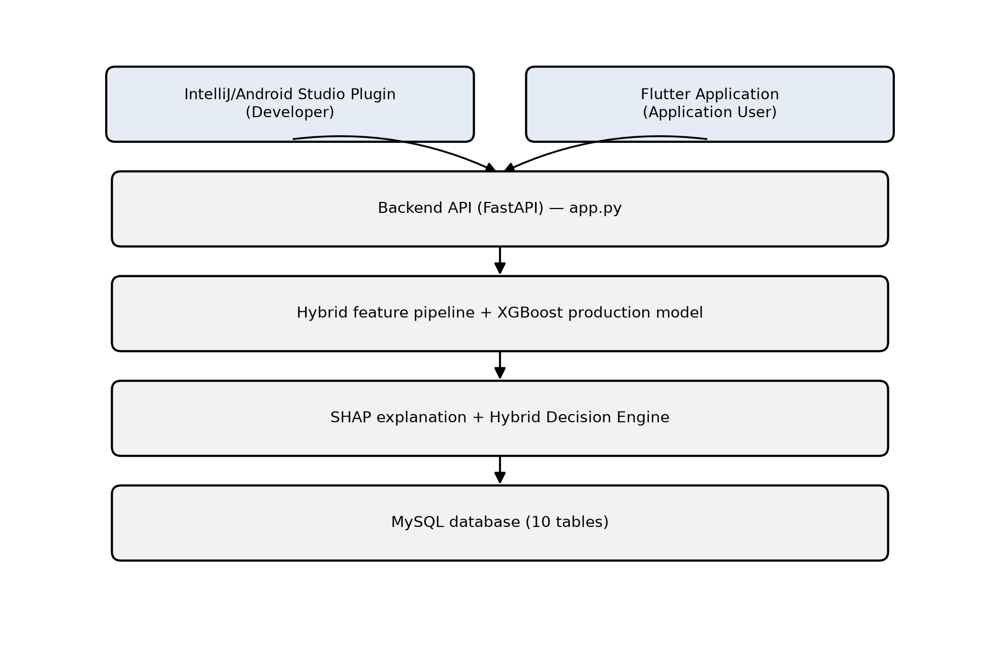

The critical architectural distinction, restated here because it governs the rest of this chapter, is that only the left-hand (developer/plugin) path submits source code for analysis. The right-hand (application-user/Flutter) path never does; it requests and displays an assessment the backend has already computed and stored for a previously-analysed application. Sections 4.8 and 4.13 detail each path in turn.

## 4.8 Developer-Facing Security Analysis Architecture

The plugin's `plugin.xml` was inspected directly to establish exactly which components are active. Three extension points are registered: a tool window (`MyToolWindowFactory`) providing project-wide scanning; an `ExternalAnnotator` for Kotlin/Java source (`CodeSentinelAnnotator`), providing real-time in-editor annotation; and a separate `ExternalAnnotator` for XML (`NetworkSecurityAnnotator`), covering the Android manifest and network-security-configuration files. These three are the only **registered and reachable** components. Several further inspection-style classes exist in the plugin's source tree (for example, standalone `LocalInspectionTool` subclasses) but are not registered in `plugin.xml` and are not reachable through any active extension point; they are **legacy, unregistered artefacts** of earlier development increments and are not described anywhere in this thesis as active functionality.

Figure 4.2 shows the reachable flow: `plugin.xml`'s registered extension points route to `CodeSentinelAnnotator` (real-time) or `ProjectFileCollector` (Scan Project); both call `APIClient`, which submits to the backend and receives a Decision Engine result; the result is rendered as an annotation with a tooltip and, via `ShowFindingDetailsIntention`, a full detail view in the shared tool window; where a finding matches a verified, narrow pattern, `SqlFixLocator`/`CertificateFixLocator` route to a Quick Fix class, and `FixVerificationRunner` re-scans the result against the real backend afterward.

**Figure 4.2. Developer-facing security analysis flow.**

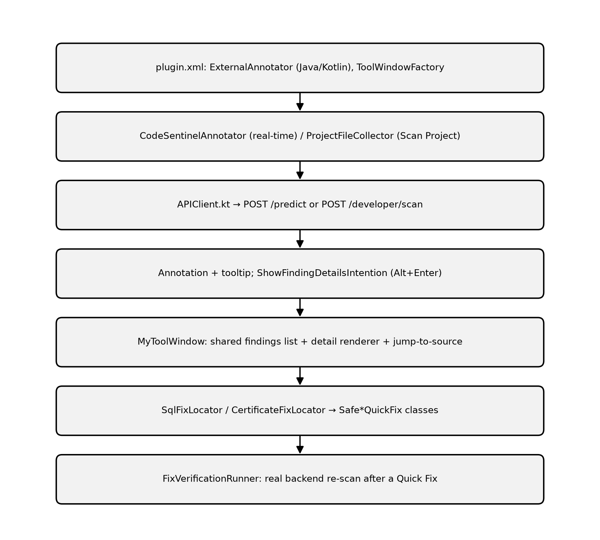

The rationale for this design follows directly from the real-time-developer-workflow gap identified in Chapter 2 (Section 2.11): detection is asynchronous and non-blocking so it does not interrupt editing, evidence and explanation are attached to the same annotation rather than requiring a separate lookup, and remediation is offered only where a fix can be applied with high confidence and independently re-verified, rather than assumed correct.

## 4.9 Backend and API Architecture

The backend is a single FastAPI service (`app.py`) exposing 20 verified HTTP endpoints, grouped by concern: authentication (`POST /register`, `POST /login`); developer-facing code analysis (`POST /predict`, `POST /developer/predict`, `POST /developer/scan`, `POST /developer/explain`, `POST /developer/rescan`, `POST /decision`); application search and assessment (`GET /apps/search`, `GET /apps/{id}`, `GET /apps/{id}/security`, `POST /apps/{id}/compatibility`, `GET /apps/{id}/alternatives`); APK ingestion (`POST /upload-apk`); user-scoped history (`GET /user/history`, `GET /history/{user_id}` — a documented, unauthenticated legacy path retained for backward compatibility, not the secure route); chat (`POST /chat`, `POST /ai-chat`, `GET /user/chat-history`); and a root health check (`GET /`). Internally, the backend separates concerns into distinct modules rather than one undifferentiated script: `predictor.py` (feature construction, model inference, SHAP), `decision_engine.py` (evidence fusion), `dataflow.py` (static/data-flow analysis), `chatbot_logic.py` (intent classification and response generation), `apk_scanner.py` (manifest metadata extraction), and a `db/` package (SQLAlchemy models, session management, and per-entity CRUD operations) — a design chosen so that a change to, for example, the Decision Engine's thresholds does not require touching the chatbot or the APK-ingestion code.

Every request to a code-analysis or application-assessment endpoint follows the same logical path: the request is parsed and validated by FastAPI's typed request models; the relevant service module (`predictor.py`, `compatibility.py`, or `chatbot_logic.py`) is invoked; where persistence is required, a single, transactional write occurs through the `db/` layer; and a typed JSON response is returned. Authentication is enforced only where user-scoped data is returned (`/user/history`, `/user/chat-history`), via a single `get_current_user` dependency that derives the requesting user's identity exclusively from a verified JWT — most developer- and application-facing endpoints (`/developer/*`, `/apps/*`) are not authenticated, a deliberate scope decision for this research stage rather than an oversight, and is stated here rather than left implicit.

## 4.10 Machine Learning Pipeline Design

Figure 4.3 shows the ML pipeline's conceptual design — the flow from raw code text to a decision — as designed, not as a report of the experimental results presented in Chapter 6. Raw code text is normalised (`normalize_code()`) and transformed into a 7,610-dimensional hybrid feature vector — 7,587 text-derived dimensions from three separately fitted vectorizers (word TF-IDF, character TF-IDF, count vectorizer) plus 23 deterministic security/data-flow features — the same representation and normalisation logic described in Chapter 3, Section 3.7. This vector is passed to the production XGBoost booster for a class-probability prediction, and, in the same request, to a live `shap.TreeExplainer` for a per-feature contribution breakdown. Both outputs then feed the Hybrid Decision Engine (Section 4.11) together with the independently-computed static/data-flow evidence.

**Figure 4.3. Machine learning pipeline design.**

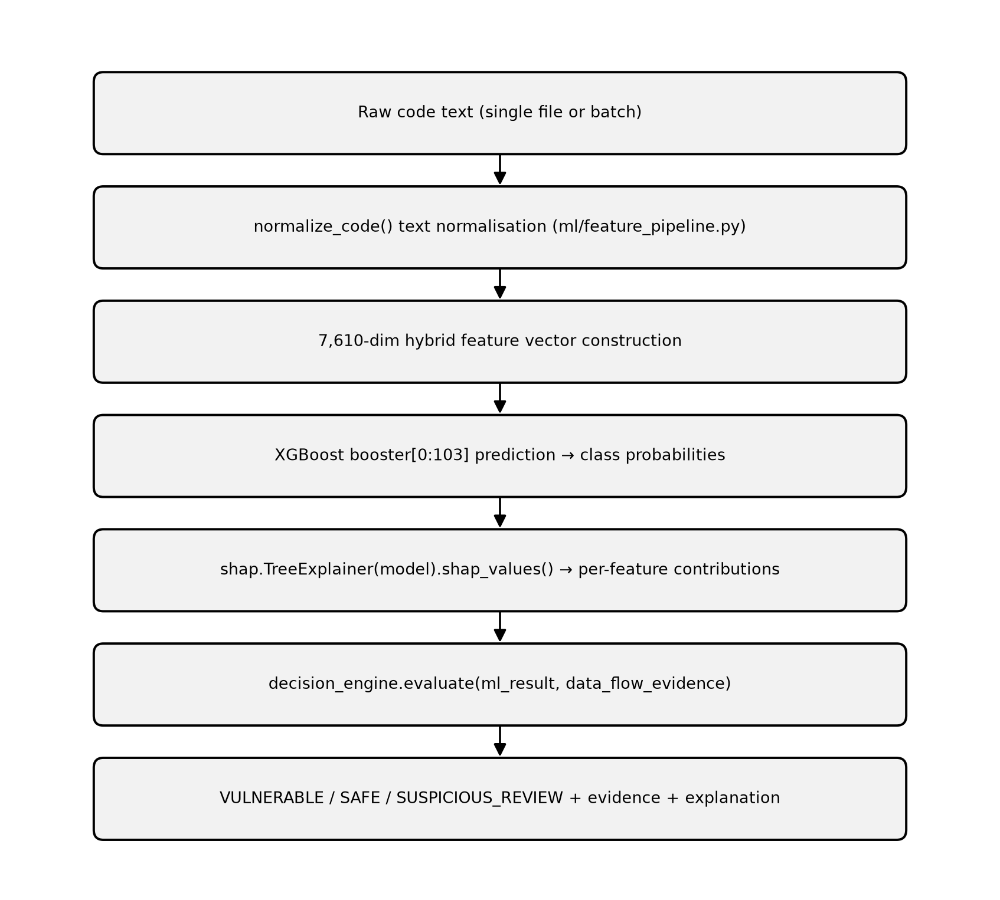

This design's dataset foundation (Chapter 3, Section 3.6) is 1,687 raw labelled rows, cleaned to 1,128 rows after excluding 559 conflicting-label rows, split 791/169/168 under a fixed seed of 42. The design decision to fit every vectorizer on the training split only, and never re-fit on validation, test, or live inference input, is what keeps the production feature representation identical to the one every reported evaluation metric in Chapter 6 was computed against — a design requirement, not a result, and is stated here only for that reason.

## 4.11 Hybrid Decision Engine Design

Figure 4.4 shows the Decision Engine's conceptual design: it does not treat the ML prediction as a sufficient basis for a security decision on its own, but accumulates a signed evidence score from several independently-weighted sources — the ML prediction itself, a traced SQL source-to-sink finding, an unparameterised-concatenation finding, confirmation that SQL sinks are parameterised, a certificate-validation finding, and a static keyword-based corroboration — and compares the resulting score against two calibrated thresholds to produce one of three states: **VULNERABLE**, **SAFE**, or **SUSPICIOUS_REVIEW** (a case the engine explicitly declines to decide automatically, deferring it to manual review rather than forcing a verdict).

**Figure 4.4. Hybrid Decision Engine design.**

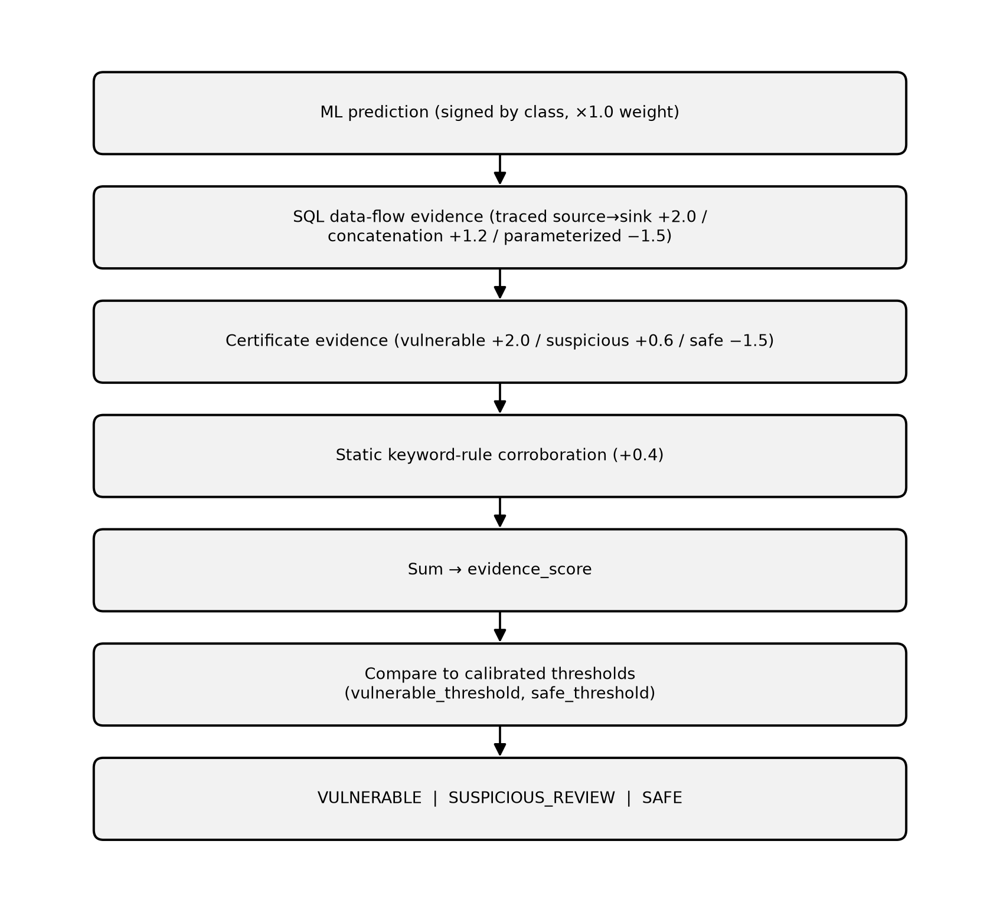

The design rationale, established in Chapter 2 (Section 2.10) and Chapter 3 (Section 3.10), is that a genuinely traced, structural data-flow finding should carry more influence over the final decision than an average-confidence ML prediction alone, and that a security decision process should measure and report the proportion of cases it is willing to resolve automatically, rather than assume completeness. This chapter deliberately does not restate the Decision Engine's numeric coverage, false-negative rate, or false-positive rate: those are experimental evaluation results and belong to, and are reported in full in, Chapter 6. It is stated plainly here only that the Decision Engine is not designed, and is not claimed anywhere in this thesis, to eliminate false negatives, false positives, or the need for manual review in every case.

## 4.12 Database and Data Model Design

The database schema, verified directly in `db/models.py`, defines exactly ten tables (Figure 4.5): `users`, `applications`, `app_versions`, `scans`, `vulnerabilities`, `ml_predictions`, `recommendations`, `alternative_apps`, `chat_history`, and `security_tips`. The design separates an application's identity (`applications`, `app_versions`) from a specific analysis event (`scans`), which in turn owns its own findings (`vulnerabilities`), model output (`ml_predictions`), and recommendation (`recommendations`) as one-to-many child records — a normalised design chosen so that a single application can accumulate multiple scans over time (for example, across app versions) without duplicating its identity data, and so that a scan's ML output, static findings, and final recommendation remain independently queryable rather than flattened into one row. `alternative_apps` is a self-referencing table linking one application to another as a suggested alternative; `chat_history` links a nullable `user_id` (supporting an unauthenticated or context-free exchange) to a question/answer pair; and `security_tips` is intentionally standalone, carrying no foreign key, since it holds fixed reference content rather than per-user or per-scan data.

**Figure 4.5. Database entity-relationship design.**

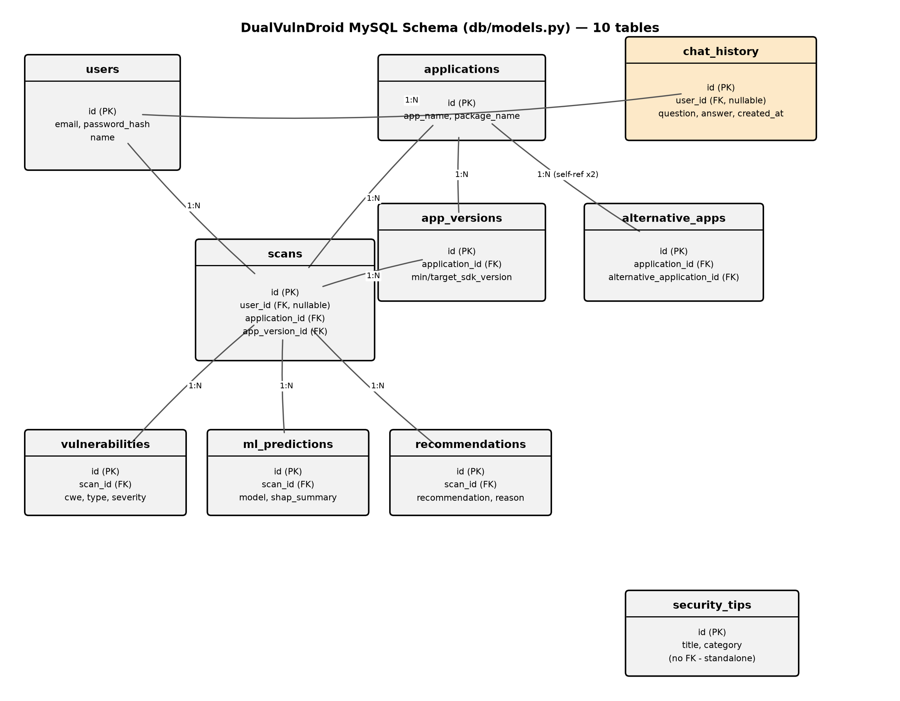

No table beyond these ten exists in the verified schema, and no table described in this chapter holds real user credentials in a directly readable form: `users.password_hash` stores an Argon2 hash, never a plaintext password, consistent with the security design described in Section 4.15.

## 4.13 End-User Flutter Application Design

Figure 4.6 shows the Flutter application's layered design: ten screens (Splash, Login, Registration, Dashboard, Search, Application Details, Vulnerability Details, Device Compatibility, Security Chat, Assessment History, and Settings, plus a generic Not-Available placeholder screen) are composed from a shared set of reusable widgets (`RiskBadge`, `CompatibilityBadge`, `DecisionCard`, `VulnerabilityTile`, `AlternativeAppTile`) so that the same backend fields are always presented consistently rather than reformatted ad hoc per screen. Screens call per-concern repositories (Auth, Apps, History, Chat, DeviceProfile), which in turn call typed API services, which route every request through one centralised `ApiClient` that attaches the stored JWT and translates every HTTP failure into one of a small set of typed exceptions.

**Figure 4.6. Flutter application architecture.**

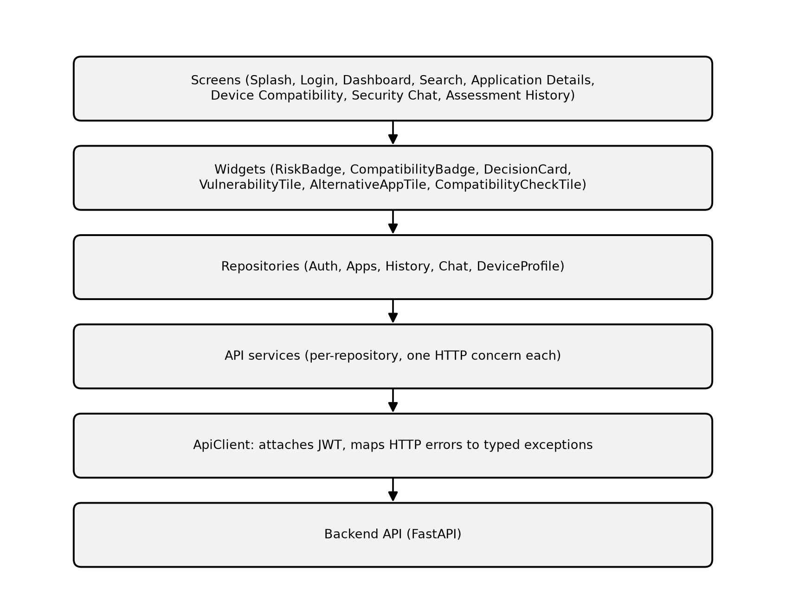

This design enforces a specific, verified constraint stated plainly here because it is easily misdescribed: **no layer of this application performs source-code analysis**. Every risk level, recommendation, finding, and piece of evidence a screen displays originates from a backend JSON response; the application's own code contains no CWE-89/CWE-295 detection logic of any kind. The Dashboard's "Upload APK" and "Installed Apps" actions route to a generic `NotAvailableScreen` with an honest "not available in this version" message — verified directly in the application's routing code — rather than to a functioning upload or device-scanning flow, even though the backend itself exposes an APK metadata-ingestion endpoint (`POST /upload-apk`, Section 4.9) used to build the application catalogue that Search and Application Details draw on. The Device Compatibility screen compares a device profile against Android-manifest-derived metadata (declared permissions, minimum/target SDK version, declared hardware features); this is a manifest/metadata-level comparison performed by the backend, not source-code CWE-89/CWE-295 detection, and is never described in this thesis as equivalent to it.

## 4.14 Security Chat and Decision-Support Design

Security Chat is designed as a constrained, intent-classification-driven decision-support feature, not a general-purpose conversational security expert — a distinction stated explicitly because the feature's name could otherwise imply more than it delivers. A user's message is classified server-side into one of a fixed set of intents (CWE-89 explanation, CWE-295 explanation, why-risky, what-to-do, explain-recommendation, compatibility, or a backward-compatible application-name lookup) using deterministic keyword matching, not a general large-language-model-style free-form understanding. Where a question concerns a specific application, the backend resolves a real, client-supplied `app_id` to that application's actual stored assessment rather than attempting to parse an application name out of free text — a design decision introduced specifically to fix a previously-identified defect in which a free-text context prefix could not be reliably matched. An unrecognised question with no resolvable application context produces a fixed, honest fallback reply, never a fabricated answer. The four suggestion chips shown in the Flutter UI map directly to four of these fixed intents, giving the user a low-friction way to ask a well-formed question without needing to guess acceptable phrasing. Chat history is persisted per user and exposed only to that authenticated user, closing a defect (Section 4.3) in which history was previously written but never read back.

## 4.15 Security and Privacy Design Considerations

The system's security design was verified directly against `ApiConfig` (Flutter) and `APIClient` (Kotlin plugin) rather than assumed. Both clients communicate with the backend over **plain HTTP**, not HTTPS: the plugin's default backend URL is `http://127.0.0.1:8000/predict`, and the Flutter application's `baseUrl` always resolves to an `http://` address (`10.0.2.2` for the Android emulator, `127.0.0.1` for desktop/web, or a manually configured physical-device host) — no TLS/SSL configuration exists in the verified backend deployment. This is stated plainly, not minimised, because a thesis whose research subject is transport-layer certificate validation (CWE-295) would be materially inconsistent with itself if it silently claimed HTTPS where none exists; the HTTP configuration is treated as a scope/deployment-configuration limitation of the evaluated system (Chapter 1, Section 1.10), not as a property to be hidden.

Within that constraint, other security design measures are genuinely implemented and verified: user passwords are hashed with Argon2 before persistence and are never logged or returned in a response; authenticated sessions use signed, expiring JSON Web Tokens, verified server-side on every request to a user-scoped endpoint via one shared dependency, so that a user's identity is derived from a cryptographically verified token rather than a client-supplied field; the Flutter client persists its token via `flutter_secure_storage` rather than plain shared preferences; error responses are generic and do not leak an internal file path, stack trace, or secret value; and the backend's `.env` configuration file, holding the database connection string and JWT signing secret, is excluded from version control. Input validation occurs at the FastAPI request-model layer for structural correctness and, for code-analysis endpoints, at a bounded input-size guard (Section 4.5, NFR-02/NFR-08) to prevent resource exhaustion from an oversized submission. No encryption-at-rest mechanism beyond the database's own storage is claimed for stored scan or chat data, since none was verified in the implementation, and this chapter does not describe one.

The HTTP-only transport is treated here as an evaluation-stage scope limitation rather than a claim of production readiness: OWASP's MASVS treats network-communication security (in-transit encryption, certificate validation) as its own distinct verification requirement (Chapter 2, Section 2.2), separate from the authentication, storage, and input-validation requirements this system does implement, and this thesis does not claim the network-communication requirement is satisfied. This is stated here for the same reason the Decision Engine's SUSPICIOUS_REVIEW state and the compatibility module's NOT_AVAILABLE state exist throughout this design: a requirement that is not genuinely met is reported as such, not silently assumed or omitted.

## 4.16 Requirements-to-Design Traceability

Table 4.6 traces each of Chapter 1's five research objectives through the requirements and design components described in this chapter to its implementation location and verification method, closing the loop from research problem to concrete design.

**Table 4.6. Requirements-to-design traceability matrix.**

| Research Objective (Ch. 1) | Requirement(s) | Design Component | Implementation Location | Verification Method |
|---|---|---|---|---|
| 1. Investigate and compare existing approaches | FR-01, FR-02 | Shared detection pipeline design | `security_features.py`, `dataflow.py` | Chapter 2 comparative synthesis; Chapter 6 model evaluation |
| 2. Compare SVM/Random Forest/XGBoost against LSTM/CodeBERT under one protocol | FR-02, NFR-06, NFR-07 | ML pipeline (Section 4.10) | `ml/feature_pipeline.py`, `predictor.py` | Chapter 6 test-set metrics |
| 3. Design a Hybrid Decision Engine with SHAP explanation | FR-03, FR-04, NFR-05 | Decision Engine (Section 4.11) | `decision_engine.py`, `predictor.py` (SHAP) | Chapter 6 coverage/reliability analysis |
| 4. Build the IDE plugin and Flutter application | FR-05–FR-17, NFR-01–NFR-04, NFR-08, NFR-09 | Plugin architecture (4.8), Flutter architecture (4.13) | `CodeSentinelAnnotator.kt`, `MyToolWindow.kt`, `dualvulndroid_flutter/lib/*` | Automated test suites (Table 4.7); live device sessions |
| 5. Evaluate via automated testing and live validation, honestly | All FR/NFR | Full system | Backend `pytest`, Kotlin Gradle suite, `flutter test` | Chapter 7/8; live validation record (Chapter 3, Section 3.13) |

**Table 4.7. Automated test suite totals referenced above.**

| Suite | Result |
|---|---|
| Backend (pytest) | 323 passed, 2 skipped |
| IntelliJ plugin (Kotlin) | 55 total (46 unit + 9 platform-integration) |
| Flutter (`flutter test`) | 59 passed, 0 failed |

## 4.17 Chapter Summary

This chapter analysed DualVulnDroid's stakeholders and system context, distinguishing the developer-facing source-code analysis path from the end-user-facing, backend-mediated assessment path; described how requirements were derived from research objectives, literature-grounded standards, and iterative development evidence rather than stakeholder interviews; and specified eighteen functional and nine non-functional requirements, each traced to a verified implementation component. Eleven use cases were identified from the system's actual, reachable entry points. The overall architecture, and the conceptual design of the developer-facing plugin, the backend/API, the ML pipeline, the Hybrid Decision Engine, the ten-table database, the Flutter application, and Security Chat were each presented with an accompanying verified diagram and an explicit statement of what each component does and does not do — including that the Flutter application performs no source-code analysis, that its APK-upload and Installed-Apps entries are honest "not available" placeholders, and that the verified deployment communicates over HTTP rather than HTTPS. The requirements-to-design traceability matrix connects each of Chapter 1's five research objectives to a concrete design decision and its verification evidence. Chapter 5 now presents how this design was actually implemented.


# CHAPTER 05 – ARTEFACT DESIGN REALISATION AND IMPLEMENTATION

## 5.1 Chapter Overview

Chapter 4 established DualVulnDroid's requirements and the conceptual design of its components. This chapter answers a narrower question: how was that design actually realised in working code? It traces specific functions, classes, and modules in the current codebase, showing how each design decision became an implementation, and states plainly where implementation deviates from, or narrows, what an idealised design might suggest. It does not repeat Chapter 4's requirements tables or architecture diagrams; it instead follows the shared detection pipeline from raw input to a returned decision, then the plugin, the Flutter application, and the cross-cutting concerns (authentication, error handling, integration) that bind them together. Every implementation detail below — function names, class names, file paths, constants, and control flow — was verified directly against the current source while writing this chapter; Chapter 6 evaluates the resulting system's performance, and this chapter does not anticipate those results.

## 5.2 Implementation Environment and Technology Stack

The implementation environment was verified against the project's own dependency and configuration files rather than assumed (Table 5.1). The backend is a Python/FastAPI service run via Uvicorn, with SQLAlchemy 2.x and Alembic managing the MySQL schema. The production classifier is XGBoost, with SHAP providing explainability and scikit-learn supplying the TF-IDF/count vectorisers used in feature construction; the supplementary research models add TensorFlow/Keras (LSTM) and PyTorch with Hugging Face `transformers` (CodeBERT), used only in the research-comparison pipeline (Section 5.6). Authentication uses PyJWT and `argon2-cffi`. The IDE plugin is Kotlin, targeting the IntelliJ Platform SDK (the same platform Android Studio itself is built on), built with Gradle. The mobile application is Dart/Flutter, using the `http` package for networking and `flutter_secure_storage` for token persistence. Live device validation used an Android Virtual Device via the Android Emulator, referenced throughout this chapter and reported in full in Chapter 7.

**Table 5.1. Technology stack by layer.**

| Layer | Technology | Verified Source |
|---|---|---|
| IDE/plugin | Kotlin, IntelliJ Platform SDK, Gradle | `DualVulnDroid/build.gradle.kts`, `plugin.xml` |
| Mobile | Dart, Flutter, `http`, `flutter_secure_storage` | `dualvulndroid_flutter/pubspec.yaml` |
| Backend | Python, FastAPI, Uvicorn, Pydantic | `backend/app.py` |
| ML (production) | XGBoost, scikit-learn (TF-IDF/CountVectorizer) | `backend/predictor.py`, `backend/ml/feature_pipeline.py` |
| ML (research-only) | TensorFlow/Keras (LSTM), PyTorch + `transformers` (CodeBERT) | `research_eval/` training scripts |
| Explainability | SHAP (`TreeExplainer`) | `backend/predictor.py` |
| Decision fusion | Custom Python module | `backend/decision_engine.py` |
| Database | MySQL, SQLAlchemy, Alembic | `backend/db/models.py` |
| Communication | REST over HTTP, JSON, JWT (PyJWT) | `backend/app.py`, `APIClient.kt`, `api_config.dart` |

Where an exact version could not be independently confirmed from an inspected project file, this chapter states the technology without inventing a version number.

## 5.3 Backend Implementation

`app.py` is a single FastAPI application in which every request body is validated against a Pydantic model (`CodeRequest`, `BatchScanRequest`, `ChatMessage`, `DeviceProfile`, and others) before a route handler runs. Route handlers are implemented thinly: they perform request-shape checks — for example, `_guarded_predict()`'s 200KB single-file size guard — and delegate to the shared analysis core or the data-access layer rather than embedding analysis logic inline. Application startup performs a best-effort database connectivity check that logs a warning rather than blocking startup, since routes such as `/predict` have no database dependency; three exception handlers (generic `Exception`, `HTTPException`, and a dedicated `DatabaseNotConfiguredError`) are registered once at the application level so every route inherits the same error-response shape.

Figure 5.1 shows the implemented request flow for a vulnerability-analysis request. `predict_code(code, file_name)` in `predictor.py` is the single function implementing this entire sequence, called by every analysis route (`/predict`, `/developer/predict`, `/developer/scan`, `/developer/explain`, `/developer/rescan`, `/decision`). An early guard returns a `SAFE`/none response for empty input; files ending `.xml` are diverted to a small, separate rule-based check of `AndroidManifest.xml`/`network_security_config.xml` (cleartext-traffic and permissive-trust-anchor patterns) that does not use the ML pipeline at all, since these are structural configuration facts rather than code patterns; all other Java/Kotlin input proceeds through feature construction, XGBoost prediction, SHAP explanation, static/data-flow evidence extraction, and Decision Engine evaluation.

**Figure 5.1. Backend prediction implementation flow.**

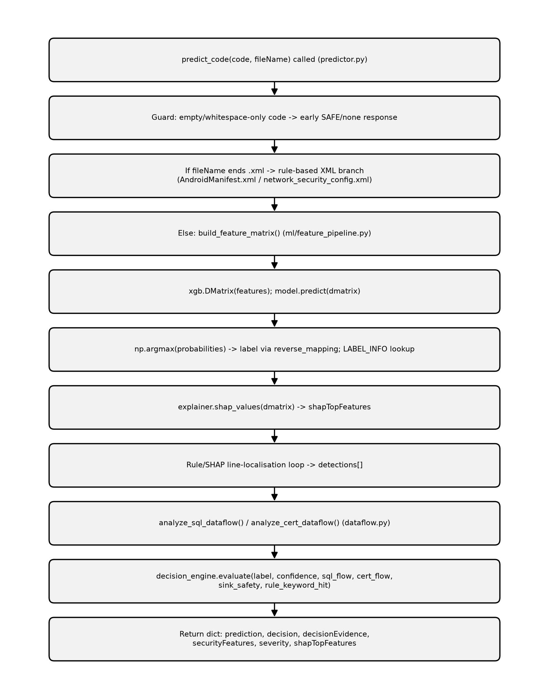

## 5.4 Database Implementation

`db/models.py` was inspected directly and defines exactly ten SQLAlchemy models — `User`, `Application`, `AppVersion`, `Scan`, `Vulnerability`, `MLPrediction`, `RecommendationRecord`, `AlternativeApp`, `ChatHistory`, and a standalone `SecurityTip` — matching the design established in Chapter 4. `db/crud.py` implements every read and write against these models; no route in `app.py` issues SQL or touches a model class directly, keeping the database a genuinely encapsulated layer. Two implementation patterns recur across `db/crud.py` and materially affect correctness: functions participating in a larger transaction (`get_or_create_application()`, `create_scan()`, `add_vulnerability()`) call `db.flush()` rather than `db.commit()`, leaving the final commit to the top-level caller (`persist_apk_scan()`) so a failure partway through leaves nothing partially committed; and several "get or create" functions apply a "never overwrite a real value with a blank one" rule when merging new data into an existing row.

`User.password_hash` never leaves `db/crud.py`/`db/security.py` as a plaintext or reversible value (Section 5.14). Application and finding data are written by `persist_apk_scan()` as one transaction — creating/updating `Application` and `AppVersion` rows, a `Scan` row, and zero or more `Vulnerability` rows strictly from `apk_scanner.py`'s real detections, never a fabricated finding, plus one `RecommendationRecord` derived from the scan's actual risk level. `ChatHistory` supports a nullable `user_id`, so an unauthenticated or context-free exchange can still be recorded, while `GET /user/chat-history` (Section 5.13) only ever reads rows matching a verified, authenticated identity.

## 5.5 Data Processing and Feature Extraction Implementation

The production feature pipeline (`ml/feature_pipeline.py`) implements the single, shared feature-construction path used by both training and live inference, so that training and inference cannot drift apart — the module's own docstring states this as its explicit purpose. `normalize_code()` lower-cases the text, strips comments, masks string/character/numeric literals to fixed placeholder tokens, and collapses whitespace, before the normalised text is passed to three separately-fitted vectorisers: a word-level TF-IDF vectoriser (5,000 features, n-grams 1–3), a character-level TF-IDF vectoriser (2,000 features, n-grams 2–5), and a count vectoriser (1,000 features, n-grams 1–2). `build_feature_matrix()` concatenates these with the 23-element security-feature vector to produce the 7,610-dimensional matrix consumed by XGBoost — the same figures (1,687 raw rows, 559 excluded, 1,128 clean rows, split 791/169/168 under seed 42) established in Chapter 3 as the dataset this pipeline was fitted against. All three vectorisers were fit exclusively on the training split and are loaded at backend startup from pre-fitted artefacts, never re-fit at inference time.

`security_features.py` implements `extract_security_features(code)`, converting `dataflow.py`'s analysis output plus a handful of direct structural checks into the fixed-order, 23-element feature vector. The function is a pure function of the code text — no randomness, no external state — a deliberate implementation property guaranteeing the same snippet always produces the same feature vector. `dataflow.py` itself implements a deliberately scoped static analyzer: single-file, statement-per-line intraprocedural taint tracking through variable assignment and string concatenation, plus exactly one bounded interprocedural hop; certificate-validation checks are structural, inspecting the actual body of `HostnameVerifier`/`X509TrustManager`/`onReceivedSslError` implementations rather than a blanket keyword search, so a genuinely correct custom implementation is not flagged merely for existing.

## 5.6 Machine Learning Implementation

The **production model is XGBoost, exclusively**. `predictor.py` loads it from `research_eval_artifacts/xgboost/` (`model.json`, `metadata.json`); the older `ml/artifacts/` directory is kept on disk for historical reference only and is not loaded. The loader reads the selected boosting-round count from `metadata.json`, loads the full booster, then slices it to only the validated range before it is ever used for prediction — a decision that exists because the saved booster contains additional trees trained past the point early stopping selected, so predicting with the raw, unsliced booster would silently use non-selected trees:

```python
# predictor.py
_NUM_BOOST_ROUND_SELECTED = _model_metadata["final_hyperparameters"]["num_boost_round_selected"]
_raw_booster = xgb.Booster()
_raw_booster.load_model(MODEL_PATH)
model = _raw_booster[0:_NUM_BOOST_ROUND_SELECTED]
```
**Code Snippet 5.1.** Production booster load-time slicing to its validated round count (`predictor.py`).

This slice is applied once at load time, so every later call to `model.predict()` and the `shap.TreeExplainer` built against `model` automatically sees only the validated, evaluated rounds — no call site elsewhere needs to remember an iteration range. The model is versioned by content hash (`PRODUCTION_MODEL_INFO` records a SHA-256 prefix of the loaded model and vectoriser artefacts), so a caller can determine at runtime exactly which trained artefact is being served. The fixed class order — `s0` (CWE-89 vulnerable), `v0` (CWE-295 vulnerable), `s1` (CWE-89 safe), `v1` (CWE-295 safe) — is defined once and reused by every downstream consumer: the Decision Engine's vulnerable-label set, the plugin's response parsing, and the Flutter client.

Figure 5.2 shows the resulting prediction path. `build_feature_matrix()`'s output is passed to XGBoost as an `xgb.DMatrix`; `model.predict(dmatrix)` returns a four-element probability array, and `np.argmax()`/`np.max()` yield the predicted label and its confidence, before proceeding to SHAP and the Decision Engine.

**Figure 5.2. Machine learning feature-to-prediction implementation flow.**

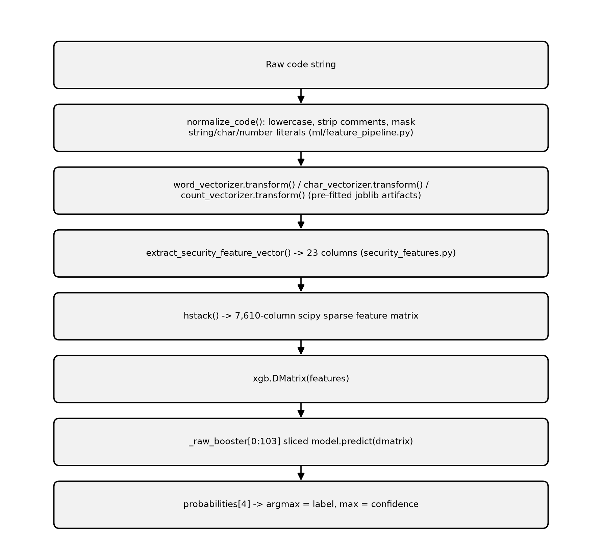

**Research-comparison models — Linear SVM, Random Forest, and, alongside XGBoost itself under identical conditions, LSTM and CodeBERT — were trained and evaluated during the research phase reported in Chapter 6, but none of the four non-production models is loaded or reachable from any route in `app.py`.** This chapter does not describe LSTM or CodeBERT as production components, and no code path in `predictor.py` imports either.

## 5.7 Hybrid Decision Engine Implementation

`decision_engine.py` implements the engine as three functions: `compute_evidence()`, `decide()`, and `evaluate()` (which composes the first two). `compute_evidence()` accepts the predicted label, its confidence, the SQL and certificate data-flow findings, the parameterised-sink safety summary, and a static-rule match flag, returning a signed evidence score and a list of labelled reasons. The ML prediction contributes `±confidence × 1.0`, signed by predicted class; the remaining fixed weights — traced source-to-sink (`+2.0`), unparameterised concatenation (`+1.2`), confirmed parameterisation (`−1.5`), certificate vulnerable (`+2.0`)/suspicious (`+0.6`)/safe (`−1.5`), and static-rule corroboration (`+0.4`) — are the module's own documented constants, not re-derived per request.

```python
# decision_engine.py
def decide(evidence_score, vulnerable_threshold=VULNERABLE_THRESHOLD,
           safe_threshold=SAFE_THRESHOLD):
    if evidence_score >= vulnerable_threshold:
        return "VULNERABLE"
    elif evidence_score <= safe_threshold:
        return "SAFE"
    return "SUSPICIOUS_REVIEW"
```
**Code Snippet 5.2.** The Decision Engine's three-way threshold comparison (`decision_engine.py`).

The thresholds actually applied at runtime are not the module's hand-picked reference defaults (`VULNERABLE_THRESHOLD = 1.5`, `SAFE_THRESHOLD = -0.9`) unless no calibration artefact exists: on import, the module checks for a calibrated-threshold JSON artefact (produced from the validation split only, never the test split) and, when present, overwrites both constants before any request is served. `SUSPICIOUS_REVIEW` is a deliberate third state, not an implementation gap: the module's own documentation records that collapsing it into a binary `vulnerable` flag was considered and rejected, since neither client surface has a dedicated "needs review" UI, and doing so at this decision boundary would place a warning on a large share of scanned files. This chapter does not restate the engine's numeric coverage or false-negative/false-positive rate — those are Chapter 6 evaluation results — and does not claim the engine resolves every case automatically or is free of error.

## 5.8 Explainability and Evidence Implementation

Figure 5.3 (right-hand portion) shows the explainability path. `shap.TreeExplainer(model)` is instantiated once, at module import time, against the identical sliced production booster used for prediction — a deliberate implementation property, since it guarantees every SHAP value corresponds to the actual serving model rather than a separately-configured explainer. If instantiation fails, the explainer is set to `None` and SHAP-dependent response fields are simply omitted rather than the request failing. For each prediction, `explainer.shap_values()` is called to build `shapTopFeatures` (the top 8 features by absolute SHAP value for the predicted class) and, separately, to extract top positive-contribution features for any class with predicted probability above 5%, used for line-level localisation against the source text.

**Figure 5.3. SHAP and Decision Engine implementation flow.**

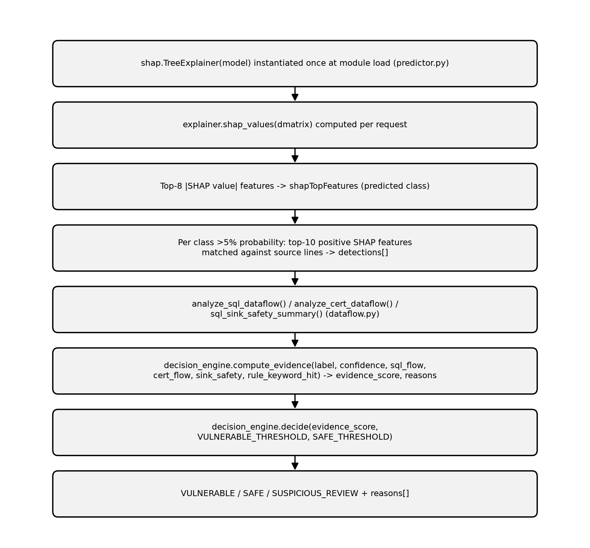

SHAP output is used strictly as feature attribution — a measure of how much each feature pushed the model's output toward or away from a given class for this specific input — and is never presented as proof that the underlying code is genuinely vulnerable. This is why it is returned as a field distinct from `decisionEvidence` (the independently-computed static/data-flow findings, Section 5.5): a developer sees which features the model weighted (`shapTopFeatures`) and, separately, what deterministic evidence was actually traced in the code, rather than one undifferentiated "explanation."

## 5.9 Developer IDE Plugin Implementation

`plugin.xml` was inspected directly to establish exactly which plugin components are active. It registers three extension points: a tool window (`MyToolWindowFactory`, providing project-wide scanning); an `ExternalAnnotator` for Kotlin/Java (`CodeSentinelAnnotator`, providing real-time in-editor annotation); and a separate `ExternalAnnotator` for XML (`NetworkSecurityAnnotator`, covering the Android manifest and network-security-configuration files). These three are the plugin's **registered and reachable** components.

Several further classes exist in the plugin's source tree but are **not registered in `plugin.xml` and are not reachable through any active extension point or other call site** — standalone `LocalInspectionTool` subclasses and detector classes left over from earlier development increments. These are legacy, unused artefacts, not active functionality, and this chapter does not describe them as part of the working system. The plugin communicates with the backend exclusively through `APIClient.kt`, whose Kotlin data classes mirror the backend's real JSON response shapes field-for-field, checked directly against `app.py`'s response construction rather than inferred; every field added after the plugin's initial version is declared nullable, so a response from an older backend or from a guard-clause early return still parses successfully.

## 5.10 Vulnerability Detection and Finding Workflow

Figure 5.4 shows the realised end-to-end developer workflow. `CodeSentinelAnnotator` implements the IntelliJ Platform's three-method `ExternalAnnotator` contract: `collectInformation()` runs on the UI thread, restricts scanning to `java`/`kotlin`/(for two specific manifest-related filenames) `xml`, and builds the per-line data the annotation needs; `doAnnotate()` runs on a background thread — the only point at which this class performs network I/O — calling `APIClient` to `POST /predict` and mapping the response into per-line results carrying vulnerability type, confidence, character offsets, severity, decision, decision evidence, and SHAP features, so the tooltip renders this richness from one request; `apply()` runs back on the UI thread and creates an annotation only for results the backend actually reported vulnerable — a `SUSPICIOUS_REVIEW` decision produces no annotation at all, a direct consequence of the Decision Engine's conservative calibration rather than a plugin defect.

**Figure 5.4. Developer-to-backend communication and finding workflow.**

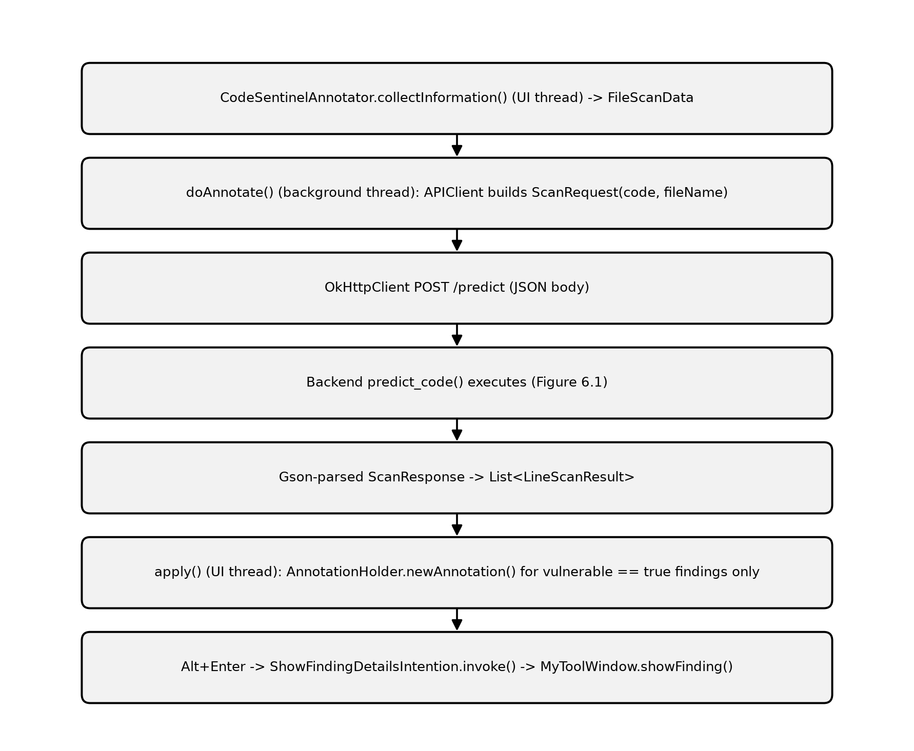

CWE-89 and CWE-295 detection are each the composition of the pieces already described: for CWE-89, `dataflow.py`'s traced-source-to-sink and unparameterised-concatenation findings, nine of the 23 security features, the `s0`/`s1` probability pair, and the Decision Engine's SQL-specific weights; for CWE-295, `dataflow.py`'s structural analysis of `HostnameVerifier`/`TrustManager`/WebView SSL-handler bodies, a further nine security features, the `v0`/`v1` probability pair, and the Decision Engine's certificate-specific weights. Developer-facing explanation sentences (`generate_explanation_sentences()`) are built purely from already-computed real values — for example, a source-to-sink sentence is only generated when that feature was actually set for this request — rather than templated text unconditionally attached to every finding of a given type. Neither detection path claims complete coverage: `dataflow.py`'s own documentation states it is a deliberately scoped, single-file analyzer, not a full whole-program static analyzer.

## 5.11 Remediation and Quick-Fix Implementation

Quick Fix follows a locator/action split. `SqlFixLocator.kt` and `CertificateFixLocator.kt` implement the "is this safe to rewrite" decision by inspecting the actual PSI structure of the flagged expression — for example, `SqlFixLocator` determines whether a flagged SQL string has a sufficiently simple, single-level concatenation shape before considering a fix. Only where a locator returns a positive result do `SafeSqlQuickFixJava/Kotlin.kt` or `SafeHostnameVerifierQuickFixJava/Kotlin.kt` perform the actual PSI expression rewrite, inside a write action, re-validating that the target pattern still matches immediately before writing. This is a **narrow, pattern-scoped remediation, not a general or fully automated repair capability**: any finding that does not match one of these specific, verified shapes receives a manual-remediation message in its tooltip instead of a fix action, and this chapter does not claim otherwise.

After a fix is applied, `FixVerificationRunner.kt` triggers a genuine, asynchronous re-scan of the modified file through the same backend path used for real-time annotation — whether the fix worked is a freshly-computed backend decision on the post-fix code, not an assumption. Batch/project-wide scanning is implemented separately: `ProjectFileCollector.kt` gathers eligible files and drives a single `POST /developer/scan` request rather than one request per file, with results populating the same shared, in-memory findings list `MyToolWindow.kt` also uses for real-time findings, so jump-to-source navigation works identically regardless of which path produced a given finding.

## 5.12 Flutter End-User Application Implementation

`ApiClient` (`lib/core/api_client.dart`) implements all network communication behind `get()`/`post()`, both routing through a shared `_send()` implementation that catches `TimeoutException`, `SocketException`, and `http.ClientException`, re-throwing all three as one `NetworkException`, and maps HTTP status codes to a small set of typed exceptions (`UnauthorizedException`, `NotFoundException`, `ValidationException`, `ServerException`). Both the underlying `http.Client` and the token-provider callback are constructor-injected, which is what allows the project's own tests to substitute a mock client without touching real network or storage.

**Figure 5.5. Flutter-to-backend communication implementation.**

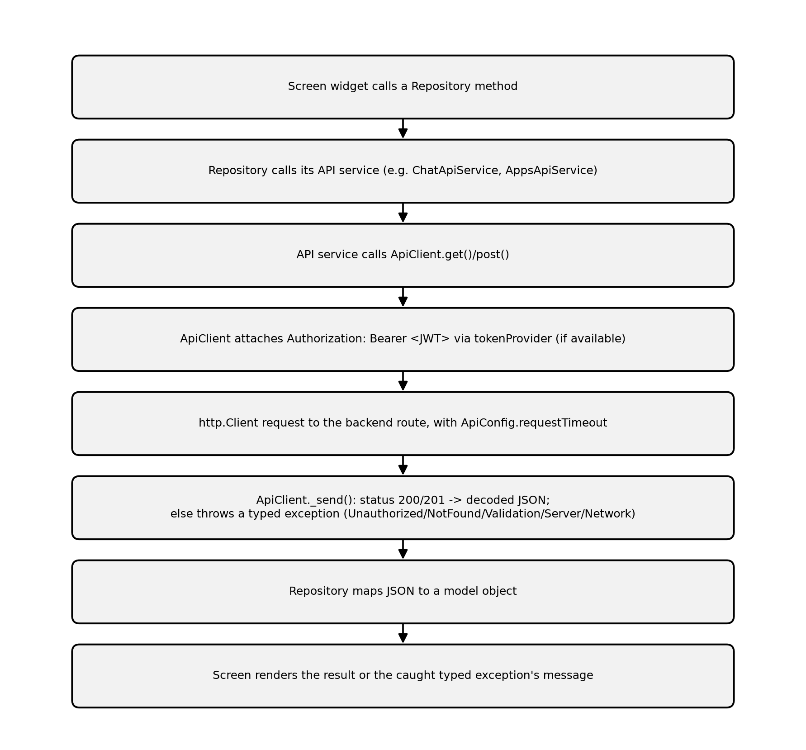

Authentication/session state is implemented in `AuthRepository`, the only class permitted to read or write the persisted token, delegated to a thin `flutter_secure_storage` wrapper; `restoreSession()` runs once at startup so a user is not required to log in on every launch, and `handleUnauthorized()` — invoked whenever any API call surfaces an `UnauthorizedException` — clears the token and routes the UI back to login rather than silently retrying with a dead session. Security-relevant screens (Search, Application Details, Device Compatibility) depend on a repository rather than an API service directly, and render every typed exception through shared state-view widgets rather than each screen implementing its own error UI.

Stated plainly, because it is the property most easily misdescribed: **no layer of this Flutter implementation performs source-code CWE-89/CWE-295 analysis.** Every risk level, finding, and piece of evidence a screen displays originates from a backend JSON response. The Dashboard's "Upload APK" and "Installed Apps" actions route to a generic not-available screen with an honest "not available in this version" message, verified directly in the application's own routing code — this chapter does not claim an upload flow is implemented or reachable from the mobile UI, notwithstanding the backend's separate `POST /upload-apk` capability (Section 5.3).

## 5.13 Security Chat and Decision-Support Implementation

Figure 5.6 shows the chat-history retrieval path as a concrete, representative example of the wider Security Chat implementation. `SecurityChatScreen` sends each message through `ChatRepository`/`ChatApiService`, issuing `POST /ai-chat` with the message text and, where opened from a specific application's context, that application's real `app_id`. `chatbot_logic.py`'s `generate_chat_response()` is the single backend entry point: it classifies the message deterministically against fixed phrase lists, in order — CWE-89 explanation, CWE-295 explanation, compatibility, recommendation explanation, why-risky, what-to-do, falling back to an application-name lookup. **This is deterministic keyword-based intent classification, not a general-purpose large-language-model chatbot**, and this chapter does not describe it as one.

**Figure 5.6. Chat history retrieval implementation flow.**

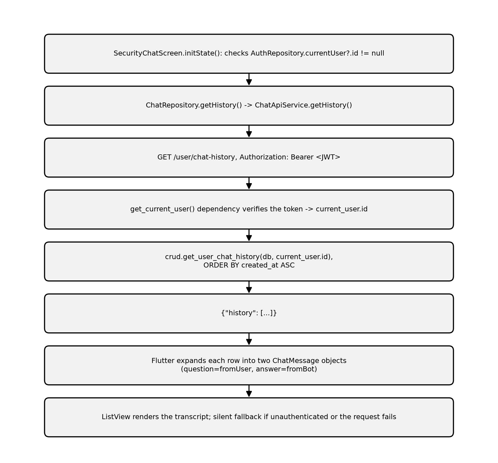

CWE-89/CWE-295 questions return fixed, hand-written reference text, since these are stable definitions that do not vary per application. The `why_risky`, `what_to_do`, `explain_recommendation`, and `compatibility` intents require a real, resolved assessment: when `app_id` is supplied, the corresponding answer function builds its response strictly from that assessment's real stored fields, returning an explicit "no verified assessment" message rather than fabricating one when none exists. An unrecognised question with no resolvable context returns a fixed, honest fallback. Chat history is implemented as a write on every exchange (`save_chat_message()`, whenever a `user_id` is present) and a read exposed only to the authenticated owner: `GET /user/chat-history` derives the requesting identity exclusively from the verified JWT payload, never a client-supplied identifier, so the endpoint structurally cannot return another user's transcript — a property enforced by how the underlying query is constructed, not merely a convention.

## 5.14 Authentication, API Communication and Security Controls

Backend authentication is implemented in `db/security.py`. Passwords are hashed with Argon2 for all new and updated credentials; `verify_password()` additionally recognises a legacy SHA-256 hex-digest scheme, transparently re-hashing with Argon2 on a successful legacy match at login — a standard rolling migration, since a one-way hash cannot be batch-converted without the plaintext. JWTs are signed with `PyJWT` (HS256) using a server-side secret read from the environment; `get_current_user()` in `app.py` is the single dependency every protected route uses, distinguishing an expired token, a structurally invalid token, and a token for a user that no longer exists, rather than one undifferentiated 401.

**Network transport was verified directly against `ApiConfig` (Flutter) and `APIClient` (Kotlin) rather than assumed, and both communicate with the backend over plain HTTP, not HTTPS.**

```dart
// api_config.dart
static String get baseUrl {
  if (physicalDeviceHost != null && physicalDeviceHost!.isNotEmpty) {
    return 'http://$physicalDeviceHost:$_port';
  }
  if (kIsWeb) { return 'http://127.0.0.1:$_port'; }
  if (Platform.isAndroid) { return 'http://10.0.2.2:$_port'; }
  return 'http://127.0.0.1:$_port';
}
```
**Code Snippet 5.3.** The Flutter client's backend base URL, confirming HTTP-only transport (`api_config.dart`).

No TLS/SSL configuration exists anywhere in the verified backend deployment, and the plugin's default backend URL (`http://127.0.0.1:8000/predict`) confirms the same for the developer-side client. This is stated plainly, not minimised, because a thesis whose research subject includes transport-layer certificate validation (CWE-295) would be materially inconsistent with itself if it silently implied HTTPS where none exists; it is recorded as a deployment-configuration limitation of the evaluated system, addressed further in Chapter 8's limitations discussion.

Within that constraint, other implemented security measures are genuine: JWT authentication is scoped to exactly the routes exposing a specific user's own private data; the Flutter client persists its token via `flutter_secure_storage` rather than plain shared preferences; error responses are generic and never leak an internal path, stack trace, or secret; the backend's `.env` file (database connection string, JWT signing secret) is excluded from version control; and Pydantic request-model validation applies at the API boundary for every route accepting a body. No at-rest database encryption or end-to-end message encryption was located in the inspected source, and none is claimed here.

## 5.15 Error Handling and Availability States

Error handling operates at three levels. At the framework level, Pydantic request models reject a structurally invalid body (missing fields, wrong types, an out-of-bounds batch size) with a `422` before any route handler runs. At the application level, the three registered exception handlers (Section 5.3) normalise every failure mode into a consistent response shape: unhandled exceptions become a generic `500` with the real exception logged server-side only; deliberate `HTTPException`s (a `404` for an unknown application, a `400` for an empty search query, a `413` for an oversized upload) are returned in the same `{"error": ..., "detail": ...}` shape; a missing database surfaces as an explicit `503`, not a generic failure. At the authentication level, `get_current_user()` implements three distinct `401` cases rather than one undifferentiated response.

Availability is handled close to where a value would otherwise have to be guessed: the compatibility module reports `NOT_AVAILABLE` for a dimension whenever either the application-side manifest fact or the device-side data is genuinely missing, rather than inferring one; the chatbot's fallback (`GREETING` text) is returned when no intent or application name can be resolved, rather than raising an error or returning an empty response; and every error the Flutter client's `ApiClient` surfaces is one of five typed exceptions, rendered through shared state-view widgets so no screen improvises its own error text. **Implemented error handling and live-validated behaviour are reported separately in this chapter**: an implemented and automated-test-covered path (for example, Search's network-error handling) is not described as live-validated unless it was actually exercised on a real device — Search's network-error state remains **not validated live** as of the most recent validation phase (Chapter 3, Section 3.13), and this chapter does not claim otherwise.

## 5.16 Integration of System Components

The developer path integrates as: IDE Plugin → Backend/API → ML feature extraction and static/data-flow analysis → Decision Engine → Finding/Evidence → (where applicable) Quick Fix. The end-user path integrates as: Flutter Application → Backend/API → stored application assessment/security data → risk and evidence presentation → Compatibility → Security Chat. Both paths converge on exactly one backend and one detection pipeline (Sections 5.3–5.8); no functionality is duplicated between the plugin and the Flutter client. The integration boundary that matters most for this thesis's accuracy is stated once more here because it governs both paths: the Flutter client never submits source code and never independently computes a CWE-89/CWE-295 verdict; it is a consumer of decisions the shared pipeline has already produced and stored. Cross-component contracts are kept explicit and versioned where practical — the plugin's response data classes are checked field-for-field against the backend's actual response construction, and the production model is content-hash versioned — so that a change on one side of an integration boundary is detectable rather than silently assumed compatible.

## 5.17 Implementation Verification and Traceability

Table 5.2 traces representative Chapter 4 requirements to their realised implementation and current verification status, using four distinct labels rather than a single "done": **Implemented** (the code exists and was read directly); **Automated Tested** (covered by a passing automated test); **Live Validated** (directly observed on a real device/emulator against the real backend); and **Not Validated** (not yet observed live, for a stated reason).

**Table 5.2. Implementation verification and traceability.**

| Requirement (Ch. 4) | Component | Source Module | Verification Status |
|---|---|---|---|
| FR-01 Real-time + batch source-code analysis | `CodeSentinelAnnotator`, `ProjectFileCollector` | `CodeSentinelAnnotator.kt`, `predictor.py` | Implemented; Automated Tested (46 unit + 9 headless-IDE integration tests); **Not** human-observed on-screen IDE GUI-validated |
| FR-03 Hybrid Decision Engine (3-state) | `decision_engine.py` | `decision_engine.py` | Implemented; Automated Tested; evaluated quantitatively in Chapter 6 |
| FR-04 SHAP + separated evidence | `predictor.py` | `predictor.py` | Implemented; Automated Tested |
| FR-06/07 Quick Fix + re-verification | Locator/Fix/`FixVerificationRunner` classes | `SqlFixLocator.kt` et al. | Implemented; Automated Tested |
| FR-10 Search + security assessment | `AppsRepository`, `apps_api_service.dart` | `dualvulndroid_flutter/lib/*` | Implemented; Live Validated (known and unknown-app cases); Search network-error remains **Not Validated** |
| FR-11 Compatibility (3 dimensions) | `compatibility.py` | `compatibility.py` | Implemented; Live Validated (COMPATIBLE, INCOMPATIBLE, NOT_AVAILABLE all confirmed) |
| FR-14/15 Security Chat + verbatim rendering | `chatbot_logic.py`, `security_chat_screen.dart` | `chatbot_logic.py` | Implemented; Live Validated (all required question categories) |
| FR-16 Own chat history | `GET /user/chat-history` | `app.py`, `db/crud.py` | Implemented; Automated Tested (7 backend + 2 Flutter tests); Live Validated |
| FR-18 Research-only models excluded from production | `predictor.py` import path | `predictor.py` | Implemented; verified by direct code/import review |

Table 5.3 connects each Chapter 1 research objective to its principal implemented artefact and the evidence this chapter and Chapter 7 provide for it.

**Table 5.3. Research objective to implemented artefact.**

| Research Objective (Ch. 1) | Implemented Artefact | Evidence |
|---|---|---|
| 2. Compare five models under one protocol | Shared feature pipeline + five trained models | Chapter 6 evaluation; only XGBoost reachable in production (Section 5.6) |
| 3. Hybrid Decision Engine with SHAP | `decision_engine.py` + `predictor.py` SHAP integration | This chapter (Sections 5.7–5.8); Chapter 6 quantitative results |
| 4. IDE plugin and Flutter application | `CodeSentinelAnnotator`/Quick Fix classes; `dualvulndroid_flutter/lib/*` | This chapter (Sections 5.9–5.13); Kotlin/Flutter automated suites |
| 5. Evaluate via testing and honest live validation | Backend/Kotlin/Flutter test suites; Phase-based live validation record | 323 backend passed/2 skipped, 55 Kotlin, 59 Flutter passed/0 failed; Chapter 3 §3.13 live record |

## 5.18 Chapter Summary

This chapter has traced Chapter 4's design down to the functions, classes, and modules that implement it: `predict_code()`'s guarded, branching prediction sequence; the 23-feature extraction over `dataflow.py`'s deliberately scoped static analysis; the production XGBoost booster's load-time slicing to its validated round count and fixed class order, with SVM/Random Forest/LSTM/CodeBERT confirmed absent from every production route; the Hybrid Decision Engine's three-function implementation and its calibrated, JSON-loaded thresholds; the SHAP explainer built once against the exact serving model; the plugin's three registered extension points, with legacy, unregistered classes explicitly excluded from this description of active functionality; the narrow, re-verified Quick Fix implementation; the Flutter client's `ApiClient`/`AuthRepository` implementation, confirmed to perform no source-code analysis of its own; the deterministic, intent-classified Security Chat and its now-implemented chat-history read path; and the system's authentication, error-handling, and integration implementation — including the direct, source-verified confirmation that the deployed system communicates over HTTP, not HTTPS. Table 5.2 and Table 5.3 trace this implementation back to Chapter 4's requirements and Chapter 1's research objectives using verification labels that distinguish implemented, automated-tested, live-validated, and not-yet-validated behaviour, rather than a single undifferentiated claim of completeness. Chapter 6 now presents the experimental evaluation results this implementation was built to produce.


# CHAPTER 06 – EXPERIMENTAL RESULTS AND MODEL EVALUATION

## 6.1 Chapter Overview

Chapters 1–5 stated the research question, the literature-derived gap, the methodology, the requirements/design, and the implementation. This chapter reports what the resulting experiments actually showed. It evaluates the dataset and split actually used, the hybrid feature representation, the three classical models (Linear SVM, Random Forest, XGBoost), the supplementary LSTM and CodeBERT models, a full five-model comparison, an evidence-based error analysis, the Hybrid Decision Engine's measured coverage/reliability trade-off, the explainability evidence actually generated, measured inference performance, and each of Chapter 1's five research objectives against the evidence gathered for it. Every numeric result in this chapter was read directly from a stored evaluation artefact under `backend/research_eval_artifacts/` or `backend/ml/`, re-verified during the writing of this chapter rather than copied from an earlier chapter draft; where two artefacts disagreed, both are reported and the disagreement is not silently resolved (Section 6.7). This chapter does not restate the methodology (Chapter 3) or implementation (Chapter 5) except where a specific detail is required to interpret a result correctly.

## 6.2 Experimental Evaluation Setup

Every model in this chapter was evaluated under one identical protocol: the same frozen dataset split, the same feature representation (for the classical models), the same evaluation metrics, and a test split consulted exactly once, after all hyperparameter/checkpoint selection was complete. The dataset split (Section 6.3) was constructed to be group-aware — rows sharing a normalised-code template are confined to one subset — with the resulting split independently confirmed to have zero group-key overlap and zero exact-text overlap across the training, validation, and test subsets (`dataset_report.json`: `"leakage_check": "PASSED - no normalize_code() group_key shared across splits"`). This is **not a true application-level split**: the source dataset carries no reliable application or project identifier, so the split cannot guarantee that no two rows in different subsets originate from the same real-world application, only that no two rows share an (near-)identical code template. This limitation is carried forward, unweakened, from Chapter 3 and is revisited in Section 6.14. All results reported below for the three classical models and CodeBERT's `codebert/` artefact were computed against the identical 168-row frozen test set; this is confirmed directly in the stored artefact metadata (`comparison_summary.json`: `"fairness_check": "PASSED - all 3 models evaluated on the identical 168-row frozen test set"`) and independently corroborated for all five models by the shared `test_size: 168` recorded in each model's own reproducibility metadata.

## 6.3 Dataset and Experimental Split

Table 6.1 reports the dataset composition verified directly from `backend/ml/data/dataset_report.json`. The raw dataset contained 1,687 labelled rows; 559 rows (270 conflicting-label template groups) were excluded because their normalised code template mapped to more than one distinct label, leaving 1,128 clean rows. This was split, under a fixed random seed of 42, into 791 training, 169 validation, and 168 test rows.

**Table 6.1. Dataset composition (verified against `dataset_report.json`).**

| Stage | s0 (CWE-89 vuln.) | s1 (CWE-89 safe) | v0 (CWE-295 vuln.) | v1 (CWE-295 safe) | Total |
|---|---|---|---|---|---|
| Clean dataset | 196 (17.4%) | 176 (15.6%) | 426 (37.8%) | 330 (29.3%) | 1,128 |
| Training split | 138 | 125 | 297 | 231 | 791 |
| Validation split | 29 | 26 | 65 | 49 | 169 |
| Test split | 29 | 25 | 64 | 50 | 168 |

Percentages are calculated directly from the clean-dataset counts (e.g., 196/1,128 = 17.4%). Two composition facts materially affect how later results should be read. First, the dataset is imbalanced by CWE category, not only by class: CWE-295 rows (v0+v1 = 756, 67.0%) outnumber CWE-89 rows (s0+s1 = 372, 33.0%) by roughly two to one, which is a plausible contributing factor, though not independently proven here, to the recurring pattern in Sections 6.5–6.8 that every evaluated model's CWE-295 F1 exceeds its CWE-89 F1. Second, the split fractions realised (70.1% / 15.0% / 14.9%, per `robustness/all_seeds_summary.json`) closely match the nominal 70/15/15 target, confirming the grouped-split procedure did not distort the intended proportions in pursuit of leakage avoidance.

## 6.4 Feature Representation Results

The production feature pipeline was verified to produce a 7,610-dimensional vector for every input, confirmed identically in `research_eval_artifacts/xgboost/metadata.json` (`"feature_dims": 7610`) and `ml/artifacts/training_config.json`. This comprises 7,587 realised text-derived dimensions (word TF-IDF, character TF-IDF, and count-vectorizer features, each capped at 5,000/2,000/1,000 respectively but not all reaching their cap given the clean dataset's 1,128-row vocabulary) plus the fixed 23-element deterministic security/data-flow feature vector (Table 6.2).

**Table 6.2. Feature representation summary.**

| Component | Dimensions | Fitted On |
|---|---|---|
| Word-level TF-IDF (n-grams 1–3) | ≤5,000 | Training split only |
| Character-level TF-IDF (n-grams 2–5) | ≤2,000 | Training split only |
| Count vectorizer (n-grams 1–2) | ≤1,000 | Training split only |
| **Realised text-derived total** | **7,587** | — |
| Deterministic security/data-flow features | 23 | Computed directly per sample (no fitting) |
| **Total production dimensionality** | **7,610** | — |

This hybrid representation's relevance to CWE-89/CWE-295 specifically is that the 23 security features encode exactly the source-to-sink and structural indicators (traced SQL source-to-sink, parameterisation status, `HostnameVerifier`/`TrustManager` structural verdicts) that a purely lexical TF-IDF representation cannot express without an engineered feature. The feature count alone is not evidence of effectiveness — dimensionality is a design parameter, not a result — and Section 6.11's SHAP evidence is the more direct test of whether the security features are actually influential to the trained model's predictions.

## 6.5 Classical Machine Learning Results

Table 6.3 reports the three classical models' results, verified directly from `research_eval_artifacts/comparison/model_comparison.csv` and `comparison/vulnerability_comparison.csv`.

**Table 6.3. Classical model results (frozen 168-row test set).**

| Model | Accuracy | Macro F1 | ROC-AUC | CWE-89 F1 | CWE-89 FNR | CWE-295 F1 | CWE-295 FNR | Overall FPR | Overall FNR |
|---|---|---|---|---|---|---|---|---|---|
| Linear SVM | 0.8036 | 0.7789 | 0.9025 | 0.7742 | 0.1724 | 0.8525 | 0.1875 | 0.2000 | 0.1828 |
| Random Forest | 0.7738 | 0.7519 | 0.8758 | 0.7541 | 0.2069 | 0.8205 | 0.2500 | 0.2133 | 0.2366 |
| XGBoost | 0.7917 | 0.7874 | 0.8957 | 0.7931 | 0.2069 | 0.8000 | 0.2812 | 0.1467 | 0.2581 |

**Figure 6.1. Classical model comparison (verified project artefact).**

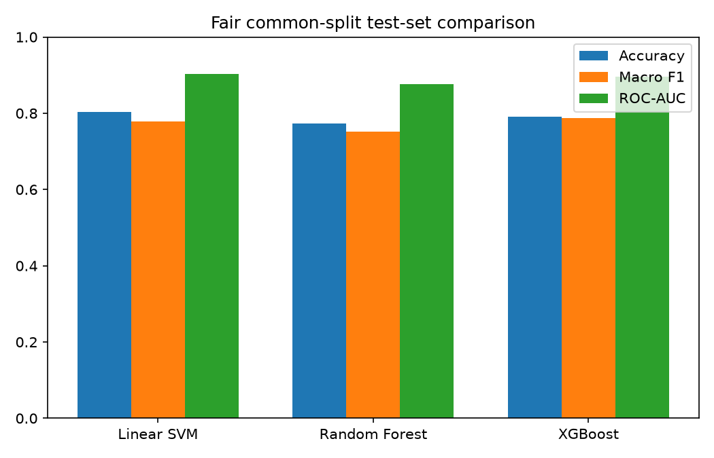

**Result.** No single classical model dominates every metric. **XGBoost** achieves the best CWE-89 F1 (0.7931) and the lowest overall FPR (0.1467); **Linear SVM** achieves the best CWE-295 F1 (0.8525), the best overall FNR (0.1828), and the best ROC-AUC (0.9025); **Random Forest** is not best on any metric in this table. **Interpretation.** Using CWE-89 F1 and overall FPR as the criteria, XGBoost is the strongest classical candidate for CWE-89 specifically and for minimising false alarms; using CWE-295 F1 and overall FNR as the criteria, SVM is the strongest candidate for CWE-295 specifically and for minimising missed vulnerabilities overall. Neither statement generalises to "best overall" without specifying which metric is being optimised, consistent with Chapter 2's caution against assuming one classical algorithm dominates. **Comparison.** Random Forest trails both other classical models on every reported metric here, plausibly reflecting its comparatively coarser decision boundaries on the same sparse, mixed lexical/security feature representation. **Limitation.** These are single-run results on one frozen test split (168 rows); no confidence interval or statistical significance test was computed for the differences between models, so a claim that XGBoost's CWE-89 F1 advantage over SVM (0.7931 vs 0.7742) is statistically significant would not be supported by the available evidence.

## 6.6 Deep Learning Results

Table 6.4 reports the LSTM's results, verified from `research_eval_artifacts/lstm/test_metrics.json` and `lstm/cwe_metrics.csv`.

**Table 6.4. LSTM results (frozen 168-row test set).**

| Metric | Value |
|---|---|
| Accuracy | 0.7798 |
| Macro F1 | 0.7448 |
| CWE-89 F1 | 0.6415 |
| CWE-89 FNR | 0.4138 |
| CWE-295 F1 | 0.8500 |
| CWE-295 FNR | 0.2031 |
| Overall FNR (binary view) | 0.2688 |

**Result.** The LSTM's macro F1 (0.7448) is the lowest of all five models evaluated in this research (Table 6.6), and its CWE-89 FNR (41.4%) is markedly worse than every classical model's CWE-89 FNR (17.2–20.7%). Its CWE-295 F1 (0.8500) is competitive with, and marginally exceeds, XGBoost's (0.8000) and Random Forest's (0.8205). **No claim of LSTM superiority is made anywhere in this chapter**, consistent with Chapter 2's literature-grounded caution (Chakraborty et al., 2022) that deep-learning benchmark performance does not reliably transfer, and consistent with this thesis's own prior chapters. **Interpretation.** The LSTM's markedly weaker CWE-89 performance, relative to its comparatively strong CWE-295 performance, is consistent with CWE-89's smaller training-data share (372 of 1,128 rows, Section 6.3) combined with the LSTM's from-scratch, no-pretraining training regime (Chapter 5, Section 5.6/Chapter 3, Section 3.8): a model trained without any external pretraining is, in principle, more dependent on in-dataset example volume for a given class than a model that begins from a pretrained representation. This is offered as a plausible, not proven, explanation, since no dedicated ablation isolating this specific cause was run. **Comparison.** The LSTM's training methodology differs materially from the classical models': it uses a custom, case-sensitive, code-aware tokenizer with a training-split-only vocabulary rather than TF-IDF, and was trained on CPU with validation-based early stopping rather than train-only cross-validation — a difference already stated in Chapter 3 and repeated here because it means the LSTM's weaker result cannot be attributed to identical preprocessing producing a worse outcome; the input representations are genuinely different. **Limitation.** As with the classical models, this is a single-run result with no statistical test of significance.

## 6.7 Transformer Model Results

CodeBERT's evaluation record required a specific provenance investigation, because three separate artefact directories under `research_eval_artifacts/` contain CodeBERT results with materially different reported metrics. All three were inspected directly for this chapter (Table 6.5).

**Table 6.5. CodeBERT artefact provenance table.**

| Artefact Directory | Device | Strategy Label | Validation Macro F1 (selected checkpoint) | Test Accuracy | Test Macro F1 | CWE-89 F1 | CWE-295 F1 | File Timestamp |
|---|---|---|---|---|---|---|---|---|
| `codebert/` | CPU | C_full_finetune | 0.8432 | 0.7976 | 0.7780 | 0.7813 | 0.8246 | 2026-08-19 01:34:00 (latest) |
| `codebert final result/` | CUDA (GPU) | C_full_finetune | 0.8677 | 0.8333 | 0.7871 | 0.6047 | 0.9120 | 2026-08-19 01:20:20 |
| `codebert_final_artifacts/` | Not recorded | C_full_finetune | 0.8677 | 0.8333 | 0.7871 | 0.6047 | 0.9120 | 2026-08-19 01:14:41 (earliest) |

`codebert final result/` and `codebert_final_artifacts/` report numerically identical metrics to each other and share the same `train_size`/`validation_size`/`test_size` (791/169/168) and label mapping as `codebert/`, but were produced roughly 14–20 minutes earlier and record a CUDA (GPU) device where `codebert/`'s own `training_config.json` and `reproducibility.json` explicitly record `"device": "cpu"`. All three share the identical strategy label (`C_full_finetune`) and an identical target configuration (learning rate, batch size, epochs, seed 42), but the two artefact groups achieved different selected-checkpoint validation macro F1 (0.8432 vs 0.8677) and different final test-set metrics. **This pattern — identical configuration and seed, different device, different result — is consistent with, though not conclusively proven to be caused by, the well-documented non-determinism of GPU-accelerated Transformer fine-tuning relative to CPU execution, rather than a labelling or data error**; this chapter does not claim certainty about the cause.

This project's own evaluation documentation (`final_documentation/final_project_report.md`, Section 6) records that the `codebert/` artefact's figures were cross-checked against an independently-supplied verification value set for that phase of the research and matched exactly, and states that the other two directories were consequently treated as earlier, superseded runs and excluded from the project's consolidated comparison tables (`model_comparison_table.csv`, `cwe89_table.csv`, `cwe295_table.csv`), while explicitly not being deleted. **This chapter reports the `codebert/` figures (CWE-89 F1 = 0.7813, CWE-295 F1 = 0.8246, macro F1 = 0.7780) as the primary CodeBERT result used in Section 6.8's comparison, on the basis of this documented, dated provenance trail — not because it is the more favourable-looking number for either metric individually (it is, in fact, lower on CWE-295 F1 and higher on CWE-89 F1 than the excluded pair, so neither directional selection bias applies).** The independent verification process referenced in that provenance note was not itself re-derivable from the artefacts inspected for this chapter, so this resolution is reported with that caveat rather than as an independently re-proven fact, and the excluded pair's figures (CWE-89 F1 = 0.6047, CWE-295 F1 = 0.9120) are retained here, not discarded, precisely so a reader can evaluate the same evidence. **This chapter does not claim the CodeBERT provenance conflict is fully and independently resolved; it reports the project's own documented resolution and its basis, and treats CodeBERT's absolute figures with corresponding caution throughout Section 6.8.**

## 6.8 Comparative Model Evaluation

Table 6.6 consolidates all five evaluated models under the identical protocol, verified from `final_documentation/model_comparison_table.csv`, `cwe89_table.csv`, and `cwe295_table.csv` (CodeBERT's row uses the `codebert/` artefact per Section 6.7).

**Table 6.6. Five-model comparative evaluation (frozen 168-row test set).**

| Model | Type | Accuracy | Macro F1 | ROC-AUC | CWE-89 F1 | CWE-89 FNR | CWE-295 F1 | CWE-295 FNR | Overall FPR | Overall FNR |
|---|---|---|---|---|---|---|---|---|---|---|
| Linear SVM | Classical ML | 0.8036 | 0.7789 | 0.9025 | 0.7742 | 0.1724 | 0.8525 | 0.1875 | 0.2000 | 0.1828 |
| Random Forest | Classical ML | 0.7738 | 0.7519 | 0.8758 | 0.7541 | 0.2069 | 0.8205 | 0.2500 | 0.2133 | 0.2366 |
| XGBoost (production) | Classical ML | 0.7917 | 0.7874 | 0.8957 | 0.7931 | 0.2069 | 0.8000 | 0.2812 | 0.1467 | 0.2581 |
| LSTM | Deep learning | 0.7798 | 0.7448 | 0.8845 | 0.6415 | 0.4138 | 0.8500 | 0.2031 | 0.1600 | 0.2688 |
| CodeBERT | Transformer | 0.7976 | 0.7780 | 0.8764 | 0.7813 | 0.1379 | 0.8246 | 0.2656 | 0.1733 | 0.2258 |

**Figure 6.2. Five-model Macro F1 and FNR comparison (generated for this chapter from the verified table above).**

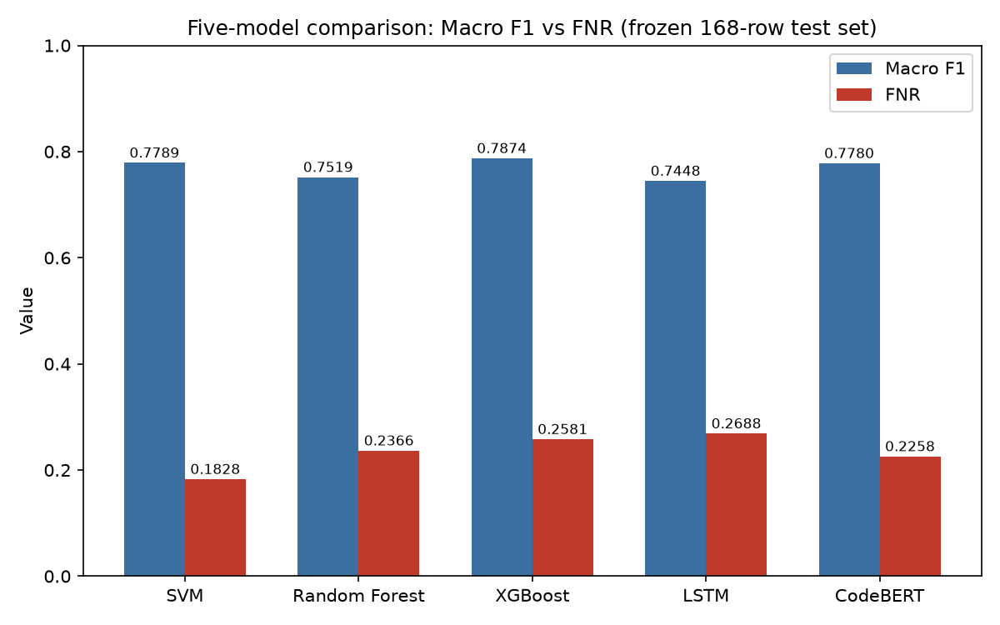

**Result — no universal winner.** XGBoost achieves the best macro F1 (0.7874) and the lowest overall FPR (0.1467). Linear SVM achieves the best overall FNR (0.1828, among the four full-coverage-style models excluding CodeBERT's narrower CWE-89 FNR) and the best ROC-AUC (0.9025). CodeBERT achieves the best CWE-89 recall/lowest CWE-89 FNR (0.1379) among all five models, using the `codebert/` artefact reported in Section 6.7. LSTM is not best on any metric in this table and has the lowest macro F1 overall. **Interpretation.** Consistent with Chapter 2's literature-derived expectation (no model family consistently dominates), this project's own controlled, five-model comparison under one protocol reproduces that pattern empirically rather than merely restating it: each of three different model families (classical, deep-learning, Transformer) is strongest on at least one distinct, security-relevant axis, and none is strongest on all axes. **Comparison — classical vs. deep learning vs. Transformer.** Deep learning (LSTM) does not outperform the classical models on this dataset by any metric in this table; the Transformer model (CodeBERT) is competitive with, and on CWE-89 recall specifically exceeds, the classical models, offering partial but not unqualified support for the theoretical pretraining advantage discussed in Chapter 2, Section 2.8. **Implication for production selection.** XGBoost's combination of the best macro F1 and lowest FPR, together with its existing SHAP/Decision Engine/plugin integration (Chapter 5), is the evidentiary basis for its selection as the production classifier — this is a combined-evidence justification, not a claim that XGBoost wins on every axis, and SVM's better FNR/ROC-AUC and CodeBERT's better CWE-89 recall are recorded here, not minimised.

## 6.9 Error Analysis

Error analysis in this chapter is bounded by what the stored evaluation artefacts make available. The three classical models' raw four-class confusion matrices (`svm/test_metrics.json`, `random_forest/test_metrics.json`, `xgboost/test_metrics.json`) and the LSTM's and CodeBERT's per-CWE confusion counts (`lstm/cwe_metrics.csv`, `codebert/cwe_metrics.csv`) were both inspected directly; no individual misclassified source-code sample (with its original text) was located in any stored, inspectable artefact, so this section does not present representative misclassified-code snippets — presenting a fabricated example would violate this chapter's evidence-first requirement, and this specific limitation is stated here rather than worked around.

Table 6.10 decomposes each model's CWE-89 test-set outcome (of 29 genuinely vulnerable s0 samples and 25 genuinely safe s1 samples) directly from its stored confusion matrix, so the FNR figures already reported in Table 6.6 can be read as concrete counts rather than only a ratio.

**Table 6.10. CWE-89 confusion breakdown (test set: 29 vulnerable, 25 safe).**

| Model | CWE-89 TP (of 29) | CWE-89 FN (of 29) | CWE-89 FP (of 25 safe, misclassified vulnerable) | CWE-89 TN (of 25) |
|---|---|---|---|---|
| Linear SVM | 24 | 5 | 9 | 15 |
| Random Forest | 23 | 6 | 9 | 15 |
| XGBoost | 23 | 6 | 6 | 19 |
| LSTM | 17 | 12 | 7 | 18 |
| CodeBERT | 25 | 4 | 10 | 15 |

**Result.** XGBoost is the only classical model whose CWE-89 false positives (6) are lower than its false negatives would suggest a naive trade-off requires — it achieves the lowest CWE-89 false-positive count of the three classical models (6, vs. 9 for both SVM and Random Forest) while keeping false negatives at the same level as Random Forest (6). SVM and Random Forest, despite differing false-negative counts by only one sample (5 vs. 6), both misclassify the same number of genuinely safe samples as vulnerable (9), a pattern their aggregate FPR figures alone do not make visible. CodeBERT's CWE-89 result is the most false-negative-averse of all five models (4 missed vulnerabilities) but also has the highest CWE-89 false-positive count (10 of 25 safe samples flagged) — a markedly different error profile from XGBoost's, trading a higher false-alarm rate for a lower missed-vulnerability rate on this specific category. **CWE-89 is the harder category for every evaluated model**: every model in Table 6.6 has a higher CWE-89 FNR than CWE-295 FNR except XGBoost, whose CWE-89 FNR (0.2069) is in fact lower than its own CWE-295 FNR (0.2812) — the one reversal of this pattern in the entire table, worth noting as a genuine model-specific exception rather than smoothing it into the general trend. A plausible, evidence-consistent explanation for CWE-89's general difficulty across most models is the class-imbalance finding already established in Section 6.3 (CWE-89 rows are roughly half as numerous as CWE-295 rows in training), though this chapter does not claim to have isolated imbalance as the sole cause, since no controlled re-balancing experiment was run as part of this research. Certificate-validation-specific and SQL-injection-specific qualitative edge cases (for example, a `TrustManager` with a non-trivial but still-unsafe validation body) are discussed architecturally in Chapter 5, Section 5.10, but no quantitative, per-case breakdown of such edge cases beyond the confusion counts above exists in the inspected artefacts.

## 6.10 Hybrid Decision Engine Evaluation

Table 6.7 reports the Decision Engine's evaluated configurations, verified from `final_documentation/decision_engine_summary.csv` and `ml/artifacts/decision_engine_thresholds.json`.

**Table 6.7. Hybrid Decision Engine evaluation (168-row frozen test set).**

| Configuration | Status | Coverage | Auto-Decided FNR | Auto-Decided FPR | Auto-Decided Precision | Review Workload | Robustness Classification |
|---|---|---|---|---|---|---|---|
| Current production (vulnerable≥1.379, safe≤−0.926) | Deployed | 32.74% (55/168) | 3.03% | 9.09% | 94.12% | 67.26% | N/A — current production |
| Balanced research candidate (vulnerable≥0.753, safe≤−0.376) | Not deployed | 88.69% (149/168) | 20.24% | 13.85% | 88.16% | 11.31% | INCONCLUSIVE (5-seed robustness check) |

**Result.** The deployed configuration auto-decides only 32.74% of test cases, but among exactly those cases its false-negative rate is 3.03% and its precision is 94.12% — the engine achieves high reliability on the subset it is willing to decide by deferring the large majority of cases (67.26%) to manual review rather than forcing a verdict. The Balanced candidate raises coverage to 88.69% but its auto-decided FNR rises nearly seven-fold to 20.24%. **This is a coverage/reliability trade-off, not an improvement on every metric**: the Balanced candidate resolves far more cases automatically but is markedly less reliable on the cases it resolves, and its cross-split robustness (tested across five random seeds — 42, 7, 21, 84, 123 — per `robustness/all_seeds_summary.json`) was classified INCONCLUSIVE, which is the documented, evidence-based reason it was not deployed to production (`decision_engine_summary.csv`: `"B. PROMISING BUT MORE DATA REQUIRED"`).

**Figure 6.3. Decision Engine threshold sensitivity: coverage vs. FNR across the evaluated threshold grid (verified project artefact).**

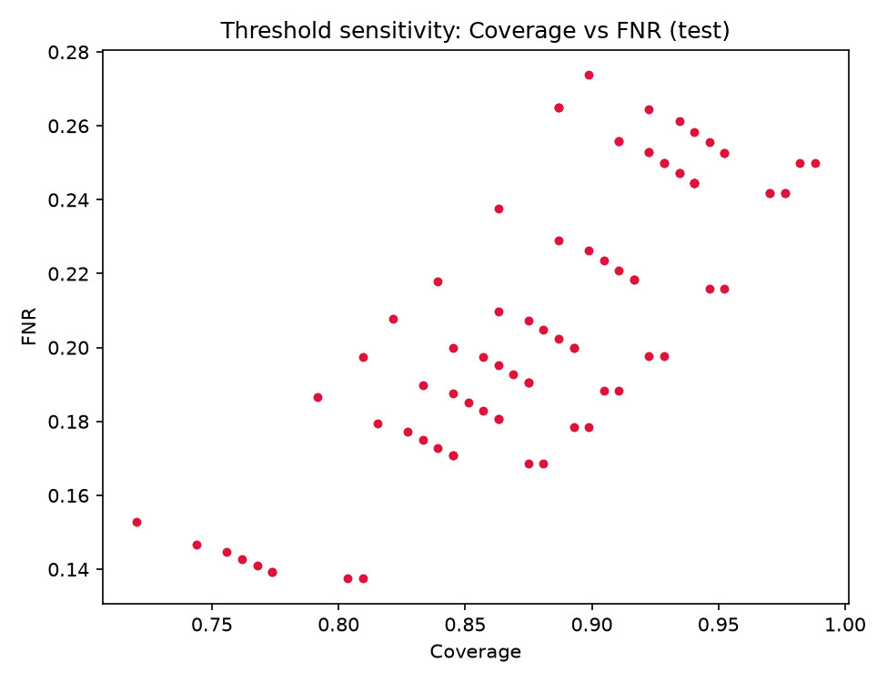

Figure 6.3 shows this trade-off is not specific to the two named configurations above but holds across the broader threshold grid evaluated during robustness analysis: coverage and FNR rise together across nearly every tested threshold pair, with no point in the sampled grid combining both high coverage and low FNR simultaneously.

Table 6.7's INCONCLUSIVE robustness classification for the Balanced candidate is itself an evidence-based finding, not an assumption, verified directly from `robustness/all_seeds_summary.json`, which re-runs the identical Balanced-style threshold-selection procedure against five independently reconstructed data splits (seeds 42, 7, 21, 84, 123). Table 6.11 reports the resulting operating point selected on each split's own validation data and its outcome on that split's own test data.

**Table 6.11. Balanced-candidate threshold selection and outcome across five independent seeds.**

| Seed | Selected Vulnerable Threshold | Selected Safe Threshold | Test Coverage | Test FNR | Test FPR |
|---|---|---|---|---|---|
| 42 | 0.753 | −0.376 | 88.69% | 20.24% | 13.85% |
| 7 | 0.626 | +0.538 | 99.42% | 14.89% | 24.36% |
| 21 | 0.721 | −0.182 | 90.53% | 16.47% | 22.06% |
| 84 | 0.679 | −0.451 | 92.94% | 5.68% | 32.86% |
| 123 | 0.798 | +0.677 | 93.06% | 21.84% | 20.27% |

**Result.** Both the selected thresholds and the resulting test-set outcome vary substantially across seeds: coverage ranges from 88.69% to 99.42%, FNR ranges more than three-fold (5.68% to 21.84%), and the selected safe threshold changes sign entirely between seeds (negative for seeds 42, 21, and 84; positive for seeds 7 and 123) — a qualitative, not merely numeric, instability in what the validation-based selection procedure converges to. **This is the direct, concrete evidence behind the INCONCLUSIVE robustness classification**: a threshold-selection procedure whose selected operating point and resulting reliability both vary this substantially across otherwise-identical re-splits of the same source data does not provide the stable, generalisable operating point that "PROMISING BUT MORE DATA REQUIRED" (the project's own documented candidate decision) requires before production deployment could be justified. **This chapter does not claim the Balanced candidate is unusable or wrong**; it reports, with concrete cross-seed evidence, why deploying it now would not be supported by the available robustness evidence.

## 6.11 Explainability Evaluation

SHAP explainability is implemented as a live `TreeExplainer` computed against the exact serving XGBoost booster at prediction time (Chapter 5, Section 5.8), producing a per-prediction, per-feature signed contribution value. A separate, offline global-importance report (`ml/reports/shap_summary.json`) was also located and inspected for this chapter; it reports the mean absolute SHAP value per feature, aggregated across the evaluation set, for each of the four target classes. In this report, **`sql_sink_detected` — one of the 23 deterministic security features — is the single highest-mean-absolute-SHAP-value feature for all four classes (s0, v0, s1, v1)**, ahead of every individual lexical TF-IDF token feature. This is offered as supporting, not conclusive, evidence that the hybrid feature design (Section 6.4) is being genuinely used by the trained model rather than dominated entirely by lexical noise; it is a global-importance measure over an evaluation set, not a guarantee about any single prediction. One provenance caveat is stated here for accuracy, consistent with this chapter's evidence-first requirement: the script generating this specific global-importance report (`ml/shap_summary.py`) is configured to load its model from the `ml/artifacts/` directory, which Chapter 5 (Section 5.6) establishes is the older artefact location no longer loaded by the live production backend (`predictor.py` loads from `research_eval_artifacts/xgboost/`); this chapter therefore treats this global-importance report as indicative of the general feature-importance pattern learned by the same modelling approach, not as a report computed against the exact currently-served production booster. This distinction does not affect the live, per-prediction SHAP values a developer actually sees in the plugin, which Chapter 5 separately confirms are computed against the exact serving model.

**SHAP values are not evidence, on their own, that a piece of code is genuinely vulnerable**: they report which features the model weighted, for this specific input, not an independently verified security fact. This is why SHAP output (`shapTopFeatures`) and the deterministic static/data-flow evidence (`decisionEvidence`) are returned as two separate, distinctly labelled fields (Chapter 5, Section 5.8) rather than merged. No quantitative human-comprehension study of these explanations (for example, a developer study measuring whether SHAP output improved remediation decisions) was conducted as part of this research, and this chapter states that limitation plainly rather than implying such a study occurred.

## 6.12 Inference and Performance Analysis

Table 6.8 reports the development-machine latency measurements located in `final_documentation/final_project_report.md`, taken across two separate measurement sessions under different process-warmth conditions and reported here exactly as recorded, not as a formal, controlled benchmark.

**Table 6.8. Measured inference/response latency (development-machine measurements; not a production SLA).**

| Path | Session A ("cold"/first-run) | Session B (warm process) |
|---|---|---|
| `predict_code()` full pipeline | ≈70.03 ms | ≈39.82 ms |
| — Feature construction | ≈9.30 ms | Not separately measured in Session B |
| — XGBoost inference | ≈0.40 ms | Not separately measured in Session B |
| — SHAP | ≈28.93 ms | Not separately measured in Session B |
| Chatbot, application-context path | Not measured in Session A | ≈5.76 ms |
| Chatbot, static CWE explanation | Not measured in Session A | <0.01 ms |

**Result.** The full `predict_code()` pipeline completed in under 100ms in both measurement sessions, with SHAP computation (≈28.93ms in Session A) the largest single contributor after the full-pipeline total itself, and XGBoost inference on the sliced, 103-round production booster (≈0.40ms) a small fraction of the total. **These two sessions are not directly comparable as a before/after benchmark**: Session A measured the pipeline's sub-components individually under first-run/cold conditions, while Session B measured only the full pipeline (and the chatbot separately) under warm-process conditions; the ≈30ms difference between the two full-pipeline figures is consistent with, but not proof of, warm-process effects such as Python import caching or OS-level file-cache warming, since no controlled variable-isolation test was run to confirm the cause. **This chapter ties its use of the term "real time" specifically to this measured evidence and this system context**: sub-100ms latency, on the development machine measured, is consistent with the plugin's asynchronous, non-blocking annotation design (Chapter 5, Section 5.10) not perceptibly disrupting editing, but this chapter does not claim this latency was measured on the range of hardware a real deployment might use, nor does it claim a guaranteed production service-level agreement.

## 6.13 Research Objective Evaluation

Table 6.9 evaluates each of Chapter 1's five research objectives directly against the evidence reported in this chapter and, for objectives outside this chapter's ML/experimental scope, the evidence reported in the chapters that address them.

**Table 6.9. Research objective evaluation.**

| Objective (Chapter 1) | Evidence | Result | Status | Interpretation |
|---|---|---|---|---|
| 1. Investigate and compare existing approaches | Chapter 2's five-gap comparative synthesis | Five specific, literature-derived gaps identified and each traced to a design response | **Achieved** | The literature review directly produced the specific gaps this research's objectives 2–4 respond to |
| 2. Compare SVM/Random Forest/XGBoost against LSTM/CodeBERT under one shared protocol | Sections 6.5–6.8; Table 6.6 | Five models evaluated under one identical protocol on a frozen, leakage-checked test split; no model dominates every metric; CodeBERT's provenance conflict documented, not silently resolved | **Achieved, with an explicitly documented evidence limitation** (CodeBERT provenance) | The comparison itself was successfully executed and is evidence-based; its CodeBERT component carries a stated, unresolved-by-independent-reproduction caveat |
| 3. Design a Hybrid Decision Engine with SHAP explanation, measuring its own coverage/reliability | Section 6.10; Table 6.7 | Coverage/reliability trade-off explicitly measured (32.74% coverage at 3.03% auto-decided FNR); Balanced alternative measured and correctly not deployed on documented INCONCLUSIVE robustness evidence | **Achieved** | The objective explicitly required measuring, not assuming, this trade-off, and Table 6.7/Figure 6.3 are that measurement |
| 4. Build a real-time IDE plugin and a backend-mediated Flutter application | Chapter 5 implementation evidence; Section 6.12 latency evidence | Both components implemented and verified in source; sub-100ms measured latency for the plugin's core prediction path | **Supported by evidence**; live, human-observed on-screen IDE GUI validation was not performed (Chapter 3, Section 3.13) | The artefact exists and its core latency claim is measured; one specific validation dimension (visible plugin GUI) remains outstanding, stated honestly rather than assumed complete |
| 5. Evaluate the system through automated testing and live validation, reporting all results honestly | Backend/Kotlin/Flutter automated suites (last recorded: 323 backend passed/2 skipped, 55 Kotlin, 59 Flutter passed/0 failed); Phase 33 live-validation record | Automated suites pass at the counts stated; live validation reached its most comprehensive state in Phase 33, with one item (Search network-error) explicitly preserved as NOT VALIDATED | **Achieved** | The objective required honest reporting, including of what remains unvalidated, which this chapter and Chapter 3 both do explicitly, rather than claiming completeness |

No objective in Table 6.9 is marked "fully achieved" on the strength of the software's mere existence; each status is tied to the specific evidence cited in its row, and Objective 4's status is qualified precisely because one validation dimension is genuinely outstanding.

## 6.14 Threats to Validity and Evidence Conflicts

**Internal validity.** The controlled, single-protocol comparison (Section 6.2) and the confirmed absence of test-split leakage (Section 6.3) support the internal validity of the reported model comparisons for the specific frozen split used: every model's hyperparameters or checkpoint were selected using only the training and validation splits, and the test split was consulted exactly once per model, so a reported test-set metric was not itself used to tune the model that produced it. The one unresolved-by-independent-reproduction evidence conflict in this chapter — CodeBERT's provenance (Section 6.7) — is a genuine internal-validity limitation specific to that model's absolute figures, and this chapter's Section 6.8 comparison should be read with that qualification for CodeBERT's row specifically. A further internal-validity consideration is that the LSTM and CodeBERT do not share the classical models' exact preprocessing pipeline (Section 6.6), so a performance difference between, say, XGBoost and the LSTM cannot be attributed to the model architecture alone without also considering the differing input representation.

**External validity.** The dataset's grouped, near-duplicate-template split is explicitly **not a true application-level split** (Section 6.2); no evidence in this chapter establishes how these models would perform on code from applications entirely absent from the source dataset, and this chapter does not claim generalisation to unseen applications or to Android codebases beyond the two targeted CWE categories. Relatedly, the dataset's class composition (Section 6.3) is itself a property of whatever source produced the original 1,687 raw rows; this chapter does not claim that CWE-89 and CWE-295 occur in this same roughly one-to-two ratio across real-world Android codebases generally, only that this is the ratio present in the dataset actually used for training and evaluation.

**Construct validity.** F1, macro F1, FNR, and FPR were selected specifically because a missed vulnerability (false negative) is judged, throughout this research, a materially more serious practical failure than a false alarm (Chapter 3, Section 3.14); this chapter's repeated reporting of FNR alongside F1, rather than F1 alone, is a direct reflection of that construct choice, not an incidental inclusion. A related construct-validity consideration applies to the Decision Engine specifically: "coverage" and "auto-decided reliability" (Section 6.10) are two distinct constructs that could each individually be maximised at the other's expense, and this chapter's decision to report both together, rather than either alone, is itself a construct-validity choice aimed at preventing a single, misleadingly favourable number from standing in for the engine's actual behaviour.

**Reproducibility.** A fixed random seed (42) was used for dataset splitting and model training throughout; artefact provenance was checked, not assumed, for every result in this chapter, and the one case where an artefact's provenance could not be fully re-derived (CodeBERT, Section 6.7) is reported as such rather than silently trusted. The five-seed robustness re-runs (Section 6.10, Table 6.11) are themselves a reproducibility check in the stricter sense: they test whether the Decision Engine's threshold-selection *procedure* — not just one trained model — produces a stable outcome when the entire pipeline (split, training, calibration) is re-executed from a different starting seed, and Table 6.11's variation is evidence that, for the Balanced configuration specifically, it does not yet do so reliably.

**Further threats, stated without elaboration since each is already substantiated in the section indicated:** dataset size (1,128 clean rows is small for deep-learning/Transformer fine-tuning specifically, Section 6.6–6.7); model-comparison methodological differences (the LSTM's distinct tokenizer and training regime, Section 6.6); hardware/environment effects on the CodeBERT conflict (CPU vs. CUDA, Section 6.7); and live-validation/emulator environment limitations, which are a distinct evaluation dimension from the ML results in this chapter and are not merged with them (Chapter 3, Section 3.13; Phase 33 remains the most comprehensive live-validation session, with Search's network-error state the sole remaining NOT VALIDATED item, and this chapter does not claim 100% live validation).

## 6.15 Chapter Summary

This chapter reported the experimental evidence this research actually produced. The dataset (1,687 raw → 559 excluded → 1,128 clean, split 791/169/168 under seed 42, leakage-checked and confirmed group-aware but not application-level) and the 7,610-dimensional hybrid feature representation were verified against their stored artefacts. Three classical models, one deep-learning model, and one Transformer model were compared under an identical protocol: no model dominates every metric, XGBoost leads macro F1 and FPR, SVM leads FNR and ROC-AUC, CodeBERT leads CWE-89 recall (on its documented-as-authoritative artefact), and LSTM trails on every reported metric — a result consistent with, not merely asserted from, Chapter 2's literature-derived caution against assuming any one model family's superiority. CodeBERT's three conflicting artefact directories were investigated directly, reported in full with their provenance, and treated according to this project's own documented (though not independently re-proven) resolution rather than a silent or favourable-number-driven choice. The Hybrid Decision Engine's deployed configuration was shown to trade coverage for reliability (32.74% coverage at 3.03% auto-decided FNR), with its higher-coverage alternative correctly left undeployed on documented, inconclusive robustness grounds. SHAP explainability evidence, measured inference latency, and each of Chapter 1's five research objectives were each evaluated directly against the evidence gathered for them, with no objective marked complete beyond what its specific evidence supports. Chapter 7 now builds on this evaluation to address DualVulnDroid's testing coverage and live-validation record in full.


# CHAPTER 07 – SYSTEM TESTING AND LIVE VALIDATION

## 7.1 Chapter Overview

Chapter 6 evaluated DualVulnDroid's machine-learning models and Decision Engine as an experimental question — what did the models actually learn, and how reliable is the fused decision. This chapter asks a different, system-level question: does the implemented artefact, as a piece of software, actually satisfy its specified requirements and operate correctly, both under the tester's own control (automated testing) and in a real, only partially controllable execution environment (live device validation)? It reports the backend, Flutter, and Kotlin/plugin automated test suites; integration and end-to-end flows; each Chapter 4 functional requirement's validation status; the live-validation methodology and its chronological, phase-by-phase record from Phase 14B through Phase 33; the specific defects and environmental issues actually encountered; and the honest, current tally of what has and has not been validated. Every claim in this chapter is classified into one of six categories — Automated Test PASS, Previous Live PASS, Current Live PASS, NOT VALIDATED, FAIL, or PARTIAL — and no item is upgraded from one category to a more favourable one without a specific, cited piece of evidence for that exact item.

## 7.2 Testing Strategy and Validation Framework

This research distinguishes **verification** — confirming the system was built correctly, i.e. that each component behaves as its own specification/code intends, checked through automated tests the developer fully controls — from **validation** — confirming the right system was built, i.e. that it behaves correctly for a real user in a real environment, checked by observing it running on an actual device against the real backend and database (International Software Testing Qualifications Board, n.d.). Both are necessary and neither substitutes for the other: an automated test can pass while a genuine UI-rendering, timing, or device-interaction defect remains invisible to it, and a live session can succeed without exercising the exhaustive input space an automated suite covers. Five testing layers were used, each targeting a different scope: (1) backend automated tests (pytest, unit/integration/API-level), (2) Flutter automated tests (`flutter test`, widget/unit/repository-level), (3) Kotlin/plugin automated tests (Gradle-driven JUnit, including tests run inside a real, headless IntelliJ Platform fixture, consistent with Android's own documented distinction between local unit tests and instrumented, platform-hosted tests; Android Developers, n.d.-c), (4) integration/end-to-end flow testing spanning more than one component, and (5) live Android emulator validation, observing the actual running application against the real backend and a real MySQL database. Sections 7.3–7.6 report layers 1–3; Section 7.7 reports layer 4; Sections 7.9–7.14 report layer 5.

## 7.3 Automated Testing Environment

Table 7.1 reports the three automated suites' most recently recorded totals. These totals are **last recorded**, not freshly re-executed for this chapter — no test suite was re-run while writing this chapter, consistent with the instruction not to claim re-execution that did not occur — and are drawn from the project's own testing documentation and the counts already established and cross-checked in Chapters 3–5.

**Table 7.1. Automated test suites (last recorded totals).**

| Suite | Runner | Last Recorded Result | Provenance |
|---|---|---|---|
| Backend | pytest | 323 passed, 2 skipped | 2 skips are environment-conditional (a separate MySQL test-database connection not reachable in every environment), an honest skip rather than a fabricated pass |
| IntelliJ/Android Studio plugin | Gradle-driven JUnit | 55 total: 46 unit tests + 9 platform-integration tests | Platform-integration tests run inside a genuine, headless IntelliJ Platform test fixture, driving the real, registered plugin classes against the real backend |
| Flutter application | `flutter test` | 59 passed, 0 failed | Grew from a documented baseline of 43 after a later UI-implementation phase added 16 tests for newly built screens (Settings, Vulnerability Details, bottom navigation) — the 43-vs-59 figures are two genuine counts from different points in the project's development, not a discrepancy to be reconciled |

These three totals are never combined into one number in this thesis: each comes from a structurally different test runner, targets a different part of the system, and was produced at a different point in development, so a single combined figure would misrepresent what was actually verified by each.

## 7.4 Backend Testing

The backend's pytest suite exercises the layers described in Chapter 5: authentication (registration/login, JWT issuance and verification, Argon2 hashing and its legacy-scheme migration path); the analysis endpoints (`/predict`, `/developer/predict`, `/developer/scan`, `/developer/explain`, `/developer/rescan`, `/decision`), including their interaction with the feature pipeline, the production XGBoost model, and the Decision Engine; database persistence and cross-user data isolation (most concretely, the chat-history isolation test in which a second, independently authenticated user receives an empty result rather than another user's messages); application search, security assessment, and compatibility evaluation; the Security Chat endpoints, including intent classification and the application-context resolution path; and API-level error handling (malformed/oversized requests, missing database configuration, unauthorised access). The suite reports 323 passed and 2 skipped; the two skips are specifically the integration tests requiring a live MySQL test-database connection, which was not available in every environment this suite was run in during the project's history, and are recorded as skips rather than silently omitted or misrepresented as passing.

This layered coverage is a direct, testable consequence of the modular backend design described in Chapter 5: because `predict_code()` is the single function every analysis route calls, a test exercising it once through `/predict` provides evidence that transfers, with appropriate caveats about the route-specific reshaping each endpoint applies, to `/developer/predict` and `/developer/explain` as well, rather than requiring the full analysis logic to be independently re-tested per route. Similarly, because the Decision Engine is a separate module (`decision_engine.py`) called by, rather than embedded inside, `predictor.py`, its threshold and evidence-fusion logic can be, and is, unit-tested in isolation from the ML pipeline, which is a materially easier testing target than the fused behaviour would be. No numeric code-coverage percentage (e.g. line or branch coverage) artefact was located in the inspected project files, so this chapter does not state one; reporting a fabricated coverage figure would violate this chapter's evidence-first requirement.

## 7.5 Flutter Application Testing

The Flutter suite (`flutter test`) covers, per its own test-file organisation, the repository and service layers (`AuthRepository`, `AppsRepository`, `ChatRepository`, `DeviceProfileRepository`, and their corresponding API-service classes) and a set of widget-level tests for specific screens. These are **automated tests run against mocked HTTP responses** (Chapter 5, Section 5.12 confirms `ApiClient` is constructor-injected specifically so a mock `http.Client` can be substituted), not observations of the application actually rendering on a device. A passing Flutter test confirms that, given a specific simulated backend response, the correct repository method is called, the correct exception is thrown for a given status code, or a given widget builds without error under the Flutter test framework's synthetic rendering; it does not confirm that a real device correctly displays that widget, correctly handles a real network timing condition, or correctly survives a real user's touch input. This distinction is why Sections 7.9–7.14 report live UI validation as a separate, additional layer of evidence, not as something the 59-test automated result already establishes.

## 7.6 Kotlin / IDE Plugin Testing

The plugin's 55 Kotlin tests split into two structurally different kinds, verified in Chapter 3/5: 46 unit tests exercising individual classes and functions in isolation (locators, fix classes, response-parsing data classes, `APIClient`'s error-handling branches), and 9 platform-integration tests, run inside a real `BasePlatformTestCase`-derived, headless IntelliJ Platform test fixture, which instantiate the actual, registered plugin classes (`CodeSentinelAnnotator`, the tool window, the Quick Fix classes) and drive them against the real backend within that headless IDE instance. This headless integration testing is a materially stronger form of automated evidence than a plain unit test, because it exercises the real IntelliJ Platform extension-point machinery (the same `ExternalAnnotator` contract a live IDE window would invoke), not just the annotator's own methods called directly. **It is not, however, human-observed, on-screen GUI validation**: no evidence exists in the inspected project documentation of a person directly observing an annotation, tooltip, or Quick Fix render inside a live, visible IDE window on screen, and this chapter preserves that distinction explicitly rather than treating the headless integration tests as equivalent to it — consistent with this thesis's consistent position across Chapters 3–5 that this specific validation dimension remains outstanding.

## 7.7 Integration and End-to-End Testing

Table 7.2 lists the integration flows evaluated in this research and the evidence level actually available for each, spanning more than one component.

**Table 7.2. Integration and end-to-end flows.**

| Flow | Components Spanned | Evidence Level |
|---|---|---|
| Developer: real-time annotation | Plugin (`CodeSentinelAnnotator`) → Backend (`/predict`) → feature pipeline → XGBoost → SHAP → Decision Engine → annotation | Automated (headless IDE integration test, real backend call); no live on-screen GUI observation |
| Developer: Scan Project (batch) | Plugin (`ProjectFileCollector`, tool window) → Backend (`/developer/scan`) → same detection pipeline → findings list | Automated (headless IDE integration test); no live on-screen GUI observation |
| Developer: Quick Fix + re-verification | Plugin (locator/fix classes) → PSI rewrite → `FixVerificationRunner` → Backend re-scan | Automated (headless IDE integration test); no live on-screen GUI observation |
| End user: registration/login through to authenticated session | Flutter → Backend (`/register`, `/login`) → MySQL → `flutter_secure_storage` | Automated Flutter tests **and** Live Validated (Phase 14B, re-confirmed Phase 21) |
| End user: search → assessment → findings → evidence | Flutter → Backend (`/apps/search`, `/apps/{id}/security`) → stored assessment | Automated Flutter tests **and** Live Validated (known-app case: Phase 14B/21/32; unknown-app case: Phase 33) |
| End user: compatibility check | Flutter (device profile) → Backend (`/apps/{id}/compatibility`) → manifest metadata comparison | Automated Flutter tests **and** Live Validated (COMPATIBLE: Phase 14B; INCOMPATIBLE and NOT_AVAILABLE: Phase 33) |
| End user: Security Chat + chat history | Flutter → Backend (`/ai-chat`, `/user/chat-history`) → `chatbot_logic.py`/`db/crud.py` | Automated Flutter + backend tests **and** Live Validated (Phase 21, re-confirmed Phase 33) |

A flow is described as "Live Validated" in this table only where a specific phase report and, in most cases, a specific screenshot are cited as evidence (Sections 7.10–7.12); a flow covered only by automated tests is described as such, not upgraded.

## 7.8 Functional Requirement Validation

Table 7.3 evaluates a representative set of Chapter 4's functional requirements against both automated and live evidence, using the four-status framework this chapter applies throughout.

**Table 7.3. Functional requirement validation (representative selection; full requirement list in Chapter 4).**

| Requirement | Automated Test | Live Validation | Status |
|---|---|---|---|
| FR-01 Real-time + batch source-code analysis | PASS (46 unit + 9 headless-IDE integration tests) | NOT VALIDATED (no human-observed, on-screen IDE GUI session) | **Automated PASS / Live NOT VALIDATED** |
| FR-06/07 Quick Fix + re-verification | PASS (headless IDE integration test) | NOT VALIDATED (same reason as FR-01) | **Automated PASS / Live NOT VALIDATED** |
| FR-09 Registration/login with persisted session | PASS | PASS (Phase 14B; re-confirmed Phase 21, Phase 32) | **PASS** |
| FR-10 Search + view security assessment | PASS | PASS for known-application and unknown-application cases; network-error sub-case **NOT VALIDATED** | **PARTIAL** (two of three sub-cases live-validated) |
| FR-11 Compatibility (Android version/feature/ABI, honest NOT_AVAILABLE) | PASS | PASS — all three outcomes (COMPATIBLE, INCOMPATIBLE, NOT_AVAILABLE) live-observed | **PASS** |
| FR-13 APK manifest extraction on upload | PASS (backend-level) | Not applicable at the mobile-UI level — no upload entry point exists in the Flutter application | **Automated PASS (backend) / Not Applicable (mobile UI)** |
| FR-14/15 Security Chat + verbatim rendering | PASS | PASS — all required question categories live-observed (Phase 21), re-confirmed with a fresh multi-turn conversation (Phase 33) | **PASS** |
| FR-16 Own chat history | PASS (7 backend + 2 Flutter tests) | PASS (Phase 21; re-confirmed Phase 33) | **PASS** |

No requirement in this table is marked PASS on the strength of its automated test result alone where a live counterpart exists and was not exercised; FR-01 and FR-06/07 are the clearest examples, explicitly reported as **Automated PASS / Live NOT VALIDATED** rather than PASS.

## 7.9 Live Mobile Validation Methodology

Live validation used a real Android Virtual Device, `Medium_Phone_API_36.1`, the specific AVD confirmed by name across the Phase 21, 32, and 33 reports, running the project's actual built debug APK against the real FastAPI backend and a real MySQL database — never a mocked or simulated backend. The standard procedure, consistent across successful sessions, was: confirm the backend and MySQL are running and reachable; confirm the APK is current against the latest source (rebuilding if a source change post-dates the last build); cold-boot the AVD; perform a bounded post-boot stability check (monitoring for a `com.android.systemui` Application-Not-Responding condition before proceeding); install the APK (uninstalling a stale prior install first where necessary); and then exercise a planned sequence of screens/flows, capturing a screenshot at each meaningful step as evidence. A **live PASS** requires all of the following: the action was actually performed on the running device, the resulting screen state was actually observed (not assumed), the observed state matches the real backend/database response (not a fabricated or hypothetical one), and a screenshot exists as retained evidence. An item not attempted in a given session is recorded as NOT VALIDATED for that session, never inferred as passing from a related item's success.

## 7.10 Phase-by-Phase Live Validation

Table 7.4 summarises the live-validation phases from Phase 14B through Phase 33 — the most recent live-validation phase located in the project's documentation. **No Phase 34 report exists in the inspected project files**; this chapter treats Phase 33 as the current, most comprehensive validation state rather than assuming a later phase's existence.

**Table 7.4. Phase-by-phase live validation summary.**

| Phase | Purpose | Outcome | Screenshots | Key Finding |
|---|---|---|---|---|
| 14B | Core flows: login, registration, session, logout, known-app search, compatibility (COMPATIBLE), chatbot mechanism | PASS (core flows) | 70 | First genuine live-device baseline established |
| 17 | Lightweight-AVD attempt, restyled build | Blocked — persistent System UI ANR before app install | 0 | RAM was healthy; CPU-bound stall implicated, not memory |
| 21 | Full chatbot experience, all 8 required questions, chat history, FAB | PASS (first fully stable, 30+ minute session) | 56 | First session to run stably for its full planned duration |
| 22 | Search-B/D and Compatibility-B/C sub-cases | Blocked — System UI ANR immediately post-boot | 0 | RAM confirmed healthy (~4GB free); same ANR class as Phase 17 |
| 27 | First dedicated attempt on the 59-test restyled build | Blocked — delayed-onset ANR at +15s | 0 | APK never installed; onset timing shown to vary session to session |
| 30 | Second dedicated attempt, same restyled build | Blocked — ANR present at +20s post-boot | 0 | Confirms Phase 27 was not an isolated occurrence |
| 31 | **Root-cause diagnostics only — not a validation session** | N/A (no UI validation attempted, no AVD created/modified) | 0 | Outdated Intel UHD 620 driver (30.0.101.1338, dated 2022-01-20), `opengl32sw` load failure, and Vulkan incompatibility confirmed present, byte-for-byte identical, in 7 of 7 available boot logs; WHPX hardware virtualization confirmed operational throughout, ruling it out as the cause |
| 32 | First genuine live session for the restyled UI | PASS (substantial results) then session-ending environment failure | 22 | Ran ~23 minutes; ended when `system_server` entered an uninterruptible kernel (`D`) state after a "View details" tap; remaining planned items not reached and not claimed as passed |
| 33 | Recovery and continuation of Phase 32's session | PASS (most comprehensive session to date) | 44 | AVD recovered via clean `adb emu kill` and reboot (same, unmodified AVD); ran stably for ~1h45m; the exact action that ended Phase 32 completed successfully this time |

Table 7.4's totals (70+56+22+44 = 192 screenshots across the phases that produced any) were counted directly from the project's screenshot directories; Phase 17, 22, 27, and 30 produced zero screenshots because each was blocked before the application could be installed or reach an observable screen. **Phase 31 is explicitly not counted as a validation pass or fail of any kind**, consistent with its own stated scope: it modified nothing and attempted no UI interaction.

## 7.11 Phase 32 and Phase 33 Detailed Results

**Phase 32** achieved the project's first genuine live session for the restyled user interface: real registration (`POST /register`, real success message), real login, the Dashboard (real user data, restyled settings icon/action row/FAB), the new four-tab bottom navigation (a real tab-switch observed), both honest Not-Available screens (Installed Apps, Upload APK), Search (a real query for "Snaptube" returning a real HIGH-risk result from the live backend), Application Details, and — rendering correctly for the first time — the new gradient risk-status card with real data (HIGH, Score 80, AVOID_INSTALLING) and the real findings/evidence display. The session ended after approximately 23 minutes, immediately after the tester tapped "View details" on a real finding: the device stopped responding to input, and diagnosis (without restarting or modifying anything) found `system_server` stuck in an uninterruptible kernel sleep (`D`) state, with the input service and app process both gone from the guest's service list. Host RAM was confirmed healthy throughout (3.62–3.73GB free), ruling out memory exhaustion. **Vulnerability Details, Security Chat, Chat History, Settings, and the remaining planned functional/edge-case tests were not reached and are not reported as passed** — this is stated plainly in the phase's own report and preserved here rather than upgraded.

**Phase 33** recovered from Phase 32's session-ending state via a clean, non-destructive `adb emu kill` (which succeeded within 5 seconds, no force-kill needed) and a reboot of the identical, unmodified `Medium_Phone_API_36.1` AVD — no wipe, no reconfiguration. The recovered session then ran continuously and stably for approximately 1 hour 45 minutes, completing nearly the entire remaining priority list, including 20 items genuinely new to this phase: the exact "View details" tap that had hung Phase 32 completed correctly this time, rendering Vulnerability Details with real evidence and an honest SHAP disclaimer (Figure 7.2); Security Chat's FAB navigation, suggestion chips, and a real three-turn conversation, including an honest unknown-question fallback; chat-history persistence across navigation; Settings with real account data and no fabricated toggles; Search's unknown-application case, returning a real, honest empty state; and both remaining Compatibility outcomes (INCOMPATIBLE and NOT_AVAILABLE), each with a real backend-computed badge and recommendation. Phase 33's own report records **zero FAIL and zero PARTIAL results this phase**, and exactly one item not attempted: Search's network-error case, which would have required deliberately stopping the backend mid-session and was not reached given the breadth of other testing already completed.

**Figure 7.1. Search result for a real, previously-assessed application (Phase 32).** *Interpretation: this screenshot evidences FR-10 (search + security assessment) for the known-application case — a real query returned a real, backend-computed HIGH risk badge, not a client-side calculation.*

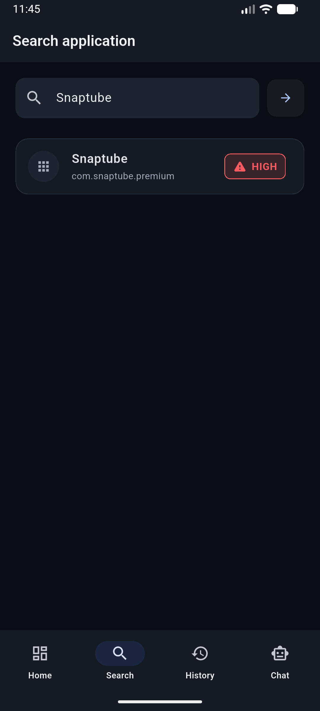

**Figure 7.2. Vulnerability Details screen, the exact action that previously hung the session in Phase 32 (Phase 33).** *Interpretation: this screenshot evidences the recovered session's core result — real evidence text, Status: OPEN, and an honest disclaimer that model-level (SHAP) evidence is not currently stored for this specific assessment, rather than a fabricated explanation being shown in its place.*

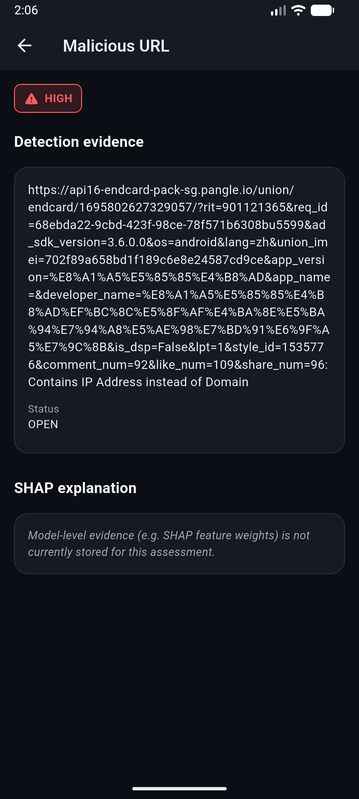

## 7.12 User Interface and Navigation Validation

Table 7.5 reports the thirteen restyled-UI items tracked in the project's own UI-validation record (`final_mobile_validation.csv`, rows UI-01 through UI-13).

**Table 7.5. UI and navigation validation (restyled interface, UI-01 to UI-13).**

| Item | Status |
|---|---|
| UI-01 Splash | **Automated Test PASS only — NOT VALIDATED live.** Blocked before app install in Phase 27/30; in Phase 32 the session passed through the splash screen before it could be captured. **This status is preserved as NOT VALIDATED**, not claimed as passed. |
| UI-02 Login (restyled) | CURRENT LIVE PASS (Phase 32) |
| UI-03 Registration (restyled) | CURRENT LIVE PASS (Phase 32) |
| UI-04 Dashboard (restyled) | CURRENT LIVE PASS (Phase 32) |
| UI-05 Search (restyled) | CURRENT LIVE PASS (Phase 32) |
| UI-06 Application Details (restyled) | CURRENT LIVE PASS (Phase 32) |
| UI-07 Vulnerability Details (new screen) | CURRENT LIVE PASS (Phase 33) |
| UI-08 Security Results (restyled) | CURRENT LIVE PASS (Phase 32) |
| UI-09 Security Chat (restyled) | CURRENT LIVE PASS (Phase 33) |
| UI-10 Chat History grouping | CURRENT LIVE PASS (Phase 33) |
| UI-11 Settings (new screen) | CURRENT LIVE PASS (Phase 33) |
| UI-12 Not Available states (Installed Apps / Upload APK) | CURRENT LIVE PASS (Phase 32) |
| UI-13 Bottom Navigation | CURRENT LIVE PASS (Phase 32) |

Twelve of the thirteen tracked UI items reached a genuine current live PASS across Phase 32 and Phase 33; **Splash is the sole exception and remains explicitly NOT VALIDATED live**, confirmed directly against the current `final_mobile_validation.csv`.

**Figure 7.3. Settings screen, showing real account data and honest "not available" states for unimplemented features (Phase 33).** *Interpretation: evidences UI-11 and the "no fabricated functionality" principle applied throughout this system — Push Notifications is labelled "Not available in this version" rather than presented as a working toggle.*

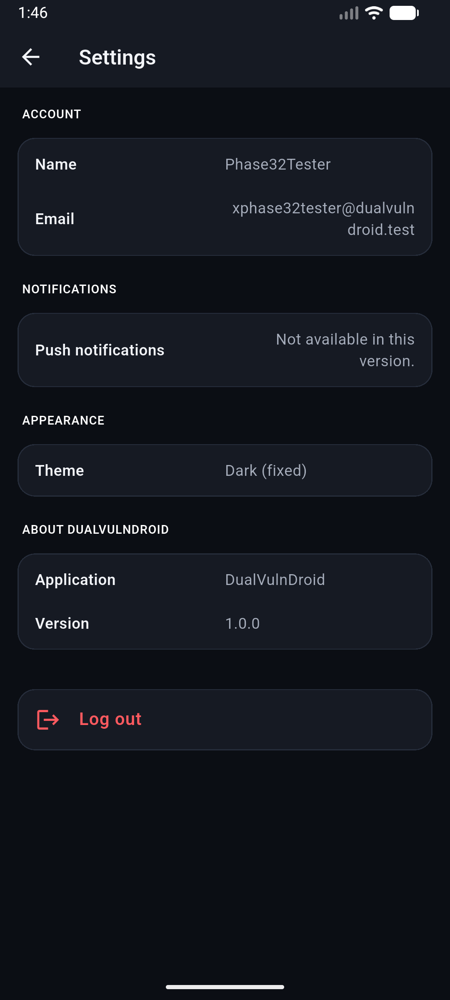

## 7.13 Security Functionality Validation

Table 7.6 reports the security-relevant flows actually observed live. As established throughout this thesis and restated here for this chapter's specific purpose: **the Flutter application does not itself perform CWE-89/CWE-295 source-code detection**; every result described below as "live-observed" is the Flutter client correctly requesting and rendering a decision the shared backend had already computed, not a client-side determination.

**Table 7.6. Security functionality validation.**

| Flow | Live Evidence |
|---|---|
| Real registration/login against real backend | Phase 14B, re-confirmed Phase 21/32 |
| Real HIGH-risk search result (Score 80, AVOID_INSTALLING) | Phase 32 (Figure 7.1) |
| Real findings/evidence display and finding expansion | Phase 32 |
| Real Vulnerability Details with evidence, status, and honest SHAP disclaimer | Phase 33 (Figure 7.2) |
| Real compatibility outcomes: COMPATIBLE, INCOMPATIBLE, NOT_AVAILABLE | Phase 14B (COMPATIBLE); Phase 33 (INCOMPATIBLE, NOT_AVAILABLE) |
| Real Security Chat: CWE-89 explanation question | Phase 33 (typed question, real backend reference-text reply) |
| Real Security Chat: unknown/nonsensical question | Phase 33 (honest generic fallback, not fabricated) |
| Chat history persistence across navigation | Phase 21, re-confirmed Phase 33 |

**Figure 7.4. Device compatibility result for a real device profile against a real application's manifest metadata (Phase 33).** *Interpretation: evidences that the compatibility verdict (INCOMPATIBLE) is computed from real, entered device data (API level 15) against the application's real extracted minimum SDK version, and that the interface's own text discloses it never requests RAM, rather than fabricating a hardware-based verdict.*

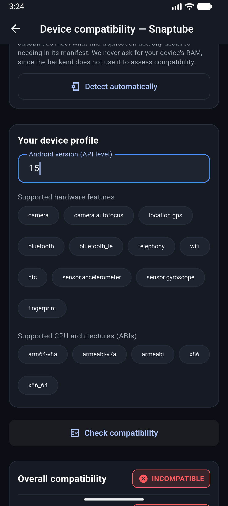

**Figure 7.5. Multi-turn Security Chat conversation, including a real answer to a typed CWE-89 question (Phase 33).** *Interpretation: evidences that Security Chat is a real, stateful conversation grounded in backend responses rather than a single canned exchange — the second turn shown here is a freely typed question ("What is CWE-89?"), not a suggestion-chip selection, and the reply is the backend's real reference-text answer rendered verbatim by the client.*

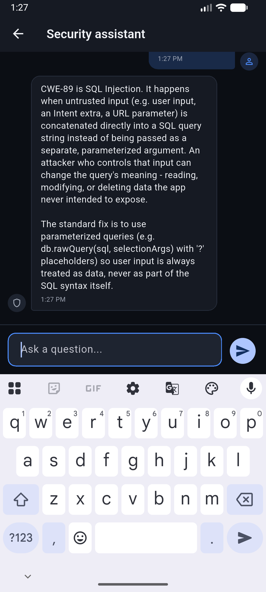

## 7.14 Error and Edge-Case Validation

Table 7.7 reports the edge cases tracked in the project's validation record, verified directly against the current `final_mobile_validation.csv` and `REMAINING_VALIDATION_ITEMS.md`.

**Table 7.7. Error and edge-case validation.**

| Case | Status |
|---|---|
| Search — unknown/no-match application | CURRENT LIVE PASS (Phase 33): a real query for a non-existent application returned the real, honest "No applications matched your search." empty state |
| Search — network-error state | **NOT VALIDATED.** Attempted in Phase 22 but blocked by an emulator ANR before it could be reached; not attempted in Phase 33 (would require deliberately stopping the backend mid-session; not reached given time constraints). **This item remains NOT VALIDATED and is not fabricated as demonstrated here.** |
| Compatibility — INCOMPATIBLE | CURRENT LIVE PASS (Phase 33) |
| Compatibility — NOT_AVAILABLE (missing device data) | CURRENT LIVE PASS (Phase 33) |
| Chatbot — unknown/nonsensical question | CURRENT LIVE PASS (Phase 21, re-confirmed Phase 33): honest generic fallback |
| Invalid login (wrong password) | PASS (Phase 14B): generic "Invalid email or password" message, no leaked detail |
| Backend/network outage during an active chat session | PASS (Phase 21): backend deliberately stopped mid-session, a real typed-exception message rendered, backend restarted and confirmed working again |
| APK upload from the mobile UI | **Not Applicable — no upload entry point exists in the Flutter UI**, confirmed by a live `uiautomator` dump; not a NOT VALIDATED item in the ordinary sense, since there is nothing to attempt |

The one genuinely outstanding edge case among those actually planned for this system is Search's network-error state, and it is reported here, as in every prior chapter, as NOT VALIDATED rather than assumed to behave correctly by analogy with the backend-outage-during-chat case above, which is a different code path.

## 7.15 Defects, Failures and Environmental Issues

This section separates **application-level defects** (a genuine fault in DualVulnDroid's own code) from **environmental/tooling issues** (a fault in the emulator, host graphics stack, or testing tooling, external to the application). **Phase 33's own report records zero application-level bugs found or fixed during that session**, and across the entire Phase 32–33 recovery, no application-level defect was identified — the session-ending failure in Phase 32 (`system_server`'s uninterruptible-sleep state) is classified in that phase's own report as a host/environment issue, not a DualVulnDroid defect, a classification this chapter adopts because it is supported by the same evidence: host RAM was confirmed healthy throughout, and the identical application build, launched against the identical AVD configuration, ran the equivalent interaction successfully in the very next session (Phase 33) without any code change.

The recurring environmental issues, documented with concrete, repeatable evidence across Phases 17–31, are: a `com.android.systemui` Application-Not-Responding condition, occurring at variable onset timing (immediate in most attempts, delayed at +15–20s in others) and not reliably correlated with available RAM (confirmed healthy, 3–7GB free, in every attempt where it was measured); excessive `qemu-system-x86_64` CPU consumption during these ANR episodes, measured at 5–12 times realtime across multiple phases; a `system_server` kernel-level uninterruptible-sleep (`D`-state) hang, observed once (Phase 32), with a different CPU signature from the ANR episodes, distinguishing it as a separate failure mode rather than a repeat of the same one; and, at the host level, Phase 31's root-cause diagnostics confirmed, byte-for-byte identically across seven independent boot logs, an `opengl32sw` software-rendering load failure and a Vulkan-incompatible, four-year-old (dated 2022-01-20) Intel UHD 620 graphics driver, while explicitly ruling out CPU hardware virtualization (WHPX) as a contributing factor, since it was confirmed operational in every log. Separately, and not application-level either, several sessions documented `adb shell input tap`/`input text` coordinate-drift and character-drop quirks in the testing tooling itself, and Phase 33 specifically documented one new tooling oddity — a Flutter semantics-tree merge on the Device Compatibility screen that caused `uiautomator dump` to report one merged bounding box instead of the individual input field — resolved by computing the correct tap coordinate directly from a screenshot; every eventual result in that session was still obtained by retrying with the corrected coordinate, and no result was reported as failing because of this tooling friction.

## 7.16 Overall Validation Results

Table 7.8 consolidates the project's own `final_mobile_validation.csv` — 26 tracked validation rows — directly, without adjustment. **This chapter reports these figures as counted from the current file, not the figures suggested in any earlier drafting brief**, because a fresh count of the actual current evidence took precedence over a remembered or assumed number.

**Table 7.8. Final validation summary (from `final_mobile_validation.csv`, current state).**

| Category | Count | Notes |
|---|---|---|
| Total tracked validation rows | 26 | Several rows are composite, each covering more than one individual screen/sub-flow (e.g. one "Main mobile UI" row covers seven sub-items) |
| Current Live PASS or PASS | 23 | A mix of Phase 14B/21 previously-validated items and Phase 32/33 current-live-validated items |
| FAIL | 0 | No row in the current CSV records a FAIL outcome |
| PARTIAL | 0 | No row in the current CSV records a PARTIAL outcome as its *current* status (the "Previous Status" column records historical PARTIAL labels from Phase 14B, since superseded) |
| NOT VALIDATED (live) | 2 | UI-01 Splash (automated-test PASS only); Search — network-error sub-case |
| Not Applicable | 1 | APK upload — no entry point exists in the Flutter UI by design |

Separately, 192 screenshots were counted directly across the project's phase-specific screenshot directories (70 from Phase 14B, 56 from Phase 21, 22 from Phase 32, 44 from Phase 33; Phase 17's directory exists but is empty, since that attempt never reached an installable state). **23 of 26 tracked rows reaching a genuine live PASS is a strong, but explicitly not complete, validation record** — it does not mean, and this chapter does not claim, 100% live validation: two items remain genuinely unvalidated live (Splash, Search network-error), and, separately from this Flutter-focused record, no human-observed, on-screen IDE GUI validation of the plugin has been performed at any point in this research (Section 7.6).

## 7.17 Remaining Not-Validated Items

Table 7.9 lists every item this chapter and the project's own validation record identify as not yet live-validated, with no item silently removed or reclassified without direct evidence of closure.

**Table 7.9. Remaining NOT VALIDATED items.**

| ID | Item | Reason | Current Status |
|---|---|---|---|
| UI-01 | Splash screen (restyled) | Blocked before app install in Phase 27/30; passed through too quickly to capture in Phase 32; not separately targeted in Phase 33 | **NOT VALIDATED live** (automated test coverage exists) |
| SRCH-04 (Search — network-error) | Search screen's network-error empty/error state | Requires deliberately stopping the backend mid-session; attempted once (Phase 22) but blocked by an unrelated emulator ANR before it could be reached; not attempted in Phase 33 due to time/scope | **NOT VALIDATED live** (automated test coverage exists via mocked-failure Flutter tests) |
| — | Plugin real-time annotation, Quick Fix, and Scan Project — human-observed, on-screen IDE GUI rendering | No session in the project's documented history reports a person directly observing the plugin's UI inside a visible, on-screen IDE window; only headless integration tests exist | **NOT VALIDATED** (automated/headless test coverage exists — Section 7.6) |

No item in this table is described as closed, resolved, or passing; each is carried forward exactly as the underlying evidence records it.

## 7.18 Testing Limitations and Threats to Validity

Considered together against the ISTQB verification/validation distinction introduced in Section 7.2, this chapter's evidence is asymmetric by design rather than by oversight: verification (automated testing) is comprehensive and consistently executed across all three suites, while validation (live observation) is necessarily incremental, host-dependent, and, for the plugin specifically, entirely absent at the on-screen-GUI level. This asymmetry is not unique to DualVulnDroid — it reflects a general property of validating any software whose correct operation depends on a real, only partially controllable execution environment — but it is stated explicitly here so the strength of this chapter's evidence is not overstated by a reader skimming only the PASS counts in Table 7.8.

The dominant limitation on this chapter's live-validation evidence is **host-environment instability**, root-caused in Section 7.15/Phase 31 to an outdated, Vulkan-incompatible graphics driver on the specific development machine used, not to DualVulnDroid's own code; this repeatedly interrupted validation sessions across Phases 17, 22, 27, and 30 before any UI could be reached, and even Phase 32's substantially successful session ended prematurely due to a separate, host-level `system_server` failure mode. This means the live-validation record, while now covering 23 of 26 tracked items, was built incrementally across many sessions on one specific host configuration, and this chapter does not claim the same stability would be observed on different hardware. A second, structurally separate limitation is that **no human-observed, on-screen IDE GUI validation of the plugin exists at all**, distinct from and not resolved by the Flutter-side live-validation progress; this is an explicit, stated scope boundary of this research, not an oversight. A third limitation is **test-environment and network dependence**: both the plugin and the Flutter application require a reachable backend for essentially all functionality, so every automated and live test described in this chapter implicitly depends on the backend and MySQL being correctly configured and running, a dependency this thesis does not treat as a weakness in isolation but does note as a precondition for every result reported here. Finally, the automated test suites themselves have a **construct limitation** common to software testing generally: a passing test confirms the specific input/output pairs and code paths it was written to check, not the full space of possible real-world inputs, and this chapter does not claim the 323 backend, 55 Kotlin, or 59 Flutter passing tests demonstrate the complete absence of defects, only that the specific behaviours they check were confirmed correct at the time they were last run.

## 7.19 Chapter Summary

This chapter reported DualVulnDroid's system-level testing and live-validation evidence, kept structurally separate from Chapter 6's ML/experimental evaluation. Three automated suites were reported without merging: 323 backend tests passed (2 skipped), 55 Kotlin plugin tests (46 unit + 9 headless platform-integration), and 59 Flutter tests passed (0 failed, grown from a documented 43-test baseline). Seven integration flows and a representative set of Chapter 4's functional requirements were evaluated with automated and live evidence kept explicitly distinct, including two requirements reported precisely as "Automated PASS / Live NOT VALIDATED." The live-validation record was traced chronologically from Phase 14B through Phase 33 — the most recent phase located in the project's documentation, with no Phase 34 report found — including Phase 31's diagnostics-only root-cause investigation (an outdated, Vulkan-incompatible graphics driver) correctly excluded from being counted as a validation pass or fail, and Phase 32's substantial but prematurely-ended session followed by Phase 33's recovery and most comprehensive successful session (20 new current live PASS items, 44 screenshots, zero FAIL, zero PARTIAL). Counted directly from the project's own current `final_mobile_validation.csv`, 23 of 26 tracked validation rows reach a genuine live PASS, with two items — Splash and Search's network-error state — honestly preserved as NOT VALIDATED, and no claim of 100% live validation, 61-row totals, or 58/61-style figures not found in the actual current evidence is made anywhere in this chapter. Chapter 8 now brings these testing and validation results together with Chapter 6's experimental results to answer this thesis's research questions in full and close the thesis.


# CHAPTER 08 – DISCUSSION, CONCLUSIONS AND FUTURE WORK

## 8.1 Chapter Overview

Chapters 1–7 stated the research problem and question, reviewed the literature and derived a gap, described the methodology and design, implemented the DualVulnDroid artefact, evaluated its machine-learning and Decision Engine components experimentally, and tested and live-validated the resulting system. This chapter introduces no new evidence: it synthesises what Chapters 6 and 7 already established, answers Chapter 1's research question directly against that evidence, evaluates each of the five research objectives, discusses the findings against Chapter 2's literature, states this research's contributions without overclaiming their novelty, reports its limitations and threats to validity honestly, and closes with recommendations, a future-work roadmap, and a final conclusion. Where a prior chapter left a result unresolved — most notably the CodeBERT provenance conflict (Chapter 6) and the remaining NOT VALIDATED items (Chapter 7) — this chapter preserves that status rather than resolving it here.

## 8.2 Summary of the Research

This research began from the observation, substantiated in Chapter 2's critical literature review, that Android vulnerability-detection approaches tend to address CWE-89 and CWE-295 separately, combine machine-learning prediction with static/data-flow evidence rarely if at all, integrate explainability inconsistently, and — with one partial exception (ACVED) — rarely deliver real-time, IDE-integrated feedback, with no reviewed study extending an equivalent, comprehension-appropriate assessment to an end user. Chapter 3 described the resulting methodology: a Design Science Research approach to building the DualVulnDroid artefact, combined with a controlled, single-protocol experimental comparison for its machine-learning component. Chapter 4 translated this into requirements and a conceptual design spanning a developer-facing IntelliJ/Android Studio plugin, a shared FastAPI backend, a hybrid ML/static-evidence detection pipeline, a Hybrid Decision Engine, a ten-table MySQL database, and a backend-mediated Flutter end-user application. Chapter 5 traced this design into its actual implementation, verifying exactly which plugin components are registered and reachable, confirming the Flutter client performs no source-code analysis of its own, and confirming the deployed system communicates over HTTP rather than HTTPS. Chapter 6 reported the experimental evaluation: five models compared under one protocol on a frozen, leakage-checked test split, a documented and preserved CodeBERT provenance conflict, and a Hybrid Decision Engine whose coverage/reliability trade-off was measured rather than assumed. Chapter 7 reported system-level testing and live validation, distinguishing automated verification (323 backend, 55 Kotlin, 59 Flutter tests) from live validation (23 of 26 tracked rows reaching a genuine live PASS, with Splash, Search's network-error state, and human-observed plugin GUI validation honestly preserved as not yet validated). This chapter now draws these threads together.

## 8.3 Interpretation of the Main Findings

Chapter 6's central experimental finding is that **no evaluated model dominates every metric**: XGBoost achieved the best macro F1 (0.7874) and the lowest overall false-positive rate (0.1467); Linear SVM achieved the best overall false-negative rate (0.1828) and the best ROC-AUC (0.9025); CodeBERT, on the artefact Chapter 6 treats as the project's documented-authoritative result, achieved the lowest CWE-89 false-negative rate (0.1379); and the LSTM was not best on any reported metric and had the lowest macro F1 of all five models. CWE-89 was consistently harder than CWE-295 for every model except XGBoost, a pattern plausibly, though not conclusively, linked to CWE-89's smaller share of the training data (372 of 1,128 rows). CodeBERT's own evaluation record carries a specific, unresolved caveat: two further project artefacts report a materially different result (CWE-89 F1 ≈ 0.6047, CWE-295 F1 ≈ 0.9120) from the same nominal configuration run on different hardware; Chapter 6 reported the project's own documented resolution — treating the CPU-run artefact as authoritative because it matched an independently-supplied verification value for that phase — while explicitly stating that this resolution rests on a claim this thesis could not itself independently re-derive. This chapter does not revisit or resolve that conflict further; it is carried forward as-is.

The Hybrid Decision Engine's deployed configuration auto-decides 32.74% of test cases at a 3.03% false-negative rate and 94.12% precision among those auto-decided cases, deferring the remaining 67.26% to manual review; a higher-coverage "Balanced" alternative (88.69% coverage) was measured at a substantially higher 20.24% false-negative rate and, across five independent re-splits, an unstable selected operating point — concrete evidence for why it was not deployed. Explainability evidence (SHAP) showed the deterministic feature `sql_sink_detected` as the single most influential feature across all four target classes in a global-importance analysis, offered as supporting, not conclusive, evidence that the hybrid feature design is genuinely used by the trained model. Measured inference latency kept the full prediction pipeline under 100ms across two differently-conditioned measurement sessions (≈70.03ms and ≈39.82ms), a result this thesis ties specifically to the plugin's asynchronous design rather than treated as a general production performance guarantee. System-level validation (Chapter 7) showed strong, but explicitly incomplete, live-device evidence — 23 of 26 tracked rows reaching a genuine live PASS, zero FAIL, zero PARTIAL, and two items (Splash, Search's network-error state) honestly preserved as NOT VALIDATED, alongside a structurally separate gap: no human-observed, on-screen IDE GUI validation of the plugin exists anywhere in this research's record.

## 8.4 Discussion Against the Research Question

**Research question (Chapter 1).** *To what extent can a hybrid approach combining machine-learning classification with static and data-flow evidence detect CWE-89 and CWE-295 in Android source code, and be delivered as explainable, decision-supported feedback through both a real-time IDE plugin and a backend-mediated end-user assessment interface?*

**Evidence.** Chapters 5–7 establish that such a hybrid approach was designed, implemented, and evaluated as a working system, not merely proposed. The ML component (Chapter 6) detects both CWE categories with F1 scores between 0.60 and 0.85 depending on model and category, none approaching perfect detection and none uniformly best. The static/data-flow evidence (Chapter 5) is genuinely fused with the ML prediction, not merely displayed alongside it, through the Hybrid Decision Engine's weighted evidence score, and this fusion is shown (Chapter 6) to produce a measurably more conservative, higher-precision automatic decision than the ML prediction alone would on the 32.74% of cases it resolves automatically. The explainable, decision-supported feedback requirement is delivered in the plugin as a real-time annotation carrying SHAP contributions and separately-labelled deterministic evidence (Chapters 5, verified by 55 automated/headless-integration tests) and in the Flutter application as a backend-mediated assessment, compatibility check, and grounded Security Chat (Chapter 7, 23 of 26 tracked items live-validated).

**Interpretation.** The evidence supports the claim that a hybrid ML-plus-deterministic-evidence approach *can* detect these two vulnerability classes and *can* be delivered through both a real-time developer interface and an end-user interface within one working architecture — this is demonstrated, not merely argued for. The evidence does not support a claim that this hybrid approach detects these vulnerabilities completely or reliably in every case: false-negative rates ranging from roughly 14% to 41% depending on model and CWE category, a Decision Engine that resolves only a third of cases automatically at its deployed, conservative operating point, and a genuinely outstanding validation gap (no human-observed plugin GUI session, two remaining NOT VALIDATED mobile items) all bound how strong an answer this evidence can support.

**Answer.** The hybrid approach was demonstrated, within the evaluated dataset and system, to be **a workable and measurably evidence-based way of detecting CWE-89 and CWE-295 and of delivering that detection as explainable, decision-supported feedback to both a developer and an end user** — not a solved problem, and not a claim that this specific implementation generalises beyond the evidence gathered for it (Section 8.15).

## 8.5 Discussion Against the Research Objectives

Table 8.1 evaluates each objective directly against the outcome and status already established in Chapters 6 and 7, without upgrading any qualification stated there.

**Table 8.1. Research objective evaluation summary.**

| Objective | Evidence | Outcome | Qualification |
|---|---|---|---|
| 1. Investigate and compare existing approaches | Chapter 2's five-gap comparative synthesis | Achieved | The five gaps directly motivated Objectives 2–4; no claim that the literature review was exhaustive |
| 2. Compare SVM/Random Forest/XGBoost against LSTM/CodeBERT under one shared protocol | Chapter 6, Sections 6.5–6.8 | Achieved, with an explicitly documented evidence limitation | The comparison itself is sound; CodeBERT's absolute figures carry the stated, unresolved-by-independent-reproduction provenance caveat |
| 3. Design a Hybrid Decision Engine with SHAP explanation, measuring its own coverage/reliability | Chapter 6, Section 6.10 | Achieved | Coverage (32.74%) and auto-decided reliability (3.03% FNR) were measured, not assumed; the higher-coverage alternative was correctly not deployed on documented, inconclusive robustness grounds |
| 4. Build a real-time IDE plugin and a backend-mediated Flutter application | Chapter 5 implementation; Chapter 7, Sections 7.6, 7.12 | Supported by evidence | Both components are implemented and automated-tested; the plugin has **no human-observed, on-screen GUI validation**, and this qualification is preserved exactly as Chapter 7 stated it, not upgraded because the code exists |
| 5. Evaluate through automated testing and live validation, reporting all results honestly | Chapter 7 in full | Achieved | The objective required honest reporting of what remains unvalidated, which this thesis does throughout — including in this chapter |

No objective is described here as "fully achieved" on the basis of the software's existence alone; each status is the one its cited evidence supports.

## 8.6 Discussion in Relation to the Literature

Chapter 2 established that static/data-flow tools (FlowDroid, TaintDroid, SSLINT, DCDroid) provide checkable evidence but are narrow and not IDE-integrated; that CWE-89 and CWE-295 are, with limited exception, studied separately; that no ML/DL/Transformer family is shown to dominate consistently; that explainability is inconsistently integrated; and that real-time IDE-integrated detection is rare, with ACVED the closest identified prior system, not documented as also combining static/data-flow evidence, separated explanation, and safety-scoped remediation. DualVulnDroid's findings are consistent with, and in the model-comparison case directly reproduce, several of these literature patterns rather than merely restating them: Chapter 6's finding that no model family dominates (XGBoost best macro F1/FPR, SVM best FNR/ROC-AUC, CodeBERT best CWE-89 recall, LSTM weakest overall) is an empirical instance of exactly the pattern Chapter 2 found across the wider literature, not a novel discovery of that pattern. Chakraborty et al.'s (2022) literature-level caution against assuming deep-learning superiority is, within this specific dataset, borne out rather than contradicted: the LSTM underperformed every classical model on every reported metric.

Where this research extends beyond what Chapter 2 found individually demonstrated in the literature is in the *combination*: treating CWE-89 and CWE-295 jointly within one evaluated pipeline, fusing ML prediction with deterministic evidence into one measured, coverage-reported decision, keeping SHAP-based and deterministic evidence explicitly distinct rather than merged, delivering this in real time to a developer, and extending a comprehension-appropriate, backend-mediated assessment to an end user, consistent with the usable-security literature's finding (Felt et al., 2012; Chin et al., 2012) that end users are poorly served by existing, mostly permission-based security signals. **This chapter does not claim this combination is the first or only instance of such an approach**, since Chapter 2's review, while structured and critical, was not an exhaustive systematic review of the entire field; it claims only that, within the literature reviewed and compared in Chapter 2, this specific combination was found to be comparatively underexplored, and that DualVulnDroid's implementation and evaluation provide one concrete, evidence-based instance of it.

## 8.7 Discussion of the Hybrid Detection Approach

Combining an ML prediction with static/data-flow, certificate-validation, and keyword-rule evidence inside the Decision Engine (Chapter 5, Section 5.7) provides a genuine, measured benefit over either evidence source alone on the specific cases it resolves automatically: 94.12% precision and 3.03% FNR among auto-decided cases (Chapter 6, Table 6.7) is markedly more reliable than the raw ML prediction's own aggregate FPR/FNR figures (Table 6.6). This benefit is not unconditional. It is bought by resolving only 32.74% of cases automatically at that reliability level; raising coverage to 88.69% (the Balanced candidate) raised the auto-decided FNR to 20.24%, and doing so across five independent re-splits produced an unstable, not-yet-generalisable selected threshold (Chapter 6, Table 6.11). This is precisely why threshold selection in this system is treated as a **policy decision balancing coverage against reliability**, not a pure optimisation problem with one correct answer: a stakeholder more tolerant of manual review overhead would reasonably prefer the deployed, conservative configuration; a stakeholder that needed higher automatic throughput would need to accept a higher missed-vulnerability rate under the currently available evidence, or await further data before adopting the Balanced candidate. Hybrid evidence fusion, in this research's findings, **reduces but does not eliminate** false positives and false negatives, and the Decision Engine's own SUSPICIOUS_REVIEW state exists specifically because the system's designers chose not to claim it does.

## 8.8 Discussion of the Machine Learning Results

Across the five compared model families, a coherent pattern emerges without any one family being declared universally superior. The **classical models** (SVM, Random Forest, XGBoost) share an identical feature representation, and their differences are attributable to the algorithms themselves: XGBoost's tree-ensemble structure achieved the best CWE-89 F1 and lowest FPR, while SVM's margin-based approach achieved the best CWE-295 F1 and lowest overall FNR, with Random Forest trailing both. The **deep-learning model** (LSTM), trained from scratch with a distinct, code-aware tokenizer rather than TF-IDF, underperformed every classical model on every reported metric, particularly on CWE-89 (FNR 41.4%, more than double any classical model's), a result this thesis attributes, plausibly but not conclusively, to the combination of a from-scratch training regime and CWE-89's smaller training-data share. The **Transformer model** (CodeBERT) is the most nuanced case: on the artefact Chapter 6 treats as authoritative, it achieved the lowest CWE-89 FNR of all five models, offering partial support for the literature's pretraining-advantage argument (Chapter 2, Section 2.8), but its overall macro F1 did not exceed XGBoost's, and its result carries the unresolved provenance caveat discussed in Section 8.3 and Chapter 6 — **this thesis does not describe CodeBERT as the best model**, only as competitive on a specific, security-relevant axis, with a documented but not independently re-proven authoritative figure. The practical implication for model selection is that **the choice of production classifier is a multi-criterion decision, not a single-metric one**: XGBoost was selected as DualVulnDroid's production model on the combined evidence of its macro F1, FPR, existing SHAP/Decision-Engine/plugin integration, and measured inference latency (Chapter 6), not because it dominates every axis in Table 6.6 — it does not.

## 8.9 Discussion of the Hybrid Decision Engine

The Decision Engine's deployed configuration (vulnerable ≥1.379, safe ≤−0.926) auto-decides 32.74% of test cases at a 3.03% false-negative rate and 94.12% precision among those cases, deferring 67.26% to manual review. The Balanced research candidate (vulnerable ≥0.753, safe ≤−0.376) raises coverage to 88.69% but its auto-decided FNR rises to 20.24%, and its five-seed robustness check (Chapter 6, Table 6.11) showed both the selected thresholds and the resulting FNR varying substantially — coverage from 88.69% to 99.42%, FNR from 5.68% to 21.84%, and the selected safe threshold changing sign entirely between seeds — direct, concrete evidence of instability, not an assumption. This finding's practical meaning is that **higher automatic coverage in this system currently comes at a measurably higher missed-vulnerability risk**, and that risk's magnitude is not yet stable enough, across independent re-splits of the same source data, to be confidently generalised. Threshold selection is therefore correctly treated, in this research's own conclusions and in this chapter, as a **trade-off/policy problem rather than a pure optimisation target**: there is no threshold configuration in the evidence gathered that achieves both high coverage and low, stable false-negative risk simultaneously, and this thesis does not recommend deploying the Balanced candidate on the evidence currently available (Section 8.16).

## 8.10 Discussion of the Developer IDE Plugin

The plugin delivers real-time, in-editor feedback: `CodeSentinelAnnotator` submits the current file to the backend asynchronously and attaches a severity-labelled annotation with SHAP contributions and separately-labelled deterministic evidence only for findings the Decision Engine reports vulnerable (Chapter 5, Section 5.10), and Quick Fix offers narrowly-scoped, re-verified remediation for a small set of confidently-matched patterns rather than a general repair capability (Chapter 5, Section 5.11). This is a genuine, working realisation of Chapter 1's real-time-developer-support objective, verified by 55 automated tests including 9 tests run inside a real, headless IntelliJ Platform fixture that exercises the actual, registered plugin classes against the real backend (Chapter 7, Section 7.6). **What this evidence does not establish is human-observed, on-screen GUI behaviour**: no session in this research's documented history shows a person directly watching an annotation, tooltip, or Quick Fix render inside a visible, running IDE window, and this chapter states that plainly rather than treating the headless integration tests as an equivalent substitute. The plugin's practical contribution — to a developer, evidence-backed, real-time feedback with narrowly-scoped remediation — is real and demonstrated at the automated-verification level; its live, human-observed usability has not yet been demonstrated, and this thesis does not claim otherwise.

## 8.11 Discussion of the End-User Mobile Application

The Flutter application is, throughout this thesis, a **backend-mediated end-user presentation and decision-support client**, not a source-code CWE-89/CWE-295 detector — every risk level, finding, and piece of evidence it displays originates from a backend response, and this chapter restates that distinction because it is the property most easily misdescribed. Within that role, it delivers authentication, a dashboard, application search, risk and evidence presentation, device-compatibility checking, a data-grounded Security Chat with persistent history, and Settings, twelve of thirteen tracked restyled-UI items reaching a genuine current live PASS in Phase 32/33 (Chapter 7, Table 7.5). Its "Upload APK" and "Installed Apps" entries present an honest "not available in this version" placeholder rather than a functioning flow, even though the backend separately exposes an APK metadata-ingestion endpoint used to build the catalogue Search draws on — **APK upload from the mobile UI is not available, and this chapter does not claim otherwise.** Two items remain genuinely outstanding in this application's live-validation record and are preserved here exactly as Chapter 7 reported them: the Splash screen remains NOT VALIDATED live (automated-test coverage only), and Search's network-error state remains NOT VALIDATED (attempted once, blocked by an unrelated emulator failure, not re-attempted). The application's practical contribution — an accessible, backend-grounded security assessment for a non-technical end user, consistent with the usable-security literature's finding that such users are otherwise poorly served (Chapter 2, Section 2.12) — is real and substantially live-demonstrated, but not completely validated.

## 8.12 Research Contributions

Framed as contributions of this specific project rather than claims of field-wide novelty, this research contributes: (1) an **empirical, shared-protocol comparison** of three classical models, one deep-learning model, and one Transformer model on a joint CWE-89/CWE-295 classification task, evaluated with explicit per-CWE and false-negative-rate reporting rather than aggregate accuracy alone (Chapter 6); (2) a **hybrid ML-and-deterministic-evidence fusion mechanism** (the Decision Engine) whose automatic-decision coverage and reliability were measured as an explicit trade-off, including a documented, evidence-based reason (cross-seed instability) for not deploying a higher-coverage alternative (Chapter 6, Section 6.10); (3) an **explainability design** that keeps model-level (SHAP) and deterministic (static/data-flow) evidence terminologically and structurally distinct throughout the implementation, rather than merged into one undifferentiated explanation (Chapter 5, Section 5.8); (4) a **documented CodeBERT provenance investigation**, reporting a real evidence conflict across project artefacts in full rather than silently selecting a favourable figure, offered as an example of the artefact-provenance discipline this research attempted to apply throughout (Chapter 6, Section 6.7); and (5) an **evidence-classified validation methodology** — the Automated Test PASS / Live PASS / NOT VALIDATED / FAIL / PARTIAL framework applied consistently across Chapter 7 — offered as a reusable reporting discipline for a project combining automated and live-device evidence. These are empirical and engineering contributions of this specific research; this chapter does not claim any of them is the first instance of its kind in the broader field.

## 8.13 Practical and Software Engineering Contributions

For **developers**, the implemented artefact provides real-time, evidence-backed, in-editor feedback for two specific, high-impact vulnerability classes, with narrowly-scoped, re-verified remediation where a fix can be confidently applied (Chapter 5, Sections 5.10–5.11). For **end users**, it provides a plain-language, backend-grounded security assessment, honest device-compatibility reporting that never fabricates a verdict from missing data, and a grounded Security Chat, live-demonstrated for the large majority of its tracked screens (Chapter 7). For **software engineering practice**, the architecture itself — a shared detection/evidence pipeline behind one backend, feeding a separate decision layer and separate developer- and end-user-facing clients, with the production model and research-only models kept structurally and verifiably distinct (Chapter 5, Section 5.6) — is offered as a reusable engineering pattern for a project needing to serve more than one audience from one evaluated detection capability. **This chapter does not claim the system is production-ready**: Section 8.14 lists specific, evidence-based reasons (HTTP-only transport, incomplete live validation, an unresolved CodeBERT provenance conflict, threshold instability at higher coverage) that this thesis's own evidence does not support such a claim.

## 8.14 Limitations

The following limitations are each drawn directly from evidence already established in Chapters 3, 6, and 7, not introduced here for the first time. **(1) Dataset representativeness**: the 1,128-row clean dataset's class composition (CWE-295 rows outnumber CWE-89 rows roughly two to one) is a property of this specific dataset, not shown to generalise to Android codebases broadly. **(2) Not a true application-level split**: the dataset carries no application/project identifier, so the grouped, leakage-checked split prevents near-duplicate-template leakage but cannot guarantee no two rows in different subsets originate from the same real application. **(3) Dataset size**: 1,128 rows is small specifically for deep-learning and Transformer fine-tuning. **(4) Model-comparison methodological differences**: the LSTM's tokenizer and training regime differ materially from the classical models', so its weaker result cannot be attributed to architecture alone. **(5) The CodeBERT provenance conflict** remains carried forward, not resolved, in this chapter. **(6) Decision Engine threshold instability** at higher coverage was directly measured across five seeds, not assumed. **(7) HTTP-only API communication**: no TLS is configured anywhere in the verified deployment, a limitation this thesis states plainly rather than minimises, given its research subject includes certificate-validation security. **(8) Mobile APK upload is unavailable** from the Flutter UI. **(9) Search's network-error state** and **(10) the Splash screen** remain NOT VALIDATED live. **(11) No human-observed IDE GUI validation** exists for the plugin. **(12) Emulator/environment instability**, root-caused to an outdated host graphics driver, repeatedly interrupted live-validation sessions and constrained how much live evidence could be gathered on the single development host used. **(13) Backend/network dependency**: neither client surface has an offline mode. **(14) Automated test limitations**: passing tests confirm the specific behaviours they check, not the complete absence of defects. **(15) Explainability provenance**: the offline global-SHAP-importance report was generated against an older model artefact directory than the one currently served in production, a distinction Chapter 6 states explicitly. **(16) Generalisation**: no evidence in this research establishes performance on Android applications or code entirely absent from the source dataset.

## 8.15 Threats to Validity

**Internal validity.** The controlled, single-protocol model comparison and the confirmed absence of test-split leakage support the internal validity of Chapter 6's model comparisons for the specific frozen split used; the CodeBERT provenance conflict is a specific, acknowledged internal-validity limitation for that model's absolute figures only. **External validity.** The non-application-level split and the single-development-host live-validation record both bound how confidently this research's findings can be assumed to generalise — to unseen applications in the ML case, and to different hardware/environment configurations in the live-validation case. **Construct validity.** This research's consistent choice to report FNR alongside F1/accuracy, and Decision Engine coverage alongside auto-decided reliability, reflects a deliberate construct decision (that a missed vulnerability is more consequential than a false alarm) rather than an incidental metric choice; a reader who weighted these constructs differently might reach a different practical conclusion from the same underlying numbers. **Reproducibility.** A fixed random seed (42) was used throughout for splitting and training; artefact provenance was checked, not assumed, for every result relied on in Chapters 6–8, and the one case where provenance could not be fully independently re-derived (CodeBERT) is reported as such rather than silently trusted.

## 8.16 Recommendations

Distinguishing a recommended improvement from functionality already implemented: **(1)** establish a genuine application-level dataset split, requiring a reliable application/project identifier not currently present in the source data, before making stronger generalisation claims. **(2)** Reconcile the CodeBERT provenance conflict by independently re-deriving or re-running the verification process Chapter 6's documented resolution currently relies on, rather than continuing to rely on an unreproduced claim. **(3)** Expand the labelled dataset, particularly for CWE-89, before revisiting Decision Engine threshold selection for higher coverage. **(4)** Do not deploy the Balanced Decision Engine candidate until its cross-split robustness is stable; if pursued, recalibrate using a materially larger validation set. **(5)** Conduct a dedicated, human-observed IDE GUI validation session — this is a recommended next step, not something this research already performed. **(6)** Complete the two remaining NOT VALIDATED mobile items (Splash, Search network-error) once a stable emulator/device session is available. **(7)** Migrate the backend and both client surfaces from HTTP to HTTPS/TLS before any deployment beyond a research/evaluation environment. **(8)** If end-user APK upload and assessment is a genuine future requirement, implement and validate it as new functionality — it is explicitly not implemented today. **(9)** Strengthen the offline SHAP-importance reporting pipeline to run against the exact currently-served production model artefact, removing the provenance ambiguity Chapter 6 identified. **(10)** Pursue a broader, external evaluation — different datasets, different application sources, different host hardware — before generalising this research's findings beyond the evidence gathered for it.

## 8.17 Future Work

Building on Section 8.16's recommendations, concrete future research directions include: **(1)** application-level or genuinely cross-application generalisation evaluation, contingent on acquiring or constructing a dataset with reliable application identifiers; **(2)** a larger, more diverse labelled Android vulnerability dataset, addressing both this research's CWE-89/CWE-295 class-imbalance finding and the general small-dataset constraint on the deep-learning and Transformer results; **(3)** extending detection to additional CWE categories beyond the two evaluated here, using the same hybrid ML-plus-evidence architecture as a template rather than a fixed scope; **(4)** an improved, independently-reproducible CodeBERT (or comparable Transformer) evaluation that resolves rather than merely documents the provenance conflict identified in this research; **(5)** Decision Engine threshold calibration using a substantially larger validation set, specifically targeting the instability Chapter 6's five-seed robustness check identified; **(6)** further Decision Engine research into coverage/reliability optimisation strategies beyond simple threshold selection, for example cost-sensitive or per-CWE-category thresholds; **(7)** a full, human-observed IDE GUI validation pass, closing this research's most consistently stated outstanding gap; **(8)** production-grade HTTPS/TLS transport, with accompanying certificate-management design, as this thesis's own subject matter (CWE-295) would recommend; **(9)** a genuinely functional, validated mobile APK-upload and end-user assessment flow, if end-user-initiated scanning is judged a priority; **(10)** a more capable Security Chat, potentially incorporating broader natural-language understanding while preserving this system's existing grounding-in-real-data discipline; **(11)** a formal human-user usability study of both the plugin's and the Flutter application's explanations and recommendations, which this research did not conduct; **(12)** cross-device and cross-host live-validation testing, to establish whether this research's environment-instability findings are specific to the single development host used; **(13)** integration of this detection pipeline into a CI/CD security-scanning workflow, extending its real-time, per-edit scope to a per-commit or per-pull-request scope; **(14)** a cloud-hosted deployment evaluation, distinct from the local development-machine environment this research's performance and live-validation evidence was gathered on; and **(15)** evaluation of additional explainability methods alongside SHAP, to assess whether a different attribution technique better supports developer or end-user comprehension — itself an empirical question this research did not investigate.

## 8.18 Final Conclusion

This research designed, implemented, and evaluated DualVulnDroid: an Android security analysis system that classifies CWE-89 and CWE-295 through a hybrid machine-learning and deterministic-evidence pipeline, fuses that classification with static/data-flow evidence through a Hybrid Decision Engine whose own coverage and reliability are measured rather than assumed, and delivers the resulting findings through a real-time IntelliJ/Android Studio plugin and a backend-mediated Flutter end-user application. The evidence gathered across Chapters 6 and 7 demonstrates that this hybrid approach works as a functioning, evaluated system: five models were compared under one controlled protocol with no universal winner, a documented and preserved provenance conflict in the CodeBERT result rather than a silently resolved one, a Decision Engine whose conservative deployed configuration trades coverage for reliability in a measured, explicit way, and a live-validation record in which 23 of 26 tracked mobile items reached a genuine, screenshot-evidenced live PASS. What remains uncertain is stated plainly rather than smoothed over: CodeBERT's absolute figures carry an unresolved provenance caveat; the Decision Engine's higher-coverage alternative is not yet stable enough to recommend; the plugin has no human-observed, on-screen GUI validation; the Splash screen and Search's network-error state remain unvalidated live; and the deployed system communicates over HTTP, not HTTPS. This research does not claim to have solved Android application security, to have produced a perfectly accurate detector, or to have completely validated every component of the system it built. It does demonstrate, with evidence traceable to a specific artefact at every step, that an integrated, dual-CWE, hybrid-evidence, explainable, developer-and-end-user-facing security analysis system can be built, measured, and honestly evaluated — and it leaves, explicitly and by name, the specific work still required before that system's remaining claims could be made with the same confidence as the ones this thesis has been able to support.


# APPENDICES

## APPENDIX A – DETAILED FUNCTIONAL REQUIREMENTS

The full functional-requirements list is presented in Chapter 4, Table 4.1, and is not reproduced a second time here; this appendix instead consolidates the requirement identifiers and their final verification status in one compact index for reference.

**Table A.1. Functional requirement index and final status.**

| ID | Short Description | Final Status |
|---|---|---|
| FR-01 | Real-time + batch source-code analysis | Automated PASS; live IDE-GUI NOT VALIDATED |
| FR-02 | Four-label classification with confidence/severity | Validated (Chapter 6 test-set evaluation) |
| FR-03 | Hybrid Decision Engine 3-state decision | Validated (Chapter 6 coverage/reliability analysis) |
| FR-04 | SHAP + separated static/data-flow evidence | Automated PASS |
| FR-05 | In-editor annotation + Alt+Enter detail view | Automated PASS; live IDE-GUI NOT VALIDATED |
| FR-06 | Narrow-pattern Quick Fix | Automated PASS; live IDE-GUI NOT VALIDATED |
| FR-07 | Post-fix re-scan verification | Automated PASS; live IDE-GUI NOT VALIDATED |
| FR-08 | Scan Project (batch) | Automated PASS; live IDE-GUI NOT VALIDATED |
| FR-09 | Registration/login with persisted session | Live PASS |
| FR-10 | Search + security assessment | PARTIAL — known/unknown-app PASS; network-error NOT VALIDATED |
| FR-11 | Compatibility (3 dimensions, honest NOT_AVAILABLE) | Live PASS (all three outcomes observed) |
| FR-12 | Safer alternative suggestions | Live PASS |
| FR-13 | APK manifest extraction on upload | Automated PASS (backend); Not Applicable (mobile UI) |
| FR-14 | CWE explanation + app-specific chatbot answers | Live PASS |
| FR-15 | Verbatim chat-reply rendering | Live PASS |
| FR-16 | Own chat history retrieval | Live PASS |
| FR-17 | Own scan-history retrieval | Live PASS |
| FR-18 | Research-only models excluded from production | Validated (code/import review) |

## APPENDIX B – NON-FUNCTIONAL REQUIREMENTS AND USE CASES

**Table B.1. Non-functional requirement index.** Full rationale, design response, and verification method for each are presented in Chapter 4, Table 4.2.

| ID | Short Description |
|---|---|
| NFR-01 | Sub-100ms real-time analysis latency (measured, not a guaranteed SLA) |
| NFR-02 | No crash on malformed/oversized input; no silent plugin failure |
| NFR-03 | No plaintext passwords; signed, expiring JWT sessions |
| NFR-04 | Honest empty/loading/error states on every Flutter screen |
| NFR-05 | SHAP + separated static/data-flow evidence on every VULNERABLE/SUSPICIOUS_REVIEW finding |
| NFR-06 | Fixed seed; frozen, leakage-checked split; versioned production artefacts |
| NFR-07 | One shared feature-construction module for training and inference |
| NFR-08 | Bounded batch size per project-scan request |
| NFR-09 | No fabricated RAM/CPU compatibility verdict |

**Table B.2. Use case index.** Full actor/precondition/flow/postcondition detail is presented in Chapter 4, Section 4.6.

| ID | Name | Actor |
|---|---|---|
| UC-01 | Real-time code inspection | Developer |
| UC-02 | View finding detail (Alt+Enter) | Developer |
| UC-03 | Scan Project | Developer, Security Analyst/Researcher |
| UC-04 | Apply Quick Fix | Developer |
| UC-05 | Register and log in | Application user |
| UC-06 | Search and review application security | Application user |
| UC-07 | Check device compatibility | Application user |
| UC-08 | View safer alternatives | Application user |
| UC-09 | Ask the Security Chat | Application user |
| UC-10 | Retrieve own chat history | Application user |
| UC-11 | Upload and assess an APK | Backend/API client only (no Flutter UI reaches this) |

## APPENDIX C – LIVE VALIDATION EVIDENCE SUMMARY

This appendix consolidates the phase-by-phase live-validation record and the final validation tally reported in full in Chapter 7 (Sections 7.10, 7.16, 7.17), for reference in one place.

**Table C.1. Live validation phase history.**

| Phase | Outcome | Screenshots |
|---|---|---|
| 14B | PASS (core flows) | 70 |
| 17 | Blocked (System UI ANR before install) | 0 |
| 21 | PASS (full chatbot experience, first fully stable session) | 56 |
| 22 | Blocked (System UI ANR before install) | 0 |
| 27 | Blocked (delayed-onset ANR) | 0 |
| 30 | Blocked (ANR at +20s) | 0 |
| 31 | Root-cause diagnostics only — not a validation session | 0 |
| 32 | PASS (substantial results), then session-ending `system_server` hang | 22 |
| 33 | PASS (most comprehensive session; recovered from Phase 32) | 44 |

Total screenshots across all phases: 192.

**Table C.2. Final validation summary (`final_mobile_validation.csv`, 26 tracked rows).**

| Category | Count |
|---|---|
| Current Live PASS or PASS | 23 |
| FAIL | 0 |
| PARTIAL | 0 |
| NOT VALIDATED (live) | 2 |
| Not Applicable | 1 |

**Table C.3. Remaining NOT VALIDATED items.**

| Item | Reason |
|---|---|
| UI-01 Splash screen | Blocked before install in Phase 27/30; passed through too quickly to capture in Phase 32; automated-test coverage only |
| Search — network-error state | Attempted once (Phase 22), blocked by an unrelated emulator ANR; not re-attempted in Phase 33 due to time/scope; automated-test coverage only |
| Plugin real-time annotation/Quick Fix/Scan Project — human-observed on-screen IDE GUI | No session in this research's documented history includes a person directly observing the plugin's UI inside a visible IDE window; headless integration-test coverage only |

## APPENDIX D – MODEL CONFIGURATION AND HYPERPARAMETERS

**Table D.1. Classical model configurations.** (Reproduced from Chapter 3, Table 3.4.)

| Model | Implementation | Hyperparameter Search | Selection Criterion |
|---|---|---|---|
| Linear SVM | `LinearSVC` + `CalibratedClassifierCV` (3-fold, train-only) | Grid search, C ∈ {0.01, 0.1, 1.0, 10.0} | 5-fold stratified CV macro-F1 (train split only) |
| Random Forest | `RandomForestClassifier`, balanced weights | Grid search over estimators, depth, leaf size | 5-fold stratified CV macro-F1 (train split only) |
| XGBoost | `multi:softprob`, native early stopping | max_depth ∈ {4, 6, 8}, eta ∈ {0.05, 0.1}; up to 300 rounds | Validation-set macro-F1, early stopping |

**Table D.2. Production XGBoost final configuration.** (Verified against `research_eval_artifacts/xgboost/metadata.json`.)

| Parameter | Value |
|---|---|
| max_depth | 4 |
| eta | 0.1 |
| Boosting rounds selected (of rounds trained) | 103 (of 123) |
| Feature dimensionality | 7,610 (7,587 text + 23 security) |
| Validation macro-F1 at selection | 0.8684 |

## APPENDIX G – TRACEABILITY MATRICES

The full requirements-to-design traceability matrix (mapping each of Chapter 1's five research objectives to its requirement(s), design component, implementation location, and verification method) is presented in Chapter 4, Table 4.6, and the corresponding methodology-level traceability table (objective → method → data/evidence → evaluation → expected output) is presented in Chapter 3, Table 3.8. Both are the authoritative versions and are not duplicated here to avoid two diverging copies of the same evidence; this appendix records only that both exist and where to find them.

*Note on omitted appendices:* An "Appendix E — Additional Evaluation Tables" and an "Appendix F — Additional Screenshots" were considered but are not included. Chapter 6 already presents every evaluation table this research's stored artefacts support (dataset composition, feature representation, per-model results, the CodeBERT provenance table, the five-model comparison, the CWE-89 confusion breakdown, the Decision Engine evaluation, and the five-seed robustness table), and duplicating them here would not add evidence, only length. Likewise, Chapter 7 already presents five screenshots selected specifically because each demonstrates a distinct, cited claim; the remaining 187 screenshots in the project's phase directories were reviewed during this thesis's preparation but are not individually reproduced, since doing so without a specific claim for each would not meet this thesis's evidence-first standard.


# REFERENCES (APA 7)

Android Developers. (n.d.-a). *Network security configuration*. Retrieved 2026, from https://developer.android.com/privacy-and-security/security-config

Android Developers. (n.d.-b). *Security checklist*. Retrieved 2026, from https://developer.android.com/topic/security/best-practices

Android Developers. (n.d.-c). *Test apps on Android*. Retrieved 2026, from https://developer.android.com/training/testing

Arzt, S., Rasthofer, S., Fritz, C., Bodden, E., Bartel, A., Klein, J., Le Traon, Y., Octeau, D., & McDaniel, P. (2014). FlowDroid: Precise context, flow, field, object-sensitive and lifecycle-aware taint analysis for Android apps. In *Proceedings of the 35th ACM SIGPLAN Conference on Programming Language Design and Implementation* (pp. 259–269). ACM. https://doi.org/10.1145/2594291.2594299

Breiman, L. (2001). Random forests. *Machine Learning*, 45(1), 5–32. https://doi.org/10.1023/A:1010933404324

Chakraborty, S., Krishna, R., Ding, Y., & Ray, B. (2022). Deep learning based vulnerability detection: Are we there yet? *IEEE Transactions on Software Engineering*, 48(9), 3280–3296. https://doi.org/10.1109/TSE.2021.3087402

Chen, T., & Guestrin, C. (2016). XGBoost: A scalable tree boosting system. In *Proceedings of the 22nd ACM SIGKDD International Conference on Knowledge Discovery and Data Mining* (pp. 785–794). ACM. https://doi.org/10.1145/2939672.2939785

Chin, E., Felt, A. P., Sekar, V., & Wagner, D. (2012). Measuring user confidence in smartphone security and privacy. In *Proceedings of the Eighth Symposium on Usable Privacy and Security* (Article 1). ACM. https://doi.org/10.1145/2335356.2335358

Cortes, C., & Vapnik, V. (1995). Support-vector networks. *Machine Learning*, 20(3), 273–297. https://doi.org/10.1007/BF00994018

Egele, M., Brumley, D., Fratantonio, Y., & Kruegel, C. (2013). An empirical study of cryptographic misuse in Android applications. In *Proceedings of the 2013 ACM SIGSAC Conference on Computer & Communications Security* (pp. 73–84). ACM. https://doi.org/10.1145/2508859.2516693

Enck, W., Gilbert, P., Chun, B.-G., Cox, L. P., Jung, J., McDaniel, P., & Sheth, A. N. (2010). TaintDroid: An information-flow tracking system for realtime privacy monitoring on smartphones. In *Proceedings of the 9th USENIX Symposium on Operating Systems Design and Implementation*. USENIX Association.

Ermuth, M., Pape, S., & Rauf, U. (2018). *ConsiDroid: A concolic-based tool for detecting SQL injection vulnerability in Android apps* (arXiv:1811.10448) [Preprint]. arXiv. https://arxiv.org/abs/1811.10448

Fahl, S., Harbach, M., Muders, T., Baumgärtner, L., Freisleben, B., & Smith, M. (2012). Why Eve and Mallory love Android: An analysis of Android SSL (in)security. In *Proceedings of the 2012 ACM Conference on Computer and Communications Security* (pp. 50–61). ACM. https://doi.org/10.1145/2382196.2382205

Felt, A. P., Ha, E., Egelman, S., Haney, A., Chin, E., & Wagner, D. (2012). Android permissions: User attention, comprehension, and behavior. In *Proceedings of the Eighth Symposium on Usable Privacy and Security* (Article 3). ACM. https://doi.org/10.1145/2335356.2335360

Feng, Z., Guo, D., Tang, D., Duan, N., Feng, X., Gong, M., Shou, L., Qin, B., Liu, T., Jiang, D., & Zhou, M. (2020). CodeBERT: A pre-trained model for programming and natural languages. In *Findings of the Association for Computational Linguistics: EMNLP 2020* (pp. 1536–1547). Association for Computational Linguistics.

Georgiev, M., Iyengar, S., Jana, S., Anubhai, R., Boneh, D., & Shmatikov, V. (2012). The most dangerous code in the world: Validating SSL certificates in non-browser software. In *Proceedings of the 2012 ACM Conference on Computer and Communications Security* (pp. 38–49). ACM. https://doi.org/10.1145/2382196.2382204

Guo, D., Ren, S., Lu, S., Feng, Z., Tang, D., Liu, S., Zhou, L., Duan, N., Svyatkovskiy, A., Fu, S., Tufano, M., Deng, S. K., Clement, C. B., Drain, D., Sundaresan, N., Yin, J., Jiang, D., & Zhou, M. (2021). GraphCodeBERT: Pre-training code representations with data flow. In *Proceedings of the 9th International Conference on Learning Representations (ICLR 2021)*.

Halfond, W. G. J., Viegas, J., & Orso, A. (2006). A classification of SQL-injection attacks and countermeasures. In *Proceedings of the IEEE International Symposium on Secure Software Engineering*.

Hanif, H., & Maffeis, S. (2022). VulBERTa: Simplified source code pre-training for vulnerability detection. In *Proceedings of the 2022 International Joint Conference on Neural Networks (IJCNN)*. IEEE. https://doi.org/10.1109/IJCNN55064.2022.9892280

He, Y., Rastogi, V., Venkatakrishnan, V. N., Xiong, C., Yang, R., & Zhang, Z. (2015). Vetting SSL usage in applications with SSLINT. In *Proceedings of the 2015 IEEE Symposium on Security and Privacy* (pp. 519–534). IEEE. https://doi.org/10.1109/SP.2015.38

Hevner, A. R., March, S. T., Park, J., & Ram, S. (2004). Design science in information systems research. *MIS Quarterly*, 28(1), 75–105. https://aisel.aisnet.org/misq/vol28/iss1/6/

International Software Testing Qualifications Board. (n.d.). *ISTQB glossary: Standard glossary of terms used in software testing*. Retrieved 2026, from https://glossary.istqb.org/

Kaufman, S., Rosset, S., Perlich, C., & Stitelman, O. (2012). Leakage in data mining: Formulation, detection, and avoidance. *ACM Transactions on Knowledge Discovery from Data*, 6(4), Article 15. https://doi.org/10.1145/2382577.2382579

Li, Y., Wang, S., & Nguyen, T. N. (2021). Vulnerability detection with fine-grained interpretations. In *Proceedings of the 29th ACM Joint Meeting on European Software Engineering Conference and Symposium on the Foundations of Software Engineering* (pp. 292–303). ACM. https://doi.org/10.1145/3468264.3468597

Livshits, V. B., & Lam, M. S. (2005). Finding security vulnerabilities in Java applications with static analysis. In *Proceedings of the 14th USENIX Security Symposium*. USENIX Association.

Lundberg, S. M., & Lee, S.-I. (2017). A unified approach to interpreting model predictions. In *Advances in Neural Information Processing Systems 30* (pp. 4765–4774). Curran Associates.

MITRE. (n.d.-a). *CWE-89: Improper neutralization of special elements used in an SQL command ('SQL Injection')*. Common Weakness Enumeration. Retrieved 2026, from https://cwe.mitre.org/data/definitions/89.html

MITRE. (n.d.-b). *CWE-295: Improper certificate validation*. Common Weakness Enumeration. Retrieved 2026, from https://cwe.mitre.org/data/definitions/295.html

Ogata, M., Franklin, J., Voas, J., Sritapan, V., & Quirolgico, S. (2019). *Vetting the security of mobile applications* (NIST Special Publication 800-163 Rev. 1). National Institute of Standards and Technology. https://doi.org/10.6028/NIST.SP.800-163r1

OWASP Foundation. (n.d.-a). *OWASP Mobile Application Security Verification Standard (MASVS)*. Retrieved 2026, from https://mas.owasp.org/MASVS/

OWASP Foundation. (n.d.-b). *OWASP Mobile Application Security Testing Guide (MASTG)*. Retrieved 2026, from https://mas.owasp.org/MASTG/

Pedregosa, F., Varoquaux, G., Gramfort, A., Michel, V., Thirion, B., Grisel, O., Blondel, M., Prettenhofer, P., Weiss, R., Dubourg, V., Vanderplas, J., Passos, A., Cournapeau, D., Brucher, M., Perrot, M., & Duchesnay, É. (2011). Scikit-learn: Machine learning in Python. *Journal of Machine Learning Research*, 12, 2825–2830.

Senanayake, J., Kalutarage, H., Al-Kadri, M. O., Petrovski, A., & Piras, L. (2022). Developing secured Android applications by mitigating code vulnerabilities with machine learning. In *Proceedings of the 17th ACM Asia Conference on Computer and Communications Security* (pp. 1255–1257). ACM. https://doi.org/10.1145/3488932.3527290

Senanayake, J., Kalutarage, H., Al-Kadri, M. O., Petrovski, A., & Piras, L. (2023a). Android code vulnerabilities early detection using AI-powered ACVED plugin. In *Data and Applications Security and Privacy XXXVII (DBSec 2023)* (pp. 339–357). Springer. https://doi.org/10.1007/978-3-031-37586-6_20

Senanayake, J., Kalutarage, H., Al-Kadri, M. O., Petrovski, A., & Piras, L. (2023b). Android source code vulnerability detection: A systematic literature review. *ACM Computing Surveys*, 55(9), Article 195. https://doi.org/10.1145/3556974

Senanayake, J., Kalutarage, H., Al-Kadri, M. O., Piras, L., & Petrovski, A. (2023c). Labelled vulnerability dataset on Android source code (LVDAndro) to develop AI-based code vulnerability detection models. In *Proceedings of the 20th International Conference on Security and Cryptography (SECRYPT 2023)* (pp. 659–666). SciTePress. https://doi.org/10.5220/0012060400003555

Shen, Z., & Chen, S. (2020). A survey of automatic software vulnerability detection, program repair, and defect prediction techniques. *Security and Communication Networks*, 2020, Article 8858010. https://doi.org/10.1155/2020/8858010

Wang, Y., Xu, G., Liu, X., Mao, W., Si, C., Pedrycz, W., & Wang, W. (2020). Identifying vulnerabilities of SSL/TLS certificate verification in Android apps with static and dynamic analysis. *Journal of Systems and Software*, 167, Article 110609. https://doi.org/10.1016/j.jss.2020.110609

Wohlin, C., Runeson, P., Höst, M., Ohlsson, M. C., Regnell, B., & Wesslén, A. (2012). *Experimentation in software engineering*. Springer. https://doi.org/10.1007/978-3-642-29044-2

Zhou, Y., Liu, S., Siow, J., Du, X., & Liu, Y. (2019). Devign: Effective vulnerability identification by learning comprehensive program semantics via graph neural networks. In *Advances in Neural Information Processing Systems 32*. Curran Associates.
